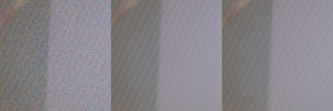
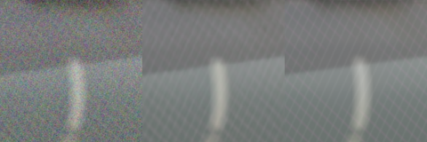

# Recovering wire colour from reserved Bayer samples

On 16 coloured ISO6400 wire targets over held-out photo backgrounds, checking the proposed hue on reserved Bayer samples raises aligned chroma response from **34.40% to 38.74%** and lowers intact chroma-increment RMS from **143.58 to 142.12 DN16**. The correction holds scene-linear luminance fixed. All confirmed standing GFX outputs reproduce the previous result, including the smooth sky and the still incomplete fine green cab crossings.

[Results and provenance](results/query-signed-colour-v1/publication.json) · [Frozen drivers and evidence](results/query-signed-colour-v1/evidence.tar.xz) · [Reviewed native crop manifest](images/query-signed-colour-v1/manifest.json).

## Adding only the measured chromatic component

The input is the existing per-direction Bayer fit with the shared gap check above the Corpus 100k EMA `87b96f3c487b9edaf1c477742b6c38f2a82cc6b20a94716d51cc8cf46a17a760`. The candidate uses the upstream weaker fundamental and Q0 phase. Each actual Bayer colour independently fits the signed amplitude along that phase. The fit accounts for smooth and step backgrounds, both fundamentals, their harmonics and interaction bands. The photo's camera matrix and white balance determine how red and blue amplitudes should scale with green for an achromatic wire.

Q0 and Q1 nominate a direction in the two resulting red/green and blue/green differences. The conditional covariance accounts for their shared green estimate. Q2 and Q3 check that fixed chroma direction. The discovery rule requires a pooled standardized score of at least 2.5 and more than 0.45 on each fold. The held rule requires 3.25 pooled and more than 0.75 on each fold. Upstream geometry admission already uses measured Bayer evidence. The new held scores compare a fixed chroma hypothesis conditional on that candidate, with no unconditional false-positive calibration implied.

The confirmed arm uses the held amplitude bounded by 1.25 times the discovery amplitude. The unchecked control uses discovery amplitude directly. Both subtract colour already present in the base and cap the edit relative to green carrier amplitude. A fixed 0.65 gain and the local weak-band envelope of the preceding correction control delivery. The camera correction lies in the null space of output scene-linear luma. Across all float32 outputs, maximum luma change is below 0.0011 DN16. No weights change. [Per-direction fit](query-shape-routing.md) · [Shared gap check](query-shared-gap.md).

## Exact-target results

The 24 Wikimedia bin4 backgrounds are disjoint from the recent donor and gap studies and the 90,692-photo training pool. They previously appeared in a separate repeat-noise evaluation. The fixed set has eight neutral, eight green and eight signed-colour weak wires and varies between ellipses, strips, smooth dips and nonzero contrast steps. The weak-wire colour comes from the analytic fixture in linear RGB. Each source uses ISO400 and ISO6400 with independent full, outside-only, strong-only and exact-flat observations. The changed exterior is sealed outside the neural input. Rotated, outside-only, strong-only and exact-flat controls reproduce the previous output in every comparison.

| ISO6400, 16 coloured fields | Aligned intact chroma response | Intact chroma-increment RMS, DN16 | Present chroma RMS, DN16 |
| --- | ---: | ---: | ---: |
| Corpus 100k EMA | 3.62% | 165.11 | 152.92 |
| Shared gap check | 34.40% | 143.58 | 135.43 |
| Unchecked colour | 40.29% | 141.67 | 134.52 |
| Confirmed colour | 38.74% | 142.12 | 134.62 |

Compared with the shared gap result, confirmation adds **4.35 points [2.20, 6.65]** of aligned chroma response and lowers intact chroma-increment error by **1.45 DN16 [0.66, 2.43]** on the ISO6400 coloured panel. Present chroma RMS falls 0.81 DN16 [0.18, 1.59]. The intervals resample photo IDs. Eleven of the sixteen coloured fields have upstream geometry and all eleven receive an edit. At ISO400, fourteen receive an edit. Mean response rises 55.22% → 59.11% and intact increment RMS falls 89.88 → 88.56 DN16. The narrower ISO6400 signed-colour subgroup gains 2.57 points, compared with 6.13 for the green subgroup.

All sixteen neutral observations at the two priors preserve the shared result exactly. The 48 older neutral ISO6400 replays also reproduce the previous fit. Unchecked colour changes 41 of those older replays. At equal aligned response on the coloured ISO6400 panel, uniform attenuation of the unchecked method gives 142.07 DN16 intact error versus 142.12 for confirmation. It still adds **5.38 DN16 RMS** colour on the neutral panel, averaged over the eight photo backgrounds. The fixed confirmation provides the neutral veto while delivering most of the measurable colour gain.

The colour edit adds mean 4.44 DN16 chroma RMS inside the eight true ISO6400 gaps in the coloured panel. In an exploratory replay, multiplying the edit by the already confirmed luminance gap taper lowers this to **3.22 DN16**. A uniform reduction of the original colour update at the same 38.57% intact response gives **4.26 DN16** inside gaps and a slightly lower intact increment error. This replay leaves residual leakage. Its exact masks set only the diagnostic comparison scale. The native boards use the original fixed policy.

The noiseless audit passes all four Bayer layouts with signed input and a nontrivial camera matrix. It rejects the neutral control. Altering Q2 and Q3 leaves discovery coefficients, phase and chroma direction fixed while changing the held scores.

Supplying the two planted frequencies to the same colour scorer admits three of the five missed ISO6400 coloured fields and both missed ISO400 fields. No neutral fields pass. The transposed-frequency control gives zero admissions. These supplied-frequency checks change no rendered pixels. The result identifies frequency discovery as a limitation for some, and shows insufficient chroma confirmation still limits the remaining high-noise cases.

## Native exact-target comparisons

Each cell is 160×160 original query pixels at `[48,48,160,160]`. Both triplets show noisy Malvar, reserved Bayer colour confirmation and exact constructed GT. ISO6400 shot/read are `0.00128/6.5536e-6`, capture exposure 0.33, ADC16 black fraction 0.03 and display exposure ×2. Every arm shares the same white balance, matrix and display transform. These two native examples show an active green and an active signed correction.

**Freirinha**, André Inidio da Silva, CC BY-SA 4.0, source box `[328,66,512,512]`, BGGR. The diagonal modulation gains a slight tint, with crossings still softer than in the exact target. Intact chroma error falls from 107.05 to 100.33 DN16. [Source](https://commons.wikimedia.org/wiki/File:Freirinha.jpg) · [All methods](images/query-signed-colour-v1/exact/001-iso6400-comparison.png) · [Quiet control](images/query-signed-colour-v1/exact/001-iso6400-quiet.png).

**St. Valentin freight train**, GT1976, CC BY-SA 4.0, source box `[266,116,512,512]`, RGGB. The tint of the weaker diagonals changes slightly beside the pale vertical detail. The exact target still has more clearly separated fine crossings. Intact chroma error falls from 106.12 to 104.00 DN16. [Source](https://commons.wikimedia.org/wiki/File:2018-06-15_(141)_33_80_7860_519-7_at_Bahnhof_St._Valentin,_Austria.jpg) · [All methods](images/query-signed-colour-v1/exact/020-iso6400-comparison.png) · [Quiet control](images/query-signed-colour-v1/exact/020-iso6400-quiet.png).

## Standing GFX100S comparisons

All eight native boards were viewed. The sky stays smooth. The coarse fence retains both directions and the fine building and foliage details stay soft. The unchecked correction makes a small change in the two left-cab profiles, 1.17 and 0.57 DN16 camera RGB RMS. The confirmed result reproduces the existing fit in all eight crops. Both right-cab views retain the earlier weak diagonals and incomplete crossings.

The DSCF3879 scene uses shot/read `0.00128/6.5536e-6` and display ×4. The DSCF3842 cab uses display ×16 and the same nominal or transferred `0.0014635775921166604/1.0715704128646712e-6` profile. The manifest binds each RAW query, coordinate and camera transform. Independent ISO100 AHD and camera JPEGs are qualitative references with different exposure, aperture and moving subjects.

[Overcast sky](images/query-signed-colour-v1/standing/main-overcast-sky-main-overcast-sky.png) · [Building](images/query-signed-colour-v1/standing/main-building-detail-main-building-detail.png) · [Foliage](images/query-signed-colour-v1/standing/main-foliage-main-foliage.png) · [Coarse fence](images/query-signed-colour-v1/standing/main-chain-link-fence-main-chain-link-fence.png).

| Cab profile | Native comparisons |
| --- | --- |
| Nominal | [Left](images/query-signed-colour-v1/standing/mesh-nominal-fine-green-mesh-left.png) · [Right](images/query-signed-colour-v1/standing/mesh-nominal-fine-green-mesh-right.png) |
| Transferred | [Left](images/query-signed-colour-v1/standing/mesh-profile3879-fine-green-mesh-left.png) · [Right](images/query-signed-colour-v1/standing/mesh-profile3879-fine-green-mesh-right.png) |

The scoped numerical and native reviews are complete. This inference study has no full427 or measured-camera PSNR inclusion. [Comparable performance history](performance-history.md).
