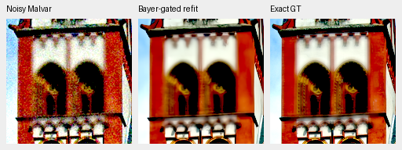
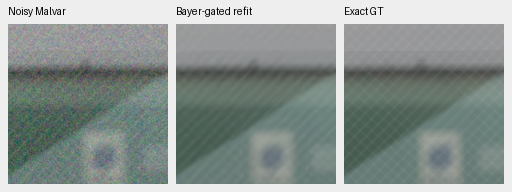

# Bayer phase corrections above the quieter local 20k model

The Bayer-gated refit raises held-out ISO6400 wire recovery from **33.41%
to 41.15%** over local-only 20k and lowers absolute error inside true gaps
from **151.80 to 148.16 DN16**. Intact-increment error rises **3.37 DN16**.
On independent natural photos the refit recovers the fine-response loss
against Corpus 100k and raises exact-flat error. In the real fine cab,
the gate strengthens some of the existing right diagonals. The crossings
remain incomplete.
[Checkpoint and results](results/quiet-parent-phase-v1/publication.json) ·
[Drivers and receipts](results/quiet-parent-phase-v1/evidence.tar.xz).

## Parent transfer and training

The [matched 20k review](scene-full-epoch-20k.md) finds less fine-increment
error and slightly weaker response over the earlier Corpus 100k parent.
This study first moves the frozen [transported-phase head](subbin-spectral-witness.md)
to the local-only 20k EMA. It then fits three new heads using the same
source scenes, observations, sampling and optimizer as the earlier phase
study. The new feature cache recomputes the local-parent spectrum and
transported proposal. Another raw-only input measures signed Bayer support
using the [indexed extractor](compact-spectral-witness.md). Its donor
windows sample the surrounding photograph or the full cached real RAW.

The ordinary refit repeats the original objective on the new parent.
The flat-weighted refit raises the exact-flat correction-energy weight
from 0.70 to 4.0. The Bayer-gated refit keeps the ordinary objective and
changes the output rule at each complex coefficient. It allows the head
to attenuate the parent along its existing phase, with a limit at zero.
The remaining proposed change is scaled by a bounded function of the
weaker of the two central signed means, green and red/blue, and the
strength of the exterior green phase. The phase is selected on the
disjoint donor samples. The gate operates on local Fourier coefficients
before overlap-add. The algebra check verifies attenuation and the
zero-parent, zero-evidence case.
[Gate and algebra audit](results/quiet-parent-phase-v1/evidence.tar.xz).

All three heads reuse the 448 training photos, consisting of 224
natural-photo and 224 wire fixtures in four Bayer layouts at ISO400 and
ISO6400. The fixed GFX families and scored photo sources are held out.
Each head takes **672 updates**, six passes, four photos per update,
2,688 photo visits and 8,064 role queries. Optimization is FP32 with
AdamW, a 24-update warmup, cosine learning-rate decay from 0.001 to
0.0001, weight decay 0.001, a per-head gradient cap of 2 and EMA 0.99.
Joint training takes **27.31 s**. The frozen parent forward
collection and feature assembly take **63.88 s** and **36.93 s**
respectively. Parent training features use standard CUDA FP16 autocast
with FP32 output. The numerical wire parents use IEEE FP32 on a
320-pixel patch with a 32-pixel halo. Natural and real predictions
reuse the matched 20k archives with identical input data and display
settings. The table and native comparisons use EMA. The raw weights
and their scores are included.

| Model or component | Checkpoint SHA256 |
| --- | --- |
| Local-only 20k EMA, frozen parent | `b892a08c8ebbccb05c000e4f42d1f86c3a7d1d5870721ccd6e1c8fe9e82c3889` |
| Three refits in one checkpoint | `069de3a3d3f18ab0f32cf9b242daa1fb859d03762086ee27244557aced803e54` |
| Frozen transported-phase component, trained on Corpus 100k | `61984f51d596a0534c6b93d5221bb14879742b7c955e9d8b732dc434254f901d` |
| Corpus 100k EMA | `87b96f3c487b9edaf1c477742b6c38f2a82cc6b20a94716d51cc8cf46a17a760` |
| Spatial 20k EMA | `e56429f491c6712ab931ad4364d5d27ca6a45df5b3d23a7616a915c3aae8dd1f` |
| V120 EMA | `a9d9b6b4f974e24a6b11e5e740aab32314233a7f53c056cf37c7d2aac1c589fb` |

## Held-out wires and natural photos

The wire panel uses 24 held-out photo backgrounds at both noise
profiles. Twelve have true gaps. Gap change is relative to local 20k
for every row. Absolute gap error uses the known clean target. The
paired error measures the restored difference between the noisy
present and weak-free roles. The other 24 wire backgrounds set the
global multipliers for the strength-matched ordinary refits.

| ISO6400 wire EMA | Intact response | Intact RMS, DN16 | Gap change, DN16 | Absolute gap RMS, DN16 |
| --- | ---: | ---: | ---: | ---: |
| V120 | 31.61% | 207.41 | 25.08 | 154.01 |
| Corpus 100k | 33.66% | 207.82 | 16.70 | 152.65 |
| Corpus 100k with frozen phase | 42.42% | 213.33 | 27.39 | 151.97 |
| Local-only 20k | 33.41% | 207.87 | 0.00 | 151.80 |
| Local 20k with frozen phase | 42.19% | 213.37 | 21.61 | 151.10 |
| Ordinary refit | 42.04% | 213.79 | 21.59 | 151.31 |
| Flat-weighted refit | 40.71% | 213.38 | 19.12 | 151.47 |
| Bayer-gated refit | 41.15% | 211.24 | 22.86 | 148.16 |
| Ordinary refit calibrated for the gate's gap change | 42.01% | 213.77 | 21.51 | 151.30 |

The frozen head transfers most of the response gain. The gate adds
**7.74 response points** [5.55, 9.73] over local 20k and cuts absolute
gap error by **3.64 DN16** [1.40, 6.14]. A positive change in gap RMS
and a **5.84 DN16** increase in paired gap error accompany the lower
absolute error. Against the ordinary refit at similar gap change, the
gate lowers intact error by **2.53 DN16** and absolute gap error by
**3.14 DN16**. Its response difference is −0.86 points
[−2.44, +0.65]. Actual held-out gap change is 1.35 DN16 higher than
the calibrated comparator. At ISO400 the gate gains 3.80 response
points over local 20k with similar intact and absolute gap errors.
[Wire results and intervals](results/quiet-parent-phase-v1/evidence.tar.xz).

The main natural results use 48 distinct held-out photos, with the
16 photos shared by the separate wire calibration panel reserved for
setting photo flat-change multipliers. The archive includes all 64
photos at both noise levels and for independent and coupled draws.
Fine response and error cover 1/8–1/3 cycles per native pixel.

| Independent ISO6400 photo EMA | Fine response | Fine-increment RMS, DN16 | Fine-flat RMS, DN16 |
| --- | ---: | ---: | ---: |
| V120 | 67.045% | 131.525 | 5.026 |
| Corpus 100k | 67.449% | 131.318 | 4.565 |
| Local 20k | 66.784% | 130.396 | 4.209 |
| Spatial 20k | 66.761% | 130.447 | 4.151 |
| Frozen phase on local 20k | 69.036% | 132.449 | 8.161 |
| Ordinary refit | 69.267% | 132.607 | 7.970 |
| Flat-weighted refit | 69.200% | 132.256 | 6.327 |
| Bayer-gated refit | 67.777% | 131.204 | 6.804 |

The gated head recovers 0.99 points from local 20k and raises fine
error by 0.81 DN16. The flat-weighted fit retains more response
and raises fine error more. On coupled ISO6400 observations the gate
reduces fine error by 0.94 DN16 over local 20k. Flat error rises
under both noise laws. In a score-only natural-photo diagnostic,
1,089 bounded pairs of separate attenuation and evidence-supported
gains fail to reproduce Corpus 100k's fine response on the 16-photo
calibration set. The highest-response setting lowers held exact-flat
RMS from 6.804 to 6.412 DN16, with 4.565 DN16 for Corpus 100k.
[Photo results and gain sweep](results/quiet-parent-phase-v1/evidence.tar.xz).

## Exact native crops

Each cell shows the same 160 × 160 query pixels at `[48,48,160,160]`
with no resizing. Both examples use the ISO6400 prior
`0.00128/6.5536e-6`, capture exposure 0.33, 16-bit ADC and black
level 0.03. All methods within a comparison use the same display
transform. The gated refit uses the EMA and parent checkpoints above.
[Source, ROI and output provenance](images/quiet-parent-phase-v1/manifest.json).

**Limburg Cathedral**, Berthold Werner, public domain. BGGR,
`[22,250,256,256]`, display exposure ×3.0303 and contrast ×2.
Both local and composed heads retain the arch shapes. The fine
molding and bricks are softer than the exact clean target.
[Source](https://commons.wikimedia.org/wiki/File:Limburger_Dom_BW_1.jpg) ·
[Comparison](images/quiet-parent-phase-v1/exact/001-iso6400-independent-comparison.png) ·
[Matched exact-flat control](images/quiet-parent-phase-v1/flat/001-iso6400-independent-flat-comparison.png).

**St. Valentin railway**, GT1976, CC BY-SA 4.0. RGGB, source scene
`[376,16,512,512]` and query `[128,128,256,256]`. Display
exposure ×2 and contrast 1.0. The fixture places a synthetic wire over
the photograph. The central opening and finer
crossing direction remain diffuse. A separate continuous-dip
comparison also retains much softer wire than its exact target.
[Source](https://commons.wikimedia.org/wiki/File:2018-05-04_%28217%29_33_53_9332_586-5_at_Bahnhof_St._Valentin.jpg) ·
[License](https://creativecommons.org/licenses/by-sa/4.0/) ·
[All railway methods](images/quiet-parent-phase-v1/exact/012-iso6400-comparison.png) ·
[Continuous-dip comparison](images/quiet-parent-phase-v1/exact/014-iso6400-comparison.png).

## Standing GFX100S comparisons

All eight boards were inspected alongside V120, Corpus 100k, spatial
20k and the unmodified local 20k parent. Each new correction follows
frozen local 20k EMA. The gate changes sky RGB by 1.79 DN16 RMS and
keeps it visually smooth. The coarse fence retains coherent crossings
with slightly stronger existing texture. The thin building wires and
foliage remain soft. Some existing diagonals become stronger in the
right cab under both profiles. The left lattice remains diffuse and
many fine junctions are still missing. The ISO100 AHD views and both
cab JPEGs are qualitative references from captures with different
aperture, exposure and motion. The original local 20k display pixels
were reproduced before inserting the new panels.
[Capture conditions](scene-full-epoch-20k.md#standing-gfx100s-comparisons) ·
[Native crop provenance](images/quiet-parent-phase-v1/manifest.json).

| Scene and conditioning | Native comparisons |
| --- | --- |
| DSCF3879/3880 main, nominal | [Sky](images/quiet-parent-phase-v1/standing/main-overcast-sky-main-overcast-sky.png) · [Building](images/quiet-parent-phase-v1/standing/main-building-detail-main-building-detail.png) · [Foliage](images/quiet-parent-phase-v1/standing/main-foliage-main-foliage.png) · [Coarse fence](images/quiet-parent-phase-v1/standing/main-chain-link-fence-main-chain-link-fence.png) |
| DSCF3842/3835 cab, nominal | [Left](images/quiet-parent-phase-v1/standing/mesh-nominal-fine-green-mesh-left.png) · [Right](images/quiet-parent-phase-v1/standing/mesh-nominal-fine-green-mesh-right.png) |
| DSCF3842/3835 cab, transferred DSCF3879 | [Left](images/quiet-parent-phase-v1/standing/mesh-profile3879-fine-green-mesh-left.png) · [Right](images/quiet-parent-phase-v1/standing/mesh-profile3879-fine-green-mesh-right.png) |

Training, numerical evaluation and native review are complete. The
gated correction is a crop component tested on exact targets and
standing GFX scenes. The fixed 427-photo and known/unseen camera
panels are outside this scope. V120 remains the general inference
recommendation.
[Model guide](current-model.md) · [Comparable PSNR history](performance-history.md).

The first natural replay stopped when a stored source was reached
through a different symlink. The completed replay checks resolved
paths, source hashes, query fingerprints and bitwise parent arrays.
The earlier wire scores and standing renders retain their original
driver and receipt.
[Initial review sources and logs](results/quiet-parent-phase-v1/initial-review.tar.xz).
