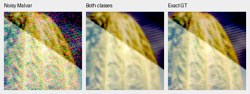
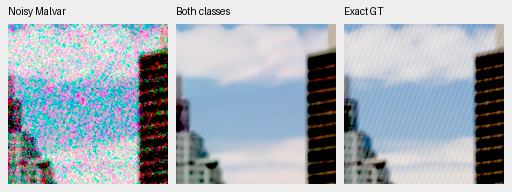

# Separating the two Bayer green alias classes

The two measured green phases separate a pair of planted frequencies that
collide on either green plane alone. In noisy photographs, the corresponding
native correction carries extra detail and also adds visible variation.
At the fixed flat-texture budget, it recovers only a small additional
fraction of the planted weak carrier. Both real fence reviews retain
incomplete fine crossings.
[Scores, source hashes and native comparisons](results/quincunx-green-v1/publication.json).

## Recovering native frequencies from both measured phases

Separate 64-native-pixel sine windows overlap by 32 pixels. Each window
compensates the two green FFTs for their actual Bayer offsets before
combining them. Two relative phase classes separate frequencies that
fold together in the packed planes. The estimator places the first
class in the principal packed square and picks the shorter one-axis
half-cycle shift for the second class. This selects a representative
inside the green sampling diamond. It tapers ambiguous diagonal ties
and boundary frequencies. A noiseless on-grid check with both signals
in the same packed bin reconstructs the two carriers to
`1.21e-14` maximum error in float64, across four Bayer layouts and
both orientations of the alias shift.
[Four-layout alias check](results/quincunx-green-v1/four-cfa-geometry.json).

Local spectral power and the noise proxy shrink the proposed coefficients.
The positive lift delivers the part of a measured component missing from
the same projection of the neural parent. A separate blend moves toward
the measured spectrum directly. Both add camera-neutral luminance
through the original CFA support and the measured-step attenuation.
Each uses the same quiet correction from paired EMA
`02f8d5e6664bd580bafe2abeb3b8584b070b60bfadfefaff587cadd8bd643d7f`
over Corpus 100k EMA
`87b96f3c487b9edaf1c477742b6c38f2a82cc6b20a94716d51cc8cf46a17a760`.
The comparison includes the original fixed fine lift.

## Exact-target photographic comparison

All arms use the same 64-photo panel, with two noise levels, coupled and
independent draws, and present, absent and exact-flat roles. Thirty-two
calibration sources fix each method's multiplier using only added
fine-band RMS on the exact-flat cases. On the other 32 sources, the
unscaled two-class lift at ISO6400 reduces coupled increment RMS by
1.658 DN16 versus the fixed fine lift and adds 1.939 percentage points
of aligned response. It also raises flat RMS by 2.907 DN16. The
independent fine-increment error rises by 2.017 DN16.

At the calibration-matched flat addition, the two-class lift is
multiplied by 0.0225. On the held-out ISO6400 independent cases,
increment RMS differs from the fixed lift by −0.021 DN16
[−0.095, +0.061], with 0.193 percentage points lower response.
Against principal-only, enabling the second class adds 0.0035 percentage
points [0.0006, 0.0061] and changes increment RMS by −0.0024 DN16
[−0.0072, +0.0018]. Matching the added texture on calibration
cases makes the advantage small.

### Disjoint folds and surrounding RAW

A disjoint-fold control estimates each branch from alternating 2×2
blocks of packed cells. Multiplying the two estimates gives a signed
power estimate. Both folds exclude padding. Perturbing all the other
fold's raw values leaves each estimate bit-exact, including at borders.
The final projection still uses the full noisy query and neural parent.
The agreement is an empirical guide to delivery.

A separate guide uses a 128-pixel RAW window around each 64-pixel local
fit, excluding the central 80 pixels on both axes. The guide samples
the same native frequencies on its denser grid. It suppresses local
candidates without corresponding exterior support. The swapped-axes
control uses the same sensor values and estimate with a different
orientation. Changing both raw values and their noise variance in the
excluded region leaves the central guide unchanged.

| ISO6400 proposal | Added flat correction before calibration, DN16 | Strength at matched flat addition |
| --- | ---: | ---: |
| Fixed fine lift | 0.112 | 1.000 |
| Both classes, local spectrum | 4.972 | 0.0225 |
| Both classes, disjoint-fold agreement | 2.272 | 0.0493 |
| Both classes, surrounding RAW guide | 0.981 | 0.1142 |
| Both classes, swapped guide axes | 0.844 | 0.1327 |

These are fine-band corrections relative to the quiet anchor, measured
on the calibration flats. The exterior guide cuts the unscaled added
flat correction by about 80%. At matched flat addition, its true
increment RMS on ISO6400 independent cases changes by −0.0009 DN16
against local spectrum, with 0.017 percentage points lower aligned
response. The swapped-axes control is close. Much of the observed
benefit comes from attenuating the local correction.

## Second panel with planted aliases

On 32 other photographs, the weak carrier is beyond one green plane's
principal band. Both conditions retain the same weak target. The
shared-alias condition also contains a stronger carrier in the same
packed-bin class on each green plane, at the other native frequency.
Half the sources have a common sharp step. This half also uses the
vertical alias shift, so the aggregate measures do not separate
orientation from the presence of a step. Two independent ISO6400
redraws retain identical exact targets. The strengths come from
the first panel's flat calibration.

| Condition and comparison | Aligned weak response, percentage points | Increment RMS, DN16 |
| --- | ---: | ---: |
| Weak only, both classes vs principal-only | +0.172 [0.118, 0.223] | −0.039 |
| Shared alias, both classes vs principal-only | +0.086 [0.056, 0.114] | −0.019 |
| Shared alias, both classes vs fixed fine lift | −0.135 [−0.216, −0.065] | −0.217 |
| Shared alias, exterior guide vs local both classes | −0.088 [−0.118, −0.057] | −0.053 |

The alias separation improves this measured component over discarding
the second class. It recovers 1.56% of the weak-only target and 6.34%
of the shared-alias target overall, compared with 1.39% and 6.26%
for the principal-only arm. On the shared-alias controls with the weak
carrier removed, the measured carrier error changes by less than
0.0001 of full weak amplitude. Most of the weak signal remains absent.
The exterior guide mainly lowers unrelated variation on this panel
and does not increase aligned response.

## Native view

Each triplet shows noisy Malvar, both green classes at matched flat
addition, and exact GT. The native `[48,48,160,160]` crops within
256-pixel queries use ISO6400 shot/read `0.00128/6.5536e-6`,
ADC16 black 0.03, capture exposure 0.33, display exposure ×3.0303
and contrast ×2.

The shared diagonal step stays coherent. Most fine modulation
over the bud remains absent. Query origin `[284,84]`, RGGB.
Dominicus Johannes Bergsma, CC BY-SA 4.0.
[All methods](images/quincunx-green-v1/local/028-shared-alias-repeat0-role0-comparison.png).

The dominant building structure is preserved. Most of the
planted fine sky pattern remains missing. Query origin
`[246,258]`, GRBG. King of Hearts, CC BY-SA 4.0.
[All methods](images/quincunx-green-v1/local/002-shared-alias-repeat0-role0-comparison.png) ·
[Absent-detail wing](images/quincunx-green-v1/local/019-shared-alias-repeat0-role1-comparison.png) ·
[Exterior guide on native lettering](images/quincunx-green-v1/exterior/061-iso6400-independent-role0-comparison.png).

### Standing GFX100S comparisons

All eight boards for each comparison were viewed. The sky stays flat
and both directions of the coarse fence remain visible. The stronger
dense spectral correction changes the coarse fence up to 22.56 DN16
camera-RGB RMS versus Corpus 100k, without convincing new fine cab
crossings. The exterior guide also leaves the fine crossings
incomplete. Small cables and leaf boundaries stay soft.
The main native views use `[176,176,160,160]` inside the fixed
512-pixel query, nominal shot/read `0.00128/6.5536e-6` and display ×4.
The cab views use `[206,229,160,160]` and `[426,189,160,160]`
within the fixed 768-pixel query, display ×16, and both the nominal
prior and transferred shot/read `0.0014635775921166604/1.0715704128646712e-6`.
The ISO100 AHD and camera JPEGs remain qualitative references.
[Sky](images/quincunx-green-v1/local/main-overcast-sky-main-overcast-sky.png) ·
[Coarse fence](images/quincunx-green-v1/local/main-chain-link-fence-main-chain-link-fence.png) ·
[Transferred right cab](images/quincunx-green-v1/local/mesh-profile3879-fine-green-mesh-right.png) ·
[Exterior guide on the right cab](images/quincunx-green-v1/exterior/mesh-profile3879-fine-green-mesh-right.png).
