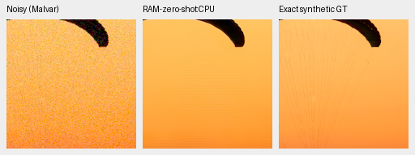
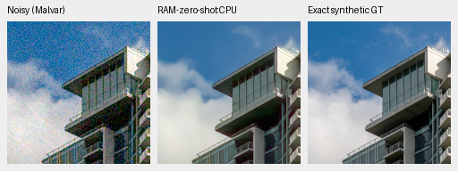
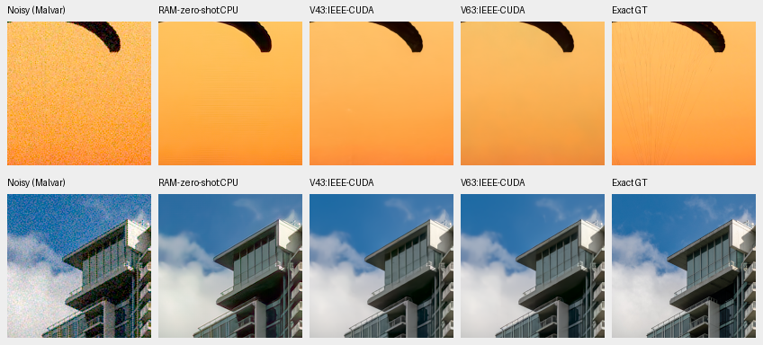
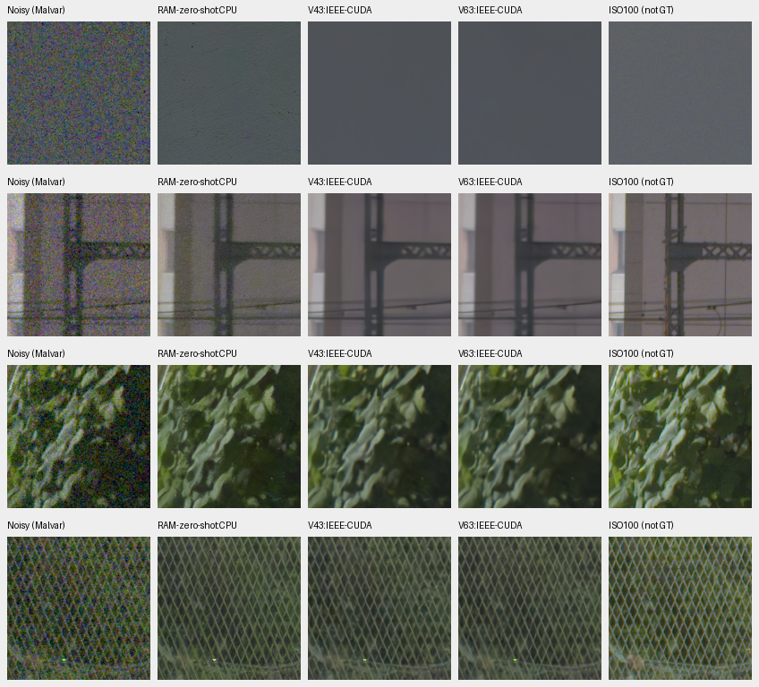

# RAM zero-shot CPU reference pilot

**RAM is not an upgrade on these six fixed observations.** Both photographic
PSNR/SSIM scores trail retained V43 and V63. The real-photo views have more
texture in foliage and fencing, alongside more grain and fine diagonal texture
in the sky. Fine canopy cords and cloud detail remain missing. The reference
stays isolated. The [V86/V87 context review](training-context-original4k-review.md)
is complete; [current model choices](current-model.md) include later improvements.

[Complete source, checkpoint, arrays, arithmetic, native-view and publication
record](results/RAM-CPU-pilot-v1.json).

The [authors' RAM implementation](https://github.com/matthieutrs/ram/tree/0de1617403291e5a28179097795752200e65b82c)
combines a DRUNet-style network with multiscale measurement-operator conditioning
and Poisson/Gaussian noise inputs. Its demosaicing example recommends adaptation
for this unseen task. This pilot uses the original zero-shot network, without
adapting on the standing qualitative captures. Architecture, pretraining and
conditioning differ together; this is not a DINO ablation.

The source is BSD-3-Clause. The
[publisher's weight repository](https://huggingface.co/mterris/ram/tree/5aec8bcc907989f25926d45c94a52c50eb987ae0)
has no model card or separate weight-license metadata. Code, dependencies and
weights remain in an optional research cache; no production dependency or
training-data admission follows.

## Fixed protocol and engineering

The pinned unmodified implementation strictly loads all 825 state tensors,
35,618,953 parameters. Weight SHA256 is
`1292571adc3d15f9db5e7f5bd92265599030b6b816637367d0f5992d8dbdef7a`.
Artificial native 64 inputs pass all four Bayer phases, exact repeats and
unchanged model/input/RNG checks. Separate FP64 upstream mask operators match
nontrivial analytic proximal/adjoint identities; FP32 errors satisfy the fixed
operation-derived rounding bound. Two earlier fixture failures are preserved:
a two-ULP FP32 formula difference and a purported FP64 check that retained an
FP32 mask. Neither was a training or quality run.

The six-case plan was frozen before new quality predictions. It binds 29 inputs
and 4,403 source/runtime files, including 45 project modules byte-identical to the
actual context trainer. RAM uses CPU/B1/FP32/two threads with DeepInv 0.3.0,
Torch 2.14.1 and torchvision 0.29.1 in a separate dependency directory. The
production environment/lockfile stay unchanged. CUDA remains uninitialized.

The original DeepInv masked linear operator receives the exact supplied Bayer
measurements in their observed camera-RGB channels. No observation is regenerated,
clamped, white-balanced or fitted before the network. Noise gain is shot;
Gaussian sigma is the square root of read variance. All six cases exceed the
publisher's original .001 conditioning floors. WB/matrix are used for the shared
display transform. Retained V43/V63 predictions are actual IEEE-FP32 CUDA arrays
from byte-identical observations; no CPU/GPU equivalence is assumed.

All six new RGB arrays are finite and repeat exactly, with weights/input/RNG
unchanged. Independent CPU checks cover all 3,538,944 saved FP32 values, all 30
native board cells, common noisy/reference pixels and metadata, and 12 PSNR
replays using NumPy-FP64/`math.fsum`. Maximum PSNR summation difference is
.000003005dB. SSIM uses the existing tested implementation. Both boards were
actually viewed at original resolution before opening the numerical results.

## Two fixed photographic crops

These are central160 regions of native 256 RGGB inputs with the same saved
ISO12800-prior draw: shot .00256/read variance .0000262144, WB `[2,1,1.5]`, shared
camera matrix and display exposure ×1 (0 EV). GT is the exact clean target for the
saved synthetic experiment, replayed from the original 8×-binned source caches.
Metrics use unquantized predictions and the existing clipped camera-linear /
rendered-sRGB conventions; the PNGs are RGB8 viewing copies.

| Crop | Model | Linear PSNR | sRGB PSNR | sRGB SSIM |
| --- | --- | ---: | ---: | ---: |
| Canopy | RAM CPU | 38.56830 | 31.56631 | .937881 |
| Canopy | V43 IEEE CUDA | 43.84566 | 40.95311 | .966852 |
| Canopy | V63 IEEE CUDA | 33.45131 | 33.09373 | .965434 |
| Building/cloud | RAM CPU | 37.02953 | 31.06419 | .939183 |
| Building/cloud | V43 IEEE CUDA | 40.14702 | 34.82487 | .959359 |
| Building/cloud | V63 IEEE CUDA | 40.61390 | 35.38537 | .961910 |

Source-cache ROI `[237,51,160,160]`; input ROI `[48,48,160,160]`.
[Roy Egloff, Vertigo Swiss Riviera](https://commons.wikimedia.org/wiki/File:CH.VD.Villeneuve_2007-08-25_Vertigo-Swiss-Riviera_2392_3x2-R_4K.jpg),
[CC BY-SA 4.0](https://creativecommons.org/licenses/by-sa/4.0/), modified by
binning, crop, simulated noise and restoration.

Source-cache ROI `[243,137,160,160]`; input ROI `[48,48,160,160]`.
[Dietmar Rabich, Vancouver Coal Harbour](https://commons.wikimedia.org/wiki/File:Vancouver_(BC,_Canada),_Coal_Harbour_Seaside_Park,_Blick_in_den_Himmel_--_2022_--_2158.jpg),
[CC BY-SA 4.0](https://creativecommons.org/licenses/by-sa/4.0/), modified as above.

Strong roof/beam edges remain. All three methods lose fine canopy cords and
soften the window grid/cloud detail. The score differences also reflect color
and low-frequency errors; these views do not isolate architectural causes.

## Standing GFX3879/3880 scene

Every cell retains native 160 pixels, drawn from native 512 contexts. Common
conditioning is shot .0014635775921166604/read variance .0000010715704128646712
from the existing input Haar fit; display exposure ×4 (+2 EV). Full sensor ROIs,
integer reference offsets, WB/matrix and hashes accompany every crop in the
registry. Individual triplets are available for [sky](images/RAM-CPU-overcast-sky.png),
[building](images/RAM-CPU-building-detail.png), [foliage](images/RAM-CPU-foliage.png)
and [fence](images/RAM-CPU-chain-link-fence.png).

RAM leaves fine diagonal/periodic-looking sky texture and small residual marks;
V43/V63 are smoother. Its facade has more grain/color texture. Leaves and the
continuous chain-link pattern look more textured, without a demonstrated broad
restoration gain. The sharper ISO100 f/5.6 exposure is independently demosaiced
and differs in exposure time and moving subjects. It is a qualitative reference,
not exact GT, and receives no pixelwise score. Only cached observations are read;
the captures and siblings remain outside training.

This is a selected six-observation reference comparison, without training,
full-suite uncertainty, full-frame export or a speed benchmark. It does not
establish SOTA or broad real-photo superiority. V43 was the README reference
when this pilot was reviewed.
