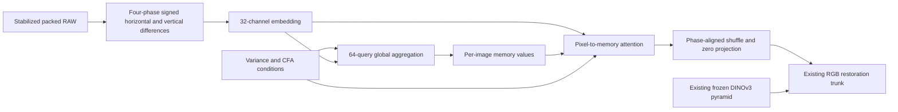

# Global attention over RAW detail

**V136's genuine CPU/CUDA16+2 checks pass and its matched1,000-update pilot is
running. Quality is unmeasured; V120 remains the general recommendation.**
This optional18,272-parameter branch summarizes signed RAW detail over a whole
tile and returns context to individual packed pixels. It complements the
existing official frozen DINOv3 Small pyramid and DRUNet restoration path.
The [V131/V132 local-attention trial](raw-spatial-training.md) retains its
separate original20k inputs and schedule.

[Implementation](../src/demosaic/raw_global_features.py) ·
[Pilot recipe](../configs/quality-v120-raw-global-pilot-v136.yaml) ·
[Runner](../scripts/train_global_attention_pilot.py) ·
[Numerical/compatibility tests](../tests/test_raw_global_features.py) ·
[Actual check/state/input/owner evidence](results/raw-global-attention-pilot-setup-v1.json) ·
[Publication verification](results/raw-global-attention-publication-v1.json).

## Hypothesis and operator

Weak periodic structure remains suppressed in both real mesh scenes and in
synthetically noised photographic detail. The March2026
[ATD paper](https://arxiv.org/abs/2603.02581) and its
[official repository](https://github.com/CVL-UESTC/Adaptive-Token-Dictionary)
describe dictionary attention for global image-restoration dependencies without
quadratic spatial cost. That motivates this independently implemented RAW
summary branch. No upstream code or weights are imported, and this is not an
ATD reproduction or a claim about its reported scores.

Each packed position carries all four CFA phases. Eight signed differences are
embedded into32 features in the existing restoration scale. RMS-normalized keys
also receive four log-variance features and twelve CFA-placement channels.
Sixty-four learned queries collect image-specific memory through four-head
attention. A second attention pass returns that memory to all packed pixels.
Values keep their unnormalized amplitude; a residual feed-forward path also
retains feature scale. A64-channel expansion pixel-shuffles into16 native
channels, followed by a zero-initialized64-channel stem projection.

Attention cost scales with image area times64 queries. Images have independent
memories, with no cross-batch pooling. There is no frequency threshold, reference
mask, inference-strength control or additional DINO encoder call. Global context
depends on the current tile, so this does not imply equality between tiled and
whole-frame inference or qualify visual seams.

Bias-free content/value paths make per-phase spatial constants produce exactly
zero added features after learning, including with varying variance conditions.
This protects the branch's constant response, not a separately trained common
trunk's color accuracy. Full camera/color checks remain necessary. The initial
projection preserves the parent's function by adding zero; it does not assert
that an old parent forward was rerun or compared.

## Compatibility and matched training

`model.raw_global_features: true` selects the branch in an otherwise compatible
native, stabilized, physically anchored pretrained-RGB model. It excludes other
experimental RAW heads and late RGB refinement. Missing flags mean false and
add no state. Learned models carry18 new tensors and require strict loading.
Feature arithmetic is IEEE FP32 inside BF16 trunk training. Explicit CPU
allocations and a local initialization stream preserve global RNG.

After erasing only the disabled option, guards and assignments, the complete
`model.py`/`pretrained_rgb.py` ASTs match the prior frozen production-compatible
source. Existing numerical operators are unchanged. Early resume checks reject
disabled or nonboolean global settings before constructing a model. Actual
portable inference will be checked by the queued endpoint collection.

V136 starts freshly from V120's completed20k Small EMA, SHA256
`a9d9b6b4f974e24a6b11e5e740aab32314233a7f53c056cf37c7d2aac1c589fb`.
It differs from saved V129 only by the new branch: same seed70,90,782 photos/
27 reviewed regions,50% reviewed quota, native256/B16/BF16, single sensor view,
zero optical PSF, paired32/native128, unchanged losses, LR1e−5 and warmup100.
Every clean/noisy input hash must match V129 **before the candidate forward**.
The control's training and inference are reused, not repeated.

The newer90,778/34 prepared bank is separate; this architectural comparison
does not silently substitute its data. V134/V135 keep their own33-region inputs.
There is no new20k global-attention run queued by this pilot.

## Actual checks and pending quality

CPU128/B1/FP32 and CUDA256/B16/BF16 each complete16 updates plus a real two-update
resume, preserving the16-step files. All109 model/EMA tensors and107 Adam states
are finite at18. All18 added tensors receive finite nonzero gradients. Four
changed-mode resumes reject before construction. The first branch offsets have
68,157,440 exactly zero values across both devices, with all91 parent tensors
verified exactly. First candidate RGB/auxiliary outputs are retained; prior
V129 outputs were not retained at initialization and are not claimed compared.
Peak CUDA allocation is8,497,402,368 bytes under a16GiB cap.

There are36 discarded training/encoder/optimizer updates over306 contexts.
Independent CPU/NumPy checks inspect526,768,092 finite values across four16/18
states and compare162,944,388 prepared-array values exactly with V129's saved
first18 batches on each device. No neural/noise/RAW/optimizer work occurs in
that audit; CUDA remains uninitialized. The focused suites pass93 tests, plus
29 legacy RGB/loading, adoption and inference-alignment regressions.

Fresh production has an original1,000-update horizon,64 validation calls and
16,000 training contexts. CPU admission is40GiB; CUDA/production52GiB, with a
16GiB allocator cap and32GB runtime floor. Limits are30min per check and8h for
production, with no automatic retry, prefix replay or schedule reset. Existing
V124/V125 and all other controllers remain unchanged.

A live dependent review declares **102 new root/DINO calls** on64 retained
shadow inputs,16 ordinary material inputs,16 faint ADC inputs, four main-GFX512
contexts and two extra-mesh768 fixed profiles. All V120/V129 predictions are
reused after exact five-tensor fingerprint checks. Full original1k state,
lineage,109 EMA/107 Adam and all1,000 training-input matches are required before
inference. Collection uses52GiB admission,12GiB CUDA cap and32GiB runtime floor.

NumPy scoring, independent FFT/native-PNG auditing and actual viewing follow.
Reports include native noisy/restored/exact synthetic GT triplets and accurately
labeled approximate references. Both main DSCF3879/3880 and corrected extra
DSCF3842/DSCF3835 scenes, JPEGs and siblings stay held out. This finite pilot
does not establish complete20k, full427 photo/camera/color/frame quality,
convergence or speed. No recommendation changes before measured evidence.
