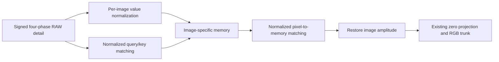

# Conditioning the global RAW attention path

**V137 passes genuine CPU/CUDA16+2 checks and its matched1,000-update training
is running. Restoration quality is unmeasured. V120 remains the general
recommendation.** The new explicit operator normalizes attention matching while
retaining value amplitude. It addresses a measured weakness in V136's global
memory path; it does not establish improved denoising or mesh recovery.

[Implementation](../src/demosaic/raw_global_conditioned_features.py) ·
[Recipe](../configs/quality-v120-raw-global-conditioned-pilot-v137.yaml) ·
[Runner](../scripts/train_conditioned_global_pilot.py) ·
[Tests](../tests/test_raw_global_conditioned_features.py) ·
[State/mechanism/check/training evidence](results/raw-global-conditioning-v1.json) ·
[Publication verification](results/raw-global-conditioning-publication-v1.json).

## What the saved V136 state shows

The [completed V1361k quality report](v136-global-attention-quality.md) finds tiny
mean gains over V129, mixed local errors and no clear new fine-mesh recovery.
Its production gradient maxima cover **updates1–16**, not all1,000 updates.
The old worker sampled only that initial window. Those numbers alone cannot
tell whether memory learned later.

A separate saved-state audit compares all18 branch tensors at1,000 with their
deterministic initialization and a CPU FP32 zero-gradient weight-decay/EMA
reference using the original learning-rate schedule. It also uses an independent
FP64 scalar decay reference. These are numerical references, without replaying
GPU optimizer steps or claiming bitwise GPU equivalence.

| Parameter | Initial RMS | Final model RMS difference from CPU decay reference |
| --- | ---: | ---: |
| Write query |.101957 |4.22316e−10 |
| Write key |.100246 |5.32738e−10 |
| Read keys |.102463 |4.49983e−8 |
| Read query |.104275 |5.96016e−8 |
| Learned queries |.019812 |2.57073e−7 |
| Local feed-forward down projection |.071751 |2.22501e−4 |

Content/memory gains coincide with the CPU decay reference in both model and
EMA. Query/key changes are much smaller than the local feed-forward changes.
This supports inspecting optimization of global matching; parameter norms do
not causally explain image-quality differences.
[All18 rows and final Adam directions](results/raw-global-conditioning-state-v1.csv).
All neural module forwards are forbidden during this state audit; it constructs
only the small deterministic initializer and reads saved weights.

## A bounded branch-only mechanism check

Six fixed contexts are the first two images from the first retained Commons,
native and paired training batches, at steps1/2/5. Selection uses no quality
outputs or target arrays. Inputs use reconstructed standard full-context
stabilization/span, without claiming bitwise equality to the original GPU
training activations.
These training-domain labels do not make six independent photographic examples.

Each gets one V136-EMA branch forward and one conditioned-operator forward
using **identical saved V136 EMA tensors**, plus a fixed Rademacher linear-output
probe backward for each. The changed operator is an untrained counterfactual,
not a trained V137 result. Totals are12 branch forwards/12 backwards and24
attention softmaxes, with zero full-model/DINO forwards, new noise observations,
RAW decodes, target reads or optimizer updates.

| Context | Read entropy/logN, old→new | Write entropy/logN, old→new | Spatial RMS / RMS of returned context, old→new |
| --- | --- | --- | --- |
| Commons0 |.99999843→.96561996 |.99999992→.90346503 |.00001335→.839094 |
| Commons1 |.99999809→.96578777 |.99999957→.90464121 |.00022737→.766577 |
| Native0 |.99999927→.97573062 |.99999998→.89273534 |.00000686→.735264 |
| Native1 |.99999955→.98054902 |1.00000000→.91468174 |.00001561→.582909 |
| Paired0 |.99999832→.96620450 |.99999996→.90629300 |.00000977→.726423 |
| Paired1 |.99999806→.96535730 |.99999991→.91103189 |.00001330→.683647 |

Entropy/logN=1 means uniform attention. V136's memory write is almost spatially
constant on these contexts. The new matching creates spatially varying memory
and raises write-query gradients about35,000–949,000× under this particular
probe. Neither this probe nor attention diversity measures restoration quality.
The spatial/RMS ratio is invariant to the new per-image value scale.
[All measurements](results/raw-global-conditioning-mechanism-v1.csv).

The first diagnostic stopped after six forwards because its deterministic VST
call guard omitted white-endpoint transforms. Preserve that source, plan,
failure log and six-result prefix. An explicit remaining-six continuation
finishes the original12-forward/12-backward budget without replay. There are12
executed analytic VST calls and one rejected attempt before execution.

Independent array reductions check720 saved-state scalar fields, all50,331,648
retained branch output values and12 linear-probe reductions. Raw attention
matrices/gradient arrays were not retained; their scalar statistics receive
consistency checks, not a claim of independent recomputation. The attention
unit tests separately compare against independent cosine mathematics.

## Operator and checkpoint compatibility

Per-head queries and keys receive L2 normalization with epsilon1e−6; their
cosine scores are scaled by the square root of head width. Values are divided
by one per-image RMS scale before aggregation, and returned context receives
that scale again. Both scales add1e−4 under the square root, matching the
existing branch's regularization.
There is no cross-image pooling, reference fitting or new encoder call.

The new operator inherits the same18 tensors/18,272 parameters and deterministic
initial values. Its initial projection remains exactly zero. Bias-free values
retain exact zero output on per-phase spatial constants after adaptation,
including changing variance. Feature arithmetic remains IEEE FP32 inside BF16
training. Global memory still depends on the tile; seams/full-frame quality and
speed are unmeasured.

Use `raw_global_features: true` with
`raw_global_conditioning: cosine-rms-v2`. Missing mode means`legacy-v1`, which
retains V136's operator. Same-shaped weights do not authorize changing this
semantic mode: changed/invalid modes reject before resume construction.
Legacy forward/helper function ASTs are unchanged outside the two constructors
and early resume checker; the constructors select only the explicit new mode.

## Actual checks and matched training

The focused suites pass74 tests, plus four faint-analysis tests. CPU128/B1/FP32
and CUDA256/B16/BF16 each complete16 updates and a real two-update resume.
All109 model/EMA tensors and107 Adam states are finite at18; all18 branch
tensors have finite nonzero gradients. Eight changed-mode resumes reject before
construction. First branch offsets contain68,157,440 exactly zero values.
First executed RGB/auxiliary outputs match saved V136,4,259,840 values checked
independently. Peak allocated CUDA memory is8,647,816,192 bytes.

Independent saved-artifact checks inspect526,768,092 finite state values and
compare162,944,388 prepared-array values exactly with V136. All47 unchanged
legacy function/method ASTs match. These checks execute no neural modules.
The discarded training checks use36 root/DINO/optimizer updates over306 contexts;
the separate mechanism check above has its own12 branch forwards/backwards.

Fresh production starts from V120's20k Small EMA, not V136's endpoint. It keeps
V136's seed70,90,782 photos/27 reviewed regions,50% reviewed quota, B16/native256,
single-view losses, zero optical PSF, paired32/native128 and original1k schedule
at LR1e−5/warmup100. Only the global mixing operator changes. Every clean/noisy
hash must match saved V136 before candidate inference. Record gradient maxima
at updates1–16 and every25 through1,000:56 explicit observations, not all steps.
The newer90,778/34 bank remains separate; original queued jobs retain their data.

CPU admission is40GiB, CUDA/production52GiB, with16GiB allocator cap and32GB
runtime floor. The original horizon is1,000 updates/64 validation calls,
without automatic retries or schedule resets. No20k conditioned-global run is
queued.

## Prospective quality review

A live dependent review declares102 new V137 root/DINO calls on the established
64 shadow,16 ordinary,16 faint-ADC, four main-GFX512px and two extra-mesh768px
inputs. All306 V120/V129/V136 predictions are reused. Exact66-module trained
source, semantic mode,1k endpoint/lineage and all training-input matches are
required before collection. Expected support is384 metrics/96 summaries and64
native PNGs; independent scoring/pixel auditing and actual viewing follow.

The faint supplement was frozen before production began. It uses the same
original-source masks, ROI-mean/spatial error decomposition and shared40× display
across four methods, with no extra neural calls. Quality reports will include
at least two native noisy/denoised/exact synthetic-GT triplets and both real
scene pairs: DSCF3879/3880 and corrected DSCF3842/DSCF3835. ISO100/AHD and camera
JPEG references remain approximate, not GT; captures/JPEGs/siblings stay held
out. Numerical conditioning and passing checks do not establish trained quality,
convergence, full427/camera/color/full-frame performance or broad superiority.
