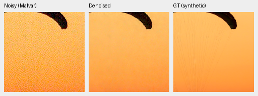
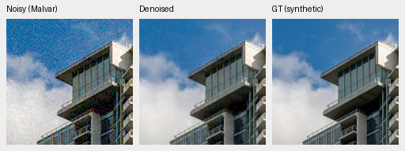
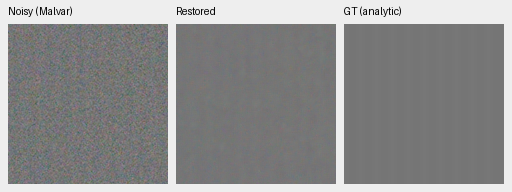
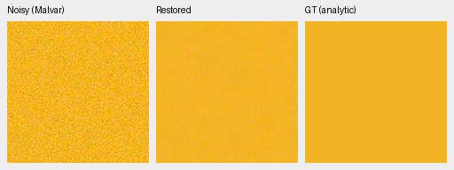
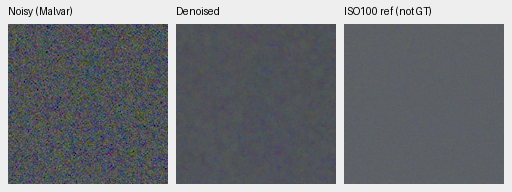
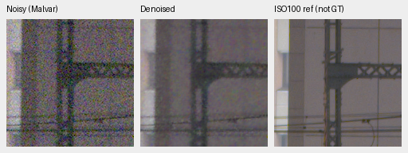
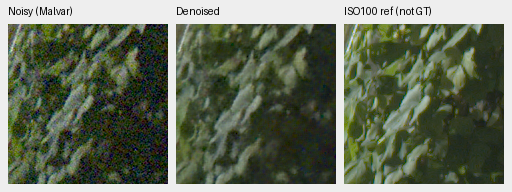
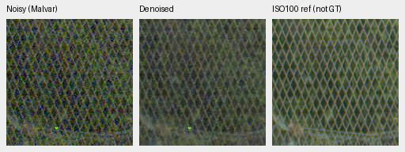

# Joint RAW reconstruction: completed V67 review at2,000

V67 makes a substantial denoising gain over its V66 initializer: **photo+2.81345dB**,
known/unseen measured-CFA+6.07209/+7.01233dB. Native grain decreases, but cords remain
missing and real detail stays noisy/soft. Photo32.33964dB still trails mature V60
by3.32464dB. Weak carriers are strongly attenuated. **No promotion; V43 remains the
working reference.** This is2,000 of the original10,000 joint updates, not convergence.

[All48 comparisons, hashes, audits and26 actual native-view receipts](results/raw-kernel-phase-joint-v67-first2k-review.json).
[Declared stage, recipe and genuine CPU/CUDA checks](raw-kernel-phase-joint-v67.md).

V67 starts from completed V66 step1000 EMA with fresh AdamW/EMA. All92 restoration
parameter tensors/32,931,920 parameters train; DINO stays frozen. Model/EMA have94
saved tensors; the two normalization buffers remain exact. All92 parameter tensors
change in model and EMA. Seed50/LR1e-4/warmup100, B16/native256/BF16, workers4+2+2,
original40,170 Commons/native128/paired32, fractions, wide8 palette, geometry/noise/
validation remain as declared. The final LR9.206544616434248e-5 follows the original
10k schedule, with all81 logged learning rates checked. Initialization/scope/seed/
LR/budget/history differ from V66, so this does not isolate unfreezing alone.

Checkpoint SHA256:
`25d3bb57ff0588a804d161c957f28ebdcfc32e666bac37b52c35fd0b92de9b17`.
Model source bundle:
`fc0297db08d659523fdcefe1ef0e7a4da12ae97f648e95b1579db65de93d268a`.
Separate controller/primary/artifact CPU inspections verify finite94 model/94 EMA/
92 AdamW states, moment shapes/steps, source rebuilt from archived bytes, original
recipe/four manifests/protocol/RNG/logs. DINO is excluded from restoration checkpoints;
actual backbone hashes/gradient-free checks are separate preflight evidence. All
four workflow owners exited successfully, verified by PID/creation and process state.

## Development results

427 photographs have exact simulated targets;16 procedural sources are separate.
Known development:4 scenes/8 pairs/72 crops per method. Unseen:5 scenes/10 pairs/90
crops. Measured CFA is primary for real pairs. Independent AHD RGB is auxiliary,
not exact RGB GT. Means balance sources/scenes.

| Model | Photo PSNR / SSIM | Procedural PSNR / SSIM | Known CFA PSNR | Unseen CFA PSNR |
| --- | --- | --- | ---: | ---: |
| V60 full4k mature ancestor | 35.66428 / .961908 | 34.33768 / .971300 | 54.21125 | 53.76025 |
| V66 head1000 initializer | 29.52620 / .872886 | 28.02954 / .864642 | 45.95696 | 43.67401 |
| V67 joint2000 | 32.33964 / .927021 | 29.65301 / .917090 | 52.02905 | 50.68634 |

| Metric | V67−V66 difference [95% interval] | V67−V60 difference [95% interval] |
| --- | --- | --- |
| Photo sRGB PSNR,dB | +2.81345 [2.75571,2.87272] | -3.32464 [-3.43423,-3.22633] |
| Photo sRGB SSIM | +0.05414 [0.05297,0.05533] | -0.03489 [-0.03620,-0.03366] |
| Procedural sRGB PSNR,dB | +1.62347 [1.37134,1.87527] | -4.68467 [-5.26359,-4.06891] |
| Known CFA PSNR,dB | +6.07209 [4.14241,8.09543] | -2.18220 [-3.64725,-1.05838] |
| Unseen CFA PSNR,dB | +7.01233 [6.28237,7.90643] | -3.07391 [-3.95226,-2.32030] |

Independent arithmetic/coverage checks cover50,264 primary cases. All48 saved
comparisons and12 classical observation witnesses pass, including retained V58/V43.
Bootstrap uses1,000 paired source resamples/seed42; it does not measure training
or model-selection uncertainty. Historical training differs, and V43's real batch
differs. No protected-final model score is used.

## Native exact-GT photographic triplets

Noisy WB-aware Malvar → V67 → exact simulated GT. Each panel is native160×160 at
8×-binned evaluation resolution, never resized. Shared ROI[48,48,160,160], RGGB,
WB[2,1,1.5], original protocol matrix, shot=.00256/read variance=.0000262144,
ADC16/black.03, display×1. Predictions are unquantized for scores; PNGs are8-bit
sRGB previews. Every source/ROI/checkpoint/noise/display record is in the receipt.

Sources: [Roy Egloff](https://commons.wikimedia.org/wiki/File:CH.VD.Villeneuve_2007-08-25_Vertigo-Swiss-Riviera_2392_3x2-R_4K.jpg)
and [Dietmar Rabich](https://commons.wikimedia.org/wiki/File:Vancouver_(BC,_Canada),_Coal_Harbour_Seaside_Park,_Blick_in_den_Himmel_--_2022_--_2158.jpg),
[CC BY-SA4.0](https://creativecommons.org/licenses/by-sa/4.0/), modified by binning,
crop, simulated noise and restoration.

Grain is markedly reduced versus V66, while fabric cords remain absent and cloud/
facade detail stays grainy. Paired panels improve visibly but retain colored noise.
Q2 rocks are smoothed, Sony seams remain soft and GFX50R concrete retains granular
texture; RawNIND is smoother and is only a comparator. Those captures have no exact
GT and do not establish a decisive real-camera advantage.

## Weak signals and color/noise tradeoff

At high noise, in-phase gain is.14283 for level.01/contrast.1/period8, versus V66
.84348/Malvar1.02913; at level.18/contrast.02/period16 it is.44832, versus V66
.89198/Malvar .99177. Unrelated residual RMS also falls, to.002858/.007788 versus
Malvar .009905/.027126. Gain and residual energy must be considered together;
noise reduction alone does not establish useful fine-detail recovery.
Neutral level.18 spatial luma RMS falls to.004272, versus V66 .013338 and noisy
Malvar .020780. Coverage/arithmetic checks pass896 cases/56 groups/1,504 scalars;
full predictions were not saved for every analytic case, so no unavailable
per-case metric recomputation is claimed.

The fixed hue grid has147 colors/grays×2 conditions×4 CFAs=1,176 new predictions,
7,056 independently checked Torch64 fields and18 groups/216 descriptive scalars.
No old arrays merge into this report. All source/condition records match retained
V66 and V60 for separate comparisons; old reports retain their own source.
At high noise/peak.9, entries below are mean maximum absolute camera-channel mean
bias / mean per-case cameraRGB RMSE across96 hue/CFA cases. They are descriptive
averages, not confidence intervals or blind photo results.

| Saturation | V60 bias / RMSE | V66 bias / RMSE | V67 bias / RMSE |
| ---: | --- | --- | --- |
| .50 | .024435 / .016413 | .000765 / .022038 | .002239 / .009605 |
| .98 | .007657 / .005654 | .000463 / .018832 | .001027 / .008279 |

V67 reduces RMSE but increases mean bias versus V66. It improves moderate-saturation
RMSE over V60, while high-saturation RMSE remains worse. All three hue and four
selected CPU triplets were viewed: coarse color variation remains, especially
magenta/orange. The separate CPU check covers32 arrays/192 fields. The unchanged
clean-constant invariant does not imply unbiased noisy-field restoration.

## Full-frame standing GFX test

DSCF3879 ISO6400 f/1.7 → V67 → independently AHD-demosaiced DSCF3880 ISO100 f/5.6:
**not GT**. Reference is3m38s later, with different aperture/exposure time and moving
subjects. These native160px sensor crops come from the full101.996MP output,
shared WB/matrix/display×4 (+2EV), no warp/resizing. Integer source/ROI coordinates
and source hashes are retained. Conditioning: shot=.0014635775921166604/read
variance=.0000010715704128646712. Both cached RAFs/siblings stay out of training.

All four regions have less noise than V66, but sky remains grainy and truss/leaves
stay soft/noisy. Mesh is visible with more contrast than the small GALOSH pilot,
yet remains noisy and behind the separate ISO100 reference. Aperture differences
prevent attributing all reference sharpness to denoising.

Full restoration/blending takes52.042s on the shared GB10, tile512/overlap64/B4/
FP16 with physical FP32,520 tiles, peak CUDA allocation5.614GB. This excludes RAW
decode/TIFF encode and is not controlled throughput; the10-second target is unmet.
Both camera-linear16 and display-sRGB16 TIFFs verify. Four denoised native PNG
ROIs exactly match their full sRGB16 output.

Primary integrity checks cover19 PNGs/23 F32 arrays/two full RGB16 files. Common
noisy/reference pixels and transform metadata exactly match retained V60. Eighteen
three-camera rerenders differ in only three channel values by one8-bit code under
the unchanged historical preview-only bounds. No metric/reference tolerance is
relaxed. All26 new native PNGs were actually viewed.

## Decision and remaining original budget

Keep V43 as working reference. V67 is a large improvement over its noisy V66
initializer, but has not closed mature V60's primary-score gaps or the native
quality deficit. This2k checkpoint is not convergence. Next verify a continuation
from its complete model/EMA/AdamW/RNG state and finish the original remaining8,000
updates, with source/data/precision/seed/LR schedule unchanged. Preserve this2k
checkpoint/run/log/source and all review files by using an isolated destination.
The continuation is not launched by this report; its resume/log protocol must be
verified first. Full final development/color/analytic/native/GFX/artifact review
is required before any promotion. The original quality goal remains unmet.

After this review, the [verified isolated continuation](raw-kernel-phase-joint-v67-full10k.md)
launched from the exact2k state to finish the remaining original budget. The
original2k run/log/source and this review remain intact; no model is promoted.
