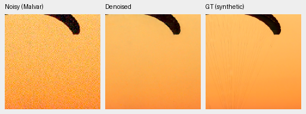
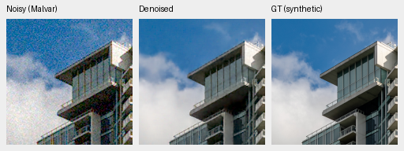
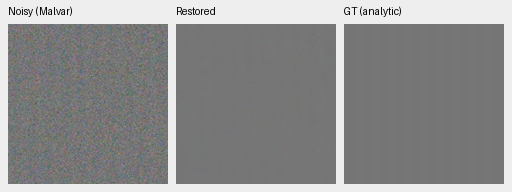
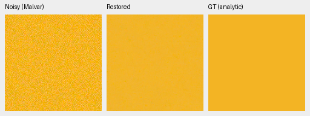
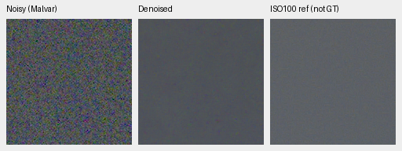
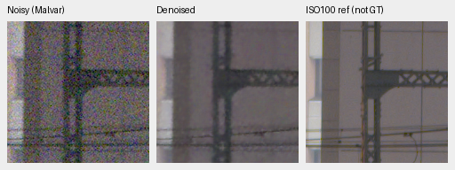
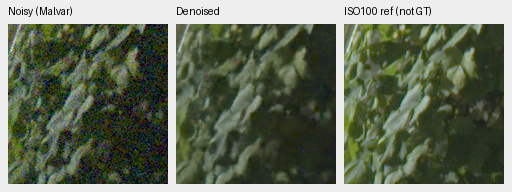
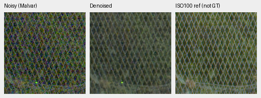
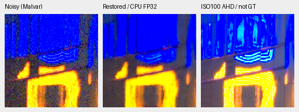
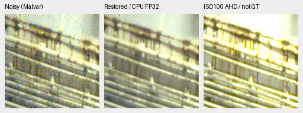

# V67: completed original 10,000-update quality review

V67 gains **1.36945 dB over its 2,000-update checkpoint** on photographs, but
still trails mature V60 by **1.95519 dB**. Native crops retain missing cords,
soft foliage and weak stripes; bright saturated color regresses from first2k.
**No promotion; V43 remains the working reference.** The original budget is
complete. This does not prove convergence.

[All scores, comparisons, state/artifact audits and 28 actual native views](results/raw-kernel-phase-joint-v67-full10k-review.json).
[Original schedule and isolated-resume checks](raw-kernel-phase-joint-v67-full10k.md).
[Retained first-2k review](raw-kernel-phase-joint-v67-first2k-review.md).

Checkpoint SHA256:
`a37e6c84597de540440bbf29c93eb79c9ddbf74024b39843a2941143fe6470fc`.
Source bundle:
`fc0297db08d659523fdcefe1ef0e7a4da12ae97f648e95b1579db65de93d268a`.

All five review owners completed and exited. Independent state reads agree on
finite94 model/94 EMA/92 AdamW states, all92 changed restoration parameter
tensors, 32,931,920 trainable parameters and two unchanged normalization buffers.
All402 logged learning rates follow the original schedule, including the exact
81-row2k prefix and321 resumed rows. Final LR is1e-5. The isolated continuation
restored genuine model, EMA, AdamW and Python/Torch/CUDA RNG at2k. Only its output
directory and notes changed. DINO remains frozen and is omitted from restoration
checkpoints; actual backbone hash/gradient checks are separate preflight evidence.

The recipe remains seed50/LR1e-4/warmup100, B16/native256/BF16, workers4+2+2,
40,170 Commons/native128/paired32, with unchanged geometry/noise/palette/fractions.
New downloads did not enter this run. Comparing2k with10k measures progress along
one trajectory, not an architecture/unfreezing/seed ablation. Historical V60/V58/V43
training differs.

## Development scores

427 photographs have exact simulated targets;16 procedural sources are separate.
Known development has four scenes/eight pairs/72 crops per method; unseen has
five scenes/ten pairs/90 crops. Real-pair measured CFA is primary; independently
demosaiced AHD RGB is auxiliary, not exact RGB GT. Means balance sources/scenes.

| Model | Photo PSNR / SSIM | Procedural PSNR / SSIM | Known CFA PSNR | Unseen CFA PSNR |
| --- | --- | --- | ---: | ---: |
| V60 full4k ancestor | 35.66428 / .961908 | 34.33768 / .971300 | 54.21125 | 53.76025 |
| V67 first2k | 32.33964 / .927021 | 29.65301 / .917090 | 52.02905 | 50.68634 |
| V67 original10k | 33.70910 / .943666 | 31.06277 / .935373 | 53.11502 | 52.13354 |

| Metric | Final−first2k [95% interval] | Final−V60 [95% interval] |
| --- | --- | --- |
| Photo sRGB PSNR,dB | +1.36945 [1.33040,1.40745] | −1.95519 [−2.03699,−1.88031] |
| Photo sRGB SSIM | +.01664 [.01588,.01744] | −.01824 [−.01891,−.01760] |
| Procedural sRGB PSNR,dB | +1.40977 [1.23369,1.64053] | −3.27491 [−3.86982,−2.64294] |
| Known CFA PSNR,dB | +1.08596 [.51113,1.71177] | −1.09623 [−1.93548,−.48279] |
| Unseen CFA PSNR,dB | +1.44720 [1.16140,1.76039] | −1.62671 [−2.19187,−1.14831] |

Independent coverage/arithmetic checks cover50,264 primary cases,48 comparisons
and12 classical witnesses, including retained V58/V43. Intervals use1,000 paired
source bootstrap resamples/seed42, not training/model-selection uncertainty.
Historical V43 real batch differs. No protected-final model scores are used.

## Native photographic triplets with exact GT

Noisy WB-aware Malvar → V67 original10k → exact simulated GT. Each panel is
native160×160 at8×-binned evaluation resolution, never resized. Shared
ROI `[48,48,160,160]`, RGGB, WB `[2,1,1.5]`, original protocol matrix,
shot=.00256/read variance=.0000262144, display×1 (0EV). PNGs are8-bit sRGB
previews; scores use unquantized outputs. Full source/ROI/checkpoint/conditioning/
transform metadata are in the receipt.

Sources: [Roy Egloff](https://commons.wikimedia.org/wiki/File:CH.VD.Villeneuve_2007-08-25_Vertigo-Swiss-Riviera_2392_3x2-R_4K.jpg)
and [Dietmar Rabich](https://commons.wikimedia.org/wiki/File:Vancouver_(BC,_Canada),_Coal_Harbour_Seaside_Park,_Blick_in_den_Himmel_--_2022_--_2158.jpg),
[CC BY-SA4.0](https://creativecommons.org/licenses/by-sa/4.0/), modified by binning,
crop, simulated noise and restoration.

Both have less grain than first2k; fabric cords remain absent and sky/facade
retain faint variation/softness. Known/unseen paired crops become smoother but
retain coarse color variation and soft transitions. Cached Q2/Sony/GFX50R views
show less noise with soft seams/boundaries. GFX50R concrete retains more granular
texture than RawNIND; without GT this cannot all be credited as recovered detail.
These views do not establish a decisive real-camera advantage.

## Weak detail and color

At high noise the dark period8 carrier's in-phase gain falls from.14283 at2k to
**−.01184** at10k (Malvar1.02913): effectively erased. The level.18/contrast.02/
period16 carrier falls from.44832 to **.22096** (Malvar.99177). Unrelated residual
RMS falls from.002858/.007788 to.001521/.004206. This is a noise/detail tradeoff,
not successful weak-signal recovery. Neutral level.18 spatial luma RMS falls
from.004272 to.002520 versus noisy Malvar.020780. The896-case/56-group/1,504-scalar
audit checks coverage/summary arithmetic; full prediction recomputation is not
claimed where arrays were not saved.

The fixed hue grid has147 colors/grays×two conditions×four CFAs=1,176 new
predictions,7,056 independently recomputed fields and216 checked summary scalars.
Source/condition records match V66/V60 grids; their historical arrays/model source
remain separate. Below: mean maximum absolute camera-channel mean bias / mean
per-case camera-RGB RMSE for96 hue/CFA cases at high noise/peak.9. These are
descriptive averages, not confidence intervals or blind photo-quality results.

| Saturation | V60 bias / RMSE | V67 first2k bias / RMSE | V67 original10k bias / RMSE |
| ---: | --- | --- | --- |
| .50 | .024435 / .016413 | .002239 / .009605 | .018945 / .015625 |
| .98 | .007657 / .005654 | .001027 / .008279 | .011956 / .010595 |

Both bright-color groups regress from first2k despite better photo averages.
Highly saturated RMSE also trails V60. Actual neutral/orange/magenta and selected
CPU views retain coarse variation, especially dark magenta mottling. The separate
CPU check verifies32 predictions/192 fields. Clean constant-color invariance does
not imply unbiased restoration of noisy fields.

## Standing GFX100S test and timing

DSCF3879 ISO6400 f/1.7 → V67 → independently AHD-demosaiced DSCF3880 ISO100
f/5.6, **not GT**. The reference is3m38s later; aperture/exposure time and moving
subjects differ. Both cached originals/siblings stay out of training. These
native160 sensor crops come from the full101.996MP output, shared WB/matrix,
display×4 (+2EV), no warp/resizing. Conditioning remains shot
.0014635775921166604/read variance .0000010715704128646712.

| Region | Noisy x,y | Reference x,y | Size |
| --- | --- | --- | ---: |
| Sky | 5800,1400 | 5800,1400 | 160 |
| Building | 5790,2690 | 5791,2690 | 160 |
| Foliage | 8890,5570 | 8890,5570 | 160 |
| Chain-link fence | 2240,6000 | 2241,6000 | 160 |

Sky is smoother but retains coarse/color grain; truss/leaf detail stays soft and
foliage muted versus the independent reference. Mesh is visible but low-contrast
and granular. Aperture/exposure differences prevent attributing all reference
sharpness to denoising.

Full restoration/blending takes **52.704s** on the shared GB10: tile512/overlap64,
B4, FP16 neural/FP32 physical, channels-last,520 tiles, peak CUDA allocation5.614GB.
This excludes RAW decode/TIFF encode and is not controlled throughput. The10-second
target remains unmet. Camera-linear16/display-sRGB16 full TIFFs and corresponding
native crops verify. Separate profiling/sweeps do not improve this quality result.

Two supplementary CPU FP32/native512/B1 predictions cover neon and the platform
boundary using the same conditioning/+2EV display. Noisy ROIs are
`[9060,2050,160,160]` and `[10320,4520,160,160]`; reference x offsets0/+1.
The neon ROI contains57 sensor-clipped pixels of25,600; the platform contains0
despite display clipping. Sign content can change over time.

Both have far less grain but soft fine strokes/rails. Context predictions are
separate from the full-frame CUDA output/timing. The primary artifact audit checks
19 PNGs/23 F32 arrays/two RGB16 TIFFs and common noisy/reference pixels/transforms
against V60. CPU-color, hue and supplementary audits bring actual new native
views to28. The original10000 run is complete and preserved; SOTA and the requested
large real-photo advantage remain unproven. No automatic budget extension,
production batch/LR change or working-reference promotion is made.
