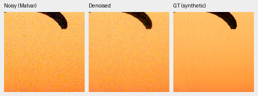
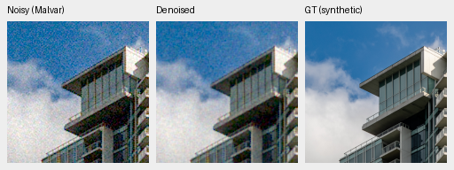
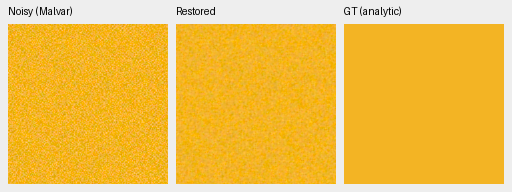
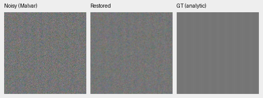
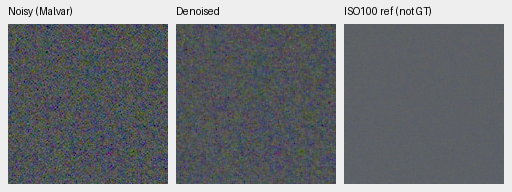
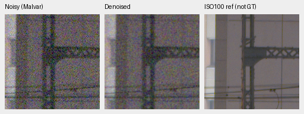
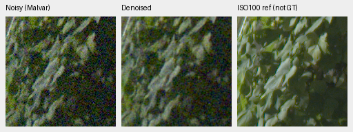
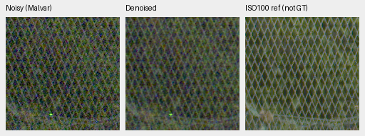

# Direct phase conditioning: completed V66 warmup

V66 improves photo PSNR by **1.69373 dB** over the matched V65 warmup, but remains
**6.13809 dB below V60**. Procedural PSNR falls 0.97537 dB. All 26 native panels
were viewed: noise reduction improves, but substantial grain still obscures
detail. **No promotion.** V43 remains the working reference. This completes the
declared 1,000-update head-only trial; it does not establish convergence.

[All scores, hashes, audits and native crop receipts](results/raw-kernel-phase-warmup-v66-first1k-review.json).
[Architecture, recipe and executed preflights](raw-kernel-phase-v66.md).

V65 and V66 start from the same V60 full-4k EMA, with a new head that initially
produces bilinear. V66 adds 5,184 zero-initialized coefficient parameters encoding
four CFA patterns × four native Bayer positions. Only its 27,216 head parameters
train; all 91 existing restoration/EMA tensors remain bitwise equal to V60.
DINO remains frozen. Both trials use seed49, B16/native256/BF16, LR2e-4/warmup50,
fresh AdamW/EMA, original1,000 updates, original40,170 Commons/native128/paired32,
the same fractions/palette/geometry/noise/validation and workers4+2+2. All **41
logged** input hashes, domains and learning rates match; unlogged observations
are not independently compared. Extra coefficient capacity is part of the change.

Checkpoint SHA256:
`df88bbc32c370754a5915eb1e49b9ce69ddef272ae816939b7cc40b49aa5b79c`.
Immutable model-source bundle:
`fc0297db08d659523fdcefe1ef0e7a4da12ae97f648e95b1579db65de93d268a`.
Independent inspection verifies finite94 model/94 EMA/three AdamW states, old91
unchanged, original recipe/data/source/RNG and complete logs. All four workflow
owners exited successfully. No schedule was changed during training.

427 photographic sources use exact simulated targets;16 procedural sources are
separate. Real development panels contain known4 scenes/8 pairs/72 crops and
unseen5 scenes/10 pairs/90 crops per method. Measured-CFA PSNR is primary there;
independently AHD-demosaiced RGB is auxiliary, not exact RGB GT.

| Model | Photo PSNR / SSIM | Procedural PSNR / SSIM | Known CFA PSNR | Unseen CFA PSNR |
| --- | --- | --- | ---: | ---: |
| V60 full4k parent | 35.66428 / .961908 | 34.33768 / .971300 | 54.21125 | 53.76025 |
| V65 head warmup | 27.83246 / .821633 | 29.00491 / .856454 | 44.22499 | 41.44299 |
| V66 phase head | 29.52620 / .872886 | 28.02954 / .864642 | 45.95696 | 43.67401 |

| V66−V65 | Difference | 95% paired source interval |
| --- | ---: | --- |
| Photo sRGB PSNR,dB | +1.69373 | [1.62423,1.75916] |
| Photo sRGB SSIM | +.051253 | [.049521,.052930] |
| Procedural sRGB PSNR,dB | −.97537 | [−1.59974,−.33590] |
| Known CFA PSNR,dB | +1.73197 | [1.37836,2.02578] |
| Unseen CFA PSNR,dB | +2.23102 | [2.09719,2.35320] |

Independent arithmetic/coverage checks cover50,264 primary cases,48 comparisons
against V65/V60/V58/V43 and12 classical observation witnesses. Bootstrap uses
1,000 source resamples/seed42, not training/selection uncertainty. V60/V58/V43
have different training histories; V43 also has a different real-data batch.
Protected-final model scores remain unused.

## Native exact-GT photographic triplets

Noisy WB-aware Malvar → denoised → exact simulated GT. Each panel is native160×160
at the8×-binned evaluation resolution, never resized. Shared ROI[48,48,160,160],
RGGB, WB[2,1,1.5], recorded protocol matrix, shot=.00256/read variance=.0000262144,
ADC16/black.03 and display exposure×1. Scores use unquantized predictions;
these are8-bit sRGB previews. Every crop records source, checkpoint hash,
conditioning and display transform in the linked receipt.

Sources: [Roy Egloff](https://commons.wikimedia.org/wiki/File:CH.VD.Villeneuve_2007-08-25_Vertigo-Swiss-Riviera_2392_3x2-R_4K.jpg)
and [Dietmar Rabich](https://commons.wikimedia.org/wiki/File:Vancouver_(BC,_Canada),_Coal_Harbour_Seaside_Park,_Blick_in_den_Himmel_--_2022_--_2158.jpg),
[CC BY-SA4.0](https://creativecommons.org/licenses/by-sa/4.0/), modified by binning,
crop, simulated noise and restoration.

Both are less noisy than V65, but cords, facade and cloud detail remain obscured.
Four paired crops also retain colored grain. In six native Q2/Sony/GFX50R views,
dark rocks and concrete remain noisy and window seams stay soft; RawNIND is a
smoother comparator, not GT.

## Color and analytic checks

The fixed grid contains147 colors/grays×2 conditions×4 CFAs=1,176 observations.
Only V66 runs anew:1,176 arrays/7,056 independently checked Torch64 metric fields,
18 groups/216 descriptive scalars. All source/condition records match V65 and
V60 for separate descriptive comparison. Older reports retain their original
source; no legacy prediction is merged into the changed-source report.

At high noise/peak.9, entries are mean maximum absolute camera-channel mean bias
/ mean per-case cameraRGB RMSE across96 hue/CFA cases. These are descriptive
averages, not confidence intervals or blind photo results.

| Saturation | V60 bias / RMSE | V65 bias / RMSE | V66 bias / RMSE |
| ---: | --- | --- | --- |
| .50 | .024435 / .016413 | .000814 / .026831 | .000765 / .022038 |
| .98 | .007657 / .005654 | .000472 / .022325 | .000463 / .018832 |

The low mean bias still comes with large residual noise. Clean constant-color
invariance does not establish unbiased noisy-field restoration. Four selected
CPU-color and three grid triplets were actually viewed; the separate CPU audit
covers32 arrays/192 fields.

High-noise carrier gain is.84348 at level.01/contrast.1/period8 and.89198 at
level.18/contrast.02/period16, versus V65 .82523/.91727 and Malvar1.02913/.99177.
Neutral level.18 spatial luma RMS is.01334, versus V65 .01393/Malvar .02078.
Noise remains prominent; carrier gain alone does not establish useful detail.
The analytic audit checks896 cases/56 groups/1,504 scalar-summary fields; full
predictions were not saved for every case, so no full-array audit is claimed.

## Standing full-frame GFX test

DSCF3879 ISO6400 f/1.7 → V66 → DSCF3880 ISO100 f/5.6. These are native160×160
sensor crops from full101.996MP output with shared display×4/+2EV. The reference
was taken3m38s later with different aperture/exposure time/moving subjects and
independently AHD demosaiced: **not GT**. Both cached RAFs and siblings remain
outside training. Shared WB/matrix and integer source/ROI coordinates are in
the crop records; no warp/resizing. Conditioning shot=.0014635775921166604,
read variance=.0000010715704128646712.

Sky grain is reduced versus V65 but remains strong; truss, leaves and mesh remain
obscured. Full restoration/blending takes51.352s on the shared GB10,
tile512/overlap64/B4/FP16 with physical FP32, peak CUDA allocation5.614GB.
This excludes RAW decode/TIFF encode and is not controlled timing;10s is unmet.
Camera-linear16 and display-sRGB16 TIFFs verify, and all four denoised PNG ROIs
match the full sRGB16 TIFF exactly.

The primary integrity audit covers19 PNGs/23 F32 arrays/two full RGB16 files.
Noisy/reference pixels and transform metadata exactly match retained V60.
Eighteen three-camera rerenders have just one changed channel value by one8-bit
code, within the unchanged historical preview-only bound. This does not relax
metric/reference tolerances. All26 new native PNGs were actually viewed.

The next useful test is a separately declared joint restoration-training stage
from V66 EMA, keeping the DINO backbone frozen and the physical reconstruction
unchanged. Neither head warmup trained the existing restoration features. That
motivates the experiment, but does not establish why V65/V66 remain poor. A new
stage has different initialization/budget/LR and cannot isolate unfreezing alone.
This report launches no continuation. The requested quality goal remains unmet.
