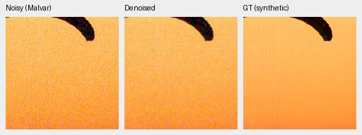
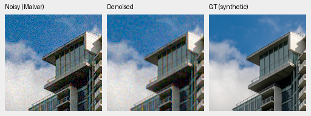
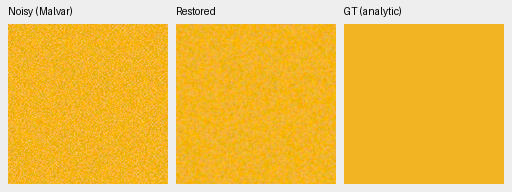
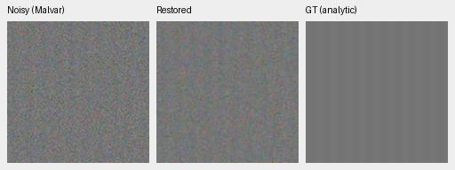
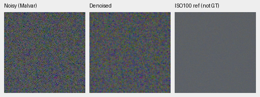
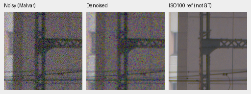
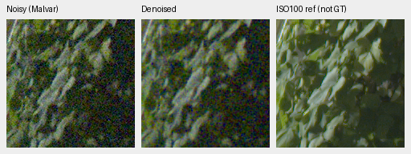
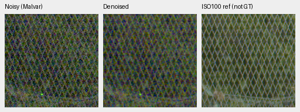

# RAW-head warmup: completed 1,000-update review

Current architecture and recommendations: [current model guide](current-model.md).
The versioned study below retains its measured results and original protocol.

The new head passes its numerical/state checks but fails as a denoiser at this
budget. Photo PSNR is **27.83246 dB**, versus 35.66428 for its mature V60 parent;
known/unseen measured-CFA means fall 9.99/12.32dB. Native images remain grainy.
Lower flat-color mean bias accompanies large residual noise, so it is not a
restoration-quality improvement. **No promotion or joint continuation.** V43 was the reference for this study. The original 1,000-update warmup is complete;
this does not establish convergence or reject end-to-end RAW-kernel training.

[All scores, hashes, audits and 26 actual native view receipts](results/raw-kernel-warmup-v65-first1k-review.json).
[Declared stage and launch](raw-kernel-warmup-v65.md).
[Reconstruction rule](raw-kernel-reconstruction.md).

## Actual training and state

V65 initializes from V60 full 4k EMA with a new zero-initialized RAW-difference
head. That starts at bilinear, not parent restoration quality. All 91 existing
restoration/EMA tensors stay bit-for-bit equal to the parent; only 22,032 head
parameters train. DINO stays frozen. Seed49, B16/native 256/BF16, LR2e-4/warmup50,
fresh AdamW/EMA, original 1,000 updates. Original40,170 Commons/native 128/paired32,
fractions/palette/geometry/noise and 8× validation remain fixed. This is exploratory
new-head training, not a matched causal architecture comparison against V60/V43.

Checkpoint SHA256:
`4cce53075921807ba15bc37717052aa0425ede752e4dcc5d9b40f6f6f9395d0a`.
Frozen model source bundle:
`32a330278824bb0b06b27a7b00439d10a3d853966ee3864ceb96a99ff08ae1c0`.

Independent CPU inspection verifies93 model/93 EMA tensors and two AdamW states,
all finite at 1000; all 91 old tensors equal the parent; complete RNG,41 logged
updates, original recipe/data hashes and the entire source snapshot. Rebuilding
the source-bundle hash from actual archived bytes matches. All training/primary/
statistics/hue/artifact owners exited successfully. No schedule is retimed.

## Development scores

427 photos use exact simulated targets;16 procedural sources are separate.
Known development has 4 scenes/8 pairs/72 crops, unseen5 scenes/10 pairs/90 crops
per method. Means balance sources. Measured-CFA PSNR is primary for real pairs;
independently AHD-demosaiced RGB is auxiliary, not exact RGB GT.

| Model | Photo PSNR / SSIM | Procedural PSNR / SSIM | Known CFA PSNR | Unseen CFA PSNR |
| --- | --- | --- | ---: | ---: |
| V60 full 4k parent | 35.66428 / .961908 | 34.33768 / .971300 | 54.21125 | 53.76025 |
| V65 warmup1000 | 27.83246 / .821633 | 29.00491 / .856454 | 44.22499 | 41.44299 |

| V65−V60 | Difference |95% paired source interval |
| --- | ---: | --- |
| Photo sRGB PSNR,dB | −7.83182 | [−8.01119,−7.66399] |
| Procedural sRGB PSNR,dB | −5.33277 | [−6.19517,−4.44754] |
| Known CFA PSNR,dB | −9.98626 | [−13.59790,−6.63895] |
| Unseen CFA PSNR,dB | −12.31726 | [−13.93902,−10.87799] |

Independent arithmetic/coverage checks cover 50,264 primary cases. All 36 saved
comparisons against V60/V58/V43 and nine classical observation witnesses are in
the receipt. Bootstrap uses 1,000 source resamples/seed42; it does not quantify
training/selection uncertainty. Initialization/training histories differ; V43's
real batch also differs. No protected-final model score is used.

## Native exact-GT photographic triplets

Noisy WB-aware Malvar→denoised→exact simulated GT. Native160×160 pixels at the
8×-binned evaluation resolution, never resized. Shared ROI[48,48,160,160], RGGB,
WB[2,1,1.5], recorded protocol matrix, shot=.00256/read variance=.0000262144,
ADC16/black.03, display exposure×1. Scores use unquantized predictions;
these are8-bit sRGB previews. Checkpoint/source/ROI/conditioning/display records
accompany every image in the receipt.

Sources: [Roy Egloff](https://commons.wikimedia.org/wiki/File:CH.VD.Villeneuve_2007-08-25_Vertigo-Swiss-Riviera_2392_3x2-R_4K.jpg)
and [Dietmar Rabich](https://commons.wikimedia.org/wiki/File:Vancouver_(BC,_Canada),_Coal_Harbour_Seaside_Park,_Blick_in_den_Himmel_--_2022_--_2158.jpg),
[CC BY-SA4.0](https://creativecommons.org/licenses/by-sa/4.0/), modified by binning,
crop, simulated noise and restoration.

0014aa4e075b1827f91ef8a02069e1e318f040ba / iso12800-prior / RGGB / 0:dino-convnext-raw-kernel-warmup-b16-v65:step-1000:

002fc6eeadf637e81d5a327f117b79abb86becd9 / iso12800-prior / RGGB / 0:dino-convnext-raw-kernel-warmup-b16-v65:step-1000:

Noise obscures cords, surface texture and facade/cloud detail. Six additional
native Q2/Sony/GFX50R views show residual grain; RawNIND is smoother and is a
comparator rather than GT. Four real paired crops also remain very noisy.

## Color means and residual noise

The fixed grid uses 147 colors/grays×2 conditions×4 CFAs=1,176 observations.
Only V65 runs anew:1,176 arrays,7,056 independently checked Torch64 metric fields,
18 groups/216 descriptive scalars. Old parent results retain their original
source/provenance and are compared separately after all 1,176 source records
match; no legacy arrays are merged into the changed-source report.

At high noise/peak.9, each table cell is mean maximum absolute camera-channel
mean bias / mean per-case camera RGB RMSE across 96 hue/CFA cases. These are
descriptive averages, not confidence intervals or a blind photo benchmark.

| Saturation | V60 parent bias / RMSE | V65 bias / RMSE |
| ---: | --- | --- |
| .50 | .024435 / .016413 | .000814 / .026831 |
| .98 | .007657 / .005654 | .000472 / .022325 |

The lower mean bias fails to compensate for the grain. The native orange grid
triplet below uses RGGB/high-noise/display×1, shared WB/matrix and ROI160:

RAW-head-warmup1000 / h030-s0.98-l0.90:

Four selected CPU-color triplets and three full-grid triplets were viewed.
Their means are reasonably close, but colored noise/coarse variation persists.
The selected CPU check covers 32 arrays/192 fields. Clean constant-color
invariance does not imply unbiased noisy restoration or good denoising.

Analytic high-noise in-phase carrier gain is.82523 at level.01/contrast.1/period8
and.91727 at level.18/contrast.02/period16. These are accompanied by noise:
neutral level.18 spatial luma RMS is.01393, versus.02078 for noisy Malvar.
Higher carrier gain alone is not useful detail recovery. Coverage/arithmetic
checks cover 896 cases/56 groups/1,504 scalars; full predictions were not saved
for every analytic case, so this audits scalar coverage/aggregation.

carrier-l0.18-c0.02-p16-draw0 / 0:dino-convnext-raw-kernel-warmup-b16-v65:step-1000:

## Standing full-frame GFX test

DSCF3879 ISO6400 f/1.7→denoised→DSCF3880 ISO100 f/5.6, native 160×160 crops
from the full 101.996MP output, shared display×4/+2EV. The reference was taken
3m38s later with different aperture/exposure time/moving subjects, independently
AHD demosaiced: **not GT**. Local cached RAFs and siblings stay outside training.
Shared WB/matrix, source hashes and integer coordinates are in each crop record;
no resizing or warp. Noise conditioning: shot=.0014635775921166604,
read variance=.0000010715704128646712.

overcast-sky / 0:dino-convnext-raw-kernel-warmup-b16-v65:step-1000:

building-detail / 0:dino-convnext-raw-kernel-warmup-b16-v65:step-1000:

foliage / 0:dino-convnext-raw-kernel-warmup-b16-v65:step-1000:

chain-link-fence / 0:dino-convnext-raw-kernel-warmup-b16-v65:step-1000:

Sky remains grainy; noise obscures truss, leaf and fence detail. Full restoration
takes 50.670s on the shared GB10, tile512/overlap64/B4/FP16 with physical FP32,
peak CUDA allocation4.255GB. This is one shared-machine restoration/blending
measurement, not total RAW decode/TIFF encode time or a controlled speed test.
The10-second target is unmet. Camera-linear16-bit and display-sRGB16-bit TIFFs
both verify; four GFX native denoised previews match their full sRGB16 ROI exactly.

The primary artifact audit covers 19 PNGs/23 F32 arrays/two fullRGB16 files;
noisy/reference pixels and transform metadata match retained V60 exactly.
Eighteen three-camera rerenders differ in only two channel values by one8-bit
code, within the unchanged historical preview-only bound. No score or reference
pixel tolerance is relaxed. All 26 new native PNGs were actually viewed.

## Next experiment supported by diagnostics

On two fixed CPU photos, coefficient RMS is.00366/.00295, far below tanh
saturation; correction RMS is.00249/.00401. This explains their small departure
from bilinear, but does not establish a general optimization cause.

A separate discarded CPU probe trains fresh standalone heads on constant
cameraRGB[.12,.23,.47] with new Poisson/read draws. It uses B4/native 64,
512 updates, MSE, ROI[20,20,24,24], and 64 independent scoring observations.
It never loads V65 or photo/evaluation-grid targets. Every tested clean constant
is preserved exactly. Against bilinear:

| Fixed head input | LR | Toy analytic gain,dB |
| --- | ---: | ---: |
| RGGB, zero feature maps | .0002 | 3.223 |
| Four CFAs, zero feature maps | .0002 | 1.036 |
| Four CFAs,16 explicit CFA/native-phase categories | .0002 | 7.036 |
| Same16 categories | .002 | 18.952 |

Explicit phase information helps this toy task, and learning rate matters there.
V65 already receives CFA information indirectly through frozen encoder features;
this probe does not prove those features caused its failure. A separate matched
trial can test direct phase conditioning without simultaneously changing the
production learning rate. No joint stage or new model is launched by this report.
SOTA and the requested large real-photo advantage remain unresolved.
