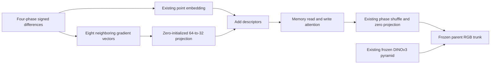

# Neighboring gradient descriptors before global memory

**V140 adds a learned neighborhood descriptor to the memory-only RAW branch.**
Genuine CPU/CUDA16+2 checks pass, with91 parent tensors exact in model and EMA.
A fresh1,000-update run waits for V139's original numeric/native/faint/JPEG
review. Restoration quality remains unmeasured; V120 stays the general choice.
The102-input review support is fixed; dedicated review automation remains next work.

[Implementation](../src/demosaic/raw_patch_memory_features.py) ·
[Tests](../tests/test_raw_patch_memory_features.py) ·
[Recipe](../configs/quality-v120-raw-patch-memory-pilot-v140.yaml) ·
[Check driver](../scripts/check_raw_patch_memory_pilot.py) ·
[Training queue](../scripts/train_patch_memory_pilot.py) ·
[Checks, audit and queue evidence](results/raw-patch-memory-checks-v1.json).

## The hypothesis and operator

[V139](raw-global-memory-only.md) embeds each packed pixel's eight signed
horizontal/vertical phase differences independently before global matching.
It supplies no descriptor of neighboring gradient arrangements at that stage.
Repeated fine structure may benefit from comparing those arrangements rather
than individual noisy vectors. This is a hypothesis, not an established cause
of real mesh loss; V139's pending quality result remains separate evidence.

V140 retains the point embedding and adds a zero-initialized64→32 projection
of eight neighboring vectors. Each neighbor retains all eight gradient channels;
the center is excluded. Fixed row-major coordinates use zero padding outside,
without border wrap or interpolation. These are3×3 neighborhoods of gradient
vectors on the packed CFA grid, not3×3 native RGB pixels. Variance/CFA conditions,
64 slots, four cosine-attention heads and image-scale normalization stay unchanged.



Every returned feature still passes through both attention operations. There
is no local bypass to the stem. The fifteen shared initial tensors remain exact;
one new tensor adds **2,048 parameters**, for16 tensors/16,192 parameters overall.
Initial descriptors equal V139's point descriptors, and the zero final projection
preserves the parent output. Constructor RNG is preserved. Bias-free values and
signed differences keep per-phase spatial constants exactly zero after learning,
including spatially varying variance. Noisy flats and camera color still need review.

## Configuration and compatibility

```yaml
raw_global_only: true
model:
  raw_global_features: true
  raw_global_conditioning: patch-memory-v4
```

The complete recipe selects native anchored/stabilized RGB and official frozen
DINOv3 ConvNeXt-Small. Missing mode remains `legacy-v1`; `cosine-rms-v2` and
`memory-only-v3` keep their operators/state layouts. Changed modes reject before
resume construction; strict loading requires V140's learned patch tensor.

The common forward now calls a point-embedding hook. Independent AST inlining
reproduces the entire previous forward exactly. Of68 earlier neural modules,65
remain byte-identical; other changes are limited to selecting constructors and
explicit mode/hook code. The new snapshot has69 modules. Existing jobs retain
their original frozen sources/plans.

## Actual implementation checks

Both checks start freshly from V12020k and keep the1k horizon while running16
updates plus a genuine two-update resume. CPU uses native128/B1/FP32; CUDA uses
256/B16/BF16 with physical/feature math in FP32. Only16 branch tensors train;
all91 parent tensors remain exact in both model and EMA at16 and18. All107
model/EMA tensors and16 Adam states are finite. Eight changed-mode/scope resumes
per device reject before model construction.

All36 clean/noisy hashes match saved V137. Independent checking compares
162,944,388 prepared-array values and rehashes all36 batches. Initial RGB/auxiliary
outputs match4,259,840 values exactly, without control inference. All16 parameter
tensors receive finite nonzero gradients; all2,048 patch weights become nonzero
in every saved16/18 state. The audit checks263,496,816 finite saved values and576
gradient metadata fields with neural module calls forbidden. It does not
independently rederive backward derivatives.

Across the two genuine checks:36 root/encoder/optimizer calls and306 prepared
target slots, not distinct photographs. Initial branch offsets contain68,157,440
exact zeros. CUDA peak is7,995,275,776 bytes under12GiB. New CUDA admission is
50GiB, CPU40GiB, runtime floor32GB and checks30min each. Existing52GiB policies
stay unchanged. Concurrent-workload timings are not speed measurements.

The99-test feature/scope suite and21 new handoff tests pass: independent NumPy
coordinate/projection arithmetic, spatial arrangement, no center/border leakage,
all-CFA constants, tiny/rectangular inputs, batching/layout, gradients, strict
reload, mode guards and complete dependency handoff. A test-collection filename
typo collected zero tests; a static-audit metadata helper initially rejected a
string path after its source assertions passed. Both are preserved. Neither
required training-check or old-control replay.

## Queued quality experiment

V140 changes only the descriptor against V139's recipe: V120 parent,
90,782 photos/27 regions, seed70,50% reviewed quota, paired32/native128, zero PSF,
native256/B16/BF16, single-view loss, LR1e−3 and100-step warmup. The newer90,774/36
prepared bank remains separate. Checks end during warmup and do not establish
convergence or peak-LR behavior.

The controller adopts byte-identical completed checks and starts production
freshly from V120. It waits for all seven original V139 review stages and exact
owner exit within that queue's original deadline, without a quality-score or
human-publication gate. Then50GiB RAM and128/208GiB internal/external space must
hold15s within a2h wait;12GiB CUDA cap,32GB floor and8h worker limit apply. No
original job, data, budget or deadline changes; no automatic retry/horizon reset.
The run plans1,000 root/optimizer plus64 validation and1,064 encoder calls over
16,000 target slots. All input hashes must match saved V137.

The fixed review declaration covers102 future calls:64 shadow,16 ordinary,
16 faint ADC, four main-GFX512 contexts and two extra-mesh768 profiles. It plans
to adopt612 predictions from six old methods, including V139 and its inherited
V138 controls. Before inference, bind the actual1k state/source and compare all
1,000 V139 clean/noisy hashes. Preserve ROIs, exposures, source-defined masks
and both camera JPEGs. Expected primary support:672 rows/168 groups/64 native
PNGs; faint420 strata/224 decompositions and both mesh profiles/regions with JPEGs.

This is a **support declaration, not a live review controller**. Dedicated
binder/collection/report/audit automation remains next work, followed by actual
native viewing/publication. Native100% noisy/denoised/GT triplets, both protected
GFX pairs and accurate approximate-reference labels are required. These checks
do not establish restoration gains, full427-photo/camera/color quality, tiled
seams/full frames, speed or broad superiority.
