# Direct RAW fitting trades a little detail for less spill

The later [guarded wider-context option](wide-phase-context.md) tests additional
measured frequencies, with fresh quality/flat controls and complete-frame native
comparisons. This report retains its original method and evidence.

**A direct RAW refit lowers fresh mean blank-region spill 7.7%, with 0.5% lower
mesh response and slightly higher image error than the current sparse method.**
It does not solve the missing lattice or false boundary continuation. The centred
real crops show uneven, sometimes wavier recovery. This remains a research tool;
[current inference choices](sparse-phase-support.md) and learned weights are unchanged.

[Reproducible research implementation](../scripts/experimental_raw_phase_refit.py) ·
[Summary](results/raw-phase-refit-summary-v1.json) ·
[Independent audit](results/raw-phase-refit-independent-final-audit-v1.json) ·
[Source/ROI/checkpoint/noise/display manifest](images/raw-phase-refit-v1/manifest.json).

## Hypothesis and implementation

The existing method refits coefficients against a Gaussian-smoothed phasor map.
That map already spreads evidence across texture boundaries. This study instead
fits measured RAW residuals after the parent prediction and fixed per-phase
affine backgrounds. Frequency selection, guarded frequency refinement, original
inactive gates and connected support selection remain unchanged.

The selected policy uses a 32×32 complex coefficient grid, spaced eight native
pixels apart. Clamped bilinear interpolation produces the packed 128×128 field;
the existing support mask multiplies it before interpolation to the four physical
Bayer positions. All selected waves are fitted jointly. The original fitted
RGB/green complex ratios share information across all four phases.

In median green RAW-noise units, the objective is

`0.5*||A*u-y||² + 4*sum(norm(gradient(u))) + 0.125*sum(norm(u)) + 0.025*||u||²`.

`A` includes physical interpolation, fixed support, color transport and observed
variance whitening. Each TV norm shares spatial axes and sine/cosine components;
waves retain separate norms. The group term encourages zeros; the quadratic term
makes the objective strongly convex. Post-filter power shrink 9, magnitude cap 3,
global gate 9 and 32-pixel aprons retain the earlier synthesis. Observed clipping
uses the exact earlier grid-TV fallback.

The solver uses primal–dual updates of the type described by
[Chambolle and Pock](https://www.cambridge.org/core/journals/acta-numerica/article/an-introduction-to-continuous-optimization-for-imaging/1115AA7E36FC201E811040D11118F67F).
It returns the achieved feasible-dual gap, including failures to reach its target.
The covariance/power proxy, support and RGB ratios reuse the observation. They
are **not calibrated uncertainty or a probability that texture exists**. No GT,
reference, RNG, training update or neural call enters correction.

## Development and numerical limitations

The previous 64-recipe/512-observation sparse holdout became development data for
this study. Eleven settings were tried: three dense green fits, three coarse
green fits, two coarse RGB fits and three RGB fits with group penalties. Direct
dense fitting added grain and much more blank spill. Coarse fields pooled more
evidence, and RGB coupling reduced spill relative to green-only fitting.

| Development present cases | Response | Full error RMS DN16 | Mean added blank RMS DN16 | Worst added blank RMS DN16 |
| --- | ---: | ---: | ---: | ---: |
| Current sparse | .07390 | 10.98928 | .04099 | 1.99739 |
| Dense green TV .25 | .06491 | 12.84474 | .20098 | 7.24445 |
| Coarse green TV 4 | .07823 | 10.95967 | .08354 | 2.97358 |
| Coarse RGB TV 4 | .07825 | 10.96203 | .06258 | 2.44079 |
| RGB TV 4, group .125 | .07376 | 10.99412 | .03695 | 1.68575 |
| RGB TV 4, group .25 | .07104 | 11.02901 | .02441 | 1.34173 |
| RGB TV 4, group .5 | .06681 | 11.09224 | .01334 | .98063 |

Group .125 was frozen before new inputs and parent forwards. An independent
audit then exposed substantial numerical under-convergence: all 41 development
coarse RGB/group fits hit 2048 iterations, with maximum normalized gap 2.3523.
The apparent development benefit is a property of that **bounded estimator**,
not a verified minimizer of the objective.

Acceleration and an absolute-row/column preconditioner were studied separately
on the old development cases. At the same cap, their maximum gaps fell to .7583
and .0876, while response decreased. All 41 still capped. These numerical variants
were **not substituted into the new validation**. Its original lock, outputs,
failed checks and source snapshots remain intact. Independent dense-matrix
quadratic solutions and constructed positive-TV/group optima verify the operator
and gap bounds; they do not establish convergence on the photographic inputs.

## New independent validation

Seeds 2026111100–2026111163 supply 64 new recipes, present/absent × four CFAs:
**512 actual V143 root/DINO calls and 512 new sensor-noise observations**. No new
V120 controls, training, real RAW opens or corpus changes. Model, backbone,
inputs and RNG integrity checks pass. Every correction shares the same actual
parent predictions. All 76 package modules match the frozen parent execution.

Native 256 uses the same continuous 512→geometry→area2 generator, zero optical
PSF, scene level .02, shot .00128/read variance 6.5536×10⁻⁶, ADC16 and black .03.
Checkpoint SHA256:
`96d146d017c54196288c585f8b7eddcf030e8a235061049c31e985b9380b7ce4`.
GT enters scoring only. These are per-case means over 256 present cases; CFA
variants are correlated, and this is not a comparison of independent training runs.

| Fresh present cases | V143 parent | Refined TV | Current sparse | Direct RAW trial |
| --- | ---: | ---: | ---: | ---: |
| Known-template gain, ideal 1 | .01673 | .03641 | .04174 | .04152 |
| Native 160 spatial error, RMS DN16 | 12.15637 | 11.62589 | 11.55615 | 11.56446 |
| Complete 256 error, RMS DN16 | 10.24145 | 9.90575 | 9.86546 | 9.87207 |
| Added field in exact-blank pixels, RMS DN16 | 0 | .06436 | .05536 | .05111 |
| Error in those blank pixels, RMS DN16 | 6.37013 | 6.37516 | 6.37592 | 6.37535 |
| Worst per-case added blank RMS, DN16 | 0 | 1.74678 | 1.98859 | 1.90650 |

Versus current sparse, mean added blank RMS falls 7.68% and its worst case falls
4.13%. Response falls .52%, spatial error rises .072% and complete error rises
.067%. Seven cases increase blank GT error, seven increase added blank RMS and
13 lose response. The largest blank-error increase is .07114 DN16, seed 1151/GBRG.
Both corrected methods still exceed parent mean blank error.

Thirty present cases from 11 recipes change. Fifty-three recipes and **all 256
fresh absent inputs** retain every parent value. All 30 joint RAW fits cap at
2048 steps; median normalized gap .6107, maximum 1.5797. These gaps preclude a
claim that the new objective has been solved accurately.

## Native exact-GT examples

Noisy Malvar → direct RAW trial → **exact procedural GT**. Each native 160-pixel
cell uses `[48,48,160,160]`, identical WB/matrix and +3EV. Selection is the first
two active seeds, largest blank-error regression and first inactive recipe,
chosen after complete evaluation. Comparisons with current sparse are in the manifest.

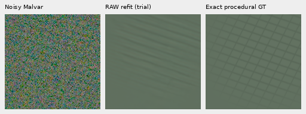

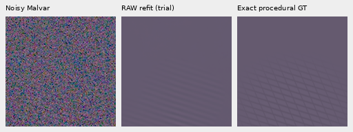

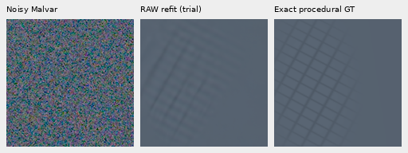

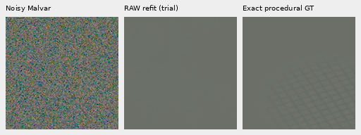

The worst-regression control uses ROI `[69,0,160,160]`, centred/clamped around the
largest added-field pixel in exact-blank support. Noisy → parent → sparse → RAW
trial → exact GT. Both corrections still continue stripes past the true boundary.

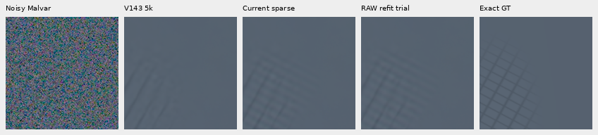

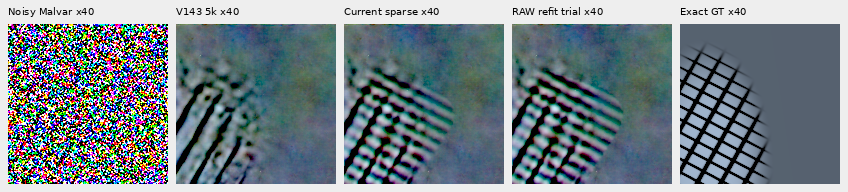

The second row applies `empty+40*(value-empty)` in camera-linear space before
the same WB/matrix/+3EV. The exact-empty background is used only for this common
display transform. Pixel coordinates and sizes remain unchanged.

## Real captures

These are matched **centred native256 developmental windows**, not new complete
102MP inferences. Parents, observed RAW, priors and display transforms are reused.
Rows are noisy → V143 → current sparse → RAW trial → independent ISO100 AHD.
No crop pixels resize. The ISO100 and JPEG captures are **not exact GT** because
aperture, exposure, motion and processing differ. Sources and siblings remain
excluded from training; originals and unavailable source drives remain untouched.

Main DSCF3879/3880, common +2EV, including sky/building/foliage/larger fence:

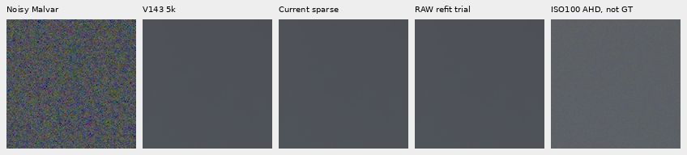

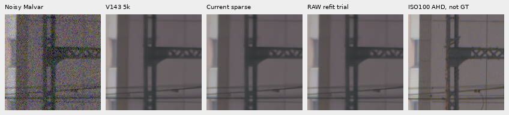

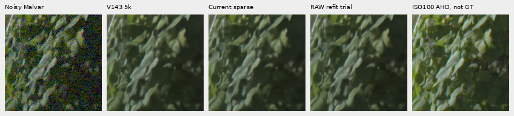

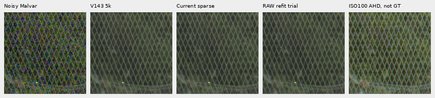

The centred 256×256 sky retains all 196,608 parent channels. This is a local
check, not a new complete-frame or wider-sky safety claim.

DSCF3842/3835 fine green mesh, native left/right ROIs starting `[806,6489]` and
`[1026,6449]`, common +4EV. Nominal shot/read is .00128/6.5536×10⁻⁶; nearby-Haar is
.0014635775921166604/1.0715704128646712×10⁻⁶, fixed from DSCF3879. JPEG rows append
ISO6400 JPEG, independent ISO100 AHD and ISO100 JPEG, all using the same +4EV display.

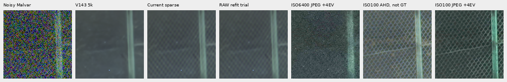

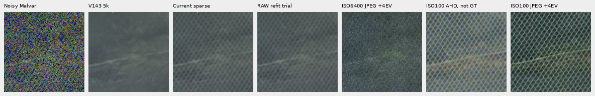

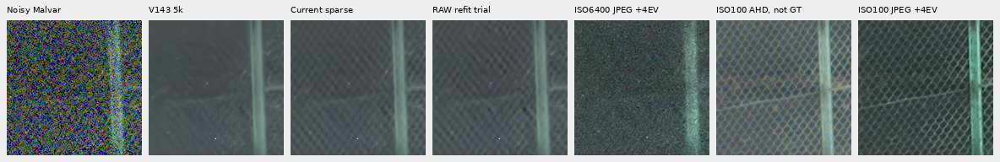

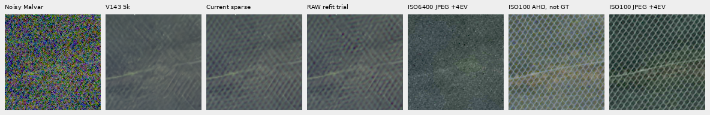

RAW fitting sometimes raises local contrast, but introduces uneven phase/waviness
and does not close the large gap to ISO100. The current sparse method remains the
more useful documented option. Foliage stays painterly; broader camera quality,
highlights and 100MP speed were not newly tested here.

## Reproduction and verification

The serial research script consumes archived native256 measurements and a parent
prediction. It reads `packed`, `variance`, `colors` and parent RGB; target/reference
arrays are ignored. It writes a linear camera-RGB NPY and a hashed JSON receipt.
It does not add an `infer` option or export a new full-frame RGB16 image.

```bash
source scripts/env.sh
PYTHONPATH=.:src:scripts .venv/bin/python scripts/experimental_raw_phase_refit.py \
  observation.npz parent.npy trial.npy --device cuda
```

Independent joint 10-column fits verify all 2560 fresh metric rows, maximum gain
difference 2.22×10⁻¹⁴. CPU/GPU comparison checks 100,663,296 values, maximum difference
3.47×10⁻¹⁸. The readable research script matches all 100,663,296 archived private
GPU values exactly. All 22 boards were viewed at native size; independent rendering
and copy checks verify 8,755,200 PNG channels exactly.

Eleven research tests pass: independent physical interpolation/adjoints for all
four phases, known positive-TV/group optima and feasible-gap bounds, CPU/CUDA RNG
and buffer reset, four physical CFAs, ADC bypass, exact clipped-grid fallback and
actual archive CLI dispatch. These are postprocessing tests, separate from the
512 actual parent-model calls. All failed checks and experimental outputs remain
preserved. The missing detail and flat-region safety goal remains active.
