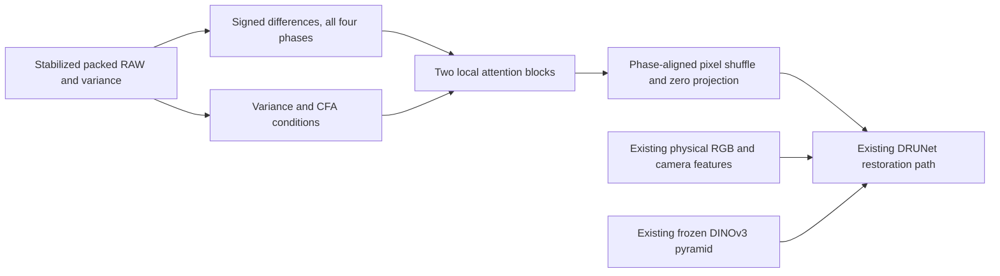

# Local spatial attention for RAW detail

**An optional 22,664-parameter branch now mixes signed RAW detail across local
windows before the pretrained RGB trunk.** Both discarded genuine-V120 CPU16+2
and CUDA256/B16 checks pass. Model quality is
unmeasured. The [V131/V132 full-budget trial](raw-spatial-training.md) has four new
matched CPU/CUDA checks complete and production queued after V125's memory
admission. V120 remains the general recommendation; the original mean-loss trial
keeps its frozen inputs and schedule.

[Implementation](../src/demosaic/raw_spatial_features.py) ·
[Bounded check runner](../scripts/check_raw_spatial_features.py) ·
[Numerical tests](../tests/test_raw_spatial_features.py) ·
[Execution/state/source evidence](results/raw-spatial-implementation-v1.json).

## Why test spatial mixing

The [completed frequency trial](v122-v123-quality.md) adds little weak natural
detail despite a small carrier gain. Its adapter mixes frequencies within
frames; the pretrained DRUNet restoration path remains convolutional.
The recent [structural-guidance JDD paper](https://arxiv.org/abs/2608.09995)
uses a native-resolution window-attention restoration branch with frozen DINOv3
context. That motivates testing spatial mixing here. This is our independent
feature branch around V120's existing trunk/pyramid, with no transferred code,
weights or benchmark claim. Whether it helps weak periodic detail is a hypothesis.

## Operator and compatibility

Horizontal and vertical differences retain the four packed CFA phases as eight
channels, in the existing restoration scale. The branch embeds these into32
features. Two four-head attention blocks use8×8 packed windows, first unshifted
and then offset by four packed pixels. Queries also receive the four variance
proxies and twelve CFA-placement channels. Learned relative-position biases
describe local geometry. Values retain unnormalized content amplitude.

Padding changes the partition origin; pixels never roll across opposite image
borders. Padded keys receive zero attention probability. Residual feed-forward
layers preserve the local feature scale. Learned64-channel packed features
pixel-shuffle into16 native channels and a zero-initialized projection supplies
64 stem offsets. There is no image interpolation, reference mask, Fourier
threshold or inference-strength parameter.

Bias-free content paths make every per-phase spatial constant produce exactly
zero added features after learning, including with spatially varying variance
conditions. This protects the branch's constant-field response. A separately
trained common trunk can still change color, as in V123; full camera/color
evaluation remains necessary. The first zero projection preserves the parent
function at initialization.

Select `model.raw_spatial_features: true` in an otherwise compatible native,
stabilized, physically anchored pretrained-RGB configuration. The option defaults
to false and adds no state to existing models. It excludes the other experimental
RAW heads and late RGB refinement. Learned checkpoints carry23 new tensors;
portable loading requires them. The existing official frozen DINOv3 encoder
and its license are unchanged.

The feature arithmetic remains IEEE FP32 inside BF16 trunk training. Construction
uses explicit CPU allocations and a local generator, preserving global RNG and
common initialization. Tiled inference aligns the new model to16 native pixels,
or32 with DINO context, including the padded final row/column. Original models
keep their existing tile grid. Alignment does not establish equality with a
complete-frame forward or qualify visual seams.

## Actual checks and remaining work

Independent NumPy attention/softmax calculations and coordinate-group averaging
check masks, padding and shifted partitions. Tests cover all four CFA constants
after nonzero adaptation, tiny/rectangular inputs, channels-last parity, gradient
flow through all23 tensors, strict learned-weight reload and invalid combinations.
Additional tiled fixtures verify global lattice coordinates at odd final borders.

The actual CPU check starts from V120's20k EMA on the prepared90,781-source/
29-region data, seed71, native128/B1/FP32. It executes the ordinary training loss
and optimizer for16 updates, preserves that checkpoint, rejects a changed model
configuration before any forward, then resumes for two new updates. All114
model/EMA tensors and112 Adam states are finite at18. All23 added tensors receive
finite nonzero gradients. One new first-batch disabled witness matches65,536
RGB/auxiliary values exactly; portable EMA reload matches all114 tensors and
runs one CPU forward. Total:18 train/optimizer, one witness, one portable and20
encoder calls. Peak RSS is3,242,172,416 bytes; CUDA stays uninitialized.

The separate CUDA check keeps the completed CPU receipt and unchanged neural
mathematics. It completes16+2 updates at native256/B16/BF16, a16GiB allocator cap,52GiB launch
headroom and32GB runtime floor. Each check is bounded to30 minutes with no
automatic retry. The first CUDA launch failed on a missing deterministic cuBLAS
environment before any batch/model work. Its source, failure and zero counts
are preserved. The explicit corrected launch retains its original absolute
deadline and source/input identities. All114 model/EMA tensors and112 Adam
states are finite at18; all23 added tensors receive finite nonzero gradients.
The zero adapter matches4,194,304 RGB/auxiliary output values exactly on the
new first batch. Three actual branch constructions preserve CPU and initialized
CUDA RNG states. Learned portable EMA loading matches all114 tensors and runs
one CPU forward on one member of that new batch. There are19 CUDA root/encoder
calls and one CPU portable call. Peak CUDA allocation is9,069,177,344 bytes.

Across both devices,36 discarded optimizer updates and40 root/encoder calls
cover306 target contexts. Independent saved-state checking reopens the four
16/18-step checkpoints without constructing a model. The executed48 feature
tests and32 feature/tiling tests overlap on19 spatial cases, for61 unique passing
cases. The CPU check's loader predates only the new-flag tile-grid addition;
all direct training/model mathematics and portable-loader ASTs match the current
implementation. The CUDA check executes the current model-source bytes.

These are discarded implementation states. The separate
[V131/V132 trial](raw-spatial-training.md) uses seed70 and full20k horizons on both
arms, with four newly executed exact-recipe checks. Production is queued; a
matched architectural comparison and native photographic/GFX recovery remain
to be measured. Both real train scenes and siblings stay outside training.
