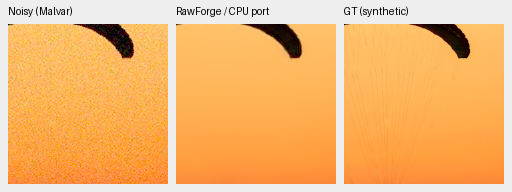
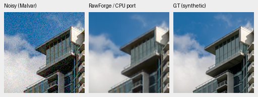
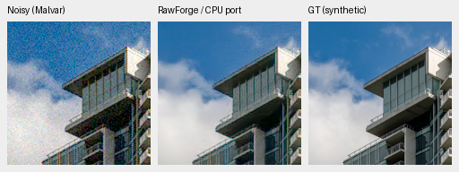
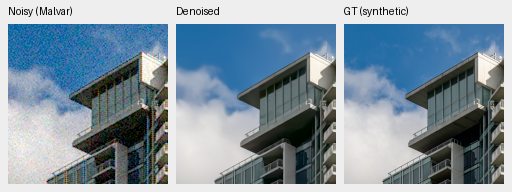
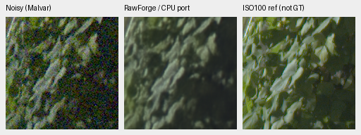
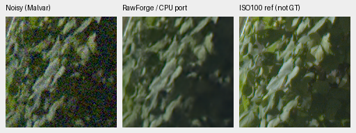
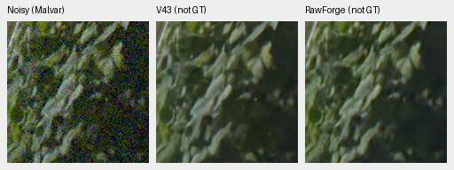
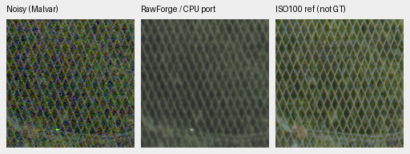
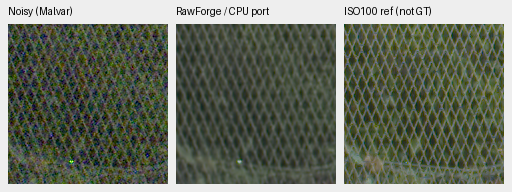
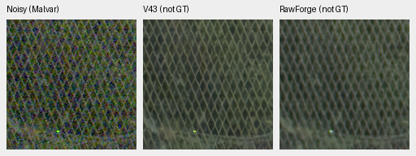

# RawForge joint models: fixed CPU comparison

The signed RawForge JDD exports give a useful additional comparison, but this
small CPU pilot does not justify replacing V43. Both remove noise and lose
fine parachute cords. The JDD variant retains more fence/foliage structure than
JDD256, with more residual grain; neither resolves every GFX detail. Their two
synthetic-photo scores are below saved V43 on the same observations and ROI.
**Keep V43. The [original-export GPU follow-up](rawforge-original-gpu-review.md)
now passes the fixed no-autocast parity bound and reviews all 24 new triplets.**

[Complete source, weights, input, crop and audit receipts](results/rawforge-cpu-pilot.json).
The [CPU renderer preparation](results/rawforge-original-gpu-render-queue.json)
preceded the completed original GPU checker and 24 native triplets: both models, both
precision modes, two fixed photos and all four GFX regions. Its unit conversion
already matches all twelve saved CPU predictions bit for bit and reconstructs
their 36 native panels exactly. Genuine GPU rendering and visual review are
now complete; those later results establish the selected numerical comparison.

## Released files and explicit CPU adaptation

The publisher's [May 28, 2026 release metadata](https://api.github.com/repos/rymuelle/RawForge/releases/tags/JDD_v1.0.0)
describes experimental joint models. The pinned [registry](https://github.com/rymuelle/RawForge/blob/79f17700c29765b28a4cf5bd1b6d90bc7e3eb7f2/RawForge/application/MODEL_REGISTRY.py)
selects six-channel sparse RGB/CFA-mask input and blind inference. JDD256
subtracts phase black levels; JDD includes them and uses the publisher's
mean-black output subtraction. Registered serving tiles are 256 and 768 px;
the actual training crop sizes and exact training membership are unverified.

Both original files match GitHub's SHA256 digests and the publisher's RSA-PSS
signatures. Each has 11,319,924 measured parameters in 163 parameter tensors.
Code is MIT; the release does not separately identify a weight license. The
weights remain local comparison assets and are not bundled with this project.

| Model | Original signed checkpoint SHA256 |
| --- | --- |
| JDD256 | `e3ab1b52c14e10d77fbe41c4b3530de69d533be335c2f390c26f2de1650393fc` |
| JDD | `77b9e403b4feb4579cf1eb677c7d8098cf2725dd6e433414ea8fc333e426d7dc` |

The exports hard-code CUDA for positional coordinates. Their CPU backend also
passes F16 input to F32 weights and fails. The explicit CPU port changes one
shared Device constant, leaves all other graph text intact, and preserves all
164 state tensors exactly through save/reload. We retain the publisher's F16
input rounding, then expand to F32 for CPU computation. Finite rectangular
64×80 forwards and repeated execution pass. This is an identified device port,
not an unmodified author CPU pipeline. The later
[original CUDA check](rawforge-original-gpu-review.md) now passes the fixed
selected no-autocast comparison bound.

## Input units and checks

Use the original integer ADC samples reconstructed from known phase black/white
levels, then the pinned publisher preprocessing. A four-CFA/two-black-policy
fixture, including both ADC endpoints, matches the publisher helper exactly.
All twelve real pilot inputs also match that helper bit for bit after F16
conversion. No fitted gain/offset, affine color matching, output blending or
new noise draw is used.

Output clipping follows the released backend. We then convert nominal sensor
white units using known metadata. GFX black levels differ slightly by phase;
the released mean-black output convention is retained, rather than fitting a
per-color correction. GFX results are qualitative and never pixelwise scored
against the independent ISO100 exposure.

Independent checks cover 36 saved F32 arrays, twelve predictions and all native
panels. ADC reconstruction differs by at most 7.53e-8 in camera units; independent
output-unit conversion differs by at most 6.12e-8. Eight PSNR scalar checks
agree to 2.25e-6 dB. All common noisy/reference panel pixels match earlier
methods exactly. SSIM uses the existing production metric; no independent
SSIM-definition validation is claimed here.

## Two fixed photo observations

The following scores use **ROI [8,8,240,240]** of the same saved native 256px CPU
observations. This secondary scoring ROI was added after the pilot to reuse
existing V43/RawNIND case logs without repeating those networks. The original
160px preview scores remain separately recorded. Source identities, noise and
metadata agree; one Malvar control row matches all metrics exactly, the other
has a 2-F32-ULP chroma-MAE difference under the inherited 4-ULP criterion.

| Model | Fabric PSNR / SSIM | Building PSNR / SSIM |
| --- | --- | --- |
| V43, saved CPU | 40.69080 / 0.969061 | 35.20764 / 0.968224 |
| RawNIND global CFA-LS, saved CPU | 29.73944 / 0.932956 | 26.16556 / 0.828846 |
| RawNIND channel CFA-LS, saved CPU | 29.83785 / 0.933148 | 26.17905 / 0.828876 |
| RawForge JDD256, CPU port | 33.37561 / 0.936220 | 29.72892 / 0.909590 |
| RawForge JDD, CPU port | 35.04916 / 0.949477 | 29.61016 / 0.913808 |

These are two selected observations, not a photo-corpus mean or confidence
interval. All methods above are CPU F32, with model-specific input conventions;
RawForge additionally rounds its six-channel input through F16. External
training overlap remains unknown. No broad real-camera/SOTA ranking follows.

The triplets below use **unresized native 160×160** panels at the 8×-binned
evaluation resolution: noisy WB-aware Malvar → restored → exact simulated GT.
ROI [48,48,160,160], RGGB, shot=.00256/read variance=.0000262144, ADC16/black .03,
WB [2,1,1.5], original camera matrix, display×1. The external models are blind:
these noise values describe the observations and are not model inputs.
Checkpoint hashes and exact source/ROI/display records accompany every PNG.

Sources: [Roy Egloff](https://commons.wikimedia.org/wiki/File:CH.VD.Villeneuve_2007-08-25_Vertigo-Swiss-Riviera_2392_3x2-R_4K.jpg)
and [Dietmar Rabich](https://commons.wikimedia.org/wiki/File:Vancouver_(BC,_Canada),_Coal_Harbour_Seaside_Park,_Blick_in_den_Himmel_--_2022_--_2158.jpg),
[CC BY-SA 4.0](https://creativecommons.org/licenses/by-sa/4.0/). Modified by
binning, crop, simulated noise and restoration; previews retain that license.

### Fabric

JDD256

JDD

Saved V43 CPU, identical noisy/GT panels

### Building and sky

JDD256

JDD

Saved V43 CPU, identical noisy/GT panels

## Standing GFX foliage and chain-link fence

Use the four already saved 512px contexts from cached DSCF3879 ISO6400 and
the original DSCF3880 ISO100 f/5.6 reference. No RAF or original hard drive was
read. All scene siblings stay outside training. Shared WB [1.513245033,1,2.215231788],
original camera matrix and display×4 (+2EV) apply throughout. The input-only
Haar prior is shot=.0014635775921166604/read variance=1.0715704128646712e-6;
the blind models receive neither value.

The ISO100 reference is independently AHD demosaiced, 3m38s later, with different
aperture/exposure and moving subjects. It is **not GT**, is not warped, and is
not a scoring target. Contexts/160px sensor ROIs and integer reference offsets
remain unchanged. Both new variants run on 512px contexts here; this does not
reproduce JDD's registered 768px serving geometry or produce a new full frame.

### foliage

JDD256

JDD

Direct CPU comparison: neither restored method is GT. Original native panel pixels are copied exactly.

### chain-link-fence

JDD256

JDD

Direct CPU comparison: neither restored method is GT. Original native panel pixels are copied exactly.

Both skies smooth; building truss detail softens. JDD256 blurs fence mesh and
leaf structure more than JDD. The latter retains more grain along with detail.
The direct rows expose the tradeoff against V43; these selected crops do not
establish a general winner.
V43's fence wires are more continuous and regular than RawForge JDD's, whose
mesh crossings are weaker and grainier. Fine foliage stays soft in both.
All twelve primary triplets, both saved V43 photo rows and both direct GFX rows
were actually viewed.

## Completed original GPU follow-up

Controller 1784864 (creation 1792200897.58) waited for the existing palette-review
owner 1753053 to exit successfully, then ran the
**original signed exports without graph modification** on all twelve saved
inputs, first without enclosing autocast and then with publisher FP16 autocast.
Captured convolution TF32 flags remain part of the export; no IEEE-FP32 claim
is made for the first mode. All unclipped outputs and differences are retained.
The no-autocast CPU comparison uses a predeclared absolute .002 + relative .002
tolerance; FP16 differences are descriptive, with no equality assumption or
automatic model promotion. The actual premature invocation rejected incomplete
preceding work before creating outputs or a CUDA context.

The [completed GPU/native review](rawforge-original-gpu-review.md) preserves all
24 outputs and verifies the selected no-autocast parity bound. Its renderer
and all controllers have exited; all 24 new triplets were actually viewed.
The [complete palette review](wide-flat-palette-full4k-review.md) also retains
the original frozen comparison. Broad real-photo superiority, SOTA and the
100MP/10s objective remain unresolved.

## Complete primary gallery

All twelve original PNGs are 512×192 with three native 160×160 panels. The JSON
includes complete source, checkpoint, input units, conditioning and display.

| Model / observation | Native triplet |
| --- | --- |
| JDD256 / photo-0 | [100% PNG](images/rawforge-cpu-JDD256-photo-0.png) |
| JDD256 / photo-1 | [100% PNG](images/rawforge-cpu-JDD256-photo-1.png) |
| JDD256 / gfx-overcast-sky | [100% PNG](images/rawforge-cpu-JDD256-gfx-overcast-sky.png) |
| JDD256 / gfx-building-detail | [100% PNG](images/rawforge-cpu-JDD256-gfx-building-detail.png) |
| JDD256 / gfx-foliage | [100% PNG](images/rawforge-cpu-JDD256-gfx-foliage.png) |
| JDD256 / gfx-chain-link-fence | [100% PNG](images/rawforge-cpu-JDD256-gfx-chain-link-fence.png) |
| JDD / photo-0 | [100% PNG](images/rawforge-cpu-JDD-photo-0.png) |
| JDD / photo-1 | [100% PNG](images/rawforge-cpu-JDD-photo-1.png) |
| JDD / gfx-overcast-sky | [100% PNG](images/rawforge-cpu-JDD-gfx-overcast-sky.png) |
| JDD / gfx-building-detail | [100% PNG](images/rawforge-cpu-JDD-gfx-building-detail.png) |
| JDD / gfx-foliage | [100% PNG](images/rawforge-cpu-JDD-gfx-foliage.png) |
| JDD / gfx-chain-link-fence | [100% PNG](images/rawforge-cpu-JDD-gfx-chain-link-fence.png) |
