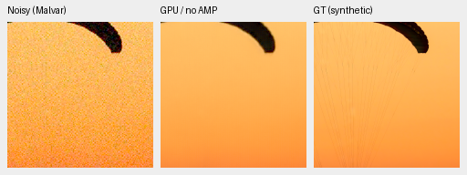
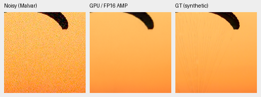
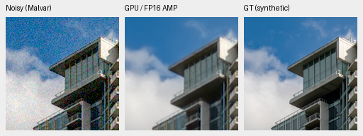
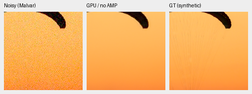
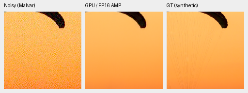
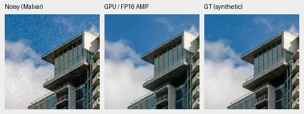
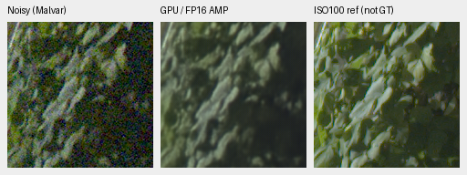
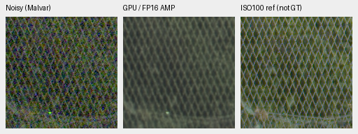
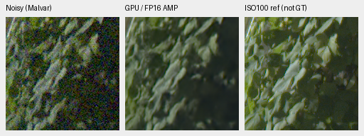
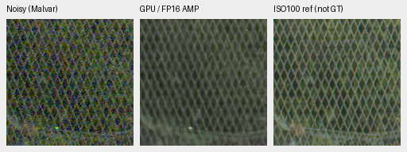

# Original RawForge GPU exports: selected native review

The original signed GPU exports support the earlier CPU pilot's conclusions
on these six observations. All twelve no-enclosing-autocast outputs pass the
**predeclared abs .002 + rel .002 × abs(CPU)** tolerance. All 24 new native
triplets were actually viewed. Neither model becomes the default: fine cords
are lost, JDD256 is soft, and JDD trades more mesh/foliage texture for grain.

[Complete original-output, normalization, score and crop receipts](results/rawforge-original-gpu-review.json).
[Publisher signatures, pinned registry and explicit CPU adaptation](rawforge-cpu-pilot.md).

The GPU checker loads the original signed TorchScript files without graph edits,
with the same twelve verified six-channel inputs. No new noise or RAW decode.
No-enclosing-autocast retains captured convolution TF32 flags, so it is not an
IEEE-FP32 reproduction. Publisher CUDA FP16 autocast is a separate mode; its
differences are retained descriptively, without declaring FP16 equality.

| Model | Mode | Native output | Maximum absolute difference from CPU port | Elements outside fixed bound |
| --- | --- | --- | ---: | ---: |
| JDD256 | no-enclosing-autocast | torch.float32 | 0.000223458 | 0 |
| JDD256 | publisher-FP16-autocast | torch.float16 | 0.001040339 | 0 |
| JDD | no-enclosing-autocast | torch.float32 | 0.000316322 | 0 |
| JDD | publisher-FP16-autocast | torch.float16 | 0.000951767 | 0 |

Every full raw-output array is retained. CPU rendering independently rebuilds
all 24 raw-drift scalar comparisons, checks nominal unit conversion against
float64 (maximum6.03e-8), and preserves exact common noisy/reference pixels in
all 48 panels. Independent NumPy64 PSNR checks cover 32 fields across both photo
ROIs. No network runs during rendering. Its helper also reproduces all 12 CPU
predictions and 36 native panels exactly. This verifies the selected numerical
contract; it does not reproduce every publisher serving path.

## Two fixed synthetic-photo scores

Scores use the original saved ROI [8,8,240,240], separate from native 160px
previews. Rows use the same CPU-generated observations as the previous pilot,
not the full427 suite's CUDA noise draws. Metrics are computed from unclipped
float outputs with the documented metric/display transforms. No target fitting.

| Model / GPU mode | Fabric PSNR / SSIM | Building PSNR / SSIM |
| --- | --- | --- |
| JDD256 / no-enclosing-autocast | 33.38153 / 0.936268 | 29.73179 / 0.909597 |
| JDD256 / publisher-FP16-autocast | 33.38192 / 0.936292 | 29.73135 / 0.909591 |
| JDD / no-enclosing-autocast | 35.05273 / 0.949556 | 29.61068 / 0.913827 |
| JDD / publisher-FP16-autocast | 35.05529 / 0.949529 | 29.61073 / 0.913793 |

Previously saved V43 CPU FP32 scores are 40.69080/.969061 and 35.20764/.968224
on those same observations/score ROI. Those are retained CPU baseline results,
not a new matched GPU-precision experiment. The earlier Malvar control witness,
source identities and score bridge remain linked above. Two selected photos
cannot support an aggregate benchmark ranking or uncertainty interval.

## Native noisy / denoised / GT triplets

Panels are 160×160 at one image pixel per PNG pixel; no resizing. Both models
and modes share ROI [48,48,160,160], RGGB, WB [2,1,1.5], original protocol matrix,
shot=.00256/read variance=.0000262144, ADC 16 / black .03 and display exposure×1.
The models are blind: no ISO/shot/read network input. Each receipt records the
original checkpoint SHA256 and exact output mode. PNGs are 8-bit sRGB previews;
scores use retained float32 arrays. Full weight/signature provenance is in the
linked CPU review. Photos: [Roy Egloff](https://commons.wikimedia.org/wiki/File:CH.VD.Villeneuve_2007-08-25_Vertigo-Swiss-Riviera_2392_3x2-R_4K.jpg)
and [Dietmar Rabich](https://commons.wikimedia.org/wiki/File:Vancouver_(BC,_Canada),_Coal_Harbour_Seaside_Park,_Blick_in_den_Himmel_--_2022_--_2158.jpg),
[CC BY-SA 4.0](https://creativecommons.org/licenses/by-sa/4.0/), modified by
binning, crop, simulated noise and restoration.

### JDD256 / no-enclosing-autocast

### JDD256 / publisher-FP16-autocast

### JDD / no-enclosing-autocast

### JDD / publisher-FP16-autocast

## Standing GFX foliage and chain-link fence

All four standing regions use the exact saved 512px contexts from DSCF3879,
with native ROI [176,176,160,160], common WB/matrix and display×4(+2EV).
Foliage corresponds to sensor[8890,5570,160,160]; fence[2240,6000,160,160].
ISO6400 input shot/read estimates describe the capture and are not blind-model
conditioning. The independently AHD-demosaiced DSCF3880 ISO100 f/5.6 capture is
**not GT**, differs in aperture/exposure/motion and is never scored or warped.
The publisher's global mean-black convention is retained despite differing
phase black levels; no fitted color correction. Originals/siblings stay
read-only and outside training. These 512px contexts do not reproduce JDD's
registered 768px serving geometry or a full 102MP prediction.

Both precision modes look very similar in these native previews. Both models lose fine parachute cords. JDD256 is soft on building/foliage/fence; JDD retains more texture and mesh with more grain, but thin fence crossings remain weak and foliage stays soft. No decisive new replacement for V43. Separate ISO100 is not GT.

## Complete native gallery

All 24 no-autocast/FP16 photo and sky/building/foliage/fence files are linked here.
Separate weight-license terms and reference training membership remain
unspecified. There is no broad real superiority, SOTA, training or full-frame
speed conclusion from this small comparison.

| Model / mode | Source | Native triplet |
| --- | --- | --- |
| JDD256 / no-enclosing-autocast | photo-0 | [100% PNG](images/rawforge-original-GPU-crop-ed77eb3532273611.png) |
| JDD256 / publisher-FP16-autocast | photo-0 | [100% PNG](images/rawforge-original-GPU-crop-333e4b9016292c32.png) |
| JDD256 / no-enclosing-autocast | photo-1 | [100% PNG](images/rawforge-original-GPU-crop-6046e0832b762189.png) |
| JDD256 / publisher-FP16-autocast | photo-1 | [100% PNG](images/rawforge-original-GPU-crop-b5d270fb7072458c.png) |
| JDD256 / no-enclosing-autocast | gfx-overcast-sky | [100% PNG](images/rawforge-original-GPU-crop-cca9bab0d7c1ff45.png) |
| JDD256 / publisher-FP16-autocast | gfx-overcast-sky | [100% PNG](images/rawforge-original-GPU-crop-7b119d5ce46db04d.png) |
| JDD256 / no-enclosing-autocast | gfx-building-detail | [100% PNG](images/rawforge-original-GPU-crop-e9ef29d19d762ea7.png) |
| JDD256 / publisher-FP16-autocast | gfx-building-detail | [100% PNG](images/rawforge-original-GPU-crop-21e6e8446cb57b56.png) |
| JDD256 / no-enclosing-autocast | gfx-foliage | [100% PNG](images/rawforge-original-GPU-crop-4b58ab09327a6f12.png) |
| JDD256 / publisher-FP16-autocast | gfx-foliage | [100% PNG](images/rawforge-original-GPU-crop-0637e9cc7cce43e1.png) |
| JDD256 / no-enclosing-autocast | gfx-chain-link-fence | [100% PNG](images/rawforge-original-GPU-crop-f61239b4b8a85000.png) |
| JDD256 / publisher-FP16-autocast | gfx-chain-link-fence | [100% PNG](images/rawforge-original-GPU-crop-8416627cefd47162.png) |
| JDD / no-enclosing-autocast | photo-0 | [100% PNG](images/rawforge-original-GPU-crop-a1fb735889f8dff2.png) |
| JDD / publisher-FP16-autocast | photo-0 | [100% PNG](images/rawforge-original-GPU-crop-c7128c187a26ef03.png) |
| JDD / no-enclosing-autocast | photo-1 | [100% PNG](images/rawforge-original-GPU-crop-50d90ebe8c03c782.png) |
| JDD / publisher-FP16-autocast | photo-1 | [100% PNG](images/rawforge-original-GPU-crop-3b3d792a832bdcc0.png) |
| JDD / no-enclosing-autocast | gfx-overcast-sky | [100% PNG](images/rawforge-original-GPU-crop-c25e1dbd1b6b0de2.png) |
| JDD / publisher-FP16-autocast | gfx-overcast-sky | [100% PNG](images/rawforge-original-GPU-crop-56c7d07e5379ff17.png) |
| JDD / no-enclosing-autocast | gfx-building-detail | [100% PNG](images/rawforge-original-GPU-crop-38617cc9241346b0.png) |
| JDD / publisher-FP16-autocast | gfx-building-detail | [100% PNG](images/rawforge-original-GPU-crop-944f8dca2e400ac6.png) |
| JDD / no-enclosing-autocast | gfx-foliage | [100% PNG](images/rawforge-original-GPU-crop-cea75dfc2e803146.png) |
| JDD / publisher-FP16-autocast | gfx-foliage | [100% PNG](images/rawforge-original-GPU-crop-fdc04c4ef0645371.png) |
| JDD / no-enclosing-autocast | gfx-chain-link-fence | [100% PNG](images/rawforge-original-GPU-crop-1f75830b9c40f349.png) |
| JDD / publisher-FP16-autocast | gfx-chain-link-fence | [100% PNG](images/rawforge-original-GPU-crop-e82dde962a3c2787.png) |
