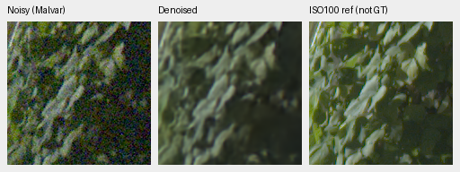
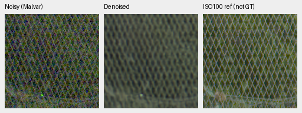

# Stronger RawNIND reference on the complete GFX frame

**The released pre-upsampled RawNIND now has a complete 101.996MP GFX output.**
V104 retains more regular fence wires; the stronger reference reduces the half
model's periodic blue-sign texture. Fine foliage remains soft across methods.
This strengthens the real-photo comparison without establishing a broad winner.

[Execution, original weights, RGB16 files, float ROIs and native review](results/rawnind-preupsample-full-GFX-review-v1.json).
The earlier [three-variant study](rawnind-variants.md) retains all camera scores
and selected synthetic-photo results; its GFX views used 512-pixel contexts.

Rows: noisy Malvar, V104, RawNIND half, RawNIND pre-upsampled, independent ISO100
reference. All thirty cells were viewed at original resolution. Each is a
160×160 sensor-pixel crop from a complete blended restoration, with no resizing.
The six fixed regions include sky, building, foliage, fence, blue/neon sign and
platform boundary. [All eighteen triplets and metadata](images/gfx-strong-fullframe/manifest.json).

## Native triplets

Noisy → **RawNIND pre-upsampled, full frame** → independent ISO100 reference.
The reference is not GT: aperture, exposure, motion and LED scan differ.
Shared display exposure is ×4 (+2EV), with the noisy capture's WB/matrix.
Shot .0014635775921166604 and read variance 1.0715704128646712e-6 come from
the same input Haar estimate used by the existing comparison.

Foliage uses noisy/reference sensor origin [8890,5570]. Fence uses [2240,6000]
for noisy and [2241,6000] for the independently captured reference. Both crops
are native160, at the original input/reference-only integer matching offsets.
All coordinates, conditioning and transforms remain in the manifest.

V104's mesh is thinner and more continuous; both external references produce
coarser, beaded structures. Pre-upsampled RawNIND removes much of the half model's
blue-sign grid, but the saturated sign and independently captured reference
cannot establish recovery of identical lettering. All methods still miss
fine leaf structure visible in the sharper f/5.6 reference. These remaining
weaknesses motivate continued joint-model training.

## Execution and preserved evidence

Only the stronger reference was run: CPU IEEE FP32, tile512/overlap64/B4,
520 tiles, 130 adapter calls and 520 upstream network calls. No joint-model
inference or CUDA was added. Both RAFs were read from the local cache;
original drives and files remain untouched. Both RawNIND variants use the
same input-only CFA-channel gain policy, with signed measurements preserved.
Their distinct weights and training histories remain separate.

| Method | Checkpoint SHA256 |
| --- | --- |
| V104 | `8a3a7d94f2b1465cbdddbeec201fb37a2f69b12c74f9298527a94e3a7bbf6300` |
| RawNIND half | `c1f7de3de24cb12f4803ee65e11cfb467e9a5b80c3cb7126746ef026106c15e0` |
| RawNIND pre-upsampled | `3d8d5fab966f790f4adbaf1786ca1ee81cb027d9cd45220787247b0af99fd814` |

The new linear/sRGB TIFFs are 8746×11662×3 uint16, completely hashed and reopened.
All six retained pre-encoding float ROIs match the linear16 export's quantized
samples exactly. The CPU observation took 263s during the ongoing GPU workflow;
it is recorded separately from earlier GPU timings.

The first board preparation found a one-DN8 difference in one sky-noise channel
between CPU and earlier CUDA previews. All twelve underlying noisy/reference
float arrays replay bit-exactly. This board uses one common CPU-rendered
noisy/reference preview for every method; the two derived older sky triplets
each change that one noisy channel. Restored pixels are untouched, no pixels
are resized, and original PNG/report bytes remain preserved. The manifest
records every original and derived hash. No neural inference was repeated.

This is a qualitative real-capture comparison with no pixelwise GFX score.
It supplements the measured camera panels and the exact-target photo tests.
