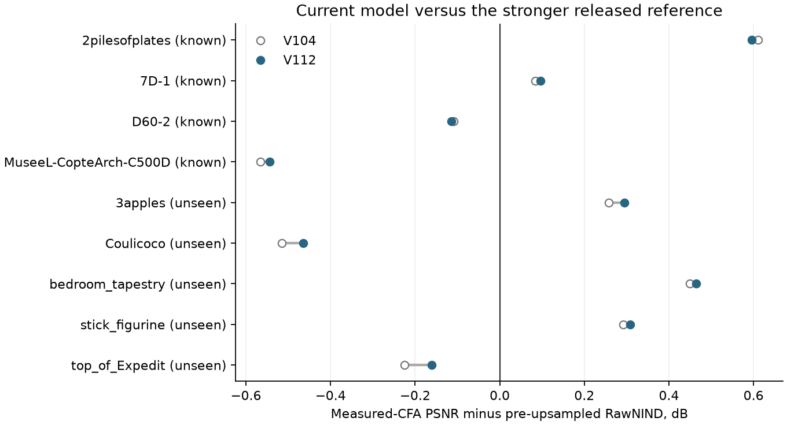
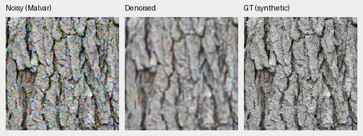
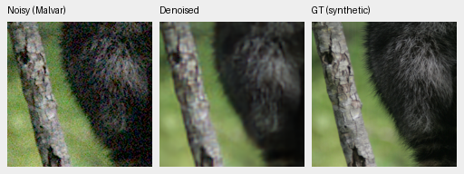

# Current RawNIND reference variants

**Current joint model: [V112](v112-quality.md).** The released-reference study below retains its original V104 controls and checkpoint-specific scores.

**The released pre-upsampled RawNIND is a stronger tested comparator than the
half-resolution variant used in our earlier reports.** It improves all 12
checked photographic cases and eight of nine development scene means.
Current V112 retains substantially more detail on the selected synthetic
photos, but its measured real-camera means remain close to this stronger
reference. It loses four of nine camera scene means; broad real-camera
superiority remains unproven.

The released width-48 model also finished the same observations and complete
camera panels. It scores below both width-32 references on all three photo
condition means and both camera panel means. Greater width alone did not help
this checkpoint; its different training history prevents a capacity-only conclusion.

[Current three-variant executions, audits and native evidence](results/rawnind-three-variants-current-v1.json) ·
[Earlier half/pre-upsampled execution](results/rawnind-preupsample-current-v1.json).
Historical RawNIND scores retain their original half-resolution checkpoint;
the four-source photographic pilot below does not replace its full427 results.

## Matched observations and scores

All three references use the authors' original UtNet2, four packed Bayer planes
and LeakyReLU. The original and pre-upsampled models have 32 starting channels;
the wider model has 48. The half-resolution networks upsample at
their PixelShuffle output heads. The alternative bilinearly upsamples the four
input planes before the CNN and uses a three-channel output head. Different
weights and training histories mean this is not an isolated architecture ablation.

Four previously selected material sources, original 240-pixel interiors,
three original noise draws/conditions, rendered sRGB PSNR:

| Condition | V112 | V104 | RawNIND half | RawNIND pre-upsampled | RawNIND width48 |
| --- | ---: | ---: | ---: | ---: | ---: |
| ADC-only | **39.74086** | 39.49290 | 27.60011 | 28.13487 | 27.02694 |
| ISO100 prior | **40.90266** | 40.80494 | 27.59567 | 28.12808 | 27.02605 |
| ISO12800 prior | **33.51165** | 33.49300 | 27.11000 | 27.59760 | 26.73293 |

The alternative gains about .49–.53 dB over the half-resolution model, with
all 12 cases improving. V104 also beats the alternative in all 12. This is a
four-source material diagnostic, not a new 427-photo/seven-condition mean.
V112 also improves all twelve cases over the stronger reference; the original
V104 metric rows replay exactly across the two execution sets.
[Current native comparison](heldout-detail.md#v112-versus-the-stronger-released-rawnind-reference).

The **complete** original camera development panels use 72 known-scene crops
and 90 unseen-scene crops, 448-pixel scoring interiors, measured registered
low-ISO CFA references and source-balanced means:

| Method | Known4 CFA PSNR | Unseen5 CFA PSNR |
| --- | ---: | ---: |
| V102 | 54.23709 | 53.97177 |
| V104 | 54.26606 | 53.91700 |
| **V112** | **54.26914** | **53.95378** |
| RawNIND half | 54.08474 | 53.76822 |
| RawNIND pre-upsampled | 54.26068 | 53.86528 |
| RawNIND width48 | 53.98802 | 53.66548 |

Pre-upsampled minus half is **+.17594 dB** on known scenes, source-bootstrap
95% interval [+.11324,+.23672], improving 4/4 scenes. On unseen scenes it is
**+.09707 dB**, interval [+.00655,+.17382], improving 4/5; top_of_Expedit declines
.07039 dB. V104 minus the alternative is only +.00539/+.05172 dB on the two
panels, with intervals [−.40295,+.43126]/[−.29569,+.34782] spanning zero.
These intervals describe this fixed small source set, not training-seed uncertainty.

Width48 minus half is −.09671/−.10273 dB on known/unseen panels, with all nine
scene means declining. Width48 minus pre-upsampled is −.27265/−.19980 dB,
intervals [−.30529,−.24002]/[−.31024,−.06174], with eight of nine scenes declining.
The wider checkpoint does not replace the stronger pre-upsampled comparator.

## Current V112 camera comparison

V112 minus pre-upsampled RawNIND is **+.00846dB known / +.08850dB unseen**,
with 2/4 and 3/5 scene means improving. Exact empirical scene-resampling95%
intervals are [−.38377,+.41835] and [−.24883,+.36799]. These enumerate all
4⁴/5⁵ resamples of the fixed small scene sets; they do not measure training-seed
uncertainty or establish a general winner.



Each point averages nine crops per noisy capture, two captures per scene.
Known/unseen refer to our training membership. V112 still loses on D60-2
(−.11473dB), MuseeL-CopteArch-C500D (−.54382), LucieB_Coulicoco (−.46431)
and LucieB_top_of_Expedit (−.16024). Its larger gains on plates, tapestry and
other scenes do not remove those weaknesses. These four scenes remain useful
checks for the active Tiny/Small comparison, whose endpoint archives retain
every numerical prediction for later native review.

[All scene values and standalone SVG](images/current-detail-reference/camera-figure.json) ·
[Score/input joins and independent checks](results/v112-strong-reference-current-v1.json).
The review joins all162 original crop scores with matching prepared manifests,
scene/capture/tile/ISO/CFA identities and reference-sample counts. All162 original
V104 control rows replay exactly. V112 full-camera float predictions were not
retained in that older evaluation, so this recomputes aggregation rather than
metric definitions from float arrays. It adds no neural inference or new scores.

The subsequent [adverse-output and isolated-repair audit](camera-outliers.md)
finds one green outlier accounts for 67% of V112 error in the worst selected
museum field. Repair shrinks that crop's gap from 4.70 to .07 dB with the same
corrected input for both methods. Some M100 reference-supported points also
recur at fixed sensor coordinates across unrelated scenes. Original scores
here remain unchanged; those deficits cannot all be interpreted as ordinary
noise/detail loss or genuine scene-detail regressions.

“Unseen” means held out from **our** training. External-model training membership
and overlap remain unproven. Neither these means nor this source set establish
a broad real-camera winner or SOTA result. The protected 16-scene reserve
remains unscored.

## Native photographic triplets

Noisy Malvar → **RawNIND pre-upsampled** → exact synthetic GT. Each panel is an
unchanged 160×160 crop at [48,48,160,160] inside its original native 256 context.
The ISO12800 physical shot/read coefficients, source/cache coordinates, WB,
camera matrix and common display exposure ×1 remain identical across methods.
The reference is exact for the declared synthetic observation. PNGs are RGB8
previews; scores use the unquantized float outputs.





[V104 and all three RawNIND variants, native comparison](images/rawnind-three-variants-current/photo/comparison.png) ·
[Source/ROI/checkpoint/noise/display and license metadata](images/rawnind-three-variants-current/photo/manifest.json).
Bark derives from Derek Ramsey (CC BY-SA 2.5), fur from Korall (CC BY 3.0);
binning, simulated noise, restoration and cropping are recorded modifications.

The alternative improves bark contours and fur modestly over the half-resolution
model. Width48 remains soft and coarse on these same bark/fur crops. All three
remain visibly softer than V104 on these exact-target examples;
V104 itself still misses some fine hairs and bark texture.

## Real captures

[All six standing GFX regions](images/rawnind-three-variants-current/gfx/comparison.png)
compare noisy Malvar, V104 and all three RawNIND variants with the independent
DSCF3880 ISO100 reference. These are **512-pixel context restorations**, not new
102MP outputs. Each displayed cell is native 160, with common +2EV display.
The reference differs in aperture, exposure, motion and time and is **not GT**.
[GFX source/ROI/noise/display metadata](images/rawnind-three-variants-current/gfx/manifest.json).

V104 retains more regular mesh and building edges. The alternative is slightly
less coarse than half around some sign/rail structures, but foliage remains
soft. Saturated-light differences are also limited by clipping in this shared
display. Width48 still has coarse/moire-prone fence mesh and a more conspicuous
periodic grid/grain in the blue sign than pre-upsampled. These views do not
establish a broad real-photo ordering.

The [complete pre-upsampled GFX restoration](rawnind-fullframe.md) now supplements
these context views. It uses the same six native regions and CFA-channel policy;
V104 retains more regular mesh, and fine foliage remains unresolved. Its full
RGB16 exports and retained float crops are separate from the earlier pilot.

The [two adverse Canon EOS M100 fields](images/rawnind-three-variants-current/camera/comparison.png)
retain the source and ROI selection made before evaluating the new variant.
The half and pre-upsampled variants are smoother and score higher than V104 on those
specifically selected dark crops. Pre-upsampled versus half is mixed there:
58.98999 versus 58.92127 dB on Coulicoco, 62.07481 versus 62.08642 on top_of_Expedit.
The AHD display reference is auxiliary, **not exact RGB GT**.
[Camera source/ROI/checkpoint/display records](images/rawnind-three-variants-current/camera/manifest.json).

## Use a tested reference

The standard loader detects width and upsampling position from the checkpoint
and strictly loads every tensor. Evaluator receipts record the detected model
configuration and checkpoint hash. Download a separately pinned variant with:

```bash
source scripts/env.sh
PYTHONPATH=src uv run python scripts/fetch_rawnind.py --variant preupsample
```

Pass `/mnt/external/demosaic/references/rawnind-preupsample` to existing
`--rawnind` options. `--variant wide48` selects the wider checkpoint;
`--output PATH` selects another cache directory. The default remains the
historical half-resolution checkpoint. Each directory uses the canonical
`utnet2-bayer.pt` filename; existing mismatched weights or provenance are rejected.

## Checkpoints and verification

The [authors' source and weight terms](https://github.com/trougnouf/rawnind_jddc/tree/e80fb7b14dc440bba38c01f312fd3cc02deb566c)
and [model definitions](https://github.com/trougnouf/rawnind_jddc/blob/e80fb7b14dc440bba38c01f312fd3cc02deb566c/src/rawnind/config/graph_denoise_models_definitions.yaml)
are pinned. Source is GPL-3.0; weights are offered under GPL-3.0 and CC BY 4.0.
The alternative's exact file ID is verified through the model-folder hierarchy
linked by the author README. Publisher arguments confirm preupsample=true,
four inputs, width 32, disabled transfer function and output-gain matching.

| Reference | Released iteration | Checkpoint SHA256 |
| --- | ---: | --- |
| Half | 4,350,000 | `c1f7de3de24cb12f4803ee65e11cfb467e9a5b80c3cb7126746ef026106c15e0` |
| Pre-upsampled | 4,320,000 | `3d8d5fab966f790f4adbaf1786ca1ee81cb027d9cd45220787247b0af99fd814` |
| Width48 | 5,985,000 | `a13db60df69de2e107a9470bd419dbcc1bb4861f37e7127159f7ed774dc4ea99` |

The separately cached alternative is
`/mnt/external/demosaic/references/rawnind-preupsample-20261023-v1/utnet2-bayer-preupsample.pt`.
Its SHA256 pins the observed downloaded bytes; the provider-returned
31,057,675-byte size is verified. It is not a separately published SHA256 claim.
All 46 tensors load strictly, with 7,760,451 parameters and no random fallback.
The width48 checkpoint has 17,457,948 parameters and 69,848,070 bytes;
its publisher arguments confirm width48 and preupsample=false.

All variants preserve signed input samples, use recorded publisher global-ADC
normalization and fit gains only to the noisy CFA channels. No model sees the
clean reference or consumes an explicit shot/read prior. The half model's four
pilot camera outputs replay earlier floats exactly; all 162 full-panel CPU
controls agree with the previous CUDA primary PSNR within .0000496 dB.
Four-CFA native 64 checks have identical canonical network inputs, repeated
outputs are exact and inverse-flip differences stay below 1.8e-7.

The original two-variant study contains 378 reference-network forwards. This
extension adds only 189 width48 forwards: five native64 functional checks,
22 pilot images and all 162 camera crops. Earlier controls are reused without
inference. Neither study adds V104 inference, training or RAW decodes.
Independent NumPy64 checks rebuild 554 joined reference score rows, including
overlapping pilot/full observations, and 1,656 channel-gain normal equations.
All 126 native panels reproduce from saved floats; all 62 distinct board cells
were actually viewed. Standard-loader validation separately replays one native256
observation byte-exactly for each genuine checkpoint, confirms cache reuse
without downloads and preserves the legacy loader's constructor RNG/state.
Source snapshots and existing machine evidence retain their bytes.

At execution, training and the V104 selector were unchanged. V112 is now selected. Retain this stronger
tested reference in additional quality comparisons while preserving historical
half-resolution scores. Other released variants remain untested here;
this is not an exhaustive ranking of the published variants.
