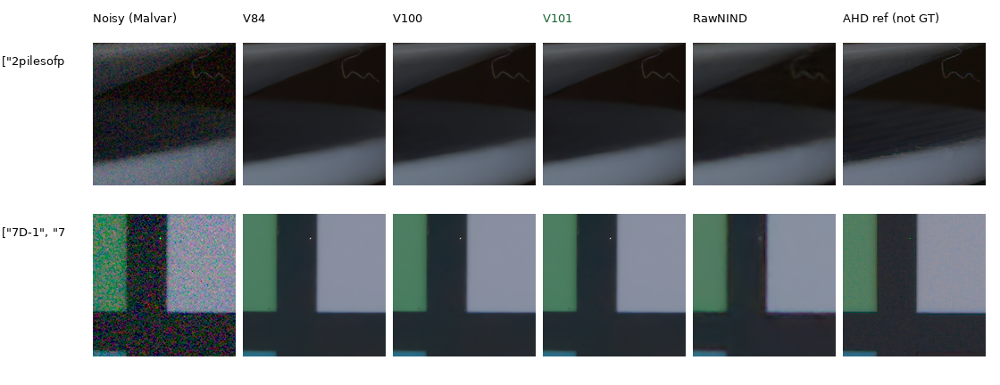
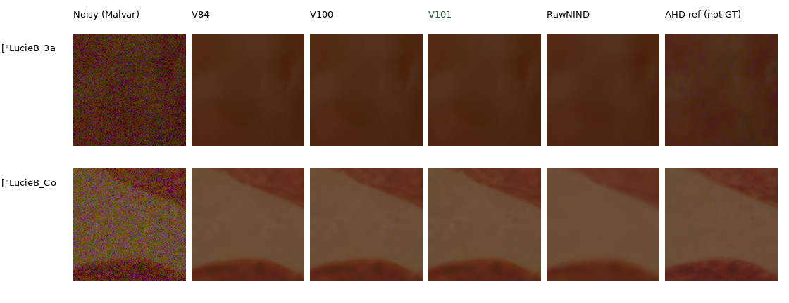

# Current real-camera quality

**V101 keeps measured-CFA means close to V84 while improving the photographic
panel.** Its known4 change is +.00282dB and unseen5 change is −.00488dB; both
scene intervals include zero. V100 has a small known gain and a clearer unseen
loss. Native learned outputs look close, with low-amplitude detail still smoothed.
[Current checkpoint choice](current-model.md) · [Full continuation study](v84-curated-quality-review.md).

| Development panel | Method | Measured-CFA PSNR | Auxiliary AHD RGB PSNR | AHD SSIM |
| --- | --- | ---: | ---: | ---: |
| Known4 | V84 | 54.17122 | 40.03507 | 0.932059 |
| Known4 | V100 | 54.17846 | 40.04376 | 0.932116 |
| Known4 | **V101** | 54.17404 | 40.04254 | 0.932157 |
| Known4 | RawNIND channel | 54.08474 | 39.71710 | 0.928831 |
| Known4 | RawNIND global | 54.06860 | 39.67805 | 0.928811 |
| Unseen5 | V84 | 53.92823 | 38.86148 | 0.924142 |
| Unseen5 | V100 | 53.89614 | 38.82767 | 0.923695 |
| Unseen5 | **V101** | 53.92334 | 38.83063 | 0.923922 |
| Unseen5 | RawNIND channel | 53.76822 | 38.56191 | 0.922127 |
| Unseen5 | RawNIND global | 53.56220 | 38.14484 | 0.918380 |

These are matched CUDA IEEE FP32 results, B2, on all 72 known and 90 unseen
prepared native512 crops: 8/10 noisy captures across 4/5 scenes. Means balance
crops within capture, captures within scene, then scenes. Both RawNIND gain
variants fit observed noisy CFA only and preserve signed/unclipped publisher
input normalization. Primary references are measured low-ISO CFA after shared
registration/gain. Auxiliary calibrated AHD RGB is **not exact RGB GT**.

[Complete source means, intervals, checkpoint hashes and independent row audit](results/v84-curated-quality-primary-statistics-v1.json).
The prior [V84/V100 CPU report](results/current-real-camera-V84-V100-CPU-v1.json)
remains unchanged; the current table uses the completed three-model CUDA study.

## Changes across scenes

| Panel / scene | V100−V84 CFA PSNR | V101−V84 CFA PSNR |
| --- | ---: | ---: |
| known / 2pilesofplates | +0.05620 | +0.03587 |
| known / 7D-1 | -0.01766 | -0.02926 |
| known / MuseeL-CopteArch-C500D | -0.00116 | +0.01263 |
| known / D60-2 | -0.00845 | -0.00798 |
| unseen / LucieB_3apples | -0.00962 | +0.01430 |
| unseen / LucieB_Coulicoco | -0.06802 | -0.10289 |
| unseen / LucieB_bedroom_tapestry | -0.04142 | -0.03418 |
| unseen / LucieB_stick_figurine | -0.00480 | +0.07215 |
| unseen / LucieB_top_of_Expedit | -0.03659 | +0.02620 |

V101−V84 known4 change has a scene-bootstrap 95% interval [−.01878,+.02491]dB;
unseen5 is [−.05601,+.04220]dB. Two known and three unseen scenes improve.
The unseen Coulicoco change is −.10289dB; the stick figurine gains +.07215dB.
V101 recovers most of V100's unseen loss, but auxiliary AHD RGB PSNR/SSIM still
fall on the unseen mean. These mixed effects remain visible alongside the
widespread synthetic-photo gain.

Known/unseen names refer to this project's camera-development panels. RawNIND
may have trained on development scenes. Small scene counts and different
training histories do not establish broad real-photo superiority or SOTA.
The [publisher test reserve](paired-reserved-test.md) remains unscored and
outside model selection.

## Native comparisons

Columns: noisy Malvar, V84, V100, **V101**, RawNIND channel and AHD reference.
Every cell is an unchanged 160×160 sensor-pixel crop. Shared coordinates, WB,
matrix, exposure ×1 and noisy/reference pixels match exactly across methods.
Open the original PNG at 100%; previews are RGB8, metrics use float predictions.

Known-camera examples at ISO12800 show plate boundaries and color patches.
The learned models preserve a clearer thin curve than RawNIND, with soft
surfaces and boundaries remaining. The checkpoints look close.



[Known source triplets, full weights, noise and ROI records](images/current-quality-v101/known/manifest.json).

Unseen examples are LucieB_3apples at ISO6400 and LucieB_Coulicoco at ISO12800.
The learned outputs retain more low-amplitude variation than RawNIND in the
second crop. The AHD reference also retains noise; every visible fluctuation
cannot be assumed to be true texture.



[Unseen source triplets, full weights, noise and ROI records](images/current-quality-v101/unseen/manifest.json).
All 24 cells on these two boards were actually viewed and checked against the
copied source triplets without resizing. Two triplets per learned checkpoint
per panel are provided, with real references labeled accurately.

## Reproduction and scope

Final EMAs are V84 original20000 and V100/V101 continuation10000. Full SHA256s
are in the [continuation report](v84-curated-quality-review.md#checkpoints-and-next-work)
and every crop sidecar. No intermediate checkpoint search selected these endpoints.
RawNIND weights: `c1f7de3de24cb12f4803ee65e11cfb467e9a5b80c3cb7126746ef026106c15e0`.

Metrics use the [32,32,448,448] interior of each prepared 512 context; displayed
crops use [176,176,160,160]. Noise is the existing per-capture input-only Haar fit
or disclosed ISO fallback, with exact coefficients in each triplet. No per-method
reference exposure fit is performed.

After sourcing `scripts/env.sh`, rerun into a fresh directory:

```bash
uv run --no-sync python scripts/evaluate_paired_raw.py \
  /mnt/external/demosaic/models/v84-original20000.pt \
  /mnt/external/demosaic/v84-curated-quality-20261022-v2/train/V100/last.pt \
  /mnt/external/demosaic/models/v101-final10000.pt \
  --prepared /mnt/external/demosaic/evaluation/paired-raw-development-prepared-v1/manifest.json \
  --rawnind /mnt/external/demosaic/references/rawnind \
  --device cuda --precision float32 --batch-size 2 \
  --output /mnt/external/demosaic/V101-camera-replay-known
```

Use `paired-unseen-development-prepared-v1/manifest.json` for unseen5. The
completed job uses the copied numerical source in
`.cache/current-quality-20261022-v1/evaluation-queue-v1/work/`.
Outputs: `/mnt/external/demosaic/v84-curated-evaluation-20261022-v1/{known,unseen}/`.
Independent aggregation reproduces every reported hierarchical mean from all
1,296 case rows across both panels. Inputs/weights remain unchanged and both
stage owners exited successfully before publication. Full-frame GFX operation
is evaluated separately.

Images: [Raw Natural Image Noise Dataset](https://doi.org/10.14428/DVN/DEQCIM),
Benoit Brummer and Christophe De Vleeschouwer (2025),
[CC BY-SA 4.0](https://creativecommons.org/licenses/by-sa/4.0/).
`7D-1`: Peter Wemmert, CC0, per cached `permissions.txt`.
Modifications are cropping, display conversion and restoration.
