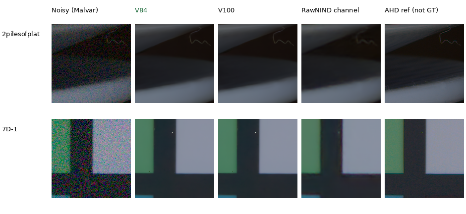
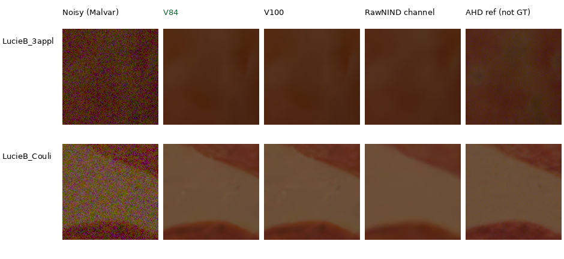

# Current real-camera quality

The completed V84/V100 CPU comparison shows a **small known-camera mean gain
and an unseen-camera mean loss** after the V100 continuation. Their native
outputs look close. The full photographic/GFX comparison with V101 is still
pending; use these results alongside the [natural-detail examples](heldout-detail.md)
and [current model guide](current-model.md).

| Development panel | Method | Measured-CFA PSNR | Auxiliary AHD RGB PSNR | AHD SSIM |
| --- | --- | ---: | ---: | ---: |
| Known4 | V84 | 54.17122 | 40.03507 | .932060 |
| Known4 | V100 | 54.17845 | 40.04376 | .932116 |
| Known4 | RawNIND global | 54.06859 | 39.67805 | .928811 |
| Known4 | RawNIND channel | 54.08474 | 39.71710 | .928832 |
| Unseen5 | V84 | 53.92822 | 38.86148 | .924142 |
| Unseen5 | V100 | 53.89614 | 38.82767 | .923695 |
| Unseen5 | RawNIND global | 53.56220 | 38.14484 | .918380 |
| Unseen5 | RawNIND channel | 53.76822 | 38.56191 | .922127 |

These are fresh CPU FP32 results, B2, on all 72 known-camera and 90 unseen-camera
prepared crops: 8/10 noisy captures across 4/5 scenes. Means balance crops within
capture, captures within scene, then scenes. Both RawNIND gains fit observed
noisy CFA only. Its publisher ADC normalization preserves signed/unclipped input.
Primary references are measured low-ISO CFA after shared registration/gain;
the auxiliary calibrated AHD RGB is **not exact RGB GT**.

[Complete scores, scene changes, intervals and viewed crops](results/current-real-camera-V84-V100-CPU-v1.json).

## Changes across scenes

V100−V84 measured-CFA PSNR is +.00723 dB on known4, with a scene-bootstrap
95% interval [−.01354,+.04003]. The plate scene improves +.05620 dB; the other
three fall by .00116–.01766 dB. On unseen5, all five scene means fall:
overall −.03209 dB [−.05112,−.01212], with individual changes from −.00480
to −.06802 dB. Auxiliary RGB PSNR and SSIM also decrease on the unseen mean.

The continuation therefore has mixed real-camera effects alongside its small
gains on the four selected synthetic-photo contexts. It changes the cohort,
optimizer state and training budget relative to V84; this does not isolate a
cleaning-only effect. V100/V101 share their initializer, cohort and schedule
for the planned comparison of the complete fine-detail package.

Known/unseen names refer to this project's camera-development panels. RawNIND
may have trained on development scenes. These small scene counts and separate
training histories do not establish broad real-photo superiority or SOTA.
The [prepared publisher test reserve](paired-reserved-test.md) remains unscored
and outside model selection.

## Native comparisons

Every cell is an unchanged 160×160 sensor-pixel crop. Noisy, restored and AHD
reference pixels use identical coordinates, WB, matrix and ×1 display exposure.
Open the original PNG at 100% if the browser scales it. All methods share the
same noisy/reference pixels; PNGs are RGB8 previews of floating-point evaluation.

Known-camera examples, ISO 12800: plate edges/curved feature and color patches.
V84/V100 look close, with a clearer thin curve than RawNIND on the plate crop.
Soft boundaries and broad smooth regions remain.



[Known source triplets, weights, noise and ROI records](images/current-real-quality/known/manifest.json).

Unseen-camera examples: LucieB_3apples at ISO 6400 and LucieB_Coulicoco at
ISO 12800. The learned models retain more low-amplitude spatial variation in
Coulicoco than RawNIND. V84 and V100 remain close. The AHD reference retains
noise, so these views do not prove every retained fluctuation is true texture.



[Unseen source triplets, weights, noise and ROI records](images/current-real-quality/unseen/manifest.json).
All 16 source triplets, including both RawNIND gain variants, are retained.
Both original review boards were actually viewed: 24 native cells. The two
published layouts repeat 20 of those cells without resizing.

## Reproduction and scope

The fixed final EMAs are V84 original20000 and V100 continuation10000,
without intermediate/best-checkpoint selection. SHA256s:

- V84: `134887e12357aabf420cceee3ee53fc8832cf02a8f81ff883b829a9e51e16f10`.
- V100: `4b689fb187b13df72fbf79ebd46f98cf7361c3ca8a97fb1f7afee940b249ad3e`.
- RawNIND: `c1f7de3de24cb12f4803ee65e11cfb467e9a5b80c3cb7126746ef026106c15e0`.

Metrics use the [32,32,448,448] interior of each prepared 512-pixel context. Display
uses its [176,176,160,160] center. Conditioning is the existing per-capture
input-only Haar fit or disclosed ISO fallback; full coefficients are in each
triplet's metadata. No reference exposure fitting is performed per method.

After sourcing `scripts/env.sh`, run the CPU evaluator into a fresh directory:

```bash
uv run --no-sync python scripts/evaluate_paired_raw.py \
  /mnt/external/demosaic/models/v84-original20000.pt \
  /mnt/external/demosaic/v84-curated-quality-20261022-v2/train/V100/last.pt \
  --prepared /mnt/external/demosaic/evaluation/paired-raw-development-prepared-v1/manifest.json \
  --rawnind /mnt/external/demosaic/references/rawnind \
  --device cpu --precision float32 --batch-size 2 \
  --output /mnt/external/demosaic/V100-camera-CPU-replay-known
```

Use `paired-unseen-development-prepared-v1/manifest.json` for the other panel.
The completed job used the copied numerical implementation from
`.cache/current-quality-20261022-v1/evaluation-queue-v1/work/`.
Results: `/mnt/external/demosaic/V100-camera-CPU-20261022-v1/`.
The independent check rebuilds all 84 hierarchical means from 1,134 per-crop
records. Inputs, weights and source files stay unchanged; the evaluator exited
successfully before this report. This CPU comparison does not replace the
queued full V84/V100/V101 GPU study or full-frame measurements.

Images: [Raw Natural Image Noise Dataset](https://doi.org/10.14428/DVN/DEQCIM),
Benoit Brummer and Christophe De Vleeschouwer (2025),
[CC BY-SA 4.0](https://creativecommons.org/licenses/by-sa/4.0).
`7D-1` is credited to Peter Wemmert under CC0 in the cached `permissions.txt`.
Panels are modified by crop, display conversion and restoration.
