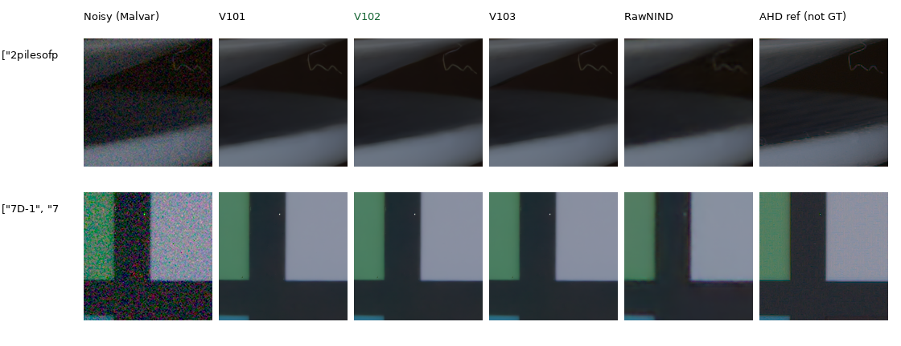
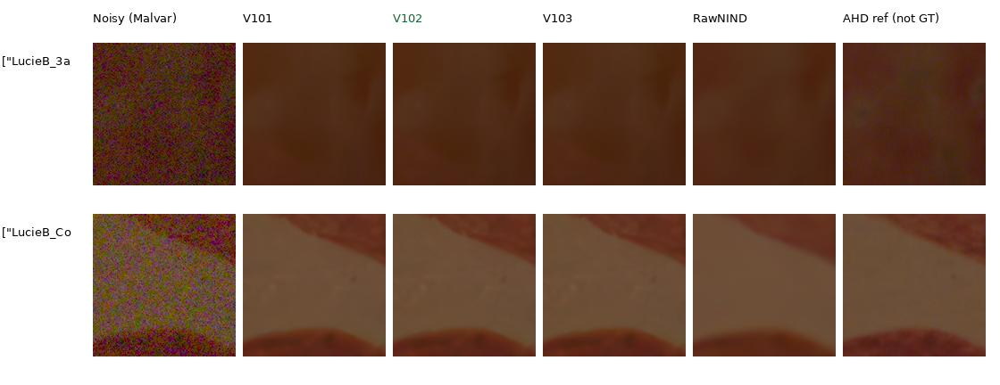

# Current real-camera quality

**V102 raises both measured-CFA panel means over V101.** Known4 gains+.06305dB
[+.03502,+.09108], with all four scenes improving; unseen5 gains+.04843dB
[−.00231,+.11316], with three scenes improving and two declining. V103 is close,
with slightly lower CFA means and a higher auxiliary unseen AHD RGB mean.
[Current choice](current-model.md) · [Completed results](v102-v103-quality-review.md).

| Panel | Method | Measured-CFA PSNR | Auxiliary AHD RGB PSNR | AHD SSIM |
| --- | --- | ---: | ---: | ---: |
| Known4 | V101 | 54.17404 | 40.04254 | 0.932157 |
| Known4 | **V102** | 54.23709 | 40.07688 | 0.932273 |
| Known4 | V103 | 54.22003 | 40.07217 | 0.932287 |
| Unseen5 | V101 | 53.92334 | 38.83063 | 0.923922 |
| Unseen5 | **V102** | 53.97177 | 38.84229 | 0.923933 |
| Unseen5 | V103 | 53.96410 | 38.85855 | 0.924147 |

These matched CUDA IEEE FP32/B2 results cover all72 known and90 unseen prepared
native512 crops:8/10 noisy captures across4/5 scenes. Means balance crops within
capture,captures within scene,then scenes. Primary references are measured
low-ISO CFA after shared registration/gain. Auxiliary independently processed
AHD RGB is **not exact RGB GT**. RawNIND uses input-only CFA gain and signed,
unclipped publisher normalization. [All eight methods,source means,intervals
and independent1,296-row audit](results/v101-detail-diversity-primary-statistics-v1.json).

## Scene changes

| Panel / scene | V102−V101 CFA PSNR | V103−V101 CFA PSNR |
| --- | ---: | ---: |
| known / 2pilesofplates | +0.09365 | +0.11463 |
| known / 7D-1 | +0.03280 | +0.01754 |
| known / MuseeL-CopteArch-C500D | +0.03724 | +0.02709 |
| known / D60-2 | +0.08851 | +0.02468 |
| unseen / LucieB_3apples | +0.06914 | +0.06932 |
| unseen / LucieB_Coulicoco | -0.01392 | -0.01269 |
| unseen / LucieB_bedroom_tapestry | -0.00046 | -0.01297 |
| unseen / LucieB_stick_figurine | +0.17019 | +0.13526 |
| unseen / LucieB_top_of_Expedit | +0.01721 | +0.02486 |

V102's known AHD chroma/gradient means rise slightly despite its higher CFA and
AHD PSNR. V103 has a higher unseen auxiliary AHD RGB mean than V102, while its
measured-CFA mean is lower. These mixed diagnostics remain visible alongside
the primary gains. Small scene counts and different training histories do not
establish broad real-photo superiority or SOTA. Known/unseen refer to this
project's development panels; RawNIND may have trained on development scenes.
The [publisher test reserve](paired-reserved-test.md) remains unscored and outside selection.

## Native comparisons

Columns:noisy Malvar,V101,**V102**,V103,RawNIND channel,AHD reference(not GT).
Each cell is160×160 original sensor pixels, with identical coordinates,WB,
matrix and exposure×1. Shared noisy/reference pixels match exactly. All24
native board cells were actually viewed; outputs remain close, with weak detail
still soft. Plate boundaries and fine curves remain clearer than RawNIND here.
The apples/cloth AHD reference retains noise, so fluctuations cannot all be
assumed to be true scene texture. PNGs are RGB8; metrics use float predictions.

[Known source triplets,checkpoint hashes,noise and ROI records](images/current-quality-v102-v103/known/manifest.json).

[Unseen source triplets,checkpoint hashes,noise and ROI records](images/current-quality-v102-v103/unseen/manifest.json).

## Reproduction and earlier evidence

The original20k V102/V103 final EMAs and parent V10110k were evaluated without
an intermediate checkpoint search. [Exact weights and complete review](v102-v103-quality-review.md).
Metrics use[32,32,448,448] interiors of prepared512 contexts; displayed crops
use[176,176,160,160]. Noise is per-capture input-only Haar fitting or the disclosed
ISO fallback; coefficients accompany every triplet. No per-method reference
exposure fit is performed. The completed frozen runner is under
`.cache/current-quality-20261022-v1/detail-diversity-evaluation-v1/`;
outputs are`/mnt/external/demosaic/v101-detail-diversity-evaluation-20261022-v1/{known,unseen}/`.

The earlier [V84/V100/V101 study](v84-curated-quality-review.md) and
[CPU V84/V100 receipt](results/current-real-camera-V84-V100-CPU-v1.json) retain
their measurements and images. Complete GFX output is evaluated separately
using an independent qualitative reference, with no pixelwise scores.

Images:[Raw Natural Image Noise Dataset](https://doi.org/10.14428/DVN/DEQCIM),
Benoit Brummer and Christophe De Vleeschouwer(2025),
[CC BY-SA4.0](https://creativecommons.org/licenses/by-sa/4.0/).
7D-1:Peter Wemmert,CC0,per cached permissions. Modifications:cropping,display
conversion and restoration.
