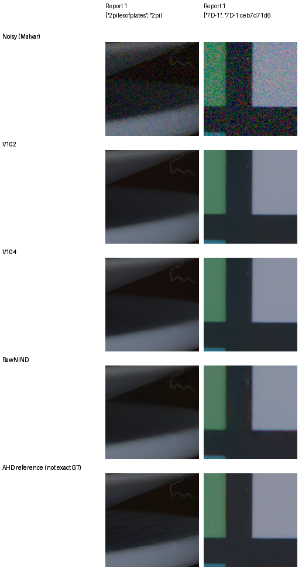
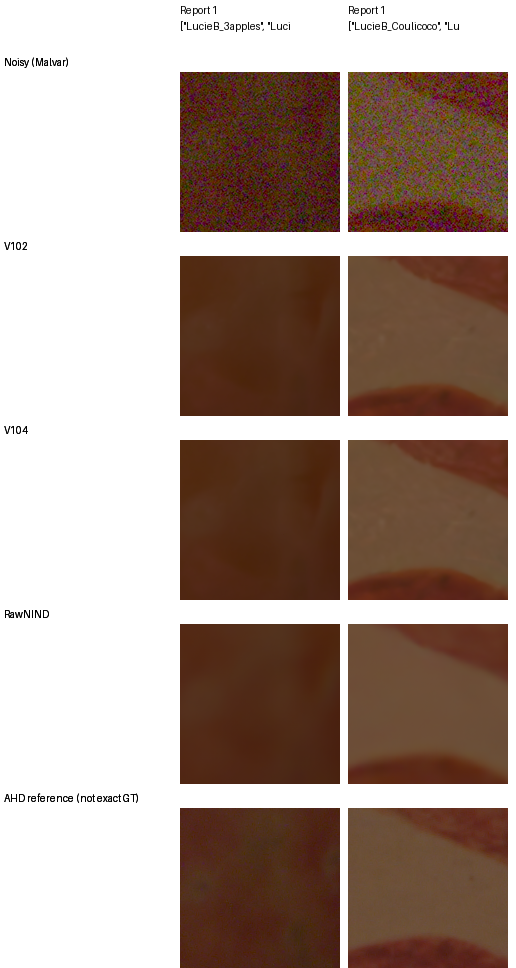
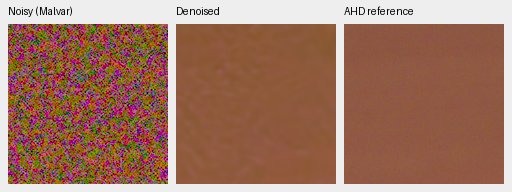
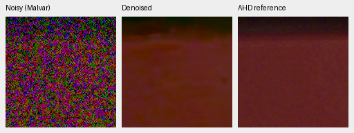

# Current real-camera quality

**V111 recovers part of V104's unseen-camera loss, with a small known-scene
tradeoff.** V111−V104 is −.01336dB known and+.02006dB unseen; all five unseen
scene means improve. V102 still has the higher unseen mean, and selected dark
fields remain worse than the stronger RawNIND-preup reference. [V111's complete
camera results and native views](v111-early-quality.md#complete-development-camera-panels).

The optional [eight-view V104 pilot](dihedral-quality.md#adverse-real-camera-crops)
improves the two original adverse crop scores by .313/.267dB. Both retain
colored blotches and remain below RawNIND pre-upsampled. These selected crop
scores are separate from the complete scene-balanced panels below.
[Current model choices](current-model.md) ·
[V104 results and native photo triplets](v104-reviewed-corpus-quality.md).

| Panel | Method | Measured-CFA PSNR | Auxiliary AHD RGB PSNR | AHD SSIM |
| --- | --- | ---: | ---: | ---: |
| Known4 | V102 | 54.23709 | 40.07688 | .932273 |
| Known4 | V104 | **54.26606** | **40.10615** | .932371 |
| Known4 | V111 | 54.25270 | 40.10536 | .932408 |
| Unseen5 | V102 | **53.97177** | **38.84229** | .923933 |
| Unseen5 | V104 | 53.91700 | 38.78090 | .923041 |
| Unseen5 | V111 | 53.93706 | 38.81689 | .923736 |

The V104−V102 known CFA change is +.02897dB, with a scene-bootstrap 95% interval
[−.01271, +.06782]. The unseen change is −.05477dB [−.13994, +.01515]. These
intervals describe sampled scenes rather than training-seed uncertainty.

V111−V104 source-bootstrap95% intervals are[−.02103,+.00130] known and
[+.00869,+.03304] unseen, with1/4 and5/5 scene means improving. New V111 rows
use CPU IEEE FP32/nativeB1 and exactly matched original inputs; the original
V102/V104 GPU controls are reused. Four V104 CPU replays match stored CPU
floats exactly and primary GPU scores within.000008dB. Complete data, auxiliary
metrics and all source changes are in the
[independent camera receipt](results/v111-camera-complete-v1.json).

The original V102/V104 matched CUDA IEEE FP32/B2 results cover all72 known and90 unseen
native512 crops: 8/10 noisy captures across 4/5 scenes. Means balance crops
within capture, captures within scene, then scenes. Primary references are
measured low-ISO CFA after shared registration/gain. Independently processed
AHD RGB is **not exact RGB GT**. RawNIND uses input-only CFA gain and signed,
unclipped publisher normalization. The independent 1,134-row audit rebuilds
all seven methods and reproduces every earlier V102 case metric exactly.
[Source means, case archives, intervals and hashes](results/v104-reviewed-corpus-primary-statistics-v1.json).

The [released pre-upsampled RawNIND comparison](rawnind-variants.md) now adds
a stronger reference on the same complete 72/90-crop panels: **54.26068/53.86528 dB**.
It improves eight of nine scene means over the earlier half-resolution
RawNIND. V104 exceeds this alternative by only .00539/.05172 dB; both
scene-bootstrap intervals span zero. The new reference uses matched CPU
IEEE FP32 inputs/calibration, with every legacy RawNIND control checked against
the earlier CUDA scores. Existing seven-method receipts retain their bytes.
The additional released width48 checkpoint reaches **53.98802/53.66548 dB**,
below both width32 references on these matched panels. Pre-upsampled remains
the strongest of the three tested RawNIND checkpoints; different training
histories prevent treating width alone as the cause.

## Scene changes

| Panel / scene | V104−V102 CFA PSNR, dB |
| --- | ---: |
| Known / 2pilesofplates | +.08397 |
| Known / 7D-1 | −.03169 |
| Known / MuseeL-CopteArch-C500D | +.01938 |
| Known / D60-2 | +.04423 |
| Unseen / LucieB_3apples | +.04701 |
| Unseen / LucieB_Coulicoco | −.20550 |
| Unseen / LucieB_bedroom_tapestry | +.00085 |
| Unseen / LucieB_stick_figurine | −.01999 |
| Unseen / LucieB_top_of_Expedit | −.09624 |

Different training duration, seed and cohort prevent attributing the change
solely to the larger corpus. Known/unseen refer to this project's development
panels; RawNIND may have trained on development scenes. The
[publisher test reserve](paired-reserved-test.md) remains unscored and outside
selection. These results do not establish broad real-camera superiority.

## Native comparisons

Rows: noisy Malvar, V102, V104, RawNIND half with channel gain, independent AHD reference.
Each cell is an unchanged 160×160 sensor-pixel crop with matching coordinates,
WB, matrix and exposure ×1. Shared noisy/reference pixels match exactly.
All 20 camera-board cells were viewed at original resolution. V102/V104 remain
close, with soft fine surface/weave detail. The separate AHD reference retains
noise; its fluctuations cannot all be treated as scene texture.

[Known source/ROI/checkpoint/noise/display metadata](images/quality-v102-v104-known/manifest.json).

[Unseen source/ROI/checkpoint/noise/display metadata](images/quality-v102-v104-unseen/manifest.json).

## Targeted dark-field regressions

Two additional views inspect the largest mean-decreasing unseen scenes. For
each, the original complete grid selects the crop with the largest V104−V102
CFA PSNR loss. Both are Canon EOS M100 at ISO12800. A post hoc native 160 window
then maximizes measured-CFA squared-error increase inside the scored 448
interior, using identical coordinates for every method.

Full 448-interior CFA PSNR for these selected crops:

| Scene | V102 | V104 | V111 | RawNIND half | RawNIND pre-upsampled |
| --- | ---: | ---: | ---: | ---: | ---: |
| LucieB_Coulicoco | 57.82471 | 56.98928 | 56.95765 | 58.92127 | 58.98999 |
| LucieB_top_of_Expedit | 61.15482 | 60.67192 | 60.88411 | 62.08642 | 62.07481 |

The [V111 board](images/v111-full-camera-adverse/comparison.png)
([metadata](images/v111-full-camera-adverse/manifest.json)) retains these exact
parent-adverse sources and ROIs. V111 still has broad spatial/color blotches;
the Coulicoco crop declines.03164dB versus V104 and top_of_Expedit gains.21219dB,
while both remain below RawNIND-preup. All12 native160 cells were viewed.

The additional RawNIND column comes from the separately validated
[released-variant study](rawnind-variants.md); its
[native board](images/rawnind-preupsample-current/camera/comparison.png) retains
the same previously selected sources, ROIs and shared +2EV display.

The original CUDA losses are −.83543/−.48289dB. CPU replay reproduces primary
and auxiliary PSNR within 7.63e-6dB; original full-panel metrics remain unchanged.
Independent NumPy64 masked-CFA arithmetic checks all 12 replay score rows,
including original batch partners.

Noisy → V104 → independent AHD reference, with shared **+2EV display** to
inspect these dark fields. Each panel is an unchanged 160×160 crop. The AHD
image is auxiliary, **not exact GT**. The display boost changes no inference,
exposure fit or scored quantity.

[All three methods at +2EV](images/v104-unseen-adverse/display2EV/native-comparison.png) ·
[Original exposure ×1](images/v104-unseen-adverse/standard/native-comparison.png) ·
[Source/ROI/checkpoint/noise/display metadata](images/v104-unseen-adverse/display2EV/manifest.json).

V104 has more coarse variation in the Coulicoco brown field; top-of-Expedit
also retains broad patches/bands. RawNIND is smoother and has higher measured
CFA PSNR on both selected crops. Reference noise means that visible AHD
fluctuations cannot all be called surface detail. These targeted adverse cases
do not establish the ordering on other scenes.

Measured channel-mean offsets account for 14.8%/14.4% of V104's full-crop CFA MSE,
leaving most error after those means are removed. Remaining error includes
spatial reconstruction, residual noise and registration/gain effects; this
is not an identified training cause. These cases complement faint-detail
examples when reviewing the pending loss-scale models.

[Executed replay, independent decomposition and 20 viewed display cells](results/v104-unseen-adverse-review-v1.json) ·
[Fixed development stress sources/ROIs](../configs/paired-adverse-v104.json).
There are two physical ROIs, each shown at two exposures. The catalogue
supports repeatable future comparisons without changing current training,
frozen evaluation plans or promotion criteria. These remain outside training;
the protected 16-scene test reserve is untouched.

A fixed low-frequency consistency check does **not** repair these fields.
Adding a normalized Gaussian average of measured-CFA residuals reduces some
channel-mean offsets but introduces broad colored blotches. The two fixed
filters use sigma 4/support 33 and sigma 8/support 65 sensor pixels, full
strength, with no target or fitted blend. Relative to original V104:

| Selected camera crop | Sigma 4 CFA PSNR change | Sigma 8 CFA PSNR change |
| --- | ---: | ---: |
| Coulicoco | −5.61955 dB | −1.91411 dB |
| top_of_Expedit | −7.03245 dB | −3.19985 dB |

Both also regress on all eight positive-noise material cases. At the ISO12800
prior, the four-source rendered mean falls .42020/.11211 dB respectively.
These fixed corrections are rejected; the trained model and output defaults
remain current. This small diagnostic does not rule out a learned or
noise-aware constraint. [Native camera comparison](images/v104-low-frequency-consistency/camera/comparison.png) ·
[Exact-target material comparison](images/v104-low-frequency-consistency/photo/comparison.png) ·
[Independent operator/score audit and all 24 viewed cells](results/v104-low-frequency-consistency-rejected-v1.json).
The [original plan and source lineage](results/v104-low-frequency-consistency-plan-lineage-v1.json)
retain the fixed filters before any outcomes and the later reporting repairs.

## Reproduction and earlier evidence

The original V102/V104 final 20k EMAs are evaluated without an intermediate
checkpoint search. Metrics use [32,32,448,448] interiors of prepared512 contexts;
display crops use [176,176,160,160]. Noise is per-capture input-only Haar fitting
or the disclosed ISO fallback, recorded with each triplet. No per-method
reference exposure fit is performed. The frozen runner is under
`.cache/current-quality-20261023-v1/reviewed-corpus-evaluation-v1/`; outputs are
`/mnt/external/demosaic/v102-reviewed-corpus-evaluation-20261023-v1/{known,unseen}/`.

The [V101/V102/V103 study](v102-v103-quality-review.md) preserves the earlier
camera gains, native comparisons and original evidence.
