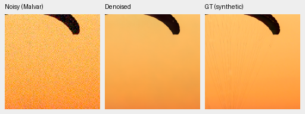
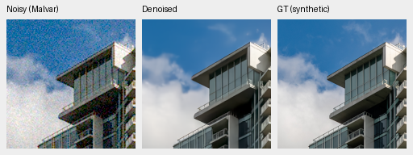
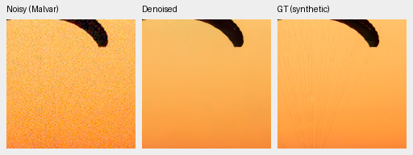
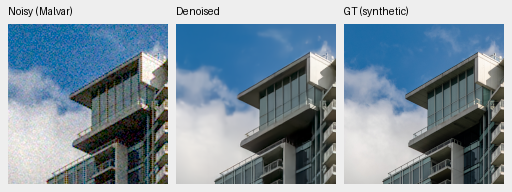

# V74/V75 first1k: training complete, quality review in progress

Both objective arms have completed1,000 updates of their original4,000-update
schedules and their owners have exited. The independent boundary audit passes.
The full held-out FP32 evaluation is running; **no quality gain, continuation or
model promotion is established**. The first fixed native views still lose fine
canopy cords and cloud detail relative to exact synthetic GT.

[Training/source boundary proof](results/reconstruction-objective-first1k-training-boundary-v1.json),
[review plan, execution snapshot, historical-reader replay and native-view evidence](results/reconstruction-objective-first1k-review-progress-v1.json),
and [original experiment and predeclared criteria](reconstruction-objective-v74-v75.md).
Execution snapshots are dated; inspect actual PID/creation identities and the
operational status file for current state.

## Completed training boundary

Both arms use genuine V63 original20k EMA, fresh AdamW/EMA, the reviewed84,867
Commons sources, native128 captures/106 groups and32 paired scenes. B16/native256,
BF16, LR1e−5/warmup100/seed51, geometry, physical noise and data fractions remain
fixed. Only the primary reconstruction objective differs. This is16,000 new
examples per arm, not complete coverage of all84,867 sources or convergence.
Own-parent comparisons also change data and optimization; they are not loss-only.

| Arm | Checkpoint SHA256 |
| --- | --- |
| V74 control1k | `be6fd22593420656fc9c4eb93845a80b8731808ee2e20f2655a015c4c0641cee` |
| V75 log-MSE1k | `f052ebbbe6bc377653a7f29813cda57132a70b0393ea788e77520c11c1d8d6ea` |

Both actual initial EMAs matched the parent. All89 trainable model and89 EMA
tensors changed; two fixed context normalization buffers remain exact. All91
model/91 EMA/89 AdamW states are finite, every optimizer step is1,000, and full
RNG state is retained. All41 logged observations/domain/LR values and the first16
actual observation hashes match between arms. Logged LRs use the original4k
horizon. The independent audit also recomputes each complete source-snapshot
digest and binds its training manifest and every package file to the frozen
training source. These are execution checks, not restoration-quality findings.

The standing GFX scene/siblings and protected-final scenes remain excluded.
Removing181 identified related-series/site files from the new training manifest
does not undo their presence in ancestor training or establish full scene
independence. The fixed418/416-source sensitivities remain required.

## First fixed native photographic views

Noisy Malvar → first1k EMA restoration → exact synthetic GT. Every panel is
native160×160 and never resized. These are the two sources/ROIs fixed by the
existing evaluation protocol, emitted at the start of the live full427 run;
they were not selected from new model errors. All six triplets, including the
parent, were actually viewed as ten unique native cells in the
[complete board](images/objective-first1k-GT-native.png).

Both use RGGB, ISO12800 prior shot=.00256/read variance=.0000262144, WB`[2,1,1.5]`,
the unchanged common protocol matrix and display exposure1/0EV. Noise uses the
existing source/condition/CFA-keyed CUDA realization with protocol seed20261014;
validation crop seed42 determines the source coordinates. These differ from
the separate CPU-generated examples in the mature autotuning report.

| Source |8× cache context xywh|Displayed cache ROI xywh|
| --- | --- | --- |
| Swiss Riviera canopy,0014aa4e… |[189,3,256,256]|[237,51,160,160]|
| Vancouver building/sky,002fc6ee… |[195,89,256,256]|[243,137,160,160]|

The displayed ROI within each saved observation is`[48,48,160,160]`. Full source,
cache, checkpoint and original crop hashes, white balance, matrix, conditioning
and display parameters accompany each published PNG in the registry. All copied
PNGs match the originals exactly. Final closure must recheck those original
crop files after the full producer exits successfully.

V74 control:

V75 log-MSE, identical observations/transforms:

Sources: [Roy Egloff](https://commons.wikimedia.org/wiki/File:CH.VD.Villeneuve_2007-08-25_Vertigo-Swiss-Riviera_2392_3x2-R_4K.jpg)
and [Dietmar Rabich](https://commons.wikimedia.org/wiki/File:Vancouver_(BC,_Canada),_Coal_Harbour_Seaside_Park,_Blick_in_den_Himmel_--_2022_--_2158.jpg),
[CC BY-SA4.0](https://creativecommons.org/licenses/by-sa/4.0/), modified by binning,
crop, synthetic noise and restoration. These are exact targets for the saved
simulation, not clean camera-RAW measurements. The selected views do not
establish a population score or a broad gain over the mature parent.

## Running numerical and real-camera review

The queued operator requires the exact original training controller and final
child to exit successfully before any new inference. It independently loads
both full-state checkpoints, checks their recipes/source/data/parent and starts
fresh FP32 workers. Known/unseen camera inference is complete; the full427-photo
stage is running. No aggregate quality table is published before that stage and
the comparison checks complete.

The primary panels contain62,020 photo/procedural records and360/450 known/unseen
camera records: two fresh learned models and three classical controls. V63,
working V43 and both RawNIND gain adapters reuse earlier matching primary scores
only after exact protocol/coverage, source-level observation identities and the
existing four-ULP classical metric checks. Thirteen forward/data/metric files are
byte-identical to the historical archive. All five suite-function ASTs and both
precision-context ASTs also match; the suite-file difference moves checkpoint
copying into the verified immutable snapshot cache. The Torch version remains
2.14.1+cu130. This is not a claim of full-source byte identity or exact numerical
replay for every future scalar.

A CPU-only historical replay filters actual completed10k case logs into the new
two-model/five-method layout. It rebuilds all108 comparisons/27 witnesses, with
every historical classical witness exact. It performs no new inference and
does not score V74/V75. Twenty-four focused review/source-sensitivity tests pass,
including rejection of unfinished training, still-live owners and reused PIDs.
Ruff passes. The first review entrypoint missed its frozen helper path under
Python`-P` and stopped before controller claim/inference. Its log is preserved;
the corrected launch sets explicit frozen scripts/src`PYTHONPATH`, with unchanged
source, plan, model, data, precision and gates.

Remaining review work is the full primary arithmetic/comparisons, predeclared
source sensitivities, analytic detail/flat fields,3,528 fresh FP32 hue predictions,
all four standing GFX context crops and supplementary sign/platform views, then
independent color and actual native-view closure. The ISO100 GFX capture remains
an independent qualitative reference, **not GT**. Native context inference does
not establish full-frame quality or timing. Neither new checkpoint is promoted
or automatically extended; the complete project quality/speed goals remain open.
