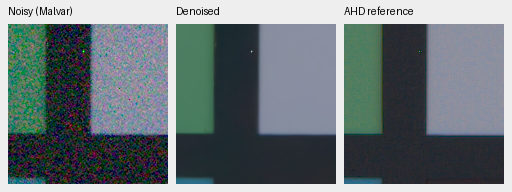
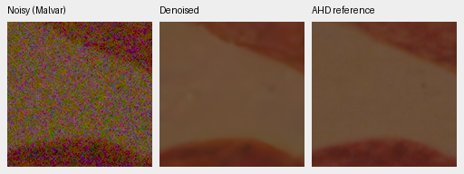
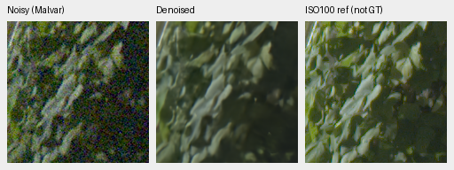
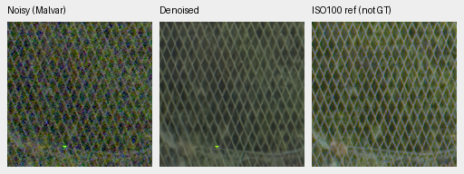
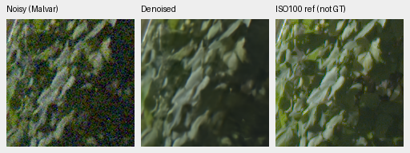
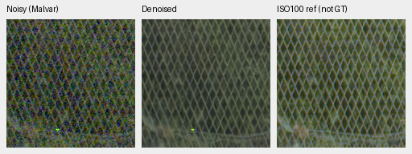

# V74/V75 first1k: small PSNR gain, continuation gate fails

Current architecture and recommendations: [current model guide](current-model.md).
The versioned study below retains its measured results and original protocol.

The complete FP32 review finds **+.02026 dB** photographic PSNR for log-MSE
(V75) over its matched control (V74), source-bootstrap95% interval
**[+.00651,+.03618]**. This is below the **predeclared .03 dB continuation
minimum**. Both stop at1,000 updates; neither is promoted or extended through
the remaining3,000 updates. V43 was the reference for this experiment.

Camera means improve slightly, with an unseen-scene interval crossing zero.
Photographic SSIM, chroma and highlight-boundary errors move slightly against
log-MSE. Saturated flat fields improve over the new control but remain close to
the parent, and native views still lose fine detail. This does not establish
SOTA, decisive real-photo superiority or an isolated larger-data benefit.

[Complete results, source bindings, independent audits and actual native views](results/reconstruction-objective-first1k-complete-v1.json),
[training/source boundary proof](results/reconstruction-objective-first1k-training-boundary-v1.json),
and [original experiment and predeclared criteria](reconstruction-objective-v74-v75.md).
The original progress and camera-interim registries remain dated evidence;
the complete registry records successful producer exits and the final decision.

## Completed training boundary

Both arms use genuine V63 original20k EMA, fresh AdamW/EMA, the reviewed84,867
Commons sources, native128 captures/106 groups and32 paired scenes. B16/native256,
BF16, LR1e−5/warmup100/seed51, geometry, physical noise and data fractions remain
fixed. Only the primary reconstruction objective differs. This is16,000 new
examples per arm, not complete coverage of all84,867 sources or convergence.
Own-parent comparisons also change data and optimization; they are not loss-only.

| Arm | Checkpoint SHA256 |
| --- | --- |
| V74 control1k | `be6fd22593420656fc9c4eb93845a80b8731808ee2e20f2655a015c4c0641cee` |
| V75 log-MSE1k | `f052ebbbe6bc377653a7f29813cda57132a70b0393ea788e77520c11c1d8d6ea` |

Both actual initial EMAs matched the parent. All89 trainable model and89 EMA
tensors changed; two fixed context normalization buffers remain exact. All91
model/91 EMA/89 AdamW states are finite, every optimizer step is1,000, and full
RNG state is retained. All41 logged observations/domain/LR values and the first16
actual observation hashes match between arms. Logged LRs use the original4k
horizon. The independent audit also recomputes each complete source-snapshot
digest and binds its training manifest and every package file to the frozen
training source. These are execution checks, not restoration-quality findings.

The standing GFX scene/siblings and protected-final scenes remain excluded.
Removing181 identified related-series/site files from the new training manifest
does not undo their presence in ancestor training or establish full scene
independence. The fixed418/416-source sensitivities remain required.

## Complete primary comparisons

All427 photographic sources use seven noise/exposure conditions and four Bayer
patterns;16 procedural targets are reported separately. The fresh FP32 panels
contain62,020 photo/procedural records and360/450 known/unseen camera records
(two new learned methods and three classical controls). Scores balance sources,
not individual pixels. The primary camera score measures registered low-noise
CFA samples; independent AHD RGB is not exact GT.

| Method | Photo sRGB PSNR | Photo SSIM | Known CFA PSNR | Unseen CFA PSNR |
| --- | ---: | ---: | ---: | ---: |
| V74 control1k |35.94016|.963249|54.20562|53.83642|
| V75 log-MSE1k |35.96041|.963194|54.27080|53.87060|
| V63 original20k parent |35.93298|.963290|54.20368|53.84318|
| V43 study comparator |34.89933|.957125|54.23334|53.80629|
| RawNIND global observed-CFA gain |26.69578|.790028|54.06860|53.56220|
| RawNIND channel observed-CFA gain |26.68357|.789899|54.08474|53.76822|
| Bilinear |27.55481|.811702|44.10599|41.41325|
| Malvar, common WB |28.53865|.839520|43.80425|40.93797|
| Wiener7 + Malvar |29.29697|.888098|50.07169|49.59129|

V74−parent photo gain is+.00718dB, interval[−.00619,+.02307]; V75−parent
is+.02744dB,[+.01351,+.04325]. Only V75−V74 isolates the objective under this
single seed and update budget. Neither ancestor comparison isolates the added
training data or reaches convergence.

The fixed source-exclusion sensitivities retain the small matched gain:
418 sources,+.01993dB,[+.00562,+.03637];416 sources,+.02021dB,
[+.00507,+.03596]. All three means fail the original.03dB minimum. Excluding
known related series does not remove ancestor exposure or prove complete scene
independence. The independent Decimal/scalar replay checks215,208 raw metric
values,7,686 source scalars and540 comparison-statistic scalars across81
comparisons; source difference0 and comparison maximum3.55e−15.

Photographic SSIM decreases by.00005515 from control. Chroma MAE rises
.00711159→.00716847; gradient MAE .01137212→.01140156; highlight-boundary
chroma MAE .01407798→.01439663 and RGB MAE .01793298→.01842366
(425 sources with boundaries). These are small, adverse descriptive changes.
The separate16 procedural targets improve34.85298→35.08124dB and
.975480→.975957 SSIM; they do not replace the photographic decision panel.

## First fixed native photographic views

Noisy Malvar → first1k EMA restoration → exact synthetic GT. Every panel is
native160×160 and never resized. These are the two sources/ROIs fixed by the
existing evaluation protocol, emitted at the start of the live full427 run;
they were not selected from new model errors. All six triplets, including the
parent, were actually viewed as ten unique native cells in the
[complete board](images/objective-first1k-GT-native.png).

Both use RGGB, ISO12800 prior shot=.00256/read variance=.0000262144, WB`[2,1,1.5]`,
the unchanged common protocol matrix and display exposure1/0EV. Noise uses the
existing source/condition/CFA-keyed CUDA realization with protocol seed20261014;
validation crop seed42 determines the source coordinates. These differ from
the separate CPU-generated examples in the mature autotuning report.

| Source |8× cache context xywh|Displayed cache ROI xywh|
| --- | --- | --- |
| Swiss Riviera canopy,0014aa4e… |[189,3,256,256]|[237,51,160,160]|
| Vancouver building/sky,002fc6ee… |[195,89,256,256]|[243,137,160,160]|

The displayed ROI within each saved observation is`[48,48,160,160]`. Full source,
cache, checkpoint and original crop hashes, white balance, matrix, conditioning
and display parameters accompany each published PNG in the registry. All copied
PNGs match the originals exactly. The completed CPU closure rechecked every
original crop PNG and metadata after the full producer exited successfully.

V74 control:

V75 log-MSE, identical observations/transforms:

Sources: [Roy Egloff](https://commons.wikimedia.org/wiki/File:CH.VD.Villeneuve_2007-08-25_Vertigo-Swiss-Riviera_2392_3x2-R_4K.jpg)
and [Dietmar Rabich](https://commons.wikimedia.org/wiki/File:Vancouver_(BC,_Canada),_Coal_Harbour_Seaside_Park,_Blick_in_den_Himmel_--_2022_--_2158.jpg),
[CC BY-SA4.0](https://creativecommons.org/licenses/by-sa/4.0/), modified by binning,
crop, synthetic noise and restoration. These are exact targets for the saved
simulation, not clean camera-RAW measurements. The selected views do not
establish a population score or a broad gain over the mature parent.

## Completed camera panels

All360 known-camera and450 unseen-camera records pass complete coverage and
summary arithmetic checks. Scores balance four known/five unseen development
scenes, with two exposures and nine512px crops per scene/exposure. The primary
metric measures registered low-noise CFA samples, not the independently
demosaiced RGB reference. Reference noise and registration remain limitations.

| Method | Known CFA PSNR | Unseen CFA PSNR |
| --- | ---: | ---: |
| V74 control1k |54.20562|53.83642|
| V75 log-MSE1k |54.27080|53.87060|
| V63 original20k parent |54.20368|53.84318|
| V43 study comparator |54.23334|53.80629|
| RawNIND global observed-CFA gain |54.06860|53.56220|
| RawNIND channel observed-CFA gain |54.08474|53.76822|

V75−V74 known-camera gain is **+.06518dB**, scene-bootstrap95% interval
**[+.04002,+.08750]**. The unseen mean gain is **+.03418dB**, interval
**[−.02270,+.07710]**. Against the own V63 parent, the corresponding means are
+.06712/+.02741dB; the unseen interval also crosses zero. These use one training
seed and four/five scenes. Scene resampling does not measure training-repeat
uncertainty or establish general real-photo superiority.

[Dated camera-only audit, comparisons, source bindings, executed reader
and actual native views](results/reconstruction-objective-camera-interim-v1.json).
All18 historical classical witnesses are exact. An independent direct18-crop
`math.fsum` scene aggregation and scalar-percentile replay verifies270 comparison
scalars, maximum difference1.42e−14 against the unchanged1e−10 bound. No inference
or new scoring target is introduced by this CPU reader.

The [known camera board](images/objective-first1k-camera-known-native.png) and
[unseen camera board](images/objective-first1k-camera-unseen-native.png) contain
all16 fixed triplets/24 unique native160px cells: V74, V75, V63 parent and the
RawNIND channel adapter at two scenes per panel. Every cell was actually viewed.
New models and parent look nearly identical in these examples. The selected
chart has more edge-color/variation in RawNIND; all methods still soften
low-signal detail. This does not show a large visible new-model gain.

V75 known-camera chart and unseen-camera fabric, noisy → restored → separately
demosaiced AHD reference, **not exact RGB GT**:

Each uses its existing native512 context/central160 ROI, the recorded input-only
noise profile, camera WB/matrix and shared display exposure. Complete sensor and
ROI coordinates, source hashes and transforms accompany the images in the
registry. There is no resizing, fitted display change or reference-based output
gain; RawNIND's named adapter fits its gain only against observed noisy CFA.
Camera source: Brummer/De Vleeschouwer,
[RawNIND](https://doi.org/10.14428/DVN/DEQCIM),
[CC BY-SA4.0](https://creativecommons.org/licenses/by-sa/4.0/), with retained
per-scene credits/CC0 grants;7D-1 is Peter Wemmert, CC0. Modifications include
registration/calibration, cropping, restoration and common rendering.

## Standing GFX sky, buildings, foliage and fence

The [complete native GFX board](images/objective-first1k-gfx-native.png) contains
12 triplets/20 unique cells: all four standing regions for V74, V75 and the
original FP32 V63 parent. Every cell was viewed. All three have similar clean
sky/building structure and continuous fence lines. Foliage remains soft compared
with the sharper separately captured f/5.6 exposure. No clear broad new-model
detail advantage appears.

DSCF3879 is ISO6400/f1.7/1/240s; DSCF3880 is ISO100/f5.6/3s, captured3m38s
later. The reference is independently AHD-demosaiced, **not exact GT**; aperture,
framing and moving subjects differ. These are native512 context outputs, not a
new full102MP export or timing claim. The scene and siblings remain excluded
from training. Only existing SSD-cached observations were read for this review.

Shared display is×4/+2EV, WB[1.5132450331125828,1,2.2152317880794703],
shot=.0014635775921166604/read variance=1.0715704128646712e−6, and the same
recorded camera-to-sRGB matrix. Native160px ROIs are sky[5800,1400],
building[5790,2690], foliage[8890,5570], fence[2240,6000]; the separate-reference
building/fence x coordinates are5791/2241. No resampling or warping is applied.
Source/context/checkpoint hashes and complete transforms accompany every PNG
in the complete registry.

V74 foliage and fence: noisy → restored → ISO100 reference, **not GT**:

V75, identical observation and display:

The two additional [sign/platform native regions](images/objective-first1k-highlights-native.png)
contain6 triplets/10 cells. All three models retain broad saturated-blue
plateaus and softened boundaries; neither a clear improvement nor a large new
failure appears. Their different-time/aperture reference is qualitative only.

## Analytic detail and color limitations

The [analytic native board](images/objective-first1k-analytic-native.png) covers
three fixed cases for both new methods: dark carrier, brighter carrier and a
neutral flat,6 triplets/12 cells. Both almost erase the dark carrier and weaken
the brighter one. Across16 CFA/draw cases at ISO12800 prior, the dark
level.01/contrast.1/period8 in-phase gain is.00475 control/.00209 log-MSE;
the brighter level.18/contrast.02/period16 gain is.31907/.30524. Gain1 would
retain the carrier. Malvar retains1.02913/.99177 but has much larger noncarrier
noise. Suppression is therefore not evidence of recovered fine detail.

The color grid has147 flat colors, two conditions and four CFAs:1,176
observations and3,528 saved predictions across V74/V75/parent. Native256/B1
FP32, fixed noise/WB/matrix and display×1 remain common. Only one draw per cell
is used; summaries describe this grid rather than confidence intervals.

For the high-noise, peak.90 groups (96 cases each), absolute channel-mean error
is measured in normalized camera RGB:

| Method | Saturation | Mean maximum channel bias | Worst maximum channel bias | Mean RGB RMSE |
| --- | ---: | ---: | ---: | ---: |
| V74 |.50|.019587|.077272|.014187|
| V75 |.50|.014266|.063101|.010157|
| V63 parent |.50|.014350|.057548|.010289|
| V74 |.98|.014899|.094790|.010446|
| V75 |.98|.005269|.027842|.004027|
| V63 parent |.98|.005739|.039979|.004512|

Log-MSE improves over the newly trained control, which regresses these bright
colors, and stays close to the parent in group means. Its moderate-color worst
case remains worse than parent. This is not broad color repair.

The [original three flat fields](images/objective-first1k-hue-native.png) and
[four additional fixed palettes](images/objective-first1k-hue-extra-native.png)
were all viewed:21 triplets/35 cells. V74 shows larger selected bright
orange/magenta shifts; V75/parent are closer to GT but retain coarse magenta
variation. Moderate bright and dark fields show no broad new-model advantage.
The four extra orange/magenta palettes were declared before any new hue output
existed and reconstructed from saved arrays without inference or new noise.

## Completed execution and independent closure

Both training, inference and CPU-closure owners/final children exited
successfully. The complete registry records PID/creation-time checks, all ten
inference stages, source snapshots and terminal states. Dated producer records
whose names say “awaiting review” are preserved; this complete review supplies
their subsequent statistical and manual closure.

All108 primary comparisons and27 historical classical witnesses pass, with
every witness exact (maximum0ULP). V63, V43 and both RawNIND adapters reuse
matching historical scores only after protocol/coverage, observation metadata
and classical checks. Thirteen forward/data/metric files are byte-identical;
five suite-function ASTs and two precision-context ASTs match. The suite-file
change moves checkpoint copying into an immutable snapshot cache. Torch is
2.14.1+cu130. This is not full-source byte identity or a fresh replay of every
historical neural prediction.

Independent saved-array Torch64 audit checks all3,528 hue predictions and
21,168 metric fields (including vector fields), maximum difference5.55e−16
against2e−14. All21 native flat triplets reconstruct exactly. An independent
54-group/648-scalar color-summary replay differs at most3.47e−18. Analytic
coverage and arithmetic check1,344 cases/84 groups/2,256 scalars, maximum
2.22e−16 against1e−12. These CPU readers do not create neural inference or
training-repeat evidence.

The native review totals **67 triplets/111 unique cells**, all actually viewed
at original resolution. The final GFX/analytic boards are byte-identical to the
boards already inspected; the final three boards were opened individually.
Early photographic and camera PNG/metadata were revalidated after successful
producer exit. Copy/board construction never substitutes for actual inspection.

The earlier24 focused review/source-sensitivity tests and six new CPU-closure
gate tests pass; Ruff passes changed code. Gates reject incomplete/failed
reviews, wrong/live owners and missing/duplicate stages. No training or inference
default changes. No complete102MP output is claimed for these ineligible
checkpoints. Quality, decisive real-photo superiority and sub10s inference
remain open project requirements.
