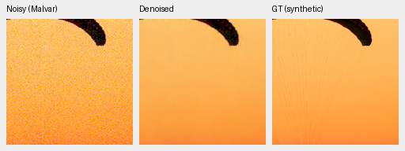
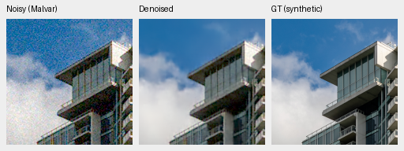

# Optional FP16 RGB refinement inference

V16 can now run its RGB correction convolutions in FP16 using
`--refinement-precision float16`. The default remains IEEE FP32. This changes
inference arithmetic only: weights, checkpoint configuration and training are
unchanged. Physical variance, high-pass normalization, noise scaling and the
final correction remain IEEE FP32; CPU execution remains FP32. The base network
still uses the independently selected `--precision`.

The unchanged default was compared with the preceding implementation on genuine
DINOv3/V16 weights across all four CFA layouts and three noise/highlight conditions:
**9,437,184 RGB values were bit-identical**. The optional path passed the full
178-test suite, including actual CUDA half convolution, FP32 output and exact
zero-noise correction. Ruff passed.

Frozen V16 step5000 weights were evaluated in both modes. Known/unseen refer to
four/five development scenes; measured-CFA PSNR is primary and calibrated AHD
sRGB metrics are auxiliary. The protected final test was not used.

| Panel | FP32 refinement | FP16 refinement |
| --- | ---: | ---: |
| Known measured-CFA PSNR | 53.27465640 | 53.27457364 |
| Unseen measured-CFA PSNR | 53.07856534 | 53.07859730 |
| Known AHD sRGB PSNR | 39.15835640 | 39.15834774 |
| Unseen AHD sRGB PSNR | 37.65963065 | 37.65963896 |
| Known AHD sRGB SSIM | 0.92151854 | 0.92151831 |
| Unseen AHD sRGB SSIM | 0.90717885 | 0.90717871 |
| Full 427-photo synthetic sRGB PSNR | 31.48799610 | 31.48799157 |
| Full 427-photo synthetic sRGB SSIM | 0.92301791 | 0.92301748 |
| 16 procedural sources, sRGB PSNR | 30.56576906 | 30.56576575 |

These numerical changes are negligible on these panels; they do not improve
model quality or close the gap to RawNIND. Synthetic evaluation covers all four
CFAs and seven noise/exposure conditions, with identical observations in both
modes. [Receipts and complete aggregate metrics](results/refinement-precision-v16.json).

Native 160×160 FP16-refinement triplets, noisy → denoised → exact synthetic GT,
with matched ROI and display settings (ISO12800 synthetic prior, RGGB):





Compare the default-mode versions in [the V16 review](wide-refinement-review.md).
Source attribution: [Roy Egloff](https://commons.wikimedia.org/wiki/File:CH.VD.Villeneuve_2007-08-25_Vertigo-Swiss-Riviera_2392_3x2-R_4K.jpg)
and [Dietmar Rabich](https://commons.wikimedia.org/wiki/File:Vancouver_(BC,_Canada),_Coal_Harbour_Seaside_Park,_Blick_in_den_Himmel_--_2022_--_2158.jpg),
[CC BY-SA 4.0](https://creativecommons.org/licenses/by-sa/4.0/); modified by
binning, cropping, synthetic noise and restoration. Each panel is one image
pixel per PNG pixel at the binned evaluation resolution; open at 100%.

On the new **DSCF3879/DSCF3880** GFX case, full 101.996MP restoration took
36.39s with FP32 refinement and 26.81s with FP16 refinement at identical 512/64/B4
geometry. Peak CUDA allocations were 0.840/0.708 GB, not total system memory.
These are single successive shared-machine runs, excluding decode/load/render/
TIFF encoding, not controlled idle timing. The 10-second target remains unmet.
Each mode produced complete uint16 linear-camera-RGB and ICC sRGB TIFFs.
Comparing all 305,987,556 encoded values per file gave:

| Encoding | FP16 vs FP32 RMS, uint16 codes | Maximum difference, codes |
| --- | ---: | ---: |
| Linear camera RGB | 0.2163 | 7 |
| sRGB at shared +2EV | 1.4667 | 197 |

The sRGB transfer amplifies some differences near dark channel values. These
figures include final uint16 rounding and do not imply pixel identity. Full
reports, four native crops per mode, file hashes and model/source snapshots:
`/mnt/external/demosaic/evaluation/gfx-3879-3880-v16-5k-{full,half-full}/`.
The [standing GFX page](gfx-qualitative.md) retains default FP32-refinement
comparisons against RawNIND.

A separate alternating-order correction-branch benchmark (eight samples after
two warmups per mode, B4×512, captured genuine decoder context) measured median
224.66ms FP32 versus 144.46ms FP16. It includes physical maps but excludes the
Bayer/DINO body and is not an end-to-end or idle benchmark. Across four exact
synthetic flats the linear RGB difference RMS was 1.33e-6, about 0.087 uint16
codes. `scripts/benchmark_refinement.py` reproduces this diagnostic.

Example for the standing GFX case, keeping defaults for the main comparison:

```bash
source scripts/env.sh
uv run --no-sync python scripts/report_raw_pair.py \
  configs/gfx-qualitative-20231231.json /path/to/v16.pt \
  --refinement-precision float16 --full-frame \
  --output /mnt/external/demosaic/evaluation/gfx-next-half-review
```

Training, loss and final quality conclusions are unchanged. Precision selection
is recorded in CLI, paired/synthetic suite and qualitative report receipts.
