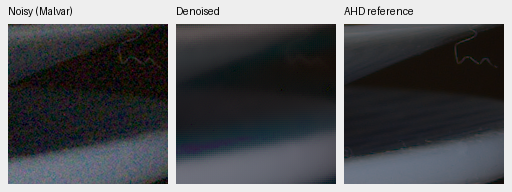
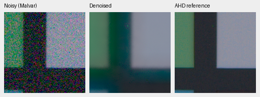

# Flat-field controls and rejected RGB refinement

Full IEEE FP32 training does not resolve the flat-noise problem in this recipe.
V12 (BF16) and V13 (IEEE FP32 forward/loss/backward) use the same V11 step5000
initialization, 1000 flat-only steps, learning rate and data sequence. With FP32
evaluation, retained noise standard deviation at scene level 0.01 is:

| Training | ISO1600 prior | ISO12800 prior | Shadows |
| --- | ---: | ---: | ---: |
| V12 BF16 | 0.18519 | 0.17141 | 0.16988 |
| V13 IEEE FP32 | 0.18232 | 0.17149 | 0.17062 |

These values are relative to bilinear interpolation, not photographic quality
scores. The close results do not support training precision as the dominant
cause here; they do not rule out precision effects in other recipes.

V14 adds an optional, zero-initialized 27,696-parameter RGB correction branch.
It sees the actual restored RGB estimate, residuals around a local mean in
estimated-noise units, noise maps and decoder features. The small branch uses
IEEE FP32. Base restoration/DINO parameters are frozen; only the new branch
trains for 1000 flat-only steps at learning rate 5e-4. This is a diagnostic with a
different architecture and learning rate, not a matched general-quality trial.
Default model configuration and earlier checkpoints leave the branch disabled.

At FP16 evaluation, V14's flat-noise fractions fall to
0.06116/0.05187/0.06681, versus V13's 0.18279/0.17154/0.17101. RawNIND is lower
again at 0.03559/0.02328/0.02796. However, on the same four known-sensor real
development scenes, V14 **loses detail and worsens primary measured-CFA PSNR**:

| Method | Measured-CFA PSNR | Auxiliary AHD sRGB PSNR | Auxiliary SSIM |
| --- | ---: | ---: | ---: |
| V11 step5000 | 51.6932 | 37.6638 | 0.8848 |
| V14 step1000 | 48.4693 | 35.8569 | 0.8992 |
| RawNIND, publisher units, CFA-LS | 54.0686 | 39.6780 | 0.9288 |

The following fixed 160×160 crops use identical WB/matrix/exposure for all
panels. Left: noisy Malvar. Middle: V14. Right: auxiliary low-noise AHD reference,
not exact RGB GT. Open each PNG at 100%; no resizing or sharpening was applied.
Coordinates, source/checkpoint hashes and complete results are in
[the diagnostic receipt](results/flat-precision-and-refiner-review.json).

2pilesofplates, ISO12800:

7D-1, ISO12800:

SSIM rises while measured-CFA and rendered PSNR worsen. Smoothing removes actual
structure and leaves visible phase patterns at edges.
V14 is **rejected for promotion**. The same trial is retained in the local GFX
comparison; no claim of improvement follows from a cleaner-looking sky alone.
No further training is currently running, and the official final-test targets
remain unused for model selection. The real RAW quality goal remains unmet.

Sources: Benoit Brummer and Christophe De Vleeschouwer, *Raw Natural Image Noise
Dataset (2025)*, [dataset](https://doi.org/10.14428/DVN/DEQCIM),
[CC BY-SA 4.0](https://creativecommons.org/licenses/by-sa/4.0/), with scene
permissions retained in the local dataset snapshot. `7D-1` is credited to Peter
Wemmert under CC0 in `permissions.txt`. Modifications: integer registration,
reference calibration, demosaicing/restoration, crop and shared sRGB display.
