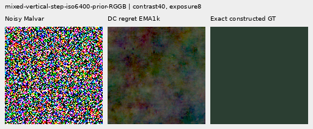
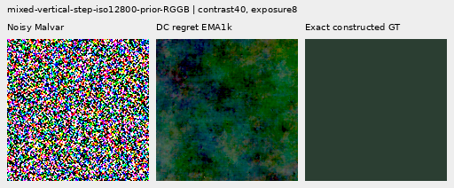
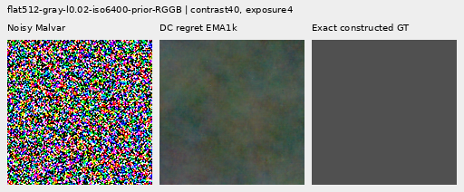
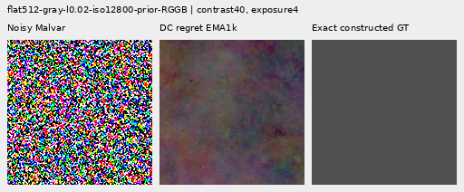

# V158: regional color bias is controlled, but useful correction shrinks

Adding regional RGB mean-error regret to the unchanged V157 hybrid removes its
large quiet-neighbor color-bias increase. EMA quiet RMS is **0.09–0.12% below
V143 on all 32 inputs**, and 0.13–0.17% lower on average than the quieter V156
EMA control. This is a useful quiet-region supervision result. It also gives up
nearly all of V157's standalone-flat gain: native512 full RMS improves only
0.046–0.053% versus V143, with block32 gains about 0.001%. Mesh response remains
below V143 and V156, and no convincing new real fine cab crossings appear.

Both fixed 1,000-update heads, four raw/EMA endpoints, 822 cases, independent
audits and all 72 actual native views are complete. Keep regional-DC supervision
as a quiet-control option, V156 as the stronger learned-detail control and V157's
direct spatial architecture/coarse-error strength as a useful implementation.
These results do not establish one model that combines their strengths. The
general inference recommendation remains V120 Small.

## Quiet neighbors: actual total error and regional color bias

The 32 exact quiet ROIs sit beside strong vertical/slanted structure. Mean quiet
RMS falls **9.38–13.10% versus matched V157**, but V157 had a substantial
regression. Against V143 the gains are small: raw 0.018–0.082%, EMA 0.090–0.119%.
Both priors improve in quiet spatial RMS by 0.12–0.17%. Whole-image error still
rises about 0.013–0.019% versus V143; cleaning a quiet ROI is not a whole-image win.

| Prior | Method | Whole RMS | Quiet RMS | Quiet spatial RMS |
| --- | --- | ---: | ---: | ---: |
|ISO6400|V143|27.105631|3.898845|3.268502|
|ISO6400|V157 raw|27.339566|4.482988|3.238095|
|ISO6400|V157 EMA|27.274996|4.365052|3.232918|
|ISO6400|DC regret raw|27.109205|3.895648|3.262998|
|ISO6400|DC regret EMA|27.109068|3.894207|3.262881|
|ISO12800|V143|36.747466|6.152652|5.341833|
|ISO12800|V157 raw|37.131077|6.898679|5.300686|
|ISO12800|V157 EMA|37.023001|6.783631|5.301677|
|ISO12800|DC regret raw|36.754312|6.151546|5.335244|
|ISO12800|DC regret EMA|36.753614|6.147099|5.335295|

Independent reductions from the original camera-RGB pixels verify all 160
method/case decompositions, 480 scalar comparisons and per-case
`total² = spatial² + DC²`, maximum scalar difference 2.67e-15 DN16.
The means below are RMS bias after averaging each RGB residual channel over
the exact native quiet ROI. Group mean RMS values do not obey the squared identity.

| Method | ISO6400 mean quiet DC RMS | ISO12800 mean quiet DC RMS |
| --- | ---: | ---: |
|V143|2.016074|2.849060|
|V157 raw|2.925343|4.229166|
|V157 EMA|2.766653|4.037120|
|DC regret raw|2.018669|2.857871|
|DC regret EMA|2.016258|2.849290|

Raw still worsens 12/32 quiet inputs versus V143, maximum increase 0.009402 DN16.
EMA improves all 32, with its smallest improvement 0.002835 DN16. Against matched
V157, each endpoint improves 24/32; the remaining eight regress by as much as
0.177861 DN16 raw / 0.175622 EMA. A better average is not a universal guarantee.

The retained V156 comparison verifies identical 822 input/parent bindings and
identical parent metric rows. Quiet means improve 0.18–0.31% raw / 0.13–0.17% EMA;
27/32 raw and 30/32 EMA inputs improve. Maximum increases versus V156 are
0.010120 DN16 raw / 0.002830 EMA. Quiet spatial error improves on all 32 raw and
31/32 EMA inputs, but some individual DC norms worsen. That comparison also
changes architecture/base supervision versus V156; the isolated loss comparison
is V158 versus its exact V157 control. The
[original-pixel DC audit](results/v158-regional-dc-v1/quiet-DC-audit.json),
[2,176 paired entries](results/v158-regional-dc-v1/paired-regions.json) and
[192 retained-V156 entries](results/v158-regional-dc-v1/retained-V156-comparison.json)
retain every case and cost. Related CFA placements are not independent scenes.

## Weak detail, blank fields and standalone flats

Mesh response rises 2.18–2.98% versus matched V157, but stays **0.90–0.95% below
V143** and 6.20–10.33% below matched V156 endpoints. Response reaches only
2.18% of exact constructed GT. Present full RMS improves 0.027–0.034% versus
V143 and actual surrounding blank RMS 0.086–0.099%, much less than V157's gains.
The existing optional periodic comparator remains stronger in response, with its
documented partial-orientation, seam, spill and runtime limitations. Added-change
RMS is not actual blank error or calibrated hallucination risk.

| Method | Present full RMS | Response | Actual blank RMS | Blank spatial RMS | Added blank RMS |
| --- | ---: | ---: | ---: | ---: | ---: |
|V143|9.111243|0.02202090|5.523323|5.343113|0.00000000|
|V157 raw|9.074109|0.02135746|5.463479|5.279086|0.33215525|
|V157 EMA|9.073479|0.02118075|5.462776|5.281840|0.33000107|
|DC regret raw|9.108149|0.02182278|5.517871|5.338211|0.15322440|
|DC regret EMA|9.108743|0.02181101|5.518557|5.338204|0.15131497|
|Existing periodic detail|8.586126|0.07089755|5.523328|5.343118|0.00063557|

For native512 standalone noisy flats, full RMS improves on 47/48 raw and all
48 EMA inputs versus V143. Mean full gain is only **0.046–0.053%**, versus
V157's 0.94–1.10%. Mean block32 gains shrink to 0.00088–0.00113%; 46/48 raw and
45/48 EMA cases improve. Every native512 full/block32 result is worse than its
matched V157 endpoint. Mean ISO6400 full RMS is also 0.07–0.11% worse than V156,
and ISO12800 block32 is about 0.0023% worse. Broad colored mottle persists.

|Flat test|V143|V157 raw|V157 EMA|DC regret raw|DC regret EMA|
| --- | ---: | ---: | ---: | ---: | ---: |
|Native512 ISO6400 full RMS|18.546808|18.372489|18.369973|18.538168|18.538295|
|Native512 ISO6400 spatial RMS|18.235130|18.041301|18.051496|18.226495|18.226325|
|Native512 ISO6400 block32 RMS|13.440561|13.308961|13.319811|13.440437|13.440410|
|Native512 ISO12800 full RMS|24.071890|23.810498|23.805983|24.059114|24.059130|
|Native512 ISO12800 spatial RMS|23.596861|23.336459|23.349752|23.584087|23.583933|
|Native512 ISO12800 block32 RMS|17.932544|17.756811|17.771300|17.932386|17.932357|
|Older native256 ISO12800 full RMS|27.233548|26.995569|26.991236|27.221506|27.221147|
|Older native256 ISO12800 spatial RMS|26.017191|25.752030|25.761072|26.004068|26.003846|
|Older native256 ISO12800 block32 RMS|19.539875|19.366148|19.379026|19.539677|19.539673|

## Natural detail and ADC behavior

Faint/dark natural-photo response remains 0.05–0.15% below V143, although most of
V157's larger response loss is recovered. Band error worsens in all four groups.
Full RMS changes are tiny and mixed; the retained512 groups improve, organic384
groups regress. No new feather barbs, dark branch texture or real mesh crossings
are established. These reused sources and related CFA placements are not blind
generalization evidence.

|Photo test|V143|V157 raw|V157 EMA|DC regret raw|DC regret EMA|
| --- | ---: | ---: | ---: | ---: | ---: |
|Retained512 faint full RMS|33.963754|33.957648|33.956899|33.963323|33.963491|
|Retained512 faint band error|0.824639|0.824705|0.824717|0.824679|0.824680|
|Retained512 faint band response|0.298560|0.297242|0.297213|0.298328|0.298318|
|Retained512 dark full RMS|29.097715|29.104340|29.105095|29.097488|29.097562|
|Retained512 dark band error|0.661447|0.661467|0.661468|0.661458|0.661458|
|Retained512 dark band response|0.531446|0.529649|0.529646|0.531190|0.531180|
|Organic384 faint full RMS|37.469061|37.480065|37.478330|37.469799|37.470056|
|Organic384 faint band error|0.924117|0.924196|0.924213|0.924182|0.924186|
|Organic384 faint band response|0.150701|0.149852|0.149809|0.150477|0.150470|
|Organic384 dark full RMS|33.685796|33.705722|33.703303|33.685932|33.686144|
|Organic384 dark band error|0.781612|0.781593|0.781594|0.781618|0.781618|
|Organic384 dark band response|0.398945|0.397527|0.397512|0.398686|0.398678|

All 192 new-endpoint constant ADC controls remain bit-exact parent. The direct
spatial path is exactly zero at zero physical variance, but its jointly trained
spectral path can change ADC output. ADC-photo RMS/band response is effectively
parent-level, giving up V157's 1.04–1.16% improvement; V150's approximately 3.06%
photo gain remains useful. ADC sloped-field full RMS improves about 0.0085%,
while block32 worsens 0.0083–0.0085% and worst absolute DC about 0.021%.

|ADC test|V143|V157 raw|V157 EMA|DC regret raw|DC regret EMA|
| --- | ---: | ---: | ---: | ---: | ---: |
|Photo full RMS|18.149871|17.939292|17.961360|18.149871|18.149871|
|Photo band error|0.101855|0.100609|0.100758|0.101855|0.101855|
|Photo band response|0.968329|0.968694|0.968601|0.968329|0.968329|
|Sloped512 full RMS|3.771369|3.723443|3.732082|3.771049|3.771048|
|Sloped512 spatial RMS|3.397249|3.346101|3.355006|3.396769|3.396768|
|Sloped512 block32 RMS|0.574652|0.606916|0.600736|0.574701|0.574700|
|Sloped512 crop block32 RMS|0.088145|0.088148|0.088147|0.088145|0.088145|
|Sloped512 worst absolute DC|11.176981|11.223246|11.220159|11.179371|11.179393|

## Native 100% comparisons

All 72 primary figures were actually viewed in 18 original-detail sheets. Each
cell is 160×160 original pixels, never resized. The
[manifest](images/v158-regional-dc-v1/manifest-v1.json) binds source/ROI,
checkpoint SHA256, noise conditioning, exposure, target anchor and contrast.
All 48 fixed boards include retained V156 raw/EMA columns without new forwards.
The boards plus 24 repeated-cell triplets contain **39,705,600 checked RGB
channels**. Repeated cells add no observations.

The two quiet triplets show noisy Malvar → **regional-DC EMA** → exact
constructed GT. Native512 RGGB, ROI `[80,176,160,160]`, shared exposure 8 and
40× camera-linear contrast about target RGB means
`[.001500000013,.006000000052,.002666666871]`. ISO6400 shot .00128/read variance
6.5536e-6; ISO12800 .00256/2.62144e-5. The pronounced V157 casts recede toward
V143/V156; existing low-frequency texture remains visible against constant GT.





The standalone-flat triplets use the same priors, native512 RGGB,
ROI `[176,176,160,160]`, shared exposure 4 and contrast 40 about exact target means.
V158 remains very close to V143. The complete boards keep V157's modest
correction visible for comparison; neither removes the broad colored mottle.





| Endpoint | Mesh2302 | Mesh2309 | Flat ISO6400 | Flat ISO12800 | Quiet ISO6400 | Quiet ISO12800 |
| --- | --- | --- | --- | --- | --- | --- |
|dc-control-raw-step1000|[native](images/v158-regional-dc-v1/comparison-00-dc-control-raw-step1000-triplet.png)|[native](images/v158-regional-dc-v1/comparison-02-dc-control-raw-step1000-triplet.png)|[native](images/v158-regional-dc-v1/comparison-19-dc-control-raw-step1000-triplet.png)|[native](images/v158-regional-dc-v1/comparison-20-dc-control-raw-step1000-triplet.png)|[native](images/v158-regional-dc-v1/comparison-26-dc-control-raw-step1000-triplet.png)|[native](images/v158-regional-dc-v1/comparison-28-dc-control-raw-step1000-triplet.png)|
|dc-control-EMA-step1000|[native](images/v158-regional-dc-v1/comparison-00-dc-control-EMA-step1000-triplet.png)|[native](images/v158-regional-dc-v1/comparison-02-dc-control-EMA-step1000-triplet.png)|[native](images/v158-regional-dc-v1/comparison-19-dc-control-EMA-step1000-triplet.png)|[native](images/v158-regional-dc-v1/comparison-20-dc-control-EMA-step1000-triplet.png)|[native](images/v158-regional-dc-v1/comparison-26-dc-control-EMA-step1000-triplet.png)|[native](images/v158-regional-dc-v1/comparison-28-dc-control-EMA-step1000-triplet.png)|
|dc-regret-raw-step1000|[native](images/v158-regional-dc-v1/comparison-00-dc-regret-raw-step1000-triplet.png)|[native](images/v158-regional-dc-v1/comparison-02-dc-regret-raw-step1000-triplet.png)|[native](images/v158-regional-dc-v1/comparison-19-dc-regret-raw-step1000-triplet.png)|[native](images/v158-regional-dc-v1/comparison-20-dc-regret-raw-step1000-triplet.png)|[native](images/v158-regional-dc-v1/comparison-26-dc-regret-raw-step1000-triplet.png)|[native](images/v158-regional-dc-v1/comparison-28-dc-regret-raw-step1000-triplet.png)|
|dc-regret-EMA-step1000|[native](images/v158-regional-dc-v1/comparison-00-dc-regret-EMA-step1000-triplet.png)|[native](images/v158-regional-dc-v1/comparison-02-dc-regret-EMA-step1000-triplet.png)|[native](images/v158-regional-dc-v1/comparison-19-dc-regret-EMA-step1000-triplet.png)|[native](images/v158-regional-dc-v1/comparison-20-dc-regret-EMA-step1000-triplet.png)|[native](images/v158-regional-dc-v1/comparison-26-dc-regret-EMA-step1000-triplet.png)|[native](images/v158-regional-dc-v1/comparison-28-dc-regret-EMA-step1000-triplet.png)|

Mesh triplets use native512 RGGB, ROI `[176,176,160,160]`, ISO6400 shot
.00128/read variance 6.5536e-6, exposure 8 and contrast 1. All method coordinates
and transforms are identical. Complete boards retain V143, V157, V158, V156 and
the periodic comparator where applicable.

The [feather](images/v158-regional-dc-v1/comparison-13.png) uses Alexis Lours,
CC BY4.0, SHA1 `02a76fd33b5e1414a0504f0b3f0aeb03a569b6f4`, native384,
ROI `[112,112,160,160]`, exposure 14.388348 and contrast 8.
The [dark bird/branch](images/v158-regional-dc-v1/comparison-25.png) uses
Andrew Mercer, CC BY-SA4.0, SHA1 `3e638bbb56ed80abc88939468783e3bf9b92ee77`,
native512, ROI `[176,176,160,160]`, exposure 80.995917 and contrast 1.
Both use ISO6400 shot .00128/read variance 6.5536e-6. Fine texture remains weak.

Standing DSCF3879 ISO6400 / DSCF3880 ISO100 views retain
[sky](images/v158-regional-dc-v1/comparison-05.png),
[building](images/v158-regional-dc-v1/comparison-06.png),
[foliage](images/v158-regional-dc-v1/comparison-07.png) and
[chain-link fence](images/v158-regional-dc-v1/comparison-08.png), exposure 4.
DSCF3842/3835 fine cab mesh retains both windows under
[nominal left](images/v158-regional-dc-v1/comparison-09.png),
[nominal right](images/v158-regional-dc-v1/comparison-10.png),
[profile3879 left](images/v158-regional-dc-v1/comparison-11.png) and
[profile3879 right](images/v158-regional-dc-v1/comparison-12.png) priors.
Native768 contexts, left/right ROIs `[206,229,160,160]` / `[426,189,160,160]`,
exposure 16 and contrast 1. Both SOOC JPEGs remain native unboosted sRGB8.
Independent ISO100/AHD/JPEG references differ in aperture, shutter, processing
and motion: **qualitative references, not exact GT**, never pixelwise scored.
No convincing new fine cab wires appear. Protected captures, JPEGs and siblings
stay excluded from training; originals remain read-only and `/mnt/dataz` unused.

## Regional RGB bias regret


For output `O`, frozen V143 parent `B`, exact training target `T`, inherited
per-image noise unit `s` and native box width `w=32`, define:

```text
u = max(s / (w/2), 1/65535)
bB = box_mean(B - T) / u       # three camera-RGB channel means
bO = box_mean(O - T) / u
d  = box_mean(O - B) / u
q  = (1/65535) / u
rB = sqrt(mean_RGB(bB²) + q²)
rO = sqrt(mean_RGB(bO²) + q²)
regret = mean_RGB(d × (2 bB + d)) / (rO + rB)
```

The rationalized expression equals `rO−rB` without subtracting nearly equal
norms. Norm smoothing is 1 DN16; it does not quantize image pixels. The same
32px/hop16 replicated-boundary grid as the existing local loss covers every
pixel, including small and nondivisible rectangles.

The new loss averages a C1 positive hinge over boxes and images:

```text
h(r) = 0                    for r ≤ 0
       r² / (2 t)           for 0 < r < t
       r − t/2             for r ≥ t,   t = 1e−4
```

One fixed coefficient, **weight 1**, sits inside the existing domain multiplier.
Only the output receives its derivative; parent, target and units are detached.
The loss and first derivative are zero at unchanged parent output. Improving
an incorrect parent bias is unpenalized. No target or reference enters forward.

Dividing `s` by `w/2=16` uses the nominal square-root count of one Bayer phase
in an interior box. This deliberately gives mean error stronger training units
than pixel error. The 1-DN16 unit floor keeps small scales finite. This proxy
is **not calibrated post-demosaic covariance or boundary uncertainty**; repeated
edge samples and correlated restored RGB are not independent measurements.
Weight 1 is not equal-gradient-norm supervision.

The term sees channel means, so balanced zero-mean detail can remain invisible
to it. Existing RGB, gradient, delivered spectral and full-local-RMS terms all
remain active. A soft penalty can still allow worse regions, and the parent can
already contain false structure. Actual DC, spatial and weak-detail errors plus
native views remain required; this is not an inference gate or a safety guarantee.

## Fixed matched comparison


The [recipe](../configs/quality-v143-regional-dc-v158.yaml) fixes two identical
fresh `LateSpatialRgbDetail` heads, **117,677 parameters / 45 tensors each**:

| Arm | Loss difference |
| --- | --- |
| `dc-control` | Exact V157 spatial-hybrid recipe |
| `dc-regret` | Same recipe plus regional DC regret, weight 1 |

Architecture and all 87 neural source files remain byte-identical. Both heads
start fresh, with identical zero final outputs, on the same 1,000 V148 cached
batches / 4,000 old observations. The control reproduces V157's complete
spatial-hybrid trace, raw/EMA/Adam states and all 1,644 actual reviewed outputs
exactly. No early checkpoint, coefficient, window or transition selection occurs.

Pixel/gradient terms, delivered-RGB spectral MSE coefficient .25, existing local
RGB-RMS regret weight 1, domain weights, physical conditions, geometry, shared
initialization, LR, AdamW, global clipping and EMA remain fixed. There are 882
supervised batches and 118 ADC batches with zero total gradient; all 1,000
optimizer/EMA clocks advance. Adding the term changes optimization pressure and
can invoke more clipping; its training value is not a quality result.

The supplied V143 parent already carries frozen official DINOv3 ConvNeXt-Small
guidance. Parent predictions, inputs and targets are reused without new
parent/DINO calls, noise draws, source lookups or RAW decodes. Protected GFX
captures, JPEGs and siblings remain excluded from training. Originals stay
read-only and `/mnt/dataz` stays unused.

## Completed checks and execution evidence

**56 CPU tests pass in 1.90s**, including 11 independent regional-DC cases and
45 inherited loss/architecture tests. Independent NumPy enumeration checks the
actual padded pixel coordinates, RGB means and full output adjoints. Small and
nondivisible rectangles, both hinge regions, tiny positive regret, finite identity
derivatives, detached inputs, unit floor, free improving bias, zero-mean detail
and quiet regression despite global improvement are covered.

CUDA compatibility uses 28 archived native256/384/512/768 contexts across all
four CFAs and real controls, 56 actual calls. Current/frozen V157 heads agree
with archived outputs. Two discarded ten-update runs include genuine save at
update8 and model/EMA/Adam/RNG restoration for the remaining two. Production
starts fresh. Final CPU validation checks four strict raw/EMA loads, all90 finite
Adam states and exact1,000-row control trace/raw/EMA/Adam against V157. All1,644
actual control outputs replay exactly before old array storage is adopted.

The new loss raises optimization pressure sharply. Recorded noisy-batch
median/max pre-clip norms are **2.892114/357.251312**, versus
.103889/30.963337 for control. It clips **726/882** supervised batches versus
67/882. All118 ADC batches have zero loss/gradient, while all1,000 AdamW/EMA
clocks advance. These norms do not measure Adam displacement or isolate which
path caused a quality change. Smaller corrections and near-parent metrics are
observed outcomes; strong DC pressure/shared clipping as the mechanism remains
a hypothesis to test.

The independent NumPy64/Decimal audit checks the complete4,686 score rows,
3,288 actual endpoint evaluations and1,398 retained parent/periodic rows.
All30 real rows remain unscored. Original returned-forward and observation
journals retain all3,288 evaluations. Total scientific work is **5,364 head
evaluations**:56 compatibility,20 discarded smoke,2,000 production and3,288
review. All10 registered owners are terminal; original training/review completed
without restart or failed scientific stage. One separate auxiliary CPU reporter
used an obsolete arm key and failed; original source/error and passing revision2
remain preserved, including the immutable218-row historical control prefix.

New predictions total4.422GiB, all1,644 arrays external. Local storage holds
metadata/publication; old arrays and evidence are neither deleted nor moved.
Reserves are60GiB local/196GiB external with.5GiB projected margin,52GiB launch
and32GiB runtime RAM,12GiB CUDA quota. Training peak allocation is4.149GiB.
No new parent/DINO calls, noise draws, original lookups, RAW decodes or dataz
access occur. All87 neural source files remain byte-identical; only training
supervision changes.

The [final publication](results/v158-regional-dc-final-v1.json) preserves23 final
receipts,72 native PNGs, the unchanged12 preparation receipts,33 preparation
source texts,87 neural hashes and14 additional helper/metric sources. It retains
both the failed reporter and its corrected revision. The
[publication verification](results/v158-regional-dc-publication-verification-v1.json)
binds source bytes, four CPU exports to the actual final checkpoint, all3,288
output/13,152 input fingerprints, native triplets, retained V156 pixels,
2,368 paired entries and215 rounded numeric cells. The prior protocol document
and preparation diary remain historical evidence; explicit machine UTC times
are unchanged. See the [local-time final diary](../diary/2026-11-07-02-01-41-v158-final-regional-dc.md).

## What to carry forward

Regional mean-error supervision can remove the large quiet color-bias regression.
Its present weight/units also leave very little useful correction and lose most
of the coarse gain. Preserve the quiet improvement and the architectural
strength separately. V156 remains stronger in mesh response, V157 stronger on
standalone noisy flats, V153 stronger in learned mesh response and V150 stronger
on ADC photos. The next controlled change should balance regional-DC pressure
with detail/coarse learning and inspect path/gradient coupling, while retaining
these controls. Neither tests nor a soft regret term establish safe behavior on
unseen fields. Fine low-contrast real wire recovery and clean quiet regions must
still improve together; the broader goal remains active.

Fixed exported checkpoint SHA256 (bound to the actual final training checkpoint):

- `dc-control-raw-step1000`: `47e9733878e13fcd7effd026e086dc95bfdf5b2316d6c3ffa161455981ed99c0`.
- `dc-control-EMA-step1000`: `1345145d4efdbbc6fa1bbf50d25d929db943f4079797475d60b9c475b394eb3b`.
- `dc-regret-raw-step1000`: `3ead85da4c90f5cb810c22841e8130eb2566bb2143555096c455c62486ead7dc`.
- `dc-regret-EMA-step1000`: `05722c1ed8957bd5acd612005533098dd40607eead5f5fd70a377a10fc197537`.
