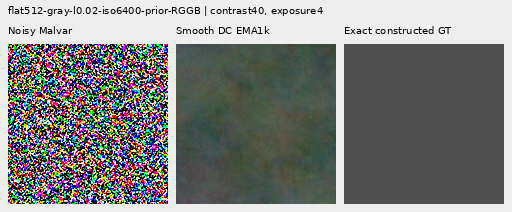
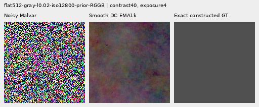
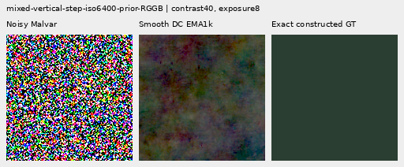
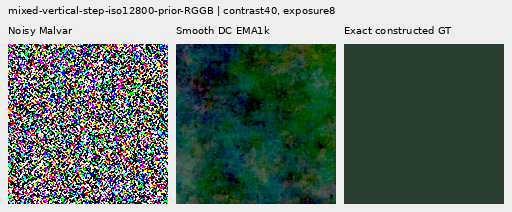

# V159: smoother DC pressure recovers modest coarse correction, with quiet costs

The wider regional-DC transition recovers some correction lost under V158.
Native512 noisy-flat full RMS falls **0.27–0.39% versus V143**, and block32
error falls **0.17–0.19% on average, improving all 48 inputs at both endpoints**.
These coarse gains exceed V158 and V156, while remaining below V157's roughly
0.9–1.0% block32 gain. Quiet total RMS instead rises **0.18–0.48% versus V143**,
with larger regional color bias. Mesh response weakens relative to V158 and
stays below V143/V156. No convincing new fine real cab crossings appear.

Both fresh 1,000-update heads, four fixed raw/EMA endpoints, all 822 cases,
independent audits and all 72 actual native views are complete. Preserve V159
as a modest coarse/quiet compromise: it has much less quiet damage than V157
and stronger standalone coarse correction than V158. Keep V158's better quiet
accuracy, V156's stronger learned detail and V157's stronger standalone-flat
capacity visible. No model here combines their strengths; the general V120
inference choice remains unchanged.

## Standalone noisy flats and surrounding blank fields

All 48 native512 noisy-flat block32 errors improve versus V143, exact V158 and
retained V156 at both endpoints. Full RMS improves on 46/48 raw and all 48 EMA
inputs versus V143; raw's two increases reach 0.000410 DN16. Against V158,
45/48 raw and all 48 EMA inputs improve full RMS. The remaining raw increases
reach 0.011267 DN16. Against V156, full RMS improves on 43/48 raw and 44/48 EMA
inputs. Mean ISO6400 full RMS is 0.14–0.15% below V156; ISO12800 block32 is
0.17–0.19% below it. Broad colored mottle persists despite these small gains.

|Flat test|V143|V158 sharp raw|V158 sharp EMA|Smooth DC raw|Smooth DC EMA|
| --- | ---: | ---: | ---: | ---: | ---: |
|Native512 ISO6400 full RMS|18.546808|18.538168|18.538295|18.497345|18.491111|
|Native512 ISO6400 spatial RMS|18.235130|18.226495|18.226325|18.181488|18.182167|
|Native512 ISO6400 block32 RMS|13.440561|13.440437|13.440410|13.414629|13.417112|
|Native512 ISO12800 full RMS|24.071890|24.059114|24.059130|23.987084|23.978038|
|Native512 ISO12800 spatial RMS|23.596861|23.584087|23.583933|23.520610|23.521144|
|Native512 ISO12800 block32 RMS|17.932544|17.932386|17.932357|17.897843|17.901153|
|Older native256 ISO12800 full RMS|27.233548|27.221506|27.221147|27.158057|27.149946|
|Older native256 ISO12800 spatial RMS|26.017191|26.004068|26.003846|25.935859|25.934000|
|Older native256 ISO12800 block32 RMS|19.539875|19.539677|19.539673|19.503014|19.505732|

Every native512 full/block32 result remains worse than the matched V157 endpoint.
V157's larger correction also carried much larger quiet costs. The independent
retained comparisons verify identical 822 input/parent bindings and parent
metric rows. Their 768 paired entries preserve both improvements and worst
regressions; related CFA placements are not independent scenes.

On present meshes, actual surrounding blank RMS falls 0.38–0.40% versus V143,
and whole present-image RMS falls 0.13–0.14%. Absent-mesh full RMS falls
0.38–0.41%. Added-change RMS is a footprint, not actual blank error or calibrated
hallucination risk. These gains do not imply quiet-neighbor safety.

## Quiet neighbors: spatial improvement, larger color bias

Quiet total RMS rises 0.18–0.48% versus V143 and 0.28–0.57% versus exact V158.
Raw worsens 14/32 inputs versus either parent or V158; EMA worsens 13/32.
Maximum increases versus V143 are 0.219149 DN16 raw / 0.224273 EMA; versus V158,
0.209746 raw / 0.228338 EMA. Whole-scene RMS also rises 0.11–0.16% versus V143.
Quiet spatial RMS improves 0.33–0.55%, so total and spatial error must remain
separate: increased regional bias offsets the spatial gain.

| Prior | Method | Whole RMS | Quiet RMS | Quiet spatial RMS |
| --- | --- | ---: | ---: | ---: |
|ISO6400|V143|27.105631|3.898845|3.268502|
|ISO6400|V158 sharp raw|27.109205|3.895648|3.262998|
|ISO6400|V158 sharp EMA|27.109068|3.894207|3.262881|
|ISO6400|Smooth DC raw|27.142075|3.906401|3.253523|
|ISO6400|Smooth DC EMA|27.135425|3.905905|3.250489|
|ISO12800|V143|36.747466|6.152652|5.341833|
|ISO12800|V158 sharp raw|36.754312|6.151546|5.335244|
|ISO12800|V158 sharp EMA|36.753614|6.147099|5.335295|
|ISO12800|Smooth DC raw|36.805737|6.169487|5.324387|
|ISO12800|Smooth DC EMA|36.794860|6.182234|5.323880|

Original-pixel reductions check 160 quiet outputs, 480 scalars and every
per-case identity `total² = spatial² + DC²`, maximum scalar difference
1.78e-15 DN16. Mean quiet RGB-bias norms rise 1.25–2.98% versus V143:

| Method | ISO6400 mean quiet DC RMS | ISO12800 mean quiet DC RMS |
| --- | ---: | ---: |
|V143|2.016074|2.849060|
|V158 sharp raw|2.018669|2.857871|
|V158 sharp EMA|2.016258|2.849290|
|Smooth DC raw|2.041217|2.913026|
|Smooth DC EMA|2.047816|2.933874|

Group mean RMS values do not obey the per-case squared identity. Against V156,
raw quiet means change −0.031% at ISO6400 / +0.115% at ISO12800; EMA worsens
0.173–0.396%. Quiet total errors improve on 18/32 raw and 19/32 EMA inputs,
while quiet spatial errors improve on all 32 at both endpoints. Against V157,
mean quiet RMS falls 8.87–12.86%, with 26/32 raw and 25/32 EMA inputs improving.
The large relative gain uses V157's regressed baseline; it is not a comparable
gain over V143. The
[paired-region receipt](results/v159-regional-dc-transition-v1/paired-regions.json),
[retained V156/V157 comparison](results/v159-regional-dc-transition-v1/retained-V156-V157-comparison.json)
and [DC audit](results/v159-regional-dc-transition-v1/quiet-DC-audit.json) retain
all cases and costs. V156 also differs in architecture/DC supervision, V157 in
DC supervision; only the V158 control isolates this transition change.

## Fine mesh, natural detail and ADC

Mesh response falls 1.45–1.89% versus V158 and **2.34–2.83% versus V143**,
reaching only 2.14–2.15% of exact constructed GT. It is 7.97–11.63% below V156,
although 0.69–1.03% above V157. The optional periodic comparator remains
stronger in response, with its documented incomplete orientations, seams,
spill, nonperiodic and runtime limits. Better present/blank RMS does not establish
new wire recovery.

| Method | Present full RMS | Response | Actual blank RMS | Blank spatial RMS | Added blank RMS |
| --- | ---: | ---: | ---: | ---: | ---: |
|V143|9.111243|0.02202090|5.523323|5.343113|0.00000000|
|V158 sharp raw|9.108149|0.02182278|5.517871|5.338211|0.15322440|
|V158 sharp EMA|9.108743|0.02181101|5.518557|5.338204|0.15131497|
|Smooth DC raw|9.099182|0.02150573|5.502339|5.320572|0.29121440|
|Smooth DC EMA|9.098538|0.02139838|5.501253|5.320642|0.29039340|
|Existing periodic detail|8.586126|0.07089755|5.523328|5.343118|0.00063557|

Natural faint/dark band response remains 0.20–0.39% below V143, with higher band
error in every group and weaker response than V158. Full error changes are
tiny and mixed: retained faint improves, organic faint/dark regress, retained
dark is effectively unchanged. No convincing new feather barbs or dark branch
texture appear. The reused sources/CFAs do not establish blind generalization.

|Photo test|V143|V158 sharp raw|V158 sharp EMA|Smooth DC raw|Smooth DC EMA|
| --- | ---: | ---: | ---: | ---: | ---: |
|Retained512 faint full RMS|33.963754|33.963323|33.963491|33.962207|33.961722|
|Retained512 faint band error|0.824639|0.824679|0.824680|0.824718|0.824723|
|Retained512 faint band response|0.298560|0.298328|0.298318|0.297723|0.297720|
|Retained512 dark full RMS|29.097715|29.097488|29.097562|29.097790|29.097665|
|Retained512 dark band error|0.661447|0.661458|0.661458|0.661459|0.661459|
|Retained512 dark band response|0.531446|0.531190|0.531180|0.530375|0.530392|
|Organic384 faint full RMS|37.469061|37.469799|37.470056|37.473202|37.473426|
|Organic384 faint band error|0.924117|0.924182|0.924186|0.924227|0.924236|
|Organic384 faint band response|0.150701|0.150477|0.150470|0.150130|0.150114|
|Organic384 dark full RMS|33.685796|33.685932|33.686144|33.689231|33.688912|
|Organic384 dark band error|0.781612|0.781618|0.781618|0.781619|0.781620|
|Organic384 dark band response|0.398945|0.398686|0.398678|0.398078|0.398083|

All 192 constant ADC controls remain bit-exact parent. The direct spatial path
is exactly zero at zero physical variance, while its jointly trained spectral
path can still change output. ADC-photo mean RMS improves 0.72–0.83% versus
V143, recovering part of V157's gain and remaining weaker than V150's roughly
3.06% gain. This cannot be credited to an active direct ADC output. Sloped-field
full RMS improves 0.71–0.86%, but block32 worsens 3.15–3.78% and worst absolute
DC rises about 0.12–0.13%.

|ADC test|V143|V158 sharp raw|V158 sharp EMA|Smooth DC raw|Smooth DC EMA|
| --- | ---: | ---: | ---: | ---: | ---: |
|Photo full RMS|18.149871|18.149871|18.149871|17.999365|18.018296|
|Photo band error|0.101855|0.101855|0.101855|0.100873|0.101014|
|Photo band response|0.968329|0.968329|0.968329|0.968928|0.968827|
|Sloped512 full RMS|3.771369|3.771049|3.771048|3.738823|3.744735|
|Sloped512 spatial RMS|3.397249|3.396769|3.396768|3.362754|3.368962|
|Sloped512 block32 RMS|0.574652|0.574701|0.574700|0.596360|0.592753|
|Sloped512 crop block32 RMS|0.088145|0.088145|0.088145|0.088145|0.088147|
|Sloped512 worst absolute DC|11.176981|11.179371|11.179393|11.190567|11.191213|

## Native 100% comparisons

All 72 primary figures were actually viewed in 18 original-detail sheets.
The [manifest](images/v159-regional-dc-transition-v1/manifest-v1.json) binds
source/ROI, checkpoint SHA256, conditioning, exposure, target anchor and contrast.
Every cell keeps 160×160 original pixels, never resized. All 48 boards retain
four V156 detail / V157 coarse raw/EMA columns without new calls. The boards
and 24 repeated-cell triplets contain **47,078,400 checked RGB channels**.
Repeated cells add no observations.

These two triplets show noisy Malvar → **smooth-DC EMA** → exact constructed
GT. Native512 RGGB, ROI `[176,176,160,160]`, shared exposure 4 and camera-linear
contrast 40 about exact target means. ISO6400 shot .00128/read variance
6.5536e-6; ISO12800 .00256/2.62144e-5. Broad colored mottle remains; the
quantitative gain is modest and the complete boards retain stronger V157.





Quiet-neighbor triplets use the same priors, native512 RGGB,
ROI `[80,176,160,160]`, exposure 8 and contrast 40 about target camera-RGB means
`[.001500000013,.006000000052,.002666666871]`. Extra V157 casts are much reduced,
but V158's better bias/total error is not retained; parent mottling remains.





| Endpoint | Mesh2302 | Mesh2309 | Flat ISO6400 | Flat ISO12800 | Quiet ISO6400 | Quiet ISO12800 |
| --- | --- | --- | --- | --- | --- | --- |
|sharp-control-raw-step1000|[native](images/v159-regional-dc-transition-v1/comparison-00-sharp-control-raw-step1000-triplet.png)|[native](images/v159-regional-dc-transition-v1/comparison-02-sharp-control-raw-step1000-triplet.png)|[native](images/v159-regional-dc-transition-v1/comparison-19-sharp-control-raw-step1000-triplet.png)|[native](images/v159-regional-dc-transition-v1/comparison-20-sharp-control-raw-step1000-triplet.png)|[native](images/v159-regional-dc-transition-v1/comparison-26-sharp-control-raw-step1000-triplet.png)|[native](images/v159-regional-dc-transition-v1/comparison-28-sharp-control-raw-step1000-triplet.png)|
|sharp-control-EMA-step1000|[native](images/v159-regional-dc-transition-v1/comparison-00-sharp-control-EMA-step1000-triplet.png)|[native](images/v159-regional-dc-transition-v1/comparison-02-sharp-control-EMA-step1000-triplet.png)|[native](images/v159-regional-dc-transition-v1/comparison-19-sharp-control-EMA-step1000-triplet.png)|[native](images/v159-regional-dc-transition-v1/comparison-20-sharp-control-EMA-step1000-triplet.png)|[native](images/v159-regional-dc-transition-v1/comparison-26-sharp-control-EMA-step1000-triplet.png)|[native](images/v159-regional-dc-transition-v1/comparison-28-sharp-control-EMA-step1000-triplet.png)|
|smooth-dc-raw-step1000|[native](images/v159-regional-dc-transition-v1/comparison-00-smooth-dc-raw-step1000-triplet.png)|[native](images/v159-regional-dc-transition-v1/comparison-02-smooth-dc-raw-step1000-triplet.png)|[native](images/v159-regional-dc-transition-v1/comparison-19-smooth-dc-raw-step1000-triplet.png)|[native](images/v159-regional-dc-transition-v1/comparison-20-smooth-dc-raw-step1000-triplet.png)|[native](images/v159-regional-dc-transition-v1/comparison-26-smooth-dc-raw-step1000-triplet.png)|[native](images/v159-regional-dc-transition-v1/comparison-28-smooth-dc-raw-step1000-triplet.png)|
|smooth-dc-EMA-step1000|[native](images/v159-regional-dc-transition-v1/comparison-00-smooth-dc-EMA-step1000-triplet.png)|[native](images/v159-regional-dc-transition-v1/comparison-02-smooth-dc-EMA-step1000-triplet.png)|[native](images/v159-regional-dc-transition-v1/comparison-19-smooth-dc-EMA-step1000-triplet.png)|[native](images/v159-regional-dc-transition-v1/comparison-20-smooth-dc-EMA-step1000-triplet.png)|[native](images/v159-regional-dc-transition-v1/comparison-26-smooth-dc-EMA-step1000-triplet.png)|[native](images/v159-regional-dc-transition-v1/comparison-28-smooth-dc-EMA-step1000-triplet.png)|

Mesh triplets share native512 RGGB, ROI `[176,176,160,160]`, ISO6400 shot
.00128/read variance 6.5536e-6, exposure 8 and contrast 1. Complete boards keep
V143, V158, V159, V156, V157 and the periodic comparator where applicable.

The [feather](images/v159-regional-dc-transition-v1/comparison-13.png) uses
Alexis Lours, CC BY4.0, SHA1 `02a76fd33b5e1414a0504f0b3f0aeb03a569b6f4`,
native384, ROI `[112,112,160,160]`, exposure 14.388348 and contrast 8.
The [dark bird/branch](images/v159-regional-dc-transition-v1/comparison-25.png)
uses Andrew Mercer, CC BY-SA4.0, SHA1 `3e638bbb56ed80abc88939468783e3bf9b92ee77`,
native512, ROI `[176,176,160,160]`, exposure 80.995917 and contrast 1.
Both use ISO6400 shot .00128/read variance 6.5536e-6. Fine texture remains weak.

Standing DSCF3879 ISO6400 / DSCF3880 ISO100 views include
[sky](images/v159-regional-dc-transition-v1/comparison-05.png),
[building](images/v159-regional-dc-transition-v1/comparison-06.png),
[foliage](images/v159-regional-dc-transition-v1/comparison-07.png) and
[coarse fence](images/v159-regional-dc-transition-v1/comparison-08.png), exposure 4.
DSCF3842/3835 fine cab windows retain
[nominal left](images/v159-regional-dc-transition-v1/comparison-09.png),
[nominal right](images/v159-regional-dc-transition-v1/comparison-10.png),
[profile3879 left](images/v159-regional-dc-transition-v1/comparison-11.png) and
[profile3879 right](images/v159-regional-dc-transition-v1/comparison-12.png).
Native768 contexts, left/right ROIs `[206,229,160,160]` / `[426,189,160,160]`,
exposure 16 and contrast 1. Both SOOC JPEGs remain native unboosted sRGB8.
Independent ISO100/AHD/JPEG references differ in aperture, shutter, processing
and moving subjects: **qualitative references, not exact GT**, never pixelwise
scored. No convincing new fine cab crossings appear. Protected captures/JPEGs/
siblings remain excluded from training; originals stay read-only and dataz unused.

## One fixed transition change


The regional RGB mean-error regret `r` is exactly the
[V158 quantity](regional-dc-regret.md#regional-rgb-bias-regret): compare the
three-channel means of output/parent errors against exact training targets,
then take their smoothed vector-norm difference. Native32 boxes/hop16 use the
same replicated boundary grid, nominal units `u=max(s/16,1/65535)` and separate
1-DN16 norm smoothing. Parent, target and units are detached.

For one fixed transition `t`, the positive C1 hinge and its derivative are:

```text
h_t(r) = 0                 r <= 0
         r*r/(2*t)         0 < r < t
         r - t/2           r >= t

h_t'(r) = 0               r <= 0
          r/t             0 < r < t
          1               r >= t
```

| Arm | Regional-DC weight | Transition in regional mean-error units |
| --- | ---: | ---: |
| `sharp-control` | 1 | 1e−4, exact V158 recipe |
| `smooth-dc` | 1 | 1 |

At regret .1 the new derivative is .1, versus 1 for the sharp control.
At regret at least 1 both derivatives are 1; the absolute hinge values then
differ by a constant. A smaller training loss under the wider hinge is not a
quality result. This is one predeclared constant, with no coefficient/window/
transition sweep or early-checkpoint selection.

One regional mean-error unit is a training proxy. Its physical DN16 size varies
with image noise and has a 1-DN16 floor. It is not calibrated post-demosaic RGB
covariance, a fixed 1-DN16 allowance, confidence or a quiet-safety bound.
Improving parent bias remains unpenalized, and balanced zero-mean detail stays
under the existing RGB/gradient/spectral/full-local losses. A wider soft penalty
can permit larger regional regressions; actual errors and weak detail must be
measured together. No target or independent reference enters inference.

## Matched training and completed evidence

Both identical fresh hybrids have 117,677 parameters / 45 tensors. All87 neural
sources and the loss implementation remain unchanged. Only the transition
differs. Base pixel/gradient, delivered-RGB spectral MSE .25, local regret1,
domain weights, shared initialization, geometry/noise, LR/AdamW/global clipping/
EMA and all clocks remain fixed on1,000 cached V148 batches/4,000 observations.
There are882 supervised batches and118 ADC zero-gradient batches; all1,000
optimizer/EMA clocks advance. Production starts fresh after discarded smoke.

60 CPU tests pass in2.52s: four wider-transition NumPy full-pixel adjoint/identity
cases plus56 inherited checks. CUDA parity uses28 archived contexts/all CFAs/
native256/384/512/768 and56 actual head calls, matching current/frozen V158 and
archive. Genuine8+2 model/EMA/Adam/RNG restoration passes. CPU validation checks
four strict final loads, all90 finite Adam states and exact1,000-row V158 control
trace/raw/EMA/Adam. All1,644 actual control outputs replay exactly before storage
reuse. The immutable40-row preparation snapshot remains historical evidence.

Noisy pre-clip median/max norms fall from2.892114/357.251312 to
**.102686/72.415810**, and clipped supervised batches from726/882 to**101/882**.
This confirms changed optimization pressure. Quality remains a tradeoff:
coarse/ADC correction partly recovers, while quiet bias rises and response
weakens. The norms do not isolate which path or gradient component caused each
quality effect, and their capped-squared sum is not Adam displacement.

The independent audit checks40,210 scalars over4,686 rows, maximum discrepancy
4.55e-13, and476 Decimal reductions. It binds3,288 actual endpoint evaluations
plus1,398 retained parent/periodic rows; all30 real rows stay unscored. Every
returned forward and complete observation is journaled. Actual scientific work
totals**5,364 head evaluations**:56 compatibility,20 discarded smoke,2,000
production and3,288 review. All10 original owners are terminal, all stages
return zero, with no training/review restart or partial replay.

All1,644 new arrays/4.422GiB are external, with60/196GiB local/external reserves
plus.5GiB projected margin. Metadata/publication stay local. Old evidence is
neither deleted nor moved. RAM guards remain52GiB launch/32GiB runtime and CUDA
quota12GiB. Within V159 there are no new parent/DINO calls, noise draws, source
lookups, RAW decodes or dataz access. The separate coupled-noise construction
uses its own documented draws and is not part of this trial.

The [final publication](results/v159-regional-dc-transition-final-v1.json)
preserves23 final receipts,72 native PNGs,11 unchanged preparation receipts,
33 preparation source texts,87 neural hashes and12 further helper/metric sources.
The [publication verification](results/v159-regional-dc-transition-publication-verification-v1.json)
checks all source/export/input/output bytes,3,288 outputs/13,152 input fingerprints,
14,745,600 retained comparator RGB values,192 ADC constants,2,944 paired entries
and215 rounded numeric cells. Protocol/preparation evidence and explicit machine
UTC timestamps stay unchanged. See the [local-time final diary](../diary/2026-11-07-02-39-41-v159-final-dc-transition.md).

An auxiliary publication checker initially failed on a generated report-path
label after checking source/export/input/output/native/paired data. Its
[source and failure receipt](results/v159-regional-dc-publication-verifier-failure-v1.json)
remain preserved. Revision2 corrects the report locator and reruns the complete
publication validation. The original final builder is retained; this separate
documentation correction records the failure history.

## Next work

The transition exposes a coarse/quiet tradeoff rather than restoring weak wires.
Preserve its modest coarse strength and V158's quiet advantage without replacing
V156's stronger learned-detail control. A fixed fresh paired-response experiment
is the next direction: the [coupled sensor-noise primitive](coupled-counterfactual-noise.md)
has independent physical checks, but no paired training or quality gain yet.
Both arms must receive the same paired data, with actual blank/quiet/coarse errors,
natural detail and real fine fence views beside any response increase. The broader
fine-detail/clean-sky goal remains active.

Training peak allocated CUDA: 4.149GiB. Fixed exported checkpoint SHA256:

- `sharp-control-raw-step1000`: `6795a29dd116c1e6551af7204b3621239c5b1a3b8a1b3333a90b4c47818c77cb`.
- `sharp-control-EMA-step1000`: `9908cb3043895fc6e7a4c2e6f02f25b6fd562b11e58145b7788d5eaa56f5edd4`.
- `smooth-dc-raw-step1000`: `caab9d4301fc6134d3c43e889cba0f180f3341010cf0a48c007a9c244ef1b046`.
- `smooth-dc-EMA-step1000`: `5eb5d0c7186cd9ea8c6a1fc7eeb80b275a545c4133ae991ec5db6d219c6a9d9a`.
