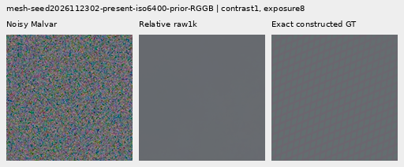
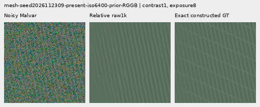
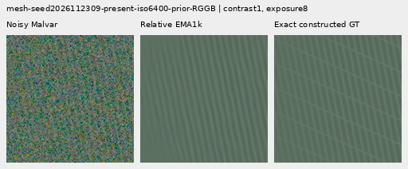

# V152 relative phase: small mesh/flat gains, worse quiet regions

Adding RAW/residual cross-spectrum inputs improves mean synthetic mesh response
**1.27–1.41% over the matched V151 noisy-only control**, or **5.09–8.74% over
V143**. Native512 noisy-flat RMS falls another .035–.048% versus control,
reaching .141–.205% below V143. These narrow gains are real on the fixed cohort,
but absolute mesh response remains only **2.31–2.39% of constructed GT**.
**No convincing new real cab wires or noisy organic texture appear.**

Exact quiet-region RMS beside strong patterns worsens .334–.834% versus V143,
more than the control's .154–.385%. Natural-photo band response falls further,
even where RMS/band-error means improve. Relative phase supplies a useful
frequency-estimator prototype for further work; V151 remains the quieter
matched comparator and V150 retains much stronger ADC photo restoration.
The next estimator/support work should retain and test these measured strengths
and costs. [V120/general and V143/explicit periodic detail](current-model.md)
remain current inference choices; there is no general replacement or inference
integration from this small, mixed result.

Both fresh heads finish 1,000 updates. All four fixed raw/EMA endpoints are
scored on 822 cases, independently audited, and actually viewed in 72 native
figures. Control trace, raw/EMA/Adam and **all 1,644 final prediction arrays**
exactly reproduce V151 noisy-only. There is no early epoch selection.

## Mesh response and actual blank errors

Errors are means of per-observation RMS in unclipped camera RGB ×65535.
Response projects onto exact plane-detrended procedural texture; ideal is 1.
The 256 present observations are 64 related recipes across four CFAs, not
256 independent scenes. Added change energy is a footprint; actual blank
error is reported beside it.

| Method | Present full RMS | Response | Actual blank RMS | Blank spatial RMS | Added blank RMS |
| --- | ---: | ---: | ---: | ---: | ---: |
|V143|9.111243|0.02202090|5.523323|5.343113|0.00000000|
|NoADC ctrl raw|9.090038|0.02361132|5.524396|5.344220|0.30090071|
|NoADC ctrl EMA|9.094019|0.02284971|5.521850|5.341595|0.28951747|
|Relative raw|9.084343|0.02394498|5.523011|5.342786|0.32348204|
|Relative EMA|9.088346|0.02314068|5.519997|5.339678|0.30660351|
|Existing periodic detail|8.586126|0.07089755|5.523328|5.343118|0.00063557|

Relative raw/EMA present-scene RMS is .295%/.251% below V143. Both actual blank
means are also below V143, by .006%/.060%, despite more added change than the
control. On absent meshes, full RMS falls .025%/.072% versus V143. Thus the
larger change is not itself evidence of hallucination. These means do not
guarantee local safety: the exact quiet regions below show a separate regression.
Both fixed mesh crops still miss crossings. Existing periodic `detail` has
stronger selected response, with incomplete orientations, support seams/spill
and weak nonperiodic gains.

## Noisy flats and natural photographs

Each flat group contains 24 observations. Block32 is a full-field coarse-error
metric; native central crops alone cannot establish broad flat safety.

|Flat test|V143|NoADC ctrl raw|NoADC ctrl EMA|Relative raw|Relative EMA|
| --- | ---: | ---: | ---: | ---: | ---: |
|Native512 ISO6400 full RMS|18.546808|18.528288|18.519647|18.520569|18.510726|
|Native512 ISO6400 spatial RMS|18.235130|18.216253|18.207427|18.208396|18.198350|
|Native512 ISO6400 block32 RMS|13.440561|13.441084|13.440601|13.440935|13.440351|
|Native512 ISO12800 full RMS|24.071890|24.045198|24.032722|24.036749|24.022431|
|Native512 ISO12800 spatial RMS|23.596861|23.569561|23.556746|23.560951|23.546239|
|Native512 ISO12800 block32 RMS|17.932544|17.931834|17.931704|17.931555|17.931410|
|Older native256 ISO12800 full RMS|27.233548|27.205031|27.188432|27.193266|27.174987|
|Older native256 ISO12800 spatial RMS|26.017191|25.987255|25.969563|25.974863|25.955418|
|Older native256 ISO12800 block32 RMS|19.539875|19.538363|19.538921|19.538810|19.539322|

Relative raw/EMA lowers native512 ISO6400 full RMS .141%/.195%, ISO12800
.146%/.205%, versus V143. Large colored mottle remains visible. ISO6400 block32
still rises slightly for raw and falls slightly for EMA; ISO12800 falls slightly
for both. Its central crop block32 remains .012–.014% above V143, despite lower
full-field coarse error. The improvements do not visibly remove the broad blobs.
All 48 constant ADC inputs remain exactly at their parents under all four
endpoints: 192 exact predictions. Sloped-field behavior is measured separately.

Each photo group has 32 related observations. The luma band uses native DCT16
coefficients in the 1/8–1/3 cycles/pixel annulus. Lower band error is better;
response is reported separately to expose attenuation.

|Photo test|V143|NoADC ctrl raw|NoADC ctrl EMA|Relative raw|Relative EMA|
| --- | ---: | ---: | ---: | ---: | ---: |
|Retained512 faint full RMS|33.963754|33.961754|33.963319|33.961358|33.962967|
|Retained512 faint band error|0.824639|0.824602|0.824726|0.824550|0.824683|
|Retained512 faint band response|0.298560|0.298248|0.297886|0.297581|0.297225|
|Retained512 dark full RMS|29.097715|29.094260|29.095017|29.093227|29.093997|
|Retained512 dark band error|0.661447|0.661397|0.661430|0.661389|0.661425|
|Retained512 dark band response|0.531446|0.531073|0.530863|0.529957|0.529776|
|Organic384 faint full RMS|37.469061|37.468482|37.473348|37.466956|37.472034|
|Organic384 faint band error|0.924117|0.924289|0.924463|0.924265|0.924445|
|Organic384 faint band response|0.150701|0.150213|0.149819|0.149864|0.149465|
|Organic384 dark full RMS|33.685796|33.683572|33.685074|33.682922|33.684475|
|Organic384 dark band error|0.781612|0.781638|0.781653|0.781610|0.781626|
|Organic384 dark band response|0.398945|0.398467|0.398212|0.397692|0.397451|

Relative raw lowers full RMS in all four noisy photo groups by .0056–.0154%
versus V143; EMA remains mixed, including worse organic-faint RMS. Every band
error mean is smaller than the corresponding control, yet all four groups'
responses fall further. Raw retained faint/dark band error improves slightly;
organic faint remains worse than V143 and organic dark is nearly tied. EMA
retained-faint and both organic band errors remain worse than V143. Native
feather/moth/grass/bark and bird/branch texture stay soft. Lower aggregate error
does not establish recovery of the requested natural fine detail.

## Strong patterns and exact quiet regions

There are 16 observations per prior: four patterns across four CFAs.
Whole-scene and exact quiet160 errors remain separate.

| Prior | Method | Whole RMS | Quiet RMS | Quiet spatial RMS |
| --- | --- | ---: | ---: | ---: |
|ISO6400|V143|27.105631|3.898845|3.268502|
|ISO6400|NoADC ctrl raw|27.042380|3.913870|3.285032|
|ISO6400|NoADC ctrl EMA|27.047239|3.906230|3.275941|
|ISO6400|Relative raw|27.026897|3.931359|3.305015|
|ISO6400|Relative EMA|27.032199|3.920584|3.292272|
|ISO12800|V143|36.747466|6.152652|5.341833|
|ISO12800|NoADC ctrl raw|36.593953|6.164208|5.355044|
|ISO12800|NoADC ctrl EMA|36.615460|6.162118|5.352656|
|ISO12800|Relative raw|36.567995|6.178347|5.370711|
|ISO12800|Relative EMA|36.590744|6.173207|5.364909|

Relative whole-scene RMS improves .271–.488% over V143, but quiet RMS worsens
.334–.834%, versus .154–.385% for control. Quiet spatial RMS is .432–1.117%
above V143. Diagnostic 40× views retain large colored blobs and show additional
fine grain in places. This tradeoff rules out calling the variant a broad
fine-detail/clean-flat solution. Main real sky remains close to parent; its
independent ISO100 reference is qualitative and never pixelwise scored.

## ADC photo and sloped-field tradeoffs

Eight ADC photo cases are two held-out Commons targets across four CFAs.
Channel-mean deviations are scaled by .025, with shot/read zero, black .03
and 16-bit quantization. Sixteen native512 slope cases cover four level/tint/
slope recipes across four CFAs. Both datasets have exact constructed targets.

|ADC test|V143|NoADC ctrl raw|NoADC ctrl EMA|Relative raw|Relative EMA|
| --- | ---: | ---: | ---: | ---: | ---: |
|Photo full RMS|18.149871|18.108684|18.110733|18.091100|18.095009|
|Photo band error|0.101855|0.101627|0.101647|0.101561|0.101598|
|Photo band response|0.968329|0.968329|0.968312|0.967721|0.967698|
|Sloped512 full RMS|3.771369|3.764842|3.765513|3.750437|3.752140|
|Sloped512 spatial RMS|3.397249|3.390132|3.390805|3.374485|3.376175|
|Sloped512 block32 RMS|0.574652|0.576346|0.575769|0.580016|0.578783|
|Sloped512 crop block32 RMS|0.088145|0.088139|0.088139|0.088127|0.088129|
|Sloped512 worst absolute DC|11.176981|11.176543|11.178324|11.169503|11.173021|

Relative ADC photo full RMS improves .302–.324% over V143, slightly more than
control's .216–.227%, but far less than [V150's roughly 3.06%](objective-floor-training.md).
Band error also improves while response falls slightly below V143. Fine bark
and fur remain present with small edge/color changes, not a large restoration.
Sloped-field full RMS falls .510–.555%, but full-field block32 error rises
.719–.933%, more than control's .194–.295%. Fixed central views look smooth
and central block32 falls slightly; the wider-field regression remains material.

## Native 100% comparisons and standing real scenes

All 72 figures were actually inspected at original detail in 18 unscaled sheets.
Every crop cell is 160×160 original pixels with identical coordinates and display
transforms across methods. The [manifest](images/v152-relative-phase-v1/manifest-v1.json)
binds source/ROI, checkpoint SHA256, conditioning, exposure, anchor and contrast.
Twenty-four triplets repeat board cells rather than add observations.

Relative raw/EMA, two fixed noisy mesh crops each: **noisy → restored → exact
constructed GT**. Native512 RGGB, ROI `[176,176,160,160]`, shot .00128,
read 6.5536e-6, exposure 8, contrast 1; seeds end 2302/2309. Case 2302 stays nearly
flat and 2309 retains one family without the exact crossing lattice.








The matching control triplets are
[2302 raw](images/v152-relative-phase-v1/comparison-00-noisy-control-raw-step1000-triplet.png),
[2309 raw](images/v152-relative-phase-v1/comparison-02-noisy-control-raw-step1000-triplet.png),
[2302 EMA](images/v152-relative-phase-v1/comparison-00-noisy-control-EMA-step1000-triplet.png) and
[2309 EMA](images/v152-relative-phase-v1/comparison-02-noisy-control-EMA-step1000-triplet.png).

ADC bark and fur triplets retain native256 contexts, ROI `[48,48,160,160]`,
display exposure 1, shared 40× contrast about target channel means, shot/read 0
and black .03. Bark: Derek Ramsey (Ram-Man), CC BY-SA2.5, source SHA1
`0ae232278265dabbdd54f52c34045a3d03323aa7`; fur: Korall, CC BY3.0,
`2b5a51667b9906eecead8f82e08c7ba11750f8c6`. Exact constructed targets,
not real-capture GT:
[bark raw](images/v152-relative-phase-v1/comparison-42-relative-phase-raw-step1000-triplet.png),
[fur raw](images/v152-relative-phase-v1/comparison-43-relative-phase-raw-step1000-triplet.png),
[bark EMA](images/v152-relative-phase-v1/comparison-42-relative-phase-EMA-step1000-triplet.png) and
[fur EMA](images/v152-relative-phase-v1/comparison-43-relative-phase-EMA-step1000-triplet.png).

The noisy [feather](images/v152-relative-phase-v1/comparison-13.png) view uses
Alexis Lours, CC BY4.0, SHA1 `02a76fd33b5e1414a0504f0b3f0aeb03a569b6f4`,
native384, ROI `[112,112,160,160]`, exposure 14.388348 and contrast 8.
The [dark bird/branch](images/v152-relative-phase-v1/comparison-25.png) uses
Andrew Mercer, CC BY-SA4.0, SHA1 `3e638bbb56ed80abc88939468783e3bf9b92ee77`,
native512, ROI `[176,176,160,160]`, exposure 80.995917 and contrast 1.
Both use shot .00128/read 6.5536e-6. Fine texture remains missing.

Standing DSCF3879 ISO6400/DSCF3880 ISO100 views retain
[sky](images/v152-relative-phase-v1/comparison-05.png),
[building](images/v152-relative-phase-v1/comparison-06.png),
[foliage](images/v152-relative-phase-v1/comparison-07.png) and
[chain-link fence](images/v152-relative-phase-v1/comparison-08.png), exposure 4.
DSCF3842/3835 fine cab mesh retains both windows under
[nominal left](images/v152-relative-phase-v1/comparison-09.png),
[nominal right](images/v152-relative-phase-v1/comparison-10.png),
[profile3879 left](images/v152-relative-phase-v1/comparison-11.png) and
[profile3879 right](images/v152-relative-phase-v1/comparison-12.png) priors.
Native768 contexts, left/right ROIs `[206,229,160,160]` / `[426,189,160,160]`,
exposure 16 and contrast 1. Both SOOC JPEGs stay native unboosted sRGB8.
Independent ISO100/AHD/JPEG references differ in aperture, shutter, processing
and motion: **qualitative references, not exact GT**, never pixelwise scored.
No convincing new fine cab wires appear. Protected captures, JPEGs and siblings
remain excluded from training; originals stay read-only and `/mnt/dataz` untouched.
The [quiet ROI](images/v152-relative-phase-v1/comparison-26.png) at 40× and
[whole-edge view](images/v152-relative-phase-v1/comparison-27.png) at 1× retain
the same coordinates across methods.

## Proposal and support interpretation

The [archived auxiliary reductions](results/v152-relative-phase-v1/proposal-support.json)
give mesh mean support .479/.464 for relative raw/EMA versus .440/.424 for
control. Pre-support coefficient RMS is 1.158e-5/1.049e-5 versus 1.144e-5/1.033e-5.
Present and absent support means are almost identical, so the higher mean does
not establish spatial selectivity. Both changed proposal and support accompany
the small gain; parameter count also differs. This does not uniquely prove
that relative phase solved an information bottleneck. The useful input feature
is available for the next estimator/support prototype, with the quieter control
and natural-band response retained as comparators. Larger image-wide corrections
still need protection of local quiet regions around strong structure.

The [completed proposal/support crossover](support-crossover.md) now holds the
actual maps fixed and evaluates both swap orders. Most of the added quiet MSE
follows the relative proposal; restoring the native map removes only part.
Full support raises the updated proposals' synthetic mesh response, with worse
actual blank/quiet errors and no convincing new real crossings. All six
compositions, 822 cases and 84 native views have independent metric,
reconstruction and conditional-risk audits. Next test the spectral term on
delivered output after support and demosaicing.

## The specific representation gap

Let `O` be the observed four-phase RAW spectrum and `I = O - P` its innovation
against the sampled V143 parent. The existing frequency network receives
separate normalized Gram descriptors of `O` and `I`, plus CFA/frequency
coordinates. The descriptor of `I` is exactly unchanged by `I → -I`; the
frequency matrix therefore cannot distinguish that relative-phase reversal
from those descriptors. This is a statement about the frequency estimator.
The complete model's spatial-support path also sees RAW, parent and proposal
and can carry other evidence; the test does not prove whole-model ambiguity or
useful recoverability from a particular noisy capture.

The new head adds eight same-site cross-spectrum coordinates:

```text
n = sum_phase(frame_noise_proxy)
z_i = O_i * conjugate(I_i)
scale = sqrt(max(sum(abs(O)^2)+n, 1e-12)
             * max(sum(abs(I)^2)+n, 1e-12))
relative8 = concatenate(real(z)/scale, imag(z)/scale)
hidden = original_conv48(original_features) + zero_init_conv8(relative8)
```

These input-only features distinguish the residual reversal while remaining
invariant to a common complex phase rotation. Their normalization is not
calibrated coherence, SNR, detection probability or a flat-safety guarantee.
There is no target/reference argument in the new feature function or forward.

The bias-free circular 3×3 adapter maps eight channels into the existing
32-channel hidden layer, before the original SiLU. It adds 2,304 parameters:
33,713 / thirteen tensors versus the native control's 31,409 / twelve.
All twelve common initial tensors match; the adapter starts zero. Loading any
trained native head with a zero adapter embeds its outputs exactly in the
tested CPU/CUDA cases. Input evidence and parameter count change together, so
an eventual gain would not isolate one causal mechanism.

The original 85 neural files remain byte-identical; the new
[research module](../src/demosaic/late_spectral_relative.py) is the sole neural
addition. Physical arguments, affine removal/taper/FFT geometry, radial band,
complex norm projection, spatial-support architecture and signed Malvar
interpolation are inherited. The existing constant-CFA inactivity property
remains tested, without implying general safety on noisy or sloped flats.

## Fixed matched training and quality review

The [recipe](../configs/quality-v143-relative-phase-v152.yaml) compares fresh
`noisy-control` and `relative-phase` heads on all 1,000 existing V148 batches /
4,000 observations and exact V143 parents. Both use V151's noisy-only objective:
16 DN floor, zero ADC-only total-loss multiplier, no peak weighting. There are
882 supervised batches / 3,528 observations per arm. All 1,000 forward, AdamW,
EMA and learning-rate clocks remain; 118 ADC steps have zero gradients but
existing moments and weight decay coast. Dataset/geometry/domain weights,
common initialization, LR/schedule/clipping, EMA and 1k horizon otherwise match.

Photographs retain native256 contexts, procedures native512, and the original
bin4→geometry→area2 pipeline. The 90,782-photo/27-region eligibility and all
validation/protected-source exclusions remain. No new parent/DINO call,
stochastic-noise draw, source/original lookup, RAW decode or `/mnt/dataz` access
is needed. All existing evidence and originals are preserved.

All four final raw/EMA endpoints are fixed before training: 822 cases × four
heads = 3,288 review forwards, with 4,686 scored rows including retained parents
and periodic-detail outputs. The native control reproduces V151 noisy-only
trace, raw/EMA/Adam state and all 1,644 raw/EMA prediction arrays exactly.
There is no early epoch selection.

The same 48 fixed ROI/display boards produce 72 native figures, including
24 repeated-cell triplets, in 18 unscaled sheets. Every cell is 160×160
original pixels with identical ROI, noise conditioning and display transform
across methods; checkpoint/source hashes and exposure are recorded. The cohort
is adaptive reused validation, not fresh independent evidence.

All noisy mesh/photo/flat controls, actual blank errors, quiet regions beside
strong patterns, ADC photos and analytic ADC slopes remain. Standing
DSCF3879 ISO6400 / DSCF3880 ISO100 views retain sky, building, foliage and coarse
fence. DSCF3842/3835 fine cab mesh retains both priors, both windows and both
camera JPEGs. Independent ISO100/AHD/JPEG references differ in aperture,
shutter, processing and motion: **qualitative references, not exact GT**,
never pixelwise scored. Both captures, JPEGs and siblings remain out of training.

## Completed audits and preserved evidence

Ten focused objective/operator tests pass in 1.06 s. Independent NumPy values,
complex finite differences and full learned matrix reconstruction accompany
the descriptor ambiguity/relative distinction, common-phase invariance,
trained native embedding/constants across four CFAs, RNG/meta behavior and
finite zero-spectrum derivatives. Compatibility passes 28 contexts: three
actual evaluations each (current native, frozen base and zero-adapter embedding)
agree with the archived V151 noisy-only pixels, 84 evaluations total.

Both ten-update discarded CUDA checks include genuine 8+2 model/EMA/Adam
restoration. All 25 tensors have finite nonzero gradients over the prefix;
seven supervised/three zero-ADC steps per arm. Production starts fresh and
finishes all 25 finite Adam states at 1k. Control trace/weights/EMA/Adam and
all 1,644 endpoint arrays reproduce V151 exactly. Both arms have 882 supervised
batches and 118 zero-loss/zero-norm ADC steps; neither noisy arm clips.
The [routing receipt](results/v152-relative-phase-v1/training-routing.json)
reduces recorded norms only; capped norm sums are not Adam influence.

The [final evidence](results/v152-relative-phase-final-v1.json) preserves 19
byte-exact receipts and 72 native PNGs. Independent metrics pass 40,210 scalar
checks and 476 Decimal reductions, maximum 4.55e-13. Display/PNG checks cover
32,332,800 RGB channels. All nine scientific owners and the failed pre-claim
bootstrap owner are terminal, 10 recorded owners total. Peak allocated CUDA is
4.15 GiB in training and 1.45 GiB in review. No scientific worker was replaced or
restarted. The initial import-only bootstrap failure is preserved. A later
publication helper's stale lowercase version path stopped before final-index
creation; its failed source and 91 partial artifact byte bindings are preserved
under owned failure evidence before corrected V152 publication. Model/input/
metric/image pixels did not change.

The [preparation evidence](results/v152-relative-phase-preparation-v1.json)
retains eleven byte-exact receipts, fourteen source texts, 86 frozen neural
hashes and the unchanged previous 85. Its original 397-row active snapshot,
46 zero-ADC rows per arm and checkpoint 250 audit remain byte-exact. Tracked head
work is 84 compatibility + 20 discarded smoke + 2,000 production + 3,288 quality
evaluations = **5,392**, excluding unit tests. All arrays/parents are adopted:
zero new parent/DINO or stochastic-noise calls, no RAW/original/dataz access.
All endpoint hashes are in the manifest; paired checkpoint SHA256 is
`5855c2777a6125dfbce62511c7a80da5d8fbae1b99ca36e1bd609b7cc9548e79`.

The requested convincing fine cab mesh and clean-flat recovery remain unmet.
See the [local-time diary](../diary/2026-11-03-16-45-21-v152-relative-phase-estimator.md).
