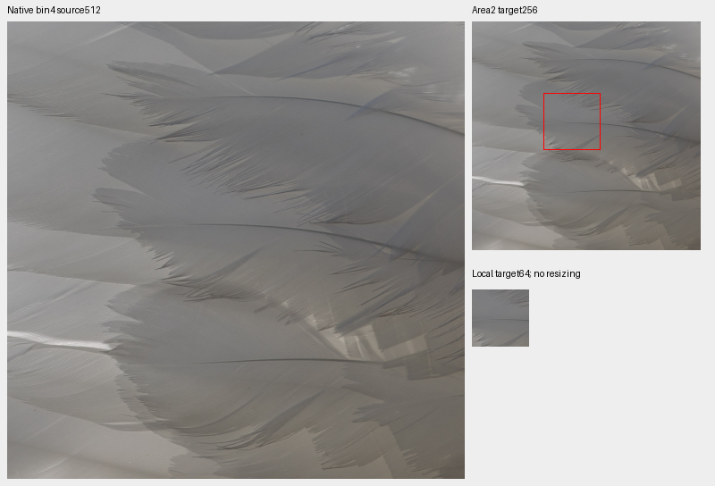
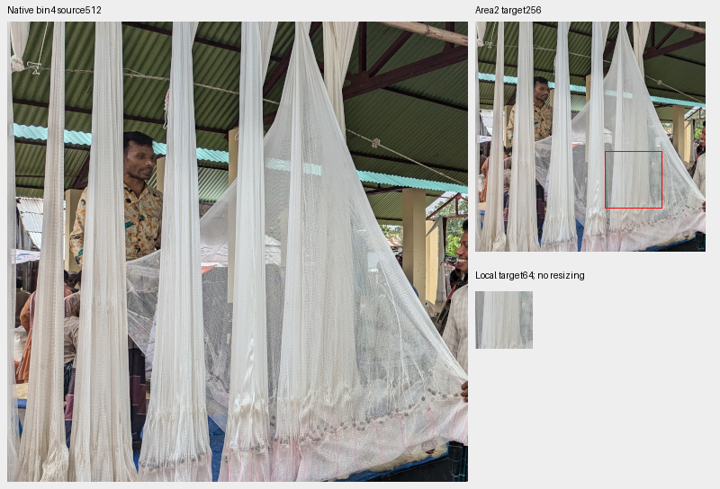
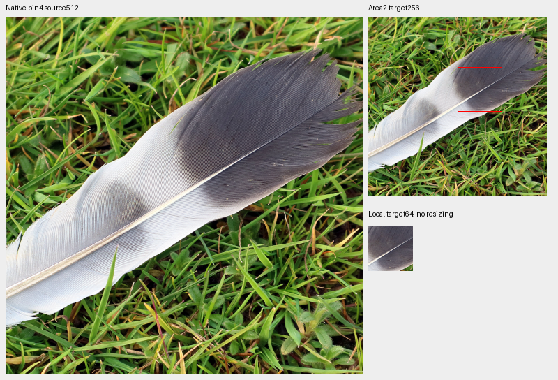
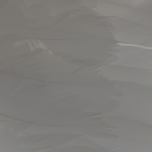

# Qualifying real repeated fine texture for future training

**One pale swan-feather region extends the prepared bank from33 to34 regions.**
It retains weak repeated photographic detail before contrast augmentation.
Eight train-only net, feather, web and fence photographs were inspected; all
remain ordinary photos. Two other proposed annotations were not admitted.
The90,778-photo manifest is unchanged, and V134/V135 retain their frozen33-region
catalogue. This is data preparation, with no measured model-quality gain.

[Decisions and source credits](results/repetitive-material-source-decisions-v1.csv) ·
[Descriptive contrast counts](results/repetitive-material-source-contrast-v1.csv) ·
[Execution, independent pixels and actual reader evidence](results/repetitive-material-source-review-v1.json) ·
[Catalogue](../configs/low-contrast-training-rois-cleaned90778-v2.json) ·
[Native image/source/ROI/display metadata](images/repetitive-material-source-review-v1/manifest.json) ·
[Publication verification](results/repetitive-material-source-publication-v1.json).

## Actual visual admission

Candidates came from title matches in the existing cleaned training manifest,
selected before image inspection. They are not a new high-loss ranking or a
random sample of the corpus. Eight native bin4 source previews, eight original
JPEG512 crops, four proposal boards and four original JPEG1024 follow-ups were
actually viewed. The final augmented feather target was also viewed at native256.
Original pixels honor EXIF/ICC; displayed crop pixels are never resized.

The qualified source is Basile Morin's
[Cygnus feathers](https://commons.wikimedia.org/wiki/File:Cygnus_feathers.jpg),
[CC BY-SA4.0](https://creativecommons.org/licenses/by-sa/4.0/).
Native1024 inspection resolves physical barbs, overlapping feather tips and faint
shadows. The clean area2 target retains repeated low-contrast structure.
Its bin4 context is`[700,400,512,512]`; the local annotation is`[80,80,64,64]`
inside the resulting native256 target. The full context also contains stronger
feather boundaries; it is not uniformly weak or certified noiseless.

Below: native bin4 source512 → clean area2 target256 → local target64, at+0EV.
The red rectangle marks the local annotation; each cell keeps its own native
sample grid. This is a source/target board, not noisy/denoised/GT output.

## Why the other proposals were not added

ROCKY's [fishing-net shop](https://commons.wikimedia.org/wiki/File:Fishing_net_shop_at_Dhap_Sultanganj_Hat.jpg),
[CC BY-SA4.0](https://creativecommons.org/licenses/by-sa/4.0/), contains genuine
fine mesh, but the original JPEG shows alias/moire and processed-looking repeated
edges. The first local annotation also crossed a broad upright; a recorded
visual revision moved it into the hanging net before contrast measurement.
The revised context remains useful ordinary photography, without qualifying
its fine structure as a clean weak-detail target.

The [feather on grass](https://commons.wikimedia.org/wiki/File:Feather_on_Grass.jpg)
has coherent barbs and a strong quill/grass background, but its proposed target
is predominantly high contrast. A fine subject does not by itself qualify a
weak-detail region. It stays ordinary photography. Attribution and license for
this source and all reviewed candidates are in the linked credits/manifest.

Other retained sources include saturated yellow nets, a backlit swan feather,
an iridescent peacock feather, a spider/web and a weathered fence post. Physical
saturation, natural depth of field and stronger texture do not automatically
make them bad photographs. No source is excluded by this pass. The second
swan image is not added just to increase a count; capture independence is
unproven and the selected material already has a representative region.

[Eight original JPEG crops at native512, with all credits in the manifest](images/repetitive-material-source-review-v1/native-original512-review.png).

## Source contrast and the actual training reader

Counts use orthonormal DCT16, linear-sRGB Rec709 luminance, radial band
1/8≤frequency<1/3 cycle/pixel and band RMS divided by block mean. Eligible blocks
have mean.02–.9 and RMS≥1e−5; cached source RGB is in[0,1]. Counts below are
descriptive, with no numerical threshold used to admit or exclude a photograph.

| Proposed source | Local64 blocks below5% / eligible | Full256 blocks below5% / eligible |
| --- | ---: | ---: |
| Qualified swan plumage |11 /16 |186 /256 |
| Net-shop proposal, not admitted |5 /16 |22 /255 |
| Grass-feather proposal, not admitted |0 /16 |12 /256 |

The actual `CleanDataset` uses the current V134 baseline recipe: native256,
bin4→geometry→area2, zero optical PSF,25% photographic contrast attenuation and
5% reviewed quota within photographic draws. Its deterministic new-region
example is global index1229/seed1299. This particular draw **is attenuated**:
252 of256 eligible fine-band blocks fall below5%, including209 below2%.
That is separate from the186/256 intrinsic source count above.

The proof visits all34 regions over83 actual clean reads. All33 common regions
are forced to the same source identity/index in the old and new readers; four
ordinary and four procedural controls also match. All8,060,928 common FP32
values are exact. Bank expansion intentionally changes reviewed-region choices;
the expanded bank does not naturally select the same reviewed source at every index.
Python/NumPy/Torch RNG stays unchanged, CUDA is uninitialized and neural module
calls are forbidden. No sensor observation, RAW decode or optimizer is executed.

Independent UINT32 area2/FP64 display and mirrored-FFT arithmetic verify all816
local/full proposal blocks with maximum statistic error6.11e−16. Native source,
sheet, proposal and actual-reader PNG channels agree; all832,560 checked
target/local channels match exactly, including near rounding boundaries.
The focused existing data suites pass48 tests.

The ledger now contains1,923 unique inspected IDs: four of the eight sources
were already reviewed. The34-region catalogue preserves all33 prior example
objects and binds the same manifest bytes, with unchanged90,778/2,303/2,255
train/validation/test membership. Existing source-order headers and V134/V135
recipes remain bound to their original33-region policy. A future34-region
training/order experiment needs its own declared bindings; none is substituted
into a live job. Both GFX pairs, JPEGs and siblings remain outside training.
