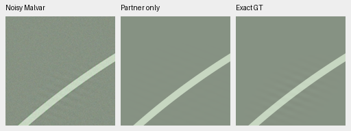
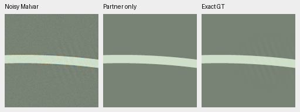

# Locating faint-wire support with reserved RAW

A stronger measured direction can locate useful support for a weaker one.
On two synthetic ISO400 panels, sharing the location only with the other
direction increases faint-wire response and lowers increment error at the same
quiet-error limit. Tapering both directions increases error. Camera tests
retain the coarse lattice and recover no new fine cab crossings.
[Complete metrics, frozen sources and native comparisons](results/reserved-wire-footprint-v1/publication.json).

## Search and independent admission

A [supplied footprint](wire-envelopes.md) helped when its center was right.
This replay estimates the center with the existing screening reserve, one
site per Bayer parity in each absolute 4×4 block. Split the reserve into
two parts. On each part, fit a screened curved rail nuisance and fundamental
carrier predictions, then measure their error on the other part.

At 81 fixed centers, test a broad cosine taper of radius 0.43 times the
query's shorter dimension. Test each nominated direction in turn while the
other remains a competitor. Compare the localized prediction with its
carrier-absent null and with the uniform fundamental fit. Rank by the
smallest standardized gain across the two comparisons and both reserve
folds. The screened and confirmed variants require gains above 0 and 1
respectively. Otherwise they use the uniform fit.

The retained three-quarters of query RAW supplies separate discovery and
validation folds for both directions after the footprint is fixed. The
location score never substitutes for this gate. The final weighted refit
uses all CFA sites after admission is fixed. The variants change the support
provided to that estimator.

- **Uniform** gives both directions a uniform basis.
- **Fixed center** applies the tapered basis to both directions at the query center.
- **Screened** and **confirmed** apply the estimated taper to both directions.
- **Partner only** uses the confirmed location for the other direction. The
  direction which found the footprint keeps a uniform basis, and both
  directions still have their own predictive scores.

The synthetic tests supply nominal frequencies and analytic rail-only
delivery parents. The prior fresh panel and a new offset panel each have
eight geometries across four Bayer layouts per noise profile. Half of
each panel have an interrupted footprint, quadratic phase and signed weak
color. The offset panel increases the along-rail location range from
±35 to ±67 pixels and uses independent geometry and sensor seeds.
Each geometry has independent strong-only and strong-plus-weak captures.

## Synthetic detail

Fixed wave gates and scales are inherited from the prior replay. The
nominal gate is 2 at ISO400 and 1 at ISO6400. Each table cell gives
faint-wire response and increment RMS in DN16 after reducing any arm's
scale that exceeds the uniform fit's quiet-region RMS on that panel.
This is a target-assisted comparison, separate from the fixed-scale
camera and rail-only results.

| Panel | Uniform | Fixed center | Confirmed, both directions | Partner only |
| --- | ---: | ---: | ---: | ---: |
| Prior fresh ISO400 | 2.33% / 6.586 | 5.56% / 6.310 | 5.85% / 6.604 | 8.95% / 6.006 |
| New offset ISO400 | 1.67% / 5.898 | 3.08% / 6.074 | 5.92% / 5.982 | 7.58% / 5.774 |
| Prior fresh ISO6400 | −0.11% / 6.791 | −0.54% / 7.056 | 0.91% / 7.002 | 0.88% / 6.700 |
| New offset ISO6400 | −0.04% / 5.971 | 0.04% / 6.450 | −0.04% / 6.617 | −0.05% / 5.970 |

At fixed scale, the ISO400 partner arm gives **9.04% / 6.004** and
**8.27% / 5.813** on the two panels. Quiet RMS rises from 2.138 to 2.160
and from 1.896 to 2.068 DN16. Strong-wire response changes by less than
0.01 percentage points on both panels. The known-envelope fundamental on
the new offset ISO400 panel reaches **9.53% / 5.632**.

Confirmed center error at ISO400 has a median of 9.93 pixels on the
eight admitted prior cases and 14.12 pixels on the seven admitted
offset cases. The fixed center's median error is 27.89 and 40.89 pixels
across all eight cases in each panel. At ISO6400 the confirmatory gate
chooses only one of eight cases in each panel, with center errors of
44.04 and 28.46 pixels. The weak gain from the prior ISO6400 panel does
not repeat on the offset cases.
[Fixed and quiet-matched results](results/reserved-wire-footprint-v1/summary.json).

### False responses on rail-only scenes

All 48 controls have deliberately misleading carrier frequencies.
Allowing any positive reserve improvement proposes a footprint on all
eight flats, all 16 straight controls and 23/24 complex controls.
Requiring a margin of one reduces these counts to zero, four and three
respectively. Final changed crops can still come from the uniform
fallback. The table gives RMS and peak correction in DN16 over each
native 160×160 crop, at the fixed gate and without correction scaling.

| Exact control | Uniform | Screened both | Confirmed both | Partner only |
| --- | ---: | ---: | ---: | ---: |
| Flat | 0.053 / 3.15 | 0.000 / 0.00 | 0.053 / 3.15 | 0.053 / 3.15 |
| Straight edge or rail | 0.100 / 4.06 | 0.443 / 13.27 | 0.279 / 5.63 | 0.107 / 4.06 |
| Complex rail | 0.207 / 4.40 | 0.506 / 14.55 | 0.207 / 4.40 | 0.208 / 4.40 |

The partner arm adds a changed crop in one straight and one complex
case relative to uniform. A footprint proposal and admitted image
detail are distinct measurements.

## Native synthetic comparisons

The ISO400 triplets show noisy Malvar, the partner-only fit and exact
constructed GT. Both use the native region `[48,48,160,160]` of a
256×256 query, shot/read `8e-5/2.56e-8`, ADC16, black 0.03 and fixed
display exposure ×4. The display uses identity camera RGB and white
balance, and clipped sRGB at contrast 1. The rail-only parent is analytic
and has no checkpoint. The fitted weak structure is still subtle in
the planar crop and remains incomplete in the interrupted offset crop.
[Crop and noise manifest](images/reserved-wire-footprint-v1/manifest.json).

[Prior case all methods](images/reserved-wire-footprint-v1/fresh400-case2-comparison.png) ·
[Offset case all methods](images/reserved-wire-footprint-v1/offset400-case4-comparison.png).

## Native GFX100S review

The camera replay uses the retained whole-frame and spectral guides,
same-side validation and gate 2 above V120 EMA
`a9d9b6b4f974e24a6b11e5e740aab32314233a7f53c056cf37c7d2aac1c589fb`.
The DSCF3879 render uses nominal shot/read `.00128/6.5536e-6` at
exposure ×4. DSCF3880 ISO100 AHD is a qualitative reference.

The sky matches V120 exactly. On the building, the less selective
screen increases the spectral correction from 1.46 to 8.21 DN16 RMS
relative to V120 and adds a faint modulation. Confirmation and the
partner arm return to the uniform result. Foliage stays soft with
all arms. The whole-frame confirmed gate strengthens the coarse fence
slightly. The partner crop retains the uniform lattice and reveals
no new crossings. [Sky](images/reserved-wire-footprint-v1/main-overcast-sky.png) ·
[Building](images/reserved-wire-footprint-v1/main-building-detail.png) ·
[Foliage](images/reserved-wire-footprint-v1/main-foliage.png) ·
[Coarse fence](images/reserved-wire-footprint-v1/main-chain-link-fence.png).

Both confirmed arms reproduce V120 in all four DSCF3842 cab crops.
The lower-margin spectral arm adds 0.0013 DN16 RMS on nominal left,
without visible new texture. The DSCF3835 ISO100 AHD and both camera
JPEGs are independently captured qualitative references. Each cell is
native 160×160 at exposure ×16.

| Cab profile | Shot/read | Native boards |
| --- | --- | --- |
| Nominal | `.00128/6.5536e-6` | [Left](images/reserved-wire-footprint-v1/mesh-nominal-left.png) · [Right](images/reserved-wire-footprint-v1/mesh-nominal-right.png) |
| DSCF3879 profile | `.0014635775921166604/1.0715704128646712e-6` | [Left](images/reserved-wire-footprint-v1/mesh-profile3879-left.png) · [Right](images/reserved-wire-footprint-v1/mesh-profile3879-right.png) |

This CPU component replay uses existing weights. It supplies no new
full427 or held-out camera scores. V120 remains the general recommendation.
