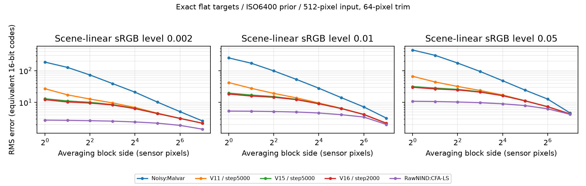
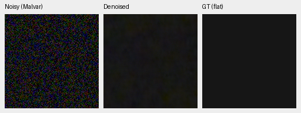
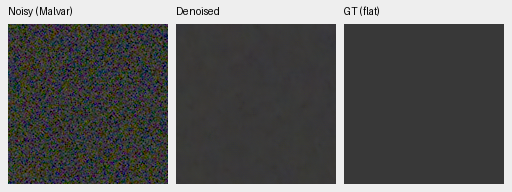
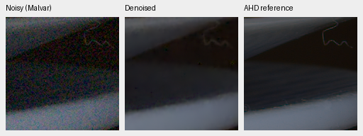
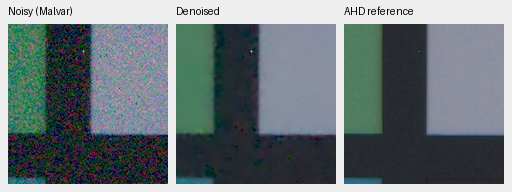

# Residual spatial scales and coarse correction

Exact synthetic flat targets help distinguish residual noise from unknown scene
detail. This diagnostic uses neutral linear-sRGB levels 0.002/0.01/0.05, the
cached GFX camera's CFA/WB/matrix, disclosed ISO6400 priors, 512-pixel inputs and
a 64-pixel trim. One fixed noise realization is used per level. No actual GFX
pixels are training targets, and this is not a photographic quality score or
measured camera noise profile.

For each RGB channel, subtract the error mean, then measure the RMS of averages
over aligned k×k blocks. This is projection onto constant blocks. The absolute
coarse error matters: retained-power fractions can rise simply because fine
noise was removed. Demosaicing and restoration produce correlated residuals;
an independent-noise 1/k² power rule is not assumed for these outputs.

At level 0.01, normalized camera-RGB standard deviations are:

| Method | Total | 8-pixel mean | 32-pixel mean | 64-pixel mean |
| --- | ---: | ---: | ---: | ---: |
| V11 step5000 | 0.00064178 | 0.00021226 | 0.00009922 | 0.00006393 |
| V15 step5000 | 0.00029864 | 0.00019049 | 0.00009735 | 0.00006325 |
| V16 step2000 | 0.00027871 | 0.00018612 | 0.00009744 | 0.00006336 |
| RawNIND, CFA-LS | 0.00008124 | 0.00007584 | 0.00006251 | 0.00005266 |

V15 halves total noise relative to V11 but barely changes the 32/64-pixel block
error. RawNIND also retains coarse residuals, with lower absolute error. These
are different model stages, not a matched-budget ablation. The diagnostic
includes bias separately; the table centers errors before pooling.

Two native 160×160 noisy/V15/exact-GT triplets at levels 0.002 and 0.01, using the
same +2 EV display transform. Open original PNGs at 100%; no resizing:

[Complete numerical/source/weight receipt](results/flat-spatial-scales.json).
The external diagnostic directory also contains the PDF figure and all methods'
native triplets. `scripts/diagnose_flat_scales.py` produces measurements;
`scripts/plot_flat_scales.py` renders the existing results without rerunning models.

This motivated an optional factor8 pooled RGB correction with a 27,696-parameter
network. It uses pooled input variance as a scale proxy, not a claim about
posterior RGB covariance. RGB and decoder context are pooled, a zero-initialized
correction is learned, and the result is interpolated back as a smooth additive
field. The original prediction bypasses this branch. Zero sensor variance makes
the correction exactly zero. Padding handles arbitrary even sensor dimensions.

Tests verify warm-start identity, unchanged ADC-only output after altering the
new weights, gradients confined to the selected branch, exact CPU resume,
frozen-weight preservation, and the ability to remove broad sinusoidal error
while preserving a checkerboard in the pooling nullspace. Existing V15 checkpoint
predictions were compared against their archived original implementation:
all 1,572,864 RGB values in two 512×512 CUDA outputs were bit-identical. This proves
compatibility for that check, not general quality improvement.

V17 trained only the new branch for 1000 steps from frozen V16 step5000, using
the original losses and data mix. It did **not** meaningfully improve quality:

| Method | Known measured-CFA PSNR | Unseen measured-CFA PSNR |
| --- | ---: | ---: |
| V16 step5000 | 53.27466 | 53.07857 |
| V17 step1000 | 53.26982 | 53.08522 |

The same 64-photo synthetic screen is effectively unchanged:
31.96724/0.924058 → 31.96726/0.924065 PSNR/SSIM. Eight-source procedural results
are 29.22482/0.910983 → 29.22556/0.910995. These are smaller subsets, not the full
427-photo/16-procedural-source evaluation. At level 0.01, 32-pixel error changes
from 0.00009647 to 0.00009660 and 64-pixel error from 0.00006318 to 0.00006330.
The coarse branch is held at this review, not promoted. A representable
smoothing operation is insufficient evidence of useful learned denoising.

Native V17 examples from the fixed real development locations; right panel is
the auxiliary AHD reference, not exact RGB GT:

[V17 metrics, parent-matched synthetic screen and flat diagnostics](results/coarse-refiner-v17-1k-review.json).
Next V18/V19 jointly tune restoration/fine correction versus a refiner-only
control with matched data settings and sampled observation hashes, while DINO
stays frozen and the coarse branch disabled. No protected test target selection.

The flat examples are procedural. Real crop sources: Benoit Brummer and Christophe
De Vleeschouwer, *Raw Natural Image Noise Dataset (2025)*,
[dataset](https://doi.org/10.14428/DVN/DEQCIM),
[CC BY-SA 4.0](https://creativecommons.org/licenses/by-sa/4.0/), with additional
scene permissions (`7D-1`: Peter Wemmert, CC0). Modified by registration,
calibration, demosaicing/restoration, crop and shared display.
