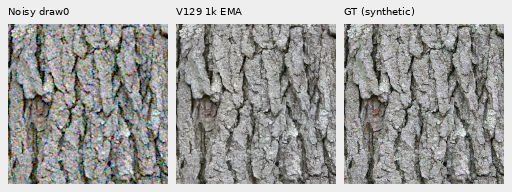
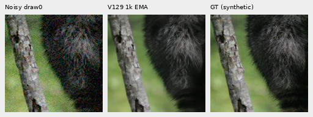
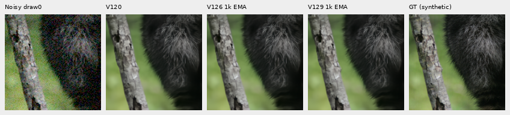
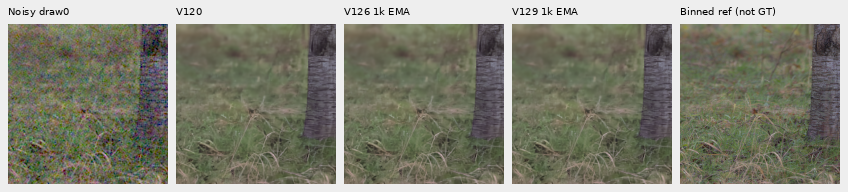

# V129: curated photographic-detail data pilot

**V129's completed1,000-update data pilot shows no useful visible quality gain
against V126.** The new90,782-source/27-region cohort changes mean sRGB PSNR
by+.00093dB on ordinary materials and+.00042dB on shadow cases. All28 native
comparison boards were inspected. Fine fur, foliage and the extra green mesh
remain weak. This short, single-seed pilot does not establish the value of a
longer training run on the curated corpus. V120 remains the general recommendation.

[Scores, training and independent audit](results/v129-data-pilot-quality-v1.json) ·
[Complete material summaries](results/v129-data-pilot-quality-v1.csv) ·
[Image/source/ROI/weights/noise/display metadata](images/v129-data-pilot-quality-v1/manifest.json).

The [V128 feature-loss pilot](v128-feature-pilot-quality.md) also found no useful
gain. V129 retains V120's architecture and reconstruction loss, with the optional
feature and shadow terms off. The next [precision-only trial](training-precision-pilot.md)
uses V129 as its saved BF16 control.

[Recipe](../configs/quality-v120-reviewed-detail-pilot-v129.yaml) ·
[Source decisions/native views](v123-source-review-through15800.md) ·
[27-region catalogue](../configs/low-contrast-training-rois-cleaned90782-v1.json).

The data change withholds one frame dominated by a flat advertising poster and
adds inspected fox fur, feather, thin iron fence/foliage and timber contexts.
All23 preceding region objects remain exact. Validation/test lines and private
GFX holdouts remain unchanged. The catalogue's original preparation-status text
is frozen because the plan binds its bytes; actual pilot status is recorded separately.

V129 and V126 share the V120 EMA parent, seed70, reviewed-region fraction.5,
native256/B16/BF16, single noise view, zero optical blur, paired32/native128,
LR1e−5,100 warmup steps and a fresh1,000-update budget. Commons inputs intentionally
change with the new membership/bank. Every native and paired clean/noisy batch
must match the retained V126 receipt; the domain schedule remains477/262/261.
This is a combined cohort/region-bank intervention rather than an isolated
estimate of the one-source exclusion.

Actual clean-reader preparation visits all27 regions and verifies common
targets. New discarded CPU128/B1 and CUDA256/B16 checks each passed16 updates
plus a two-update resume, with finite91 model/EMA tensors,89 Adam states and
all9 native/paired input hashes exact in each phase. Commons inputs deliberately
differ. [Actual check receipts](results/v129-implementation-checks-v1.json).
Fresh production completed all1,000 updates, with91 finite model/EMA tensors,
89 finite Adam states and1,000 steps per optimizer state. Totals are1,000
training and64 validation forwards,1,064 encoder calls and16,000 target contexts.
All523 native/paired clean/noisy batches match V126; Commons intentionally differs.
Plan budgets were36 check updates plus1,000 production updates,
30minutes/check and8hours production, with
no automatic retry/reset. Admission is52GiB, CUDA cap16GiB and runtime floor32GB.
V126 training/checks/predictions are reused; no control is retrained.

Training plan/status:
`.cache/current-quality-20261023-v1/reviewed-detail-training-pilot-v1/run/`.
The quality queue at
`.cache/current-quality-20261023-v1/reviewed-detail-quality-pilot-v1/queue-v1/`
completed exactly86 candidate restorations on the same retained shadow/material/
main-GFX/extra3842–3835 mesh inputs. Saved V120/V126 controls were reused, with
zero new noise draws or RAW decodes. Independent FFT/display/pixel auditing
passes240 metric rows,60 summaries,3,975 scalar fields and17,203,200 channel values
in56 PNGs. All28 comparison boards were actually viewed in seven unchanged
native sheets. V123 and its original dependent chain retain their budgets and inputs.

Checkpoint SHA256:
`5f17520fd68aed7865cd3094d77ec4368492cb67413df37a2787724ad19509c0`.

| Fixed support | V120 | V126 control | V129 |
| --- | ---: | ---: | ---: |
| Ordinary sRGB PSNR |32.30426 |32.30861 |32.30954 |
| Shadow sRGB PSNR |25.90197 |25.89620 |25.89662 |
| Ordinary camera-RGB PSNR |38.93740 |38.93942 |38.93996 |
| Shadow camera-RGB PSNR |32.39347 |32.40036 |32.40024 |

Means use four-CFA groups on four source photographs; same-source noise/exposure
conditions are not independent photos. Ordinary inputs use nominal ISO12800.
Shadow support adds gains1/8 and1/32 at ISO6400/12800, scored after the fixed
inverse display exposure. Native grass/wood references are binned low-noise
estimates; synthetic Commons targets are exact for their declared operator.
These selected cases do not replace full427-photo or camera validation.

Faint-fur projection rises from.32853 to.32991, with slightly higher band error
and orthogonal residual. The selected2–5% grass bin rises from.68082 to.68449,
also with higher error/residual. Greater projection alone does not establish
better detail recovery. Both changes remain visually subtle.

Native160px triplets, noisy → V129 → exact synthetic GT; RGGB, ISO12800 prior,
shot.00256/read.0000262144,16-bit ADC/black.03, central ROI48,48,160,160,+0EV:

Sources: Kentucky coffee-tree by Derek Ramsey, CC BY-SA2.5; raccoon by Korall,
CC BY3.0. Original source links and exact transformations are in the
image manifest. Pixels are copied without resizing.

The full comparisons add retained V120/V126 columns before V129:

Real captures use the same WB/matrix and native160px crops. Main DSCF3879/3880
foliage/fence use512px contexts and+2EV; extra DSCF3842/**DSCF3835** mesh uses768px
contexts and+4EV under both fixed noise profiles. The independent ISO100 images
are approximate qualitative references, not exact GT; no real-reference PSNR
or inference fitting is used.

