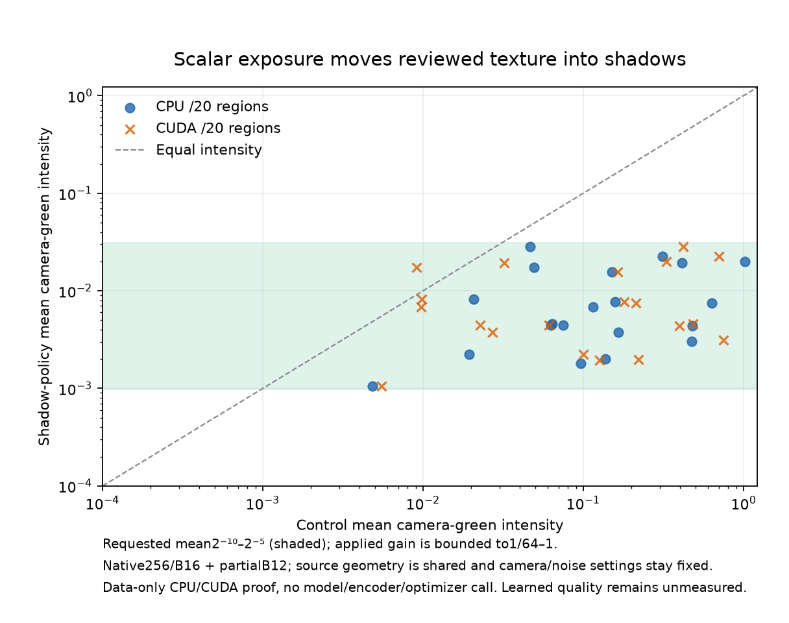

# Shadow exposure of reviewed photographic detail

**An optional training augmentation now places reviewed material crops in a
dark sensor range while preserving their geometry and color ratios.** It is
disabled by default, passes actual CPU/CUDA preparation checks, and is ready
for a future matched training trial. Its learned-quality effect is unmeasured.
V120 remains the current recommendation. Active V122/V123 and queued V124/V125
retain their original sources, recipes and budgets.

The [sensor-condition coverage check](training-target-contrast-coverage.md#shadow-brightness-and-sensor-noise)
motivates testing this idea alongside the user's underexposed real photographs.
The short retained prefix contains weak material in midtones, but relatively
few weak blocks in the coarse dark/noisy cell containing the two fixed GFX
mesh proxies. Seven reviewed-region draws contribute none in that cell.
This is a bounded inspection cue, not proof of a whole-corpus gap or camera
calibration. Neighboring cells and the small sample matter.

## Data behavior

The new settings apply only to **already-reviewed Commons photograph regions**:

```yaml
reviewed_shadow_fraction: 0.5
reviewed_shadow_policy: reviewed-shadow-green-v1
data_seed_per_step: true
```

The fraction is conditional on a selected reviewed photographic ROI; the
existing reviewed-ROI quota remains separate. This example is an experimental
setting, without a selected or queued model. A positive fraction requires the
existing reviewed catalogue and ROI fraction. Missing settings mean zero.

For selected crops, the policy samples a requested **dense camera-green mean**
log-uniformly from 2⁻¹⁰ to 2⁻⁵, then uses one scalar exposure gain bounded to
**1/64–1** of the unexposed source. Requested brightness can be unreachable at
those bounds, so preparation records both the request and the actual gain.
It can also brighten a crop relative to its ordinary random-exposure control
while remaining within this bound on the original source.

The source's bin4 → geometry → area2 path is unchanged. There is no additional
resizing, interpolation, PSF blur or contrast attenuation in this policy.
Camera matrix, WB, CFA, shot/read coefficients and ADC settings retain their
original draws. Ordinary photos, procedural sources, native-camera batches,
real paired captures and validation keep their existing behavior. Commons
provenance is enabled when needed; selection uses a separate deterministic
per-source stream and adds no global RNG draw.

Each unique target is still prepared once before independent noise views are
drawn. Both views share the same exposure, geometry and conditioning. Changing
Poisson intensities can change noise draws for other examples within an affected
batch; the policy does not promise unchanged noisy pixels there. Existing
per-step seeding and saved RNG state preserve deterministic resume. Changed
fraction or policy is rejected before model construction on resume; use a
fresh initialized run for a new data intervention.

`source-loss.jsonl` records the optional selected flag, requested green mean and
actual exposure gain. Existing records omit those fields when the policy is off.
No inference option or checkpoint transformation is introduced.

## Actual preparation checks

The proof uses the separate [90,783-source/twenty-region bank](current-source-loss-review.md),
seed68 and all twenty reviewed regions plus four ordinary and four procedural
controls. The actual reader prepares28 native256 contexts once. Their geometry
is then shared by the frozen old preparation code, current zero-policy control
and enabled policy, on CPU and CUDA. Batches are16 plus a partial12, with two
independent sensor observations per target.

The engineering proof forces Commons and fraction1 to exercise every reviewed
region. It is not a production prefix or a proposed full-training budget.
Across six device/variant workers, there are336 sensor observations and twelve
prepared batches, with **zero neural/encoder calls, RAW decodes or optimizer
updates**. CUDA peaks at183,521,792 allocated bytes under a2GiB cap.



| Actual device | Control median camera-green mean | Shadow median | Shadow range | Minimum gain bound active |
| --- | ---: | ---: | ---: | ---: |
| CPU | .126023 | .005749 | .001049–.028373 | 4/20 regions |
| CUDA | .145069 | .005747 | .001049–.028373 | 5/20 regions |

CPU/CUDA random camera/noise draws differ; these rows do not rank device quality
or timing. The same target source geometry and requested brightness stream are
reused. These are dense-green context means, distinct from the measured-green
native16 block statistics in the coverage analysis.

Independent NumPy checks establish:

- **69,733,440 preparation-array values** match the frozen old code exactly
  with the policy disabled, across both devices.
- **11,010,048 exposed-RGB values** equal the original prepared RGB multiplied
  by its recorded scalar gain exactly; color ratios and geometry are preserved.
- **12,582,912 unselected target values** remain exact. Camera/noise settings
  remain exact for all28 contexts on each device.
- **7,340,032 candidate variance values** match the supplied shot/read formula
  exactly. Independent camera/target reconstruction and gain calculations also
  pass; maximum gain difference is2.36e−8.
- Both noise views retain identical targets and exposure metadata. All worker
  Python/Torch CPU/CUDA RNG states are unchanged outside the seeded preparation
  context. Original active/queued input guards pass.

The focused regression run passes104 tests with one optional hardware case
skipped in its CPU environment; the separate actual CUDA preparation above
completes. Tests include exact local-model checkpoint/EMA/optimizer/RNG resume,
default behavior, clipping bounds, source selection, diagnostic logging,
independent-noise pairs and native/paired-domain bypass. Ruff passes. These
implementation fixtures do not establish trained restoration quality.

[Complete frozen-source, CPU/CUDA and independent verification receipt](results/reviewed-shadow-exposure-readiness-v1.json) ·
[All56 device/context case rows](results/reviewed-shadow-exposure-cases-v1.csv) ·
[Chart source/data and actual viewing](images/shadow-training-readiness-v1/manifest.json).

Implementation: [policy](../src/demosaic/shadow_exposure.py),
[physical preparation](../src/demosaic/data.py),
[training integration](../src/demosaic/train.py), and
[source diagnostics](../src/demosaic/source_loss.py).

A future comparison should initialize from the best useful completed
architectural baseline after the current trials, with matched data, seed,
budget and evaluation observations. It should compare shadow-detail retention,
grain, ADC/color behavior, camera scores and the standing GFX scenes, including
native noisy/restored/GT triplets and correctly labeled independent references.
No training run is started or queued by this readiness change. Both private
train/platform pairs and their siblings remain outside training.
