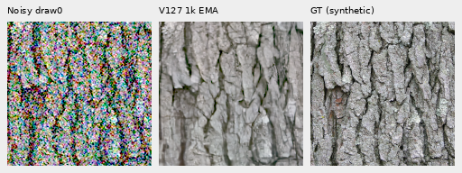
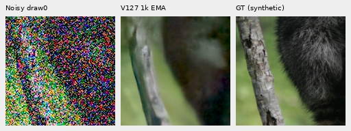

# V126/V127: completed shadow-data pilot

**The matched1,000-update pilot shows no useful quality gain from the reviewed
shadow-exposure policy.** V127 averages−.00121dB against its V126 control across
the sixteen shadow target/condition groups. Native comparisons still show lost
fine fur, softened grass/foliage and weak green mesh. V120 remains the general
recommendation, and reviewed shadow exposure stays off by default.

[Complete receipts, counts and independent checks](results/reviewed-shadow-pilot-quality-v1.json) ·
[All twenty material conditions](results/reviewed-shadow-pilot-quality-v1.csv) ·
[Source/ROI/checkpoint/conditioning/display metadata](images/reviewed-shadow-pilot-quality-v1/manifest.json) ·
[Publication and live-waiter verification](results/reviewed-shadow-pilot-publication-v1.json) ·
[Matched recipes and preparation](reviewed-shadow-training-pilot.md).

## Actual matched training

Both arms completed1,000 fresh updates from V120 Small on90,783 cleaned sources
and23 reviewed regions, seed70, batch16/native256/BF16, LR1e−5 and100 warmup
steps. Both use a50% reviewed-region quota within conditional photographic
draws. V126 applies no reviewed shadow exposure; V127 applies it to half those
reviewed draws, selecting1,367 of16,000 total training targets. Architecture,
encoder, data, noise/loss policy and update budget otherwise match.

Each arm prepared477 Commons/procedural,262 native and261 paired batches, with
1,000 optimizer/training forwards and64 validation forwards. All91 model/EMA
tensors and89 AdamW states are finite at step1,000. Peak CUDA allocation is
7,046,391,296/7,047,570,944 bytes. This is not a throughput comparison.

| Arm | Full checkpoint SHA256 |
| --- | --- |
| V126 control | `04bd122e639f94be65ecec5abdc750810d9df4df7661e3ddb06ed309e32e3294` |
| V127 shadow | `efdc8edc824084679b7781ed4c7966ad0d237ead37d3d8114a0dc61158868e77` |

The official frozen DINOv3 Small encoder remains
`691963f0f796aac860d818d59d9d14287a4675612829fbe9467c7f5df8ce5b14`.
The50% reviewed quota differs from the original5% production quota. Comparisons
with V120 also include that quota, changed data and1,000 additional updates.
Only V127 versus V126 isolates this particular shadow policy in this pilot.

## Fixed-input results

Each new endpoint completed exactly86 IEEE-FP32 root/encoder forwards:64 fixed
shadow observations,16 retained ordinary-material observations, four main-GFX
512px contexts and two extra-mesh768px contexts. The original V120 shadow64
observations and old material/GFX controls are reused. Evaluation totals236
forwards across the three models, with no old-control inference, new RAW decode,
noise resampling or optimizer work during evaluation/reporting.

The shadow set has four sources ×two camera gains ×two nominal priors ×four
CFAs, one draw per combination. These are **four sources**, not64 independent
photographs. Camera/sRGB scores apply the same fixed inverse exposure before
reduction. Bark/fur targets are synthetic GT; native grass/wood are binned
camera estimates, not exact GT. No full427-photo or all-camera test is claimed.

| Mean sRGB PSNR, dB | V120 | V1261k | V1271k | V127−V126 |
| --- | ---: | ---: | ---: | ---: |
| Sixteen shadow target/condition groups | 25.90197 | 25.89620 | 25.89500 | −.00121 |
| Four ordinary material groups | 32.30426 | 32.30861 | 32.30505 | −.00356 |

V127−V126 shadow changes range from−.03133dB to+.01370dB. The largest loss is
wood at gain1/32 with the ISO12800 prior; the largest gain is the same wood at
gain1/32 with the ISO6400 prior. Broad averaging does not establish a scene-level
improvement. Weak fur at gain1/32/ISO12800 loses.00275dB versus the control and
remains visibly soft. Its2–5%-contrast band projection rises slightly while band
error also rises; that does not establish recovered detail.

Two native160×160 triplets below show **noisy → V1271k EMA → exact synthetic
GT**, with identical central ROI`[48,48,160,160]`, WB/matrix and +5EV (×32)
display. No crop pixels are resized. Bark uses gain1/32, nominal ISO6400
shot`.00128`/read`6.5536e−6`; fur uses gain1/32, nominal ISO12800
shot`.00256`/read`2.62144e−5`. These are nominal priors, not camera calibration.

Matched noisy/V120/V126/V127/GT boards:
[bark](images/reviewed-shadow-pilot-quality-v1/V127-bark-gain1over32-iso6400-prior-comparison.png) ·
[fur](images/reviewed-shadow-pilot-quality-v1/V127-raccoon-fur-gain1over32-iso12800-prior-comparison.png).
The control has its own native triplets:
[V126 bark](images/reviewed-shadow-pilot-quality-v1/V126-bark-gain1over32-iso6400-prior-triplet.png) ·
[V126 fur](images/reviewed-shadow-pilot-quality-v1/V126-raccoon-fur-gain1over32-iso12800-prior-triplet.png).

Bark: Derek Ramsey (Ram-Man),
[Kentucky Coffee-tree](https://commons.wikimedia.org/wiki/File:Kentucky_Coffee-tree_Gymnocladus_dioicus_3264px.jpg),
[CC BY-SA2.5](https://creativecommons.org/licenses/by-sa/2.5/).
Fur: Korall,
[Racoon clinging to a tree](https://commons.wikimedia.org/wiki/File:Racoon_clinging_to_a_tree.JPG),
[CC BY3.0](https://creativecommons.org/licenses/by/3.0/).
These are binned, cropped, camera-transformed, exposure-scaled and synthetically
noised derivatives.

## Real captures and independent verification

All28 matched comparison boards were actually viewed at native resolution:
sixteen shadow conditions, four ordinary materials, four main-GFX regions and
four extra-mesh ROI/profile combinations. Main-scene foliage remains painterly;
the larger chain-link structure stays coherent but shows no useful new gain.
The extra fine green mesh remains largely erased under nominal conditioning
and weak/irregular under the fixed nearby-capture profile. Both independent
ISO100 captures are qualitative references, **not exact GT**.

[Main-scene foliage and fence](gfx-qualitative.md#v126v127-completed-shadow-pilot) ·
[Corrected DSCF3842/DSCF3835 mesh pair](gfx-green-mesh.md#v126v127-shadow-data-pilot).

The [independent audit](../scripts/audit_checkpoint_pilot.py) recomputes400 metric
rows and100 four-CFA summary groups using channelwise FP64 color and a mirrored
FFT DCT implementation. All6,625 scalar fields agree within7.11e−15dB for
PSNR and3.89e−15 for projection gain. Every32,256,000 channel value in112 PNGs
matches its independently rendered native source cell exactly. No Torch import,
model construction, CUDA, noise generation or RAW decode occurs in this audit.

This short, focused intervention has not fixed the weak-detail failure. Its
completed evidence supplies no reason to change the default policy or the
current general model. Longer/different sampling remains an open experimental
question; the [bounded frequency continuation](v123-memory-guard-recovery.md)
and [matched mean-loss trial](conditional-mean-training.md) retain their original
recipes and budgets.
