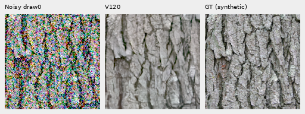
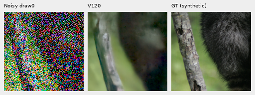

# Matched shadow-data pilot: V126/V127

**Both1,000-update arms and their fixed-input evaluation are complete.
No useful quality gain is visible.** The [completed comparison](reviewed-shadow-pilot-quality.md)
includes independently checked metrics and native100% crops. Both arms start from completed V120 Small
EMA on90,783 sources and23 reviewed regions. V120 remains the current general
recommendation. Original V122/V123 and V124/V125 inputs, parents and
budgets are unchanged.
V123's [saved-state continuation](v123-memory-guard-recovery.md) and final
[quality review](v122-v123-quality.md) are complete; no pilot training is repeated.

[Execution and independent checks](results/reviewed-shadow-training-pilot-setup-v1.json) ·
[Publication/live-owner verification](results/reviewed-shadow-training-pilot-publication-v1.json) ·
[Common inference-operator identity](results/reviewed-shadow-pilot-operator-identity-v1.json) ·
[Policy and preparation proof](reviewed-shadow-exposure.md) ·
[Inspected material bank](v123-source-review-through9800.md).

## Matched recipe

| Setting | V126 control | V127 shadow arm |
| --- | --- | --- |
| Recipe | [Control](../configs/quality-v120-reviewed-shadow-pilot-v126.yaml) | [Shadow](../configs/quality-v120-reviewed-shadow-pilot-v127.yaml) |
| Parent / data / seed | V120 Small EMA /90783 and23 regions /70 | Same |
| Conditional reviewed-region quota | .5 | .5 |
| Shadow fraction within reviewed draws | 0 | .5 |
| Updates / LR / warmup | 1,000 /1e−5 /100 | Same |
| Context / batch / precision | Native256 /16 /BF16, one noise view | Same |

The higher reviewed quota exercises the policy in this short pilot. It differs
from the original5% quota and is shared by both arms. Comparing either with
V120 also includes changed data, quota and training history. This is not a
recommendation to change all training.

Both retain V120's V84-family DRUNet RGB trunk, official frozen DINOv3 Small,
50% Commons/procedural,25% paired and25% native schedule, corrected paired32/
native128 catalogues, camera proportions, zero optical blur, geometry before
final area2 reduction and reconstruction losses. Mean-prediction and normalized
band losses are off. The main3879/3880 and extra3842/3835 GFX pairs and siblings
remain outside training. The catalogue's original preparation-status text stays
byte-bound; its23-region option is now used by this pilot.

## Actual checks

Each arm completed16 fresh plus2 resumed updates on CPU128/B1/FP32 and
CUDA256/B16/BF16. Production starts freshly from V120. All91 model/EMA tensors
and89 AdamW states are finite at step18; exact parent/resumed weights and the
official encoder pass. Eight changed fraction/policy resumes are rejected
before model construction.

Checks total72 training/encoder calls and optimizer updates over612 contexts:
510 simulated observations and102 real paired observations. Thirty targets use
shadow exposure. Independent checks establish2,754 matched camera/noise values,
46,301,184 exact unselected target values,86,264,514 exact native/paired bypass
values and31,948,800 exact variance values. Selected scalar camera-space
transport differs by at most3.04e−8. No noisy-pixel parity is promised inside an
affected Commons batch. All34 focused tests pass.

CUDA peaks are7,041,804,800/7,043,878,912 bytes under a16GiB cap. A controller
handoff reused three completed checks and changed only the launch floor from64
to52GiB:16GiB allocator +4GiB host overhead +32GiB planning reserve. The32GB
runtime floor, original pending-CUDA wait deadline,30-minute check limits and
8-hour production limits remain unchanged. No model step is repeated or worker limit extended;
only the new pilot's idle controllers were replaced.

## Fixed shadow test and current V120 baseline

The64 new observations cover four retained held-out targets ×camera gains1/8
and1/32 ×nominal ISO6400/ISO12800 priors ×four CFAs, one fixed draw per combination.
Shared display exposures×8/×32 exactly invert the gained target arrays.
Native-camera references are binned estimates, **not exact noiseless GT**.

Shot/read priors are`.00128/6.5536e−6` and`.00256/2.62144e−5`,16-bit ADC/black`.03`,
not measured camera calibration. Independent checks verify1,572,864 target/
inverse-exposure values and4,194,304 variance/ADC values exactly, preserving
723,154 negative measurements. A screen correction adopted32 existing
observations without resampling and generated32 more:64 total.

**V120 completed these64 new inputs**, with unchanged model and encoder hashes.
Below are four-CFA mean sRGB PSNRs after fixed inverse display exposure. Four
sources do not constitute64 independent photographs.

| Target | 1/8, ISO6400 | 1/8, ISO12800 | 1/32, ISO6400 | 1/32, ISO12800 |
| --- | ---: | ---: | ---: | ---: |
| Bark, synthetic GT | 25.4557 | 23.2943 | 21.2451 | 19.4042 |
| Fur, synthetic GT | 29.9818 | 28.0152 | 25.8721 | 24.2837 |
| Native grass, estimate | 28.5885 | 27.3506 | 26.1107 | 25.0126 |
| Native wood, estimate | 30.2193 | 28.4490 | 26.8051 | 24.3437 |

[Baseline values](results/reviewed-shadow-pilot-V120-baseline-v1.csv).
Camera-RGB PSNR and band errors also use exposure-normalized units. These
selected cases do not establish whole-corpus quality.

Two actually viewed native160px triplets: noisy → **current V120** → exact
synthetic GT. Gain1/32, shared +5EV (×32), identical source/ROI/WB/matrix and no
resizing. Bark uses ISO6400; fur ISO12800. Fine bark softens and weak fur largely
disappears. **These contain no V126/V127 result yet.**

Bark: Derek Ramsey (Ram-Man),
[Kentucky Coffee-tree](https://commons.wikimedia.org/wiki/File:Kentucky_Coffee-tree_Gymnocladus_dioicus_3264px.jpg),
[CC BY-SA2.5](https://creativecommons.org/licenses/by-sa/2.5/).
Fur: Korall,
[Racoon clinging to a tree](https://commons.wikimedia.org/wiki/File:Racoon_clinging_to_a_tree.JPG),
[CC BY3.0](https://creativecommons.org/licenses/by/3.0/).
Binned/cropped, camera-transformed, exposure-scaled and synthetically noised
derivatives. [Exact source/ROI/checkpoint/noise/display metadata](images/reviewed-shadow-pilot-v1/manifest.json).

Independent FFT/color checks verify64 metric rows (848 fields) and7,372,800
channel values across32 PNGs; maximum PSNR difference7.11e−15dB. The reporting
update also reproduces the prior V123 report's48 rows,12 summaries and24 PNG
bytes exactly without inference.

The completed queue added86 calls per new model after both endpoints finished:64 shadow,
16 retained ordinary-material, four main-GFX512 and two extra-mesh768 contexts
under both fixed profiles. Evaluation totals236 calls including V120's
completed64. Old controls are reused. Independent metrics and actual native
inspection are complete; full427/all-camera/color/full-frame scope is not in this pilot.
[Queue](../scripts/queue_shadow_pilot_quality.py) ·
[Saved-output reporting](../scripts/report_shadow_pilot_endpoints.py).
