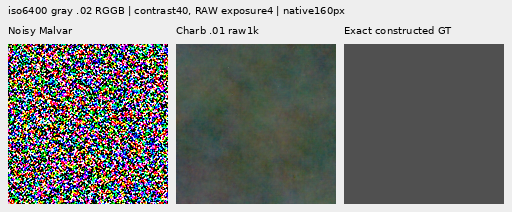
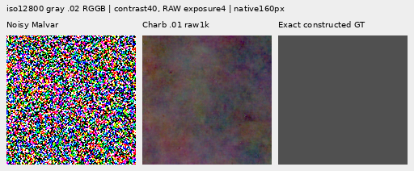
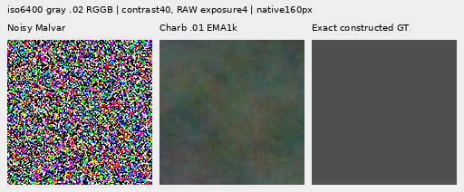
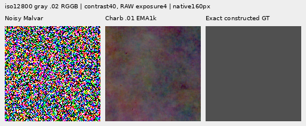
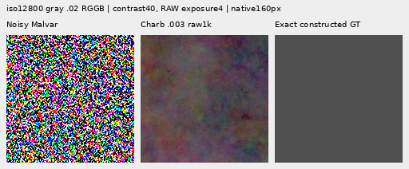
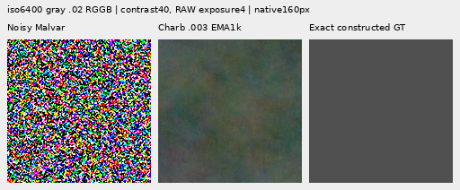
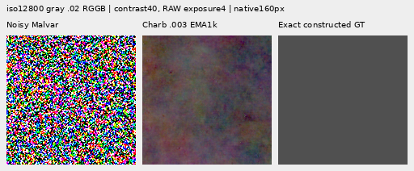

# V154: small flat-field gain, weaker detail and worse neighboring quiet regions

The completed matched trial gives more relative gradient pressure to weak
delivered-RGB spectral errors. All four robust raw/EMA endpoints reduce
native512 noisy-flat RMS **0.45–0.50% versus V143**, and present-mesh actual
blank RMS **0.21–0.27%**. Both improve over the exact RGB-MSE control.
These are useful narrow gains: **broad colored mottle remains**, mesh response
falls relative to control, natural detail weakens further, and exact quiet
regions beside structure get **1.51–2.27% worse than V143**. The fine real cab
fence is still largely missing. Standalone flats do not predict quiet-area safety.

All three fresh 1k heads, six fixed endpoints, 822 shared cases, 96 native figures
and independent audits are complete. The MSE control reproduces V153's
**delivered-RGB**, not delivered-mosaic, trace/raw/EMA/Adam and all 1,644 arrays
exactly. No endpoint was selected by early stopping. This adaptive reused cohort
is development evidence, not a blind generalization test.

Keep [V153's stronger mesh-response prototype](delivered-spectral-objective.md),
the quieter [V151](noisy-objective-training.md)/[V152](relative-phase-estimator.md)
comparators, [V150's ADC photo strength](objective-floor-training.md), and this
new flat-field gain available for further work. [V120 Small](current-model.md)
remains the general choice; optional V143 periodic detail retains its separate
real-mesh gain. There is no useful new general restoration default from V154.

## Mesh response and actual blank errors

256 present cases; four related CFA placements per recipe. RMS is scene-linear
RGB error in DN16, averaged over cases. Response is a GT-template projection,
not accuracy or a calibrated detection probability. Actual blank RMS measures
output versus true empty RGB; added blank RMS measures change from the parent.

| Method | Present full RMS | Response | Actual blank RMS | Blank spatial RMS | Added blank RMS |
| --- | ---: | ---: | ---: | ---: | ---: |
|V143|9.111243|0.02202090|5.523323|5.343113|0.00000000|
|MSE raw|9.065995|0.02583932|5.529598|5.349611|0.45695545|
|MSE EMA|9.073765|0.02453732|5.524094|5.343926|0.41348850|
|Charb .01 raw|9.068613|0.02413885|5.511892|5.331285|0.42009785|
|Charb .01 EMA|9.076687|0.02310800|5.509611|5.328917|0.39409383|
|Charb .003 raw|9.071095|0.02379580|5.510347|5.329688|0.41349557|
|Charb .003 EMA|9.078934|0.02285255|5.508550|5.327819|0.38784880|
|Existing periodic detail|8.586126|0.07089755|5.523328|5.343118|0.00063557|

Robust response stays 3.78–9.62% above V143 but reaches only 2.29–2.41% of GT,
below matched MSE's 2.45–2.58%. Present full RMS is slightly worse than MSE.
Actual blank RMS improves instead of merely shrinking added correction.
On all256 absent cases robust full RMS is 5.22340–5.22604 versus V1435.23791;
MSE is 5.23738–5.24198. These small empty-field gains coexist with the stronger
mixed-scene quiet failures below. Periodic detail has stronger response but
substantial texture/error and support limitations; it is a separate estimator.

## Noisy flats and natural photographs

Each native512 flat group has24 cases; the older256 ISO12800 group has24.
Spatial RMS removes the full-image mean. Block32 measures coarse error after
32×32 averaging without fitting it away. Lower values are better.

|Flat test|V143|MSE raw|MSE EMA|Charb .01 raw|Charb .01 EMA|Charb .003 raw|Charb .003 EMA|
| --- | ---: | ---: | ---: | ---: | ---: | ---: | ---: |
|Native512 ISO6400 full RMS|18.546808|18.526464|18.513829|18.457375|18.457054|18.454736|18.456346|
|Native512 ISO6400 spatial RMS|18.235130|18.214455|18.201512|18.144151|18.143743|18.141459|18.143018|
|Native512 ISO6400 block32 RMS|13.440561|13.440939|13.440410|13.439535|13.439151|13.439457|13.439167|
|Native512 ISO12800 full RMS|24.071890|24.048808|24.030195|23.963537|23.959810|23.959398|23.958754|
|Native512 ISO12800 spatial RMS|23.596861|23.573335|23.554204|23.486278|23.482382|23.482034|23.481289|
|Native512 ISO12800 block32 RMS|17.932544|17.931620|17.931519|17.930103|17.930209|17.929988|17.930140|
|Older native256 ISO12800 full RMS|27.233548|27.207559|27.182713|27.107266|27.099364|27.102415|27.097822|
|Older native256 ISO12800 spatial RMS|26.017191|25.990140|25.963698|25.884352|25.875779|25.879135|25.874024|
|Older native256 ISO12800 block32 RMS|19.539875|19.539392|19.539618|19.537372|19.538051|19.537426|19.538097|

Robust native512 full RMS falls about0.48–0.50% at ISO6400 and0.45–0.47% at
ISO12800 versus V143. Coarse block32 gains are only about0.008–0.014%; broad
patches remain in the native stress crops. The ISO12800 crop-block32 metric
still exceeds V143 by0.015–0.019%. A small whole-field gain is not clean sky.

Photo groups each contain32 cases. Band response is the scene-linear sRGB-luma
projection onto the constructed target's local band. Band error measures total
relative band error, so increased response alone does not establish restoration.

|Photo test|V143|MSE raw|MSE EMA|Charb .01 raw|Charb .01 EMA|Charb .003 raw|Charb .003 EMA|
| --- | ---: | ---: | ---: | ---: | ---: | ---: | ---: |
|Retained512 faint full RMS|33.963754|33.961085|33.962786|33.974867|33.973594|33.975623|33.973935|
|Retained512 faint band error|0.824639|0.824517|0.824672|0.824625|0.824745|0.824651|0.824755|
|Retained512 faint band response|0.298560|0.297382|0.297002|0.294344|0.294478|0.294327|0.294520|
|Retained512 dark full RMS|29.097715|29.093401|29.094114|29.106763|29.105115|29.107276|29.105373|
|Retained512 dark band error|0.661447|0.661406|0.661441|0.661609|0.661614|0.661614|0.661615|
|Retained512 dark band response|0.531446|0.529480|0.529353|0.526762|0.526998|0.526823|0.527090|
|Organic384 faint full RMS|37.469061|37.467960|37.473484|37.477171|37.479935|37.477857|37.480020|
|Organic384 faint band error|0.924117|0.924263|0.924464|0.924268|0.924432|0.924267|0.924415|
|Organic384 faint band response|0.150701|0.149739|0.149298|0.148016|0.147922|0.148009|0.147969|
|Organic384 dark full RMS|33.685796|33.684591|33.686215|33.696607|33.695857|33.697009|33.695996|
|Organic384 dark band error|0.781612|0.781602|0.781623|0.781591|0.781603|0.781590|0.781600|
|Organic384 dark band response|0.398945|0.397297|0.397081|0.394945|0.395125|0.395002|0.395216|

All robust photo groups have higher full RMS than V143, by0.022–0.035%.
Band response falls further than MSE, approximately1.35–1.84% below V143.
Retained-faint and organic-dark relative band errors can improve slightly,
while other band errors worsen. Feather/grass/branch detail remains visibly soft.
The flat-field gain does not transfer into better natural texture.

## Exact quiet regions beside structure

Sixteen cases per prior, comprising steps, a bar and a patterned patch with
an exactly quiet dark neighbor. Whole-image RMS and quiet-mask RMS answer
different questions. Quiet spatial RMS removes quiet-mask DC.

| Prior | Method | Whole RMS | Quiet RMS | Quiet spatial RMS |
| --- | --- | ---: | ---: | ---: |
|ISO6400|V143|27.105631|3.898845|3.268502|
|ISO6400|MSE raw|27.040450|3.932401|3.307233|
|ISO6400|MSE EMA|27.046026|3.917796|3.289952|
|ISO6400|Charb .01 raw|27.097686|3.986253|3.371469|
|ISO6400|Charb .01 EMA|27.097065|3.960906|3.341586|
|ISO6400|Charb .003 raw|27.100896|3.987465|3.372871|
|ISO6400|Charb .003 EMA|27.099589|3.961206|3.341950|
|ISO12800|V143|36.747466|6.152652|5.341833|
|ISO12800|MSE raw|36.540356|6.186339|5.379674|
|ISO12800|MSE EMA|36.576072|6.176355|5.368321|
|ISO12800|Charb .01 raw|36.712275|6.275219|5.480776|
|ISO12800|Charb .01 EMA|36.724268|6.246112|5.448045|
|ISO12800|Charb .003 raw|36.722513|6.276022|5.482116|
|ISO12800|Charb .003 EMA|36.732383|6.245435|5.447627|

Robust quiet RMS rises1.59–2.27% at ISO6400 and1.51–2.01% at ISO12800 versus
V143. The MSE-control rises only0.49–0.86% and0.39–0.55%, respectively.
Quiet spatial RMS rises roughly2.0–3.2% under robust losses. Whole-image
metrics conceal this local cost: these scenes remain slightly better than
V143 overall, but worse than matched MSE. Contrast40 quiet crops show colored
blobs in truly constant regions. Their presence prevents a clean-flat claim.

## ADC photographs and sloped fields

Forty-eight constant ADC-only fields across each of six endpoints give288
predictions **bit-exact to the parent**. Eight ADC-only photo cases across the
four robust endpoints give another32 **bit-exact parent arrays**. This preserves
the parent's ADC photo behavior where MSE regresses, but gives none of V150's
roughly3.06% ADC photo RMS improvement. Exact parent equality is not exact GT.
Sloped512 fields have16 cases, without shot/read noise.

|ADC test|V143|MSE raw|MSE EMA|Charb .01 raw|Charb .01 EMA|Charb .003 raw|Charb .003 EMA|
| --- | ---: | ---: | ---: | ---: | ---: | ---: | ---: |
|Photo full RMS|18.149871|18.162996|18.162011|18.149871|18.149871|18.149871|18.149871|
|Photo band error|0.101855|0.102076|0.102078|0.101855|0.101855|0.101855|0.101855|
|Photo band response|0.968329|0.966652|0.966671|0.968329|0.968329|0.968329|0.968329|
|Sloped512 full RMS|3.771369|3.760164|3.761401|3.773293|3.773260|3.773579|3.773485|
|Sloped512 spatial RMS|3.397249|3.384330|3.385732|3.399354|3.399343|3.399672|3.399594|
|Sloped512 block32 RMS|0.574652|0.575816|0.575689|0.576041|0.575957|0.576096|0.575983|
|Sloped512 crop block32 RMS|0.088145|0.088132|0.088133|0.088102|0.088106|0.088098|0.088100|
|Sloped512 worst absolute DC|11.176981|11.175606|11.175844|11.169219|11.169066|11.168895|11.168866|

Robust sloped full RMS is0.050–0.059% above V143 and coarse block32 error
0.227–0.251% higher; MSE has lower full RMS. Crop-block32 and worst absolute
DC improve slightly, so each diagnostic remains explicit rather than being
collapsed into an ADC-safety label.

## Native 100% comparisons

All84 primary figures were actually seen at original detail in21 unscaled
sheets, followed by12 added flat triplets in3 sheets. All96 public PNGs are
native: every cell is160×160 original pixels, without resizing. The
[manifest](images/v154-robust-spectral-v1/manifest-v1.json) binds source/ROI,
checkpoint SHA256, conditioning, display exposure, exact target anchor and
contrast. Repeated triplets add no observations. 45,235,200 panel RGB channels
are independently checked, including repeated-cell equality.

Two fixed dark-gray flat triplets per improved robust endpoint follow:
**noisy Malvar → restored → exact constructed GT**. Native512 RGGB, gray
level .02, ROI `[176,176,160,160]`; ISO6400-prior shot .00128/read6.5536e-6,
ISO12800-prior shot .00256/read2.62144e-5. Both use exposure4 and camera-linear
contrast40 about the same exact target channel means before display conversion.
This stress display clips the noisy panels. It exposes persistent broad mottle;
the tiny measured aggregate gain is not a large visible improvement.

Matching MSE controls: [iso6400 raw](images/v154-robust-spectral-v1/flat-iso6400-mse-control-raw-step1000-triplet.png), [iso12800 raw](images/v154-robust-spectral-v1/flat-iso12800-mse-control-raw-step1000-triplet.png), [iso6400 EMA](images/v154-robust-spectral-v1/flat-iso6400-mse-control-EMA-step1000-triplet.png), [iso12800 EMA](images/v154-robust-spectral-v1/flat-iso12800-mse-control-EMA-step1000-triplet.png).

All six endpoints also have two native mesh triplets and faint/dark photo plus bark/fur ADC triplets:

| Fixed endpoint | Mesh2302 | Mesh2309 | Faint photo | Dark photo | ADC bark | ADC fur |
| --- | --- | --- | --- | --- | --- | --- |
|mse-control-raw-step1000|[native](images/v154-robust-spectral-v1/comparison-00-mse-control-raw-step1000-triplet.png)|[native](images/v154-robust-spectral-v1/comparison-02-mse-control-raw-step1000-triplet.png)|[native](images/v154-robust-spectral-v1/comparison-24-mse-control-raw-step1000-triplet.png)|[native](images/v154-robust-spectral-v1/comparison-25-mse-control-raw-step1000-triplet.png)|[native](images/v154-robust-spectral-v1/comparison-42-mse-control-raw-step1000-triplet.png)|[native](images/v154-robust-spectral-v1/comparison-43-mse-control-raw-step1000-triplet.png)|
|mse-control-EMA-step1000|[native](images/v154-robust-spectral-v1/comparison-00-mse-control-EMA-step1000-triplet.png)|[native](images/v154-robust-spectral-v1/comparison-02-mse-control-EMA-step1000-triplet.png)|[native](images/v154-robust-spectral-v1/comparison-24-mse-control-EMA-step1000-triplet.png)|[native](images/v154-robust-spectral-v1/comparison-25-mse-control-EMA-step1000-triplet.png)|[native](images/v154-robust-spectral-v1/comparison-42-mse-control-EMA-step1000-triplet.png)|[native](images/v154-robust-spectral-v1/comparison-43-mse-control-EMA-step1000-triplet.png)|
|charb-0p01-raw-step1000|[native](images/v154-robust-spectral-v1/comparison-00-charb-0p01-raw-step1000-triplet.png)|[native](images/v154-robust-spectral-v1/comparison-02-charb-0p01-raw-step1000-triplet.png)|[native](images/v154-robust-spectral-v1/comparison-24-charb-0p01-raw-step1000-triplet.png)|[native](images/v154-robust-spectral-v1/comparison-25-charb-0p01-raw-step1000-triplet.png)|[native](images/v154-robust-spectral-v1/comparison-42-charb-0p01-raw-step1000-triplet.png)|[native](images/v154-robust-spectral-v1/comparison-43-charb-0p01-raw-step1000-triplet.png)|
|charb-0p01-EMA-step1000|[native](images/v154-robust-spectral-v1/comparison-00-charb-0p01-EMA-step1000-triplet.png)|[native](images/v154-robust-spectral-v1/comparison-02-charb-0p01-EMA-step1000-triplet.png)|[native](images/v154-robust-spectral-v1/comparison-24-charb-0p01-EMA-step1000-triplet.png)|[native](images/v154-robust-spectral-v1/comparison-25-charb-0p01-EMA-step1000-triplet.png)|[native](images/v154-robust-spectral-v1/comparison-42-charb-0p01-EMA-step1000-triplet.png)|[native](images/v154-robust-spectral-v1/comparison-43-charb-0p01-EMA-step1000-triplet.png)|
|charb-0p003-raw-step1000|[native](images/v154-robust-spectral-v1/comparison-00-charb-0p003-raw-step1000-triplet.png)|[native](images/v154-robust-spectral-v1/comparison-02-charb-0p003-raw-step1000-triplet.png)|[native](images/v154-robust-spectral-v1/comparison-24-charb-0p003-raw-step1000-triplet.png)|[native](images/v154-robust-spectral-v1/comparison-25-charb-0p003-raw-step1000-triplet.png)|[native](images/v154-robust-spectral-v1/comparison-42-charb-0p003-raw-step1000-triplet.png)|[native](images/v154-robust-spectral-v1/comparison-43-charb-0p003-raw-step1000-triplet.png)|
|charb-0p003-EMA-step1000|[native](images/v154-robust-spectral-v1/comparison-00-charb-0p003-EMA-step1000-triplet.png)|[native](images/v154-robust-spectral-v1/comparison-02-charb-0p003-EMA-step1000-triplet.png)|[native](images/v154-robust-spectral-v1/comparison-24-charb-0p003-EMA-step1000-triplet.png)|[native](images/v154-robust-spectral-v1/comparison-25-charb-0p003-EMA-step1000-triplet.png)|[native](images/v154-robust-spectral-v1/comparison-42-charb-0p003-EMA-step1000-triplet.png)|[native](images/v154-robust-spectral-v1/comparison-43-charb-0p003-EMA-step1000-triplet.png)|

Mesh cells use native512 RGGB ROI `[176,176,160,160]`, shot .00128/read6.5536e-6,
exposure8/contrast1. ADC bark/fur use native256 ROI `[48,48,160,160]`, shot/read0,
black .03, exposure1/contrast40 about exact target means. Bark source: Derek
Ramsey (Ram-Man), CC BY-SA2.5, SHA1 `0ae232278265dabbdd54f52c34045a3d03323aa7`;
fur: Korall, CC BY3.0, SHA1 `2b5a51667b9906eecead8f82e08c7ba11750f8c6`.
These targets are constructed from licensed photos, not real-capture GT.

The noisy [feather](images/v154-robust-spectral-v1/comparison-13.png) view uses
Alexis Lours, CC BY4.0, SHA1 `02a76fd33b5e1414a0504f0b3f0aeb03a569b6f4`,
native384, ROI `[112,112,160,160]`, exposure 14.388348 and contrast 8.
The [dark bird/branch](images/v154-robust-spectral-v1/comparison-25.png) uses
Andrew Mercer, CC BY-SA4.0, SHA1 `3e638bbb56ed80abc88939468783e3bf9b92ee77`,
native512, ROI `[176,176,160,160]`, exposure 80.995917 and contrast 1.
Both use shot .00128/read 6.5536e-6. Fine texture remains missing.

Standing DSCF3879 ISO6400/DSCF3880 ISO100 views retain
[sky](images/v154-robust-spectral-v1/comparison-05.png),
[building](images/v154-robust-spectral-v1/comparison-06.png),
[foliage](images/v154-robust-spectral-v1/comparison-07.png) and
[chain-link fence](images/v154-robust-spectral-v1/comparison-08.png), exposure 4.
DSCF3842/3835 fine cab mesh retains both windows under
[nominal left](images/v154-robust-spectral-v1/comparison-09.png),
[nominal right](images/v154-robust-spectral-v1/comparison-10.png),
[profile3879 left](images/v154-robust-spectral-v1/comparison-11.png) and
[profile3879 right](images/v154-robust-spectral-v1/comparison-12.png) priors.
Native768 contexts, left/right ROIs `[206,229,160,160]` / `[426,189,160,160]`,
exposure 16 and contrast 1. Both SOOC JPEGs stay native unboosted sRGB8.
Independent ISO100/AHD/JPEG references differ in aperture, shutter, processing
and motion: **qualitative references, not exact GT**, never pixelwise scored.
No convincing new fine cab wires appear. Protected captures, JPEGs and siblings
remain excluded from training; originals stay read-only and `/mnt/dataz` untouched.
The [quiet ROI](images/v154-robust-spectral-v1/comparison-26.png) at 40× and
[whole-edge view](images/v154-robust-spectral-v1/comparison-27.png) at 1× retain
the same coordinates across methods.

## What changed inside the correction

[Archived proposal/support reductions](results/v154-robust-spectral-v1/proposal-support.json)
show average mesh support .381/.349 for Charb .01 raw/EMA and .375/.341 for
Charb .003, versus .323/.303 for MSE. Pre-support coefficient RMS instead falls
to1.906e-5/1.798e-5 and1.875e-5/1.779e-5, versus2.616e-5/2.343e-5.
The loss opens average support while reducing proposal energy. Present support
is slightly below absent support; these averages do not demonstrate useful
spatial selectivity or calibrated confidence. Actual blank/flat error improves
while mixed quiet error worsens. Support and proposal means cannot rank quality.

[Recorded training norms](results/v154-robust-spectral-v1/training-routing.json)
show no clipping. Noisy-batch median norms are .003421/.003886/.004089 for
MSE/.01/.003, with maxima .119038/.061755/.060917. All118 ADC batches have
zero loss and gradients in every arm, while all882 supervised batches have
nonzero gradients. Summed norms are not Adam influence or a causal quality test.

## Three fixed objectives

The [recipe](../configs/quality-v143-robust-spectral-v154.yaml) fixes three fresh
identical relative-phase heads: 33,713 parameters in 13 tensors. All 86 neural
source files and inference inputs remain unchanged.

| Arm | Delivered RGB spectral penalty | Epsilon in proxy units |
| --- | --- | ---: |
| MSE control | `r²` | 0 |
| Charb .01 | `sqrt(r² + ε²) − ε` | .01 |
| Charb .003 | `sqrt(r² + ε²) − ε` | .003 |

`r² = |analysis(pixel_unshuffle(output − target, 2))|² / frame_scale`.
The output includes the parent, overlap synthesis, spatial support and signed
Malvar interpolation. Four spatial phases for R, then G, then B cover all 12
camera-RGB phases, including unsampled colors.

The robust function uses `r² / (sqrt(r² + ε²) + ε)` to avoid cancellation for
tiny powers. Zero error gives zero value and complex-error gradient, with finite
derivatives. Relative to MSE, each nonzero coefficient's gradient magnitude is
multiplied by `1 / (2 * sqrt(r² + ε²))`. This is a coefficient-level comparison,
not a claim about the total neural gradient norm or quality.

Analysis size, taper, affine removal, smooth band and averaging over frames,
channels and band bins match V153. RAW frame-noise scales are repeated for each
color and floored at `(16 / 65535)²`: **training units, not calibrated RGB
covariance, SNR or detection probability**. Epsilons are in these proxy units,
not fixed pixel-DN thresholds. Affine/DC and frequencies outside the band remain
outside this term; unchanged RGB pixel loss still penalizes those output errors.

The spectral coefficient stays .25. Pixel/gradient terms, physical conditioning,
input evidence, matrix bound, support, initialization, data/geometry/domain
weights, clipping, LR and EMA match. Penalty shape and effective gradient strength
change together. Targets enter training losses, never forward. The MSE branch
delegates to the old function without changing arithmetic and must reproduce
V153 delivered-RGB trace, raw/EMA/Adam states and all 1,644 control arrays exactly.

## Fixed data and review

Each head adopts the same 1,000 cached V148 batches / 4,000 old observations,
with original RAW, parents, targets, conditioning and noise. There are 882
supervised batches / 3,528 observations and 118 zero-ADC-gradient batches. All
1,000 AdamW/EMA clocks advance, including momentum/weight-decay coasting.
Batch4, 1k updates, .001 LR, 50-step warmup, clipping1 and EMA .999 match V153;
there is no peak weighting.

Three discarded ten-update CUDA checks include genuine8+2 model/EMA/Adam/RNG
restoration. Production starts fresh. Six final raw/EMA endpoints are fixed in
advance, without early epoch selection: 822 cases, 4,932 head calls, 84 primary native
figures and 36 repeated-cell triplets, followed by the12 flat triplets above. Actual blank/quiet errors, noisy flats,
natural response, ADC photos/slopes and whole-scene errors remain separate.
Four CFA placements are related; this adaptive reused cohort is not a fresh
blind test or 822 independent scenes.

Standing DSCF3879/3880 views retain sky, building, foliage and coarse fence.
DSCF3842/3835 cab mesh retains both windows, both priors and both SOOC JPEGs.
Independent ISO100/AHD/JPEG references differ in aperture, shutter, processing
and motion: **qualitative references, not exact GT**, never pixelwise scored.
Captures, JPEGs, siblings and validation sources stay excluded from training.
Original media remains read-only; `/mnt/dataz` is unused.

The reviewer completed final training-state audit, mandatory actual-checkpoint
validation by strict CPU loading, all six collections, exact-control array audit,
scores, independent scalar audit and native rendering. Unlike the preserved V153
reviewer failure, V154 has no scientific failure or restart. All12 retained
controller/worker owners are terminal. Crop cells, identical ROI/transforms and
checkpoint/source/conditioning/exposure metadata remain bound in the manifests.

## Completed checks and retained evidence

Twenty-seven focused tests pass in .80s. Independent NumPy dense-DFT/weighted-plane
operators check both robust values and full two-image output adjoints, four CFAs
and zero/positive scales. Other checks cover exact MSE values/gradients, tiny
complex errors, finite first/second zero-power derivatives, weak-error pressure,
flat/unsampled-color penalties and support gradients. These verify the objective,
not restoration quality. Genuine three-arm8+2 CUDA model/EMA/Adam/RNG restoration
passes; production starts fresh. All39 Adam states are finite at step1000.
All86 neural sources remain unchanged. No target enters inference.

The [independent scalar audit](results/v154-robust-spectral-v1/independent-metrics-audit.json)
checks54,246 scalars over6,330 rows, with maximum absolute discrepancy
5.12e-13 and656 Decimal reductions. 4,932 rows are new module calls and1,398
retained bindings. All42 real rows remain unscored. The
[training/state/array audit](results/v154-robust-spectral-v1/independent-training-audit.json)
binds exact MSE trace/raw/EMA/Adam and all1,644 control predictions.

Actual head evaluations total **8,018**:56 compatibility,30 discarded smoke,
3,000 production and4,932 quality. Unit tests are excluded. New parent/DINO
calls, noise draws, original lookups and RAW decodes are zero. Training/review
peak allocated CUDA is4.15/1.44GiB; RAM guards are52GiB launch/32GiB runtime,
CUDA quota12GiB. Two control endpoints use4.421GiB locally and four robust
endpoints8.842GiB externally, preserving96/208GiB reserves. Inputs remain local;
no evidence was moved or deleted and no original media was accessed.

The [final publication](results/v154-robust-spectral-final-v1.json) copies23 final
receipts byte-exact. The [preparation publication](results/v154-robust-spectral-preparation-v1.json)
retains14 original receipts,19 source texts, checkpoint250 audit and its historical
294-row live snapshot unchanged. The final source bundle records eight additional
helpers. [Publication verification](results/v154-robust-spectral-publication-verification-v1.json)
binds bytes, source hashes, all96 native PNGs/48 triplets,288 exact ADC flats,
32 exact robust ADC photos,285 independently rounded numeric table cells and
document links. Machine receipts preserve their original UTC timestamps.

## Next quality work

Weak coefficient reweighting alone does not localize useful detail or protect
quiet neighbors. A late band-limited head also cannot directly remove the
parent's affine/DC or out-of-band coarse mottle. Further work should test a
cleaner parent and spatially local supervision, with fresh heads and explicit
parent/control comparisons. V120's earlier coarse-flat advantage makes it a
useful next parent candidate; this is a hypothesis requiring a matched audit,
not a completed V120-relative improvement. Keep actual quiet masks and both
real scenes, rather than relying on standalone-flat averages.

The low-contrast/dark-detail and clean-sky goal remains active. See the
[final local-time diary](../diary/2026-11-03-19-26-05-v154-final-robust-review.md).
