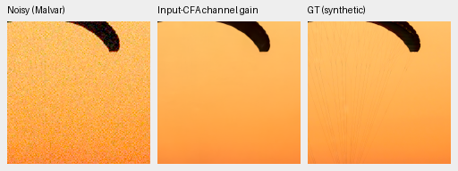
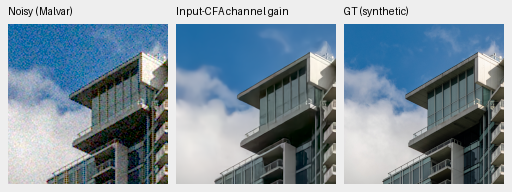
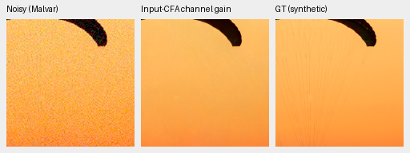
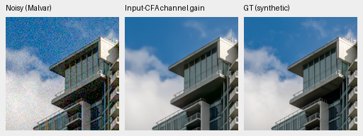
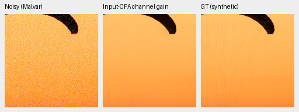
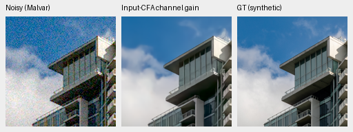
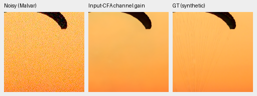
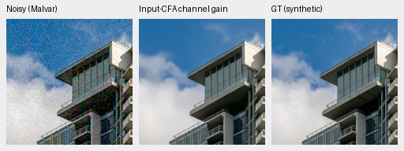

# Input-CFA gain on saved predictions: two-source CPU probe

An input-only per-channel least-squares gain removes much of the visible
step10000 fabric color shift in saved no-context/S predictions. Fine cords
remain missing and the corrected fabric is still worse than corrected step3000.
**No inference default or training policy changes.** This is an exploratory
counterfactual on two sources, not a model-quality or promotion result.

[All eight native crop receipts and numerical results](results/saved-input-cfa-gain-cpu.json).
[Original color diagnosis and uncorrected comparisons](fresh-color-mean-diagnostic.md).
The ongoing ConvNeXt trial's training/evaluation remains unmodified.

For each RGB channel, fit `g = sum(predicted_CFA * observed_CFA) /
sum(predicted_CFA**2)` over that channel's measured phases in the entire256px
tile, then multiply that output channel by `g`. This is the existing RawNIND
channel-calibration expression. The fit uses only the saved prediction and
noisy CFA; GT enters scores after fitting. A separate phase-wise NumPy dot-product
implementation rebuilds all eight gain triplets within1e-12. No network inference,
RAW/source-image decoding, new noise draw or CUDA initialization occurred.

| Arm | Update | Source | Before display PSNR | After display PSNR | RGB gains |
| --- | ---: | --- | ---: | ---: | --- |
| none | 3000 | 0014aa4e | 40.3561 | 40.6783 | 1.003400, 1.001270, 0.992606 |
| none | 3000 | 002fc6ee | 34.7092 | 34.7023 | 1.004682, 1.001134, 1.003735 |
| none | 10000 | 0014aa4e | 25.0211 | 37.1727 | 1.214507, 1.050557, 1.074447 |
| none | 10000 | 002fc6ee | 35.1232 | 35.1230 | 1.003638, 1.000370, 1.002105 |
| S | 3000 | 0014aa4e | 39.4185 | 40.5924 | 1.010870, 1.000718, 0.984134 |
| S | 3000 | 002fc6ee | 34.4977 | 34.4994 | 1.005361, 1.000776, 1.005995 |
| S | 10000 | 0014aa4e | 31.1956 | 36.9465 | 1.072003, 1.017078, 1.009422 |
| S | 10000 | 002fc6ee | 35.0091 | 35.0076 | 1.003484, 1.000710, 1.002673 |

PSNR above is computed on unquantized rendered native160×160 crops, with shared
display×1; it is not the full427 metric. RGGB/ISO12800 prior, shot.00256,
read.0000262144, WB[2,1,1.5], fixed matrix and ADC16/black.03 remain unchanged.
The same eight saved CPU-FP32 predictions and two hashed observations are reused.
ROI[48,48,160,160]; original source coordinates, checkpoints and observation hashes
are in the receipt. Noisy/reference panel pixels verify identical to the parents;
one image pixel per PNG pixel, no resizing. All eight new triplets were viewed.

Building scores change by less than.007dB, while the shifted10k fabric gains
12.15dB/no-context and5.75dB/S. The fabric is visibly closer in color but still
smooth. A gain cannot recover missing fine texture or generally correct spatially
varying error. Fitting by tile may depend on content, clipping and noise correlation
and may introduce full-frame inconsistencies. Two sources/one noise condition do
not establish saturated-color, real-camera or seam behavior. No broad evaluation
or learned-model improvement is claimed.

Noisy Malvar → corrected saved output → exact simulated GT. Sources:
[Roy Egloff](https://commons.wikimedia.org/wiki/File:CH.VD.Villeneuve_2007-08-25_Vertigo-Swiss-Riviera_2392_3x2-R_4K.jpg)
and [Dietmar Rabich](https://commons.wikimedia.org/wiki/File:Vancouver_(BC,_Canada),_Coal_Harbour_Seaside_Park,_Blick_in_den_Himmel_--_2022_--_2158.jpg),
[CC BY-SA4.0](https://creativecommons.org/licenses/by-sa/4.0/). Modified by binning,
crop, simulated noise, restoration, gain and rendering; previews retain that license.

## none, update3000

## none, update10000

## S, update3000

## S, update10000

