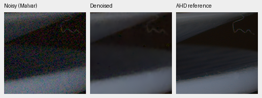
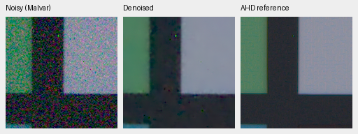
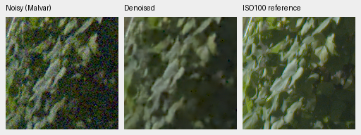
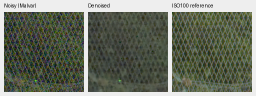

# Scale-aware measured-CFA supervision

The V17 and V24/V25 reviews found little reduction of 32/64-pixel residual
error, despite extra correction capacity and context. V26/V27 test a different
hypothesis: the original objective gives insufficient pressure to reduce these
small absolute errors. Its first controlled review is complete and does not
establish a gain. V16 remained the reviewed model at this historical gate.
The later [V61 trial](sensor-mean-v61.md) applies the same optional coefficient
to the entire restoration network, using the completed wider-palette V60 run
as control. The frozen-branch result below remains negative evidence.

Both arms start from frozen V16 step5000 and append the same factor 8 pooled
RGB correction used in V17, with 27,696 trainable parameters. The restoration
body, genuine pinned DINOv3 backbone and fine correction remain frozen. Both
use seed 46, LR 5e-4, the original 50/50 paired-RAW/Commons recipe, unchanged
augmentation and noise distributions, a planned 5000-step schedule and a
predeclared first review at 1000 steps. Per-step data RNG and sampled batch
hashes verify matched observations. The 1000-step schedule drew 530 paired and
470 Commons/procedural batches in each arm. Native-target substitution is disabled.
Protected final and personal GFX scenes/siblings remain excluded from training.

V26 adds `multiscale_sensor_weight: 0.01`; V27 uses 0. The new term samples the
RGB prediction at its actual CFA phases, then compares non-overlapping 4×4,
16×16 and 32×32 blocks in packed phase coordinates (sensor footprints 8/32/64).
For each fully valid phase block:

`standardized error = sum(prediction − reference) / sqrt(sum(input variance))`.

The variance is `shot * clean_reference + read` in observation sensor units.
The clean reference avoids conditioning weights on positive noisy tails. The
sum uses an independent-input-noise proxy, **not posterior RGB covariance**.
A Charbonnier penalty in these noise units is averaged within each scale,
then equally across the scales. Incomplete reference blocks and ADC-only
observations contribute zero. Synthetic masks exclude clipped/reconstructed
highlights and out-of-range targets. Real masks come from measured clean CFA
samples, with no new AHD fine-detail supervision. Independent reference noise
and imperfect registration remain limitations of real pairs.

The term penalizes coherent block-mean error more strongly than phasewise
zero-mean fine error. Existing linear/rendered/gradient/highlight/sensor losses
still apply. No inference input, output, transform or arithmetic changes. The
loss weight is opt-in, defaults to zero, is checked for finite nonnegative
values, and cannot change on exact resume. Existing default-loss behavior is
preserved. Physical loss operations use IEEE FP32 even inside BF16 training.

Validation before training: all 196 tests passed in 10.58 s and Ruff passed.
New tests check analytic noise scaling under all four CFAs on CPU/CUDA,
fine-error nullspace, measured-only targets without AHD dependency, invalid/
clipped/ADC-only exclusion and zero gradients, default compatibility, weighted
integration into both objectives, and exact coarse-only resume with the new
term. Genuine-DINO startup outputs match V16 bit for bit over 6,291,456 RGB
values across four CFAs and ADC/noisy inputs.
[Source, parent and startup identity receipts](results/scale-loss-v26-v27-startup.json).

Configs: `configs/dino-scale-loss-v26.yaml` and
`configs/dino-scale-control-v27.yaml`. Both run directories are under
`/mnt/external/demosaic/runs/`. Each archives actual source and data identities.
The startup logs show matching sampled batches and larger coarse-branch
gradients with the new term; that demonstrates optimization pressure, not a
quality gain. The 1000-step review must include both real development panels,
the matched synthetic screen, residual-scale diagnostics, at least two native
triplets per candidate and the new GFX pair's fixed texture regions.

## First 1000-step review

Both arms stopped at 1000 steps. **Neither is promoted.** The new term creates
stronger gradients but does not establish useful coarse denoising in this
short frozen-parent recipe. All 41 sampled observation/target hashes, CPU/Python/
CUDA RNG states, initialization and archived training source match. All original
restoration/fine model and EMA weights remain bit-identical to V16.
[Completed observation audit](results/scale-loss-v26-v27-observations-1k.json).

| Method | Known CFA PSNR | Unseen CFA PSNR | Known AHD sRGB PSNR | Unseen AHD sRGB PSNR |
| --- | ---: | ---: | ---: | ---: |
| V16 parent | 53.27466 | 53.07857 | 39.15836 | 37.65963 |
| V26 scale-aware loss | 53.27756 | 53.07374 | 39.16908 | 37.63590 |
| V27 original-loss control | 53.26538 | 53.08259 | 39.15572 | 37.65347 |
| RawNIND, observed-CFA LS | 54.06860 | 53.56220 | 39.67805 | 38.14484 |

V26-minus-control primary PSNR is +0.01218/−0.00884 dB, with scene-bootstrap 95%
intervals [−0.00393,+0.02431]/[−0.01196,−0.00635] over four/five development
scenes. Auxiliary SSIM is 0.921641/0.907009 versus control 0.921547/0.907065.
No protected final test was used. Relative to V16, both added capacity and
additional training are present; that comparison is not a matched capacity
ablation. The two arms isolate the new loss under the common architecture.

The 64-photo synthetic screen is effectively unchanged: V26/V27 rendered PSNR
31.966864/31.966871 dB, SSIM 0.924105/0.924056; parent 31.967237/0.924058.
Eight procedural sources give 29.225786/29.225118 dB. These are screening results,
not the full 427-photo panel, and do not establish improved real quality.

Two native 160×160 paired triplets per candidate, at identical coordinates and
display transforms. Left noisy Malvar, middle denoised, right registered/
calibrated low-noise AHD reference, **not exact RGB GT**. Open at 100%. V26:

V27 control:

Paired crop sources: Benoit Brummer and Christophe De Vleeschouwer,
*Raw Natural Image Noise Dataset (2025)*, [dataset](https://doi.org/10.14428/DVN/DEQCIM),
[CC BY-SA 4.0](https://creativecommons.org/licenses/by-sa/4.0/); `7D-1` additional
permission: Peter Wemmert, CC0. Modified by registration, calibration,
demosaicing/restoration, crop and shared display. The synthetic source reports
also include exact synthetic-GT triplets.

At exact-flat level 0.01 with GFX metadata and the ISO6400 prior, camera-RGB
centered standard deviations are:

| Method | Total | 32-pixel means | 64-pixel means |
| --- | ---: | ---: | ---: |
| V16 | 0.00023195 | 0.00009647 | 0.00006318 |
| V26 | 0.00023235 | 0.00009651 | 0.00006305 |
| V27 | 0.00023145 | 0.00009624 | 0.00006306 |
| RawNIND, CFA-LS | 0.00008124 | 0.00006251 | 0.00005266 |

The larger gradient pressure did not materially reduce coarse residuals. This
uses one fixed noise realization per level and input-noise priors, not a camera
calibration or photographic score. The result does not justify assuming that
loss reweighting alone solves the current correction branch's limitations.

The standing DSCF3879/DSCF3880 GFX pair was run on all four fixed regions, with
shared +2 EV and identical 512-pixel contexts for all methods. Matched V16/V26
foliage:

Matched V16/V26 fence:

Detail loss and color speckling remain. The separate f/5.6 ISO100 capture is a
qualitative reference with aperture/motion differences; no pixelwise GFX scoring
is performed. These are crop-only outputs, not new full-frame TIFF or timing
claims. README and the main GFX page retain reviewed V16 full-frame outputs.

[Complete metrics, source/weight hashes, bootstrap comparisons and crop settings](results/scale-v26-v27-1k-review.json).
The subsequent [frozen Gaussian-denoiser flat probe](gaussian-prior-probe.md)
provides a stronger flat-noise result, motivating a test of pretrained denoising
priors and physical noise adaptation on actual photographs. No photographic
superiority or state-of-the-art result is established yet.
