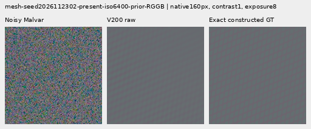
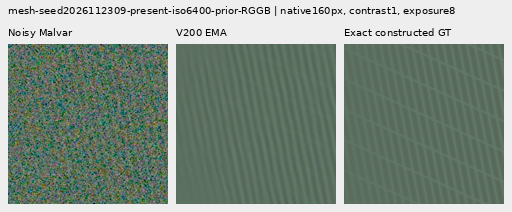
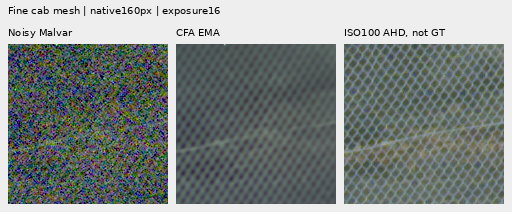
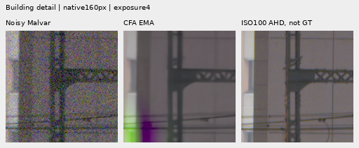

# Physical cross-scale CFA support: small quiet gains, persistent artifacts (V200)

**V200 adds a small quiet/flat-error alternative near V198, with slightly lower
mesh response. It does not resolve fine fence crossings or false texture.**
EMA mesh response is **11.101843% of exact GT amplitude**, **0.503164% lower
than V198 EMA**. Quiet spatial RMS falls **0.059153% / 0.119316%** at
ISO6400/12800, improving 31/32 inputs. Fresh-flat full RMS falls
**0.022330% / 0.030108%** on all 48 inputs. Both states retain the pronounced
green/magenta building failure, flat/photo ribbing and incomplete fine cab mesh.

V198 EMA remains the stronger-response option. V200 preserves most of that
response with these small measured quiet/flat gains; V197 has lower off-signal
costs, V195 avoids the newer building fringe, and V187 is quieter. V120 Small
remains the general recommendation. The extra 192 parameters and three-scale
measurement cost have no complete-frame speed benchmark here.

[Seven-state native viewer](images/v200-scale-supported-cfa-wave-v1/native-viewer.html) ·
[All source/ROI/noise/display/checkpoint metadata](images/v200-scale-supported-cfa-wave-v1/manifest-v1.json) ·
[Complete evidence index](results/v200-scale-supported-cfa-wave-final-v1.json) ·
[Independent publication verification](results/v200-scale-supported-cfa-wave-publication-verification-v1.json).
The viewer opens V198 EMA against V200 EMA; all seven actual states are
selectable and **Flip A/B / F** compares native pixels in the same position.

## What changed and what stayed matched

The [architecture](scale-supported-cfa-wave.md) appends twelve bounded complex
RGB amplitude/phase-agreement coordinates across 65/33/17 packed windows to
V198's unchanged 24 coordinates. Nominal fit covariance includes the full
heteroscedastic 2×2 Gram sandwich. Overlap-aware interpolation uses a conservative
nominal trace bound. Selection and correlated anchor errors are unmodeled;
**these features are not calibrated innovation confidence or flat-safety tests**.

The readout is 36→16→3 with **643 trainable parameters**, compared with V198's
451. All **193 V195 Whole EMA anchor tensors** stay frozen; full state has
197 tensors. Existing physical own-color RGB waves, eight innovation-selected
bins, native phases and real tanh gains remain. A negative gain can invert a
wave's phase; bounded gain alone does not establish support. The comparison
tests the combined features/capacity change, not covariance in isolation.

The fresh 900-update trial matches V198's 1,000 cached rows, 3,600 noisy images,
100 ADC skips, Whole ten-term objective, pair units, masks, optimizer schedule
and seed 202611080198. Initial head output is exactly zero. Adam/EMA start at
zero independently of engineering probes. The actual row-eight restoration
continues at row nine without replaying earlier forwards. Frozen V187/V195
anchor history contributes 1,800 earlier updates, separately from the new 900.
The full audit checks five factored snapshots, ten raw/EMA states and all trace
rows. [Training audit](results/v200-scale-supported-cfa-wave-v1/training-audit-v1.json).

## Full matched quantitative comparison

Each new endpoint covers all **822 retained cases**. Eleven methods retain
**9,042 metric rows**, 122 metric-table rows and 1,529 independent Decimal
summary checks. RMS is in DN16; mesh response is a template projection and
natural band gain is a response measure, not a complete quality score. Here
`raw` means the unaveraged trained state; `V197 RAW` names its measurement arm.
Real-photo references are never scored.

| Metric | Cases | V183 EMA | V187 EMA | V195 Whole EMA | V197 RAW raw | V197 RAW EMA | V197 innovation raw | V197 innovation EMA | V198 CFA raw | V198 CFA EMA | V200 raw | V200 EMA |
| --- | ---: | ---: | ---: | ---: | ---: | ---: | ---: | ---: | ---: | ---: | ---: | ---: |
| Mesh response (% GT) ↑ | 256 | 4.43900551 | 5.35911027 | 5.57480435 | 6.28904762 | 6.44906902 | 8.88238926 | 9.09218788 | 11.0750296 | 11.1579857 | 11.0029692 | 11.1018427 |
| Mesh full RMS ↓ | 256 | 8.87658208 | 8.77626519 | 8.74994784 | 8.68491411 | 8.67378254 | 8.50171719 | 8.49795148 | 8.24140961 | 8.23799614 | 8.24445272 | 8.24011501 |
| Present-case blank RMS ↓ | 256 | 5.61243198 | 5.61352478 | 5.61460516 | 5.61907447 | 5.62005314 | 5.62204239 | 5.62361296 | 5.6668851 | 5.66906384 | 5.66488671 | 5.66747129 |
| Absent-case full RMS ↓ | 256 | 5.30864483 | 5.31014343 | 5.31117581 | 5.31538414 | 5.31616104 | 5.32973714 | 5.33303257 | 5.37212991 | 5.37451352 | 5.36922853 | 5.37198699 |
| Quiet spatial RMS, ISO6400 ↓ | 16 | 3.46222047 | 3.47664374 | 3.48972317 | 3.50143703 | 3.51765479 | 3.49910973 | 3.50110283 | 3.52823567 | 3.52990498 | 3.52592176 | 3.52781694 |
| Quiet spatial RMS, ISO12800 ↓ | 16 | 5.5949994 | 5.62164923 | 5.64043344 | 5.67321933 | 5.70397426 | 5.64775448 | 5.65033341 | 5.72927949 | 5.73339232 | 5.72217876 | 5.72655149 |
| Fresh flat full RMS, ISO6400 ↓ | 24 | 18.6119521 | 18.61468 | 18.6164384 | 18.6235882 | 18.6247815 | 18.6472584 | 18.6526174 | 18.7296049 | 18.7339912 | 18.7247178 | 18.729808 |
| Fresh flat full RMS, ISO12800 ↓ | 24 | 24.181174 | 24.1857465 | 24.1891129 | 24.2023686 | 24.2047806 | 24.244943 | 24.2547879 | 24.3734983 | 24.3807656 | 24.3649929 | 24.3734252 |
| Fresh flat block32 RMS, ISO6400 ↓ | 24 | 13.4337585 | 13.4337869 | 13.4338005 | 13.4338378 | 13.4338453 | 13.4341904 | 13.4342049 | 13.4348089 | 13.4348527 | 13.4347653 | 13.4348168 |
| Fresh flat block32 RMS, ISO12800 ↓ | 24 | 17.9217798 | 17.9217305 | 17.9216853 | 17.921641 | 17.9216084 | 17.9216138 | 17.9216759 | 17.9220106 | 17.9220162 | 17.922004 | 17.9220032 |
| Retained photo faint band gain ↑ | 32 | 0.297015316 | 0.298461921 | 0.298812854 | 0.299260123 | 0.29936948 | 0.299128046 | 0.299175975 | 0.299401385 | 0.299423533 | 0.299395594 | 0.299421544 |
| Retained photo dark band gain ↑ | 32 | 0.528282161 | 0.529753504 | 0.530045786 | 0.530400453 | 0.530525432 | 0.530176351 | 0.530198669 | 0.53021463 | 0.530222336 | 0.530210389 | 0.530219728 |
| Organic photo faint band gain ↑ | 32 | 0.148382301 | 0.148564768 | 0.148652643 | 0.148814259 | 0.148845456 | 0.148967645 | 0.149021997 | 0.14914338 | 0.14916748 | 0.149139216 | 0.149168572 |
| Organic photo dark band gain ↑ | 32 | 0.395579733 | 0.395914385 | 0.396009713 | 0.396175063 | 0.396222229 | 0.396108518 | 0.396129867 | 0.396149365 | 0.396158073 | 0.396152158 | 0.396163108 |

[All 122 metric rows / 1,342 numeric cells](results/v200-scale-supported-cfa-wave-v1/metrics-table-v1.csv) ·
[Paired values, means and per-input contrasts](results/v200-scale-supported-cfa-wave-v1/paired-comparisons-v1.json.gz).

Against the matching V198 state:

| Change | V200 raw vs V198 raw | V200 EMA vs V198 EMA |
| --- | ---: | ---: |
| Mean mesh response | −0.650657%; 78 up / 178 down | −0.503164%; 79 up / 177 down |
| Present full RMS | +0.036925%; 166 better / 90 worse | +0.025721%; 170 better / 86 worse |
| Present blank RMS | −0.035264%; 255 better / 1 worse | −0.028092%; 250 better / 6 worse |
| Absent RMS | −0.054008%; all 256 better | −0.047010%; all 256 better |
| Quiet spatial RMS, ISO6400 / 12800 | −0.065583% / −0.123938%; 31/32 better | −0.059153% / −0.119316%; 31/32 better |
| Fresh-flat full RMS, ISO6400 / 12800 | −0.026093% / −0.034896%; all 48 better | −0.022330% / −0.030108%; all 48 better |

A majority of lower present-case errors does not imply a lower mean: both
states' present full-RMS means rise. EMA quiet **total** RMS falls
0.044198% / 0.094774%; its full mixed-scene error changes +0.003771% /
−0.040008%. These are different regions/metrics, with no silent substitution.

EMA's four natural full-error means fall only **0.000463–0.001555%** against
V198 EMA; 125/128 inputs improve and three worsen. Relative band-error means
fall **0.002004–0.010247%**, with 116 better / 12 worse. Natural response changes
are mixed and tiny, as the main table shows. Visible periodic ribbing remains.

Against frozen **V195 Whole EMA**, V200 EMA response is **99.143181% higher**,
with 182 up / 74 down. Present full RMS falls 5.826696% but only 99/256 inputs
improve. Blank and absent RMS rise **0.941582% / 1.144966%**, worsening every
input. Quiet spatial RMS is **1.091599% / 1.526798% higher**, all 32 worse;
fresh-flat full RMS is **0.608976% / 0.761964% higher**, all 48 worse.
All four natural full-error means also remain higher (125/128 inputs worse).
V200's small local gains over V198 do not erase these older-anchor costs.

Against V197 innovation EMA, response is 22.103094% higher, while quiet spatial
RMS is 0.763020% / 1.348913% higher and fresh-flat full RMS is 0.413833% /
0.489129% higher. Retain that model's lower-error strength alongside the newer
colored-mesh response. These empirical means do not establish a general
statistical significance or architectural promotion claim.

## Native 100% synthetic crops and directional limits

Each crop cell is **160×160 native pixels**, with no resizing. The four small
triplets below use the same 512px RGGB constructed sources, ROI
`[176,176,160,160]`, shot **0.00128**, read **6.5536e−6**, display exposure
**8 (+3 EV)** and contrast **1**. Source IDs end in seeds 2026112302 and
2026112309. Each figure is noisy Malvar → stated V200 endpoint → exact
constructed GT. White balance, matrix, anchors, full source hashes and panel
coordinates are bound in the manifest; display transforms are identical across
methods. State/checkpoint hashes are below.

V200 **raw**, two distinct sources:

V200 **EMA**, the same two sources and coordinates:

2302 retains V198-like colored modulation and rounded intersections, with thin
segments missing. 2309 still favors the near-vertical family; weak crossings
remain incomplete. All earlier methods and contrast40 counterparts are in
the viewer. The two fixed directional projections quantify this limitation:

| Example | State | Whole (% GT) | Region A (% GT) | Region B (% GT) |
| --- | --- | ---: | ---: | ---: |
| 2026112302 | V187 EMA | 5.1222526 | 6.4775008 | 3.7102210 |
| 2026112302 | V195 Whole EMA | 6.0830978 | 7.7759249 | 4.3193437 |
| 2026112302 | V197 RAW raw | 8.3992643 | 10.8804417 | 5.8141296 |
| 2026112302 | V197 RAW EMA | 8.7931831 | 11.3991207 | 6.0780609 |
| 2026112302 | V197 innovation raw | 38.3070767 | 49.6366770 | 26.5027911 |
| 2026112302 | V197 innovation EMA | 39.5850517 | 51.3487012 | 27.3285313 |
| 2026112302 | V198 CFA raw | 43.3263008 | 57.6847514 | 28.3662608 |
| 2026112302 | V198 CFA EMA | 43.8054198 | 58.3528826 | 28.6484484 |
| 2026112302 | V200 raw | 42.8699875 | 57.0682751 | 28.0768213 |
| 2026112302 | V200 EMA | 43.4451367 | 57.8733822 | 28.4123778 |
| 2026112309 | V187 EMA | 79.2443248 | 4.8230067 | 91.6903348 |
| 2026112309 | V195 Whole EMA | 79.5137222 | 4.8213863 | 92.0050560 |
| 2026112309 | V197 RAW raw | 83.4893558 | 4.7621111 | 96.6554753 |
| 2026112309 | V197 RAW EMA | 84.7731678 | 4.7426974 | 98.1572347 |
| 2026112309 | V197 innovation raw | 80.5871795 | 12.4701390 | 91.9788857 |
| 2026112309 | V197 innovation EMA | 80.6778100 | 13.1063470 | 91.9782759 |
| 2026112309 | V198 CFA raw | 81.2953950 | 17.2561683 | 92.0051437 |
| 2026112309 | V198 CFA EMA | 81.3231308 | 17.4497690 | 92.0051408 |
| 2026112309 | V200 raw | 81.2652933 | 17.0460546 | 92.0051464 |
| 2026112309 | V200 EMA | 81.2976074 | 17.2716046 | 92.0051445 |

These are whole-template / Fourier-region projections. Regions are fixed
half-plane spectral partitions, **not isolated wire-family amplitude scores**.
On 2309, EMA region A falls from V198's 17.449769% to 17.271605%; region B
stays about 92.005%. Extra cross-scale features did not recover the missing
crossing family in this example. The 2302 response also falls slightly.

## Held-out real captures: fine cab, building, sky and foliage

The main DSCF3879 ISO6400 capture is **f/1.7, 1/240 s**, versus DSCF3880 ISO100
**f/5.6, 3 s**. Sky, building, foliage and coarse-fence boards use the central
`[176,176,160,160]` ROI within their cached 512px contexts, display exposure
**4 (+2 EV)** and contrast 1. Nominal shot 0.00128/read 6.5536e−6 conditions
the input. Sky looks smooth at this ordinary exposure; foliage remains soft
and coarse fence aligned. **Both V200 states retain pronounced green/magenta
building fringes**, like V198; V195/V187 avoid this newer failure in these views.

The fine green cab mesh uses DSCF3842 ISO6400 **f/1.7, 1/300 s**, versus
DSCF3835 ISO100 **f/5.6, 2.5 s**. Both ROIs are retained within the 768px context:
left `[206,229,160,160]`, right `[426,189,160,160]`, display exposure
**16 (+4 EV)**, contrast 1. Both nominal conditioning and the fixed nearby
DSCF3879 input-Haar profile are shown. The latter uses shot
**0.0014635775921166604**, read **1.0715704128646712e−6**; it is not dedicated
flat/dark calibration. The nominal prior is also not measured calibration.
The same inputs/profiles are retained across methods without a parameter sweep.

Small triplets below: noisy → **V200 EMA** → independent ISO100 AHD. The image
header's short “CFA EMA” label refers to V200 here; the metadata binds its full
state. The cab keeps visible modulation with incomplete fine crossings. The
building's fringe is a failure, not recovered detail.

[Full building board](images/v200-scale-supported-cfa-wave-v1/comparison-10.png) ·
[Sky](images/v200-scale-supported-cfa-wave-v1/comparison-09.png) ·
[Foliage](images/v200-scale-supported-cfa-wave-v1/comparison-11.png) ·
[Coarse fence](images/v200-scale-supported-cfa-wave-v1/comparison-12.png) ·
[Nominal cab left](images/v200-scale-supported-cfa-wave-v1/comparison-13.png) /
[right](images/v200-scale-supported-cfa-wave-v1/comparison-14.png) ·
[Fixed-profile cab left](images/v200-scale-supported-cfa-wave-v1/comparison-15.png) /
[right](images/v200-scale-supported-cfa-wave-v1/comparison-16.png) ·
[Representative-panel provenance](results/v200-scale-supported-cfa-wave-v1/representative-figures-v1.json).

All real ISO100/AHD/JPEG references are **independent qualitative references,
not exact GT or pixelwise scoring targets**. Aperture, exposure time, motion
and camera processing differ. Both straight-out-of-camera JPEGs remain in the
full cab boards. Both capture families, JPEGs and siblings stay out of training;
original media are read-only and the protected RAF/JPEG caches remain local.

## Flat/photo controls and independent verification

Absent meshes, fresh gray/blue flats and quiet parts of step/bar/slanted-step/
striped-patch scenes retain corrugations and colored mottling at contrast40.
Both raw and EMA fresh-flat triplets visibly depart from exact constant GT.
Faint duck/bird/branch and dark butterfly views remain soft, with periodic
ribbing on faint feathers and backgrounds. Ordinary bright/midgray displays
look smoother; that does not negate amplified counterexamples. Ordinary steps
and bars retain their geometry; ADC bark/fur and four sloped planes remain bit-identical
to their inherited V169 outputs. Neither isolated tiny scalar gains nor these
unchanged controls prove flat safety on noisy inputs.

All **60 figures / 12 triplets** were actually viewed in **15 original-detail
sheets**. The browser's first screen and both small real triplets were inspected.
The actual seven-state browser check covers **48 boards / 336 method pairs /
1,680 native captures / 129,024,000 exact source RGB channels**, both selectors,
checkpoint/state text, click/key flipping and navigation. The earlier reused-pixel
CPU browser fixture is separately labeled and contributes no V200 quality evidence.

The independent quality audit checks 1,644 rows, 6,576 input fingerprints,
three inherited exact replays per row, all 750 input-derived measurement groups,
72 native RGB + 72 wave encodings, **53,772,288 native additions**, 510 metric
scalars, 72 wave RMS values and 278 Decimal means. Old V198 measurement/basis/
selection/support/field bindings match exactly on all 750 noisy contexts; new
support is identical between endpoints. Module weights and CPU/CUDA RNG remain
unchanged during review. No historical scientific prefix is restarted.

In-process addition closure covers **1,186,725,888 RGB channels**.
Peak allocated CUDA memory is **5,789,809,152 bytes** for this review;
this does not measure complete 100MP speed or memory.

Two strict CPU exports match the evaluated states, with 386 frozen-anchor tensor
comparisons and explicit fresh head/anchor history:

| State | Export SHA256 | Module-state SHA256 |
| --- | --- | --- |
| Raw | `04252d43838388c767f1cafdfe80c1b36997b89fcd483e6364f9933f173b9f83` | `132f1c6e75f172bbffd7c851359a9fa11b270937a7bc5f4b6ab4d899038e2913` |
| EMA | `2bb4a05943b6e9c1eb31877d19058ca4a3fea723666510fbaa133554d6ef7d22` | `cb38c1be7ad6357bba2b221b5aeb9e6871f9432f8e75588649796002197aabe3` |

Both derive from source checkpoint
`25e481535f5e547671282c012413c2c26d1c4a7652a4e62f7ca48d76c793d819`.
[Exports](results/v200-scale-supported-cfa-wave-v1/exports-v1.json) ·
[Quality audit](results/v200-scale-supported-cfa-wave-v1/quality-audit-v1.json) ·
[Completed execution / all 107 neural hashes](results/v200-completed-execution-v1.json).
The final verifier independently checks all 1,342 CSV values, 154 main-table
and 60 directional-table cells, 26,726,400 prediction-display channels,
9,830,400 noisy/reference channels and 460,800 representative-triplet channels.

The next training change must be tested against strong-edge leakage and noisy
flat controls as well as faint/dark detail. Cross-scale agreement alone gave
only a small quiet/response tradeoff in this matched experiment; it did not
separate real fine support from noise and anchor errors well enough. No new
source/noise draws, parent/DINO inference, RAF decode, original/dataz reads or
external writes occur in this experiment. Historical evidence remains intact.
