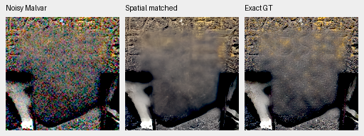
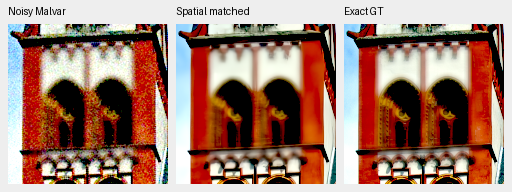

# What distant context adds at the matched 50k endpoint

On 64 held-out ISO6400 photos with independent sensor draws, Local 50k
lowers fine-increment error by **0.917 DN16** and exact-flat fine RMS
by **0.419 DN16** versus Corpus 100k, with **0.763 percentage points
less fine response**. Adding spatial context to the training recipe
gives up another 0.106 points relative to the matched local endpoint.
On the faintest third of the same panel, the spatial model recovers
**0.378 points** more with the correct distant view than with a
different distant scene. Its measured flat error is higher and its
measured response is lower than local-only in that subset.

[Training and checkpoint identities](scene-50000-native.md#training-and-review-coverage) ·
[Machine results](results/scene-050000-controlled-v1/publication.json) ·
[Frozen measurements](results/scene-050000-controlled-v1/evidence.tar.xz) ·
[Native provenance](images/scene-050000-controlled-v1/manifest.json).

## Matched sensor observations and context interventions

The 64 source photos are excluded from the 50k training manifests.
Each has present, attenuated and exact-flat versions at ISO400 and
ISO6400. Each profile uses both independently drawn sensor noise and
coupled sensor noise within the pair. The 256 matched case groups
provide 768 native queries per inference variant. The physical Bayer
inputs match the archived hashes. All inference uses CUDA IEEE FP32
and EMA checkpoints. Crop coordinates, noise conditioning, white
balance and camera matrices stay fixed across methods and scene views.

The spatial intervention preserves the noisy query pixels. Matched
context uses the correct distant view, the swapped control uses
distant content from another held-out photo, and the blurred control
retains the distant view's broad structure. The neutral control
replaces the distant view with a low-structure field. The shared
taper and halo preserve the same query context close to the crop.
The fine band measures 1/8 to 1/3 cycles per native pixel in the
central 96 × 96 core. Response pools signed projections weighted
by clean target energy. Confidence intervals resample source photos.
[Input construction and context geometry](whole-scene-context-development64.md).

## Independent ISO6400 results

| Inference | Fine response | Fine-increment RMS, DN16 | Exact-flat fine RMS, DN16 |
| --- | ---: | ---: | ---: |
| V120 | 65.468% | 124.715 | 5.100 |
| Corpus 100k | 65.840% | 124.547 | 4.589 |
| Local 50k | 65.077% | 123.630 | 4.170 |
| Spatial 50k, matching view | 64.971% | 123.594 | 4.166 |
| Spatial 50k, wrong distant view | 64.966% | 123.584 | 4.175 |
| Spatial 50k, neutral distant view | 65.118% | 123.695 | 4.377 |

Against Corpus 100k, Local 50k changes fine-increment error by
−0.917 DN16 [−1.213, −0.629]. Fine-flat RMS changes −0.419 DN16
[−0.799, −0.151] and upper-band flat RMS rises 0.424 DN16.
With coupled draws at ISO6400, local fine-increment RMS rises
0.566 DN16 against Corpus 100k. The error reduction is specific
to the independent-noise comparison.

On the full independent ISO6400 panel, matching context changes fine
response by −0.106 points [−0.205, −0.004] against local-only. Its
−0.036 DN16 fine-increment difference has an interval spanning
zero. Matching versus wrong distant context changes response by
+0.005 points [−0.041, +0.057]. The larger effect comes against
neutral distant context, where matching lowers flat RMS 0.211 DN16
and attenuates fine response by 0.147 points.

## The faintest cases

A separate readout uses the clean fine-increment RMS to order the
64 ISO6400 independent cases. This is a diagnostic grouping based
on exact targets. The lowest stratum includes 22 sources with
clean fine RMS up to 100.56 DN16.

| Matching context minus comparator, lowest stratum | Fine response | Fine-increment RMS | Fine-flat RMS |
| --- | ---: | ---: | ---: |
| Wrong distant view | +0.378 points [0.154, 0.581] | +0.018 DN16 | +0.018 DN16 |
| Local 50k | −0.212 points [−0.822, 0.372] | +0.040 DN16 | +0.087 DN16 |

The 0.378-point response shift is specific to the faintest stratum.
In the other two strata, response changes by less than 0.002 points
between matching and swapped distant views. The faintest cases
have higher exact-flat error with the spatial model than with
local-only [0.036, 0.145] DN16. The aligned view changes what the
model recovers in these cases. The separate transfer test measures
what the aligned difference adds to Local 50k.
[Aligned-context transfer](aligned-context-delta.md) ·
[Camera panels](scene-50000-cameras.md).

## Native exact-target triplets

The triplets show noisy Malvar, matched Spatial 50k EMA, and exact
GT at 160 × 160 native pixels. Both use ROI `[48,48,160,160]`,
shot/read `0.00128/6.5536e-6`, capture exposure ×0.33,
display ×3.03 and contrast ×2. The 16-bit sensor simulation uses
black level 0.03.

**Hauroth wayside cross**, Palauenc05, CC BY-SA 4.0. RGGB,
query `[218,192,256,256]`. Stone contours stay coherent. Fine
grain remains soft, with faint mottling in the stone.
[Source](https://commons.wikimedia.org/wiki/File:Hauroth_Wegekreuz_St-Bartholom%C3%A4us.jpg) ·
[All methods](images/scene-050000-controlled-v1/000-iso6400-independent-role0-comparison.png) ·
[Exact-flat companion](images/scene-050000-controlled-v1/000-iso6400-independent-role2-comparison.png).

**Limburg Cathedral**, Berthold Werner, public domain. BGGR,
query `[22,250,256,256]`. The arch outlines remain clear and
the fine masonry stays soft. The exact-flat companion retains a
smooth brown interior with the original exterior architecture.
[Source](https://commons.wikimedia.org/wiki/File:Limburger_Dom_BW_1.jpg) ·
[All methods](images/scene-050000-controlled-v1/001-iso6400-independent-role0-comparison.png) ·
[Exact-flat companion](images/scene-050000-controlled-v1/001-iso6400-independent-role2-comparison.png).

The [standing GFX reviews](scene-50000-native.md#standing-gfx100s-comparisons)
cover both protected capture families, with smooth sky and clear coarse
crossings. The fine cab intersections remain incomplete. These
controlled increments are a separate panel from the 427-photo benchmark,
which is still running.
