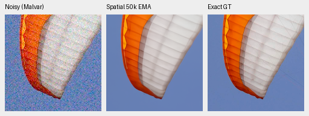
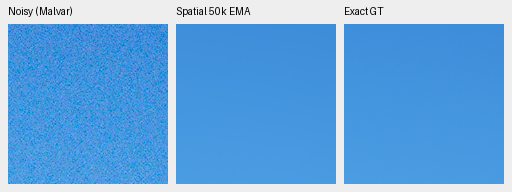

# Matched 50k native review

Both final scene-training endpoints keep the smooth sky and coarse fence
crossings. The spatial EMA adds **0.015 dB on the shadow development
crops and 0.020 dB at ISO12800** versus local-only. The finest cab
crossings remain incomplete under both noise profiles.
[Training audit](results/scene-full-epoch-v1/paired-prefix-050000.json) ·
[Native review receipt](results/scene-050000-native-v1/publication.json) ·
[Evidence archive](results/scene-050000-native-v1/evidence.tar.xz) ·
[Native provenance](images/scene-050000-native-v1/manifest.json).

## Training and review coverage

Both arms continue from Corpus 100k EMA
`87b96f3c487b9edaf1c477742b6c38f2a82cc6b20a94716d51cc8cf46a17a760`.
The matched schedule uses BF16 neural training, frozen DINO, and the same
100,000 photo observations and 400,000 native queries per arm. Each
arm has 100,000 distinct noise seeds. Both cover all 90,692 eligible
training photos once, then visit 9,308 distinct photos a second time.

| Arm | Retained training | SHA256 of checkpoint containing raw and EMA weights |
| --- | ---: | --- |
| Local-only 50k | 24,213.00 s | `62f4e9ce84075c8df1a254a1889033b5787133e8c98c63e0ec3d174a94734959` |
| Spatial 50k | 31,768.12 s | `3cfe9517164e621e112c7bff436a02c064d6db5f310a13afc0d3b7d0054c33bf` |

The report evaluates EMA at CUDA IEEE FP32. The archived V120 and
Corpus 100k rows use CPU IEEE FP32 on the same native observations
and rendering policy. The new native-query forwards total 11.09 s
local-only and 15.62 s spatial, with full scene preparation and
load timed separately in the receipt. Both endpoints completed the
native review below. Both fixed measured-camera panels and the separate
64-photo controlled review are complete. On the canonical 427-photo
panel, Local 50k reaches 37.27953 dB and Spatial 50k 37.27886 dB.
[Matched training recipe](scene-full-epoch.md) ·
[Local-only scope on 48 backgrounds](local-50000-scoped.md) ·
[Fixed photo and camera panels](scene-50000-cameras.md) ·
[64-photo distant-context review](scene-50000-controlled.md) ·
[Comparable PSNR history](performance-history.md).

## Development exact targets

Each condition has eight aligned scored crops from two development
photos. Both sources were reserved from the matched scene continuation.
The review uses constructed exact targets and the same crop borders
across all methods. These sources also appeared in the historical
larger scaling pool used to develop the parent. The scope is
development.

| Arm | Shadow sRGB PSNR | ISO12800 sRGB PSNR |
| --- | ---: | ---: |
| V120 | 47.99155 dB | 41.20822 dB |
| Corpus 100k | 48.03612 dB | 41.33623 dB |
| Local-only 50k | 48.17380 dB | 41.44911 dB |
| Spatial 50k | 48.18918 dB | 41.46959 dB |

Every triplet shows noisy Malvar, spatial 50k EMA, and exact GT
at the same 160 × 160 native ROI `[48,48,160,160]` inside its
256-pixel query. The camera simulation uses RGGB and black level 0.03.

**Paraglider canopy** by Subhrajyoti07, CC BY-SA 4.0. Query
`[388,458,256,256]`, shot/read `0.00064/1.6384e-6`, display ×8.
Both 50k models preserve the canopy seams. Fine suspension lines stay
faint or missing.
[Source](https://commons.wikimedia.org/wiki/File:An_para_glider_making_a_descent_near_Khel_Gaon_Resithang,_Sikkim.jpg) ·
[Native method comparison](images/scene-050000-native-v1/development-0-shadows-crop0.png).

**Bunkers de Tarifa** by kallerna, CC BY-SA 4.0. Query
`[992,402,256,256]`, shot/read `0.00256/2.62144e-5`, display ×1.
The blue sky remains smooth, with no visible added fine texture.
[Source](https://commons.wikimedia.org/wiki/File:Bunkers_de_Tarifa.jpg) ·
[Native method comparison](images/scene-050000-native-v1/development-1-iso12800-prior-crop0.png).

## Aligned context on held-out backgrounds

The 50k pair also replays 24 natural and 24 planted-wire ISO6400
backgrounds from the matched 47.5k review. A second spatial forward
reverses the surrounding RAW field while retaining the exact Bayer
samples, variance, camera profile and coordinates inside the scored
query. All new forwards use CUDA IEEE FP32. Source-level bootstrap
intervals account for the shared observations across arms.

| Comparison with aligned Spatial 50k | Natural fine response | Natural exact-flat fine RMS | Wire weak response | Wire exact-flat RMS |
| --- | ---: | ---: | ---: | ---: |
| Minus Local 50k | −0.226 points | +0.061 DN16 | −0.056 points | +0.578 DN16 |
| Minus Spatial 50k with reversed exterior | +0.023 points | −0.109 DN16 | −0.261 points | +0.173 DN16 |

Natural response falls 0.226 points [−0.384, −0.065] against
local-only. The 0.109 DN16 lower natural flat RMS against reversed
context has an interval of [−0.311, +0.034]. On planted wires, aligned
context raises flat RMS 0.578 DN16 [0.347, 0.812] against local-only.
Against reversed context it lowers weak-direction response by 0.261
points [−0.436, −0.097]. Wire gap RMS changes +0.260 DN16 versus
local-only, with an interval spanning zero.
[Held-out data and prior endpoint](green-covariance-refit.md) ·
[Exact overlay replay](results/scene-050000-native-v1/aligned-exact.json) ·
[Evidence archive](results/scene-050000-native-v1/aligned-exact-evidence.tar.xz).

## Standing GFX100S comparisons

The main DSCF3879/3880 scene uses the four fixed native crops at
display ×4 and shot/read `0.00128/6.5536e-6`. The spatial model is
within 0.832 DN16 RGB RMS of local-only in the sky. Building, foliage
and chain link are 5.475, 7.492 and 7.824 DN16 apart. Both produce a
smooth sky and clear coarse fence crossings. The building wires and
fine leaf structures remain soft.
[Sky](images/scene-050000-native-v1/main-overcast-sky-main-overcast-sky.png) ·
[Building](images/scene-050000-native-v1/main-building-detail-main-building-detail.png) ·
[Foliage](images/scene-050000-native-v1/main-foliage-main-foliage.png) ·
[Coarse fence](images/scene-050000-native-v1/main-chain-link-fence-main-chain-link-fence.png).

The cab DSCF3842/3835 boards use display ×16. The transferred profile
keeps the clearest right diagonals. The spatial checkpoint changes the
four outputs by 2.17–4.04 DN16 RGB RMS relative to local-only. Fine
intersections remain incomplete under both profiles. The two ISO100
AHD renders and the cab ISO100 and ISO6400 camera JPEGs are
qualitative references with capture and rendering differences.

| Cab profile | Left native crop | Right native crop |
| --- | --- | --- |
| Nominal `0.00128/6.5536e-6` | [Left](images/scene-050000-native-v1/mesh-nominal-fine-green-mesh-left.png) | [Right](images/scene-050000-native-v1/mesh-nominal-fine-green-mesh-right.png) |
| Transferred `0.0014635775921166604/1.0715704128646712e-6` | [Left](images/scene-050000-native-v1/mesh-profile3879-fine-green-mesh-left.png) | [Right](images/scene-050000-native-v1/mesh-profile3879-fine-green-mesh-right.png) |
