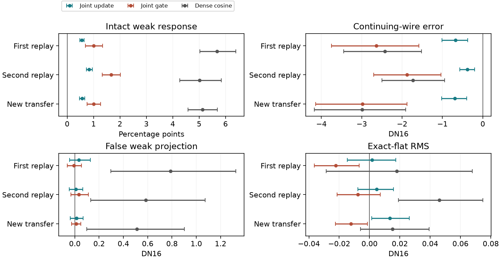
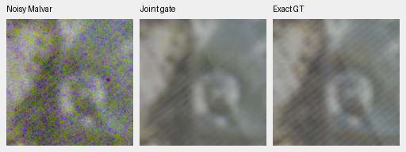
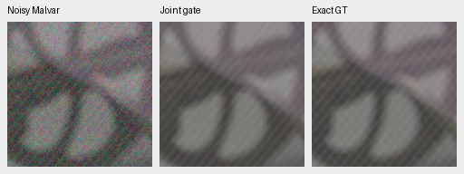

# Joint support across neighboring Fourier bins

Pooling support across neighboring Fourier bins improves weak-wire
recovery when each bin keeps its own query phase. On 32 unused
photographic backgrounds, the joint gate gains **1.004 percentage
points** of weak response and lowers continuing-wire error by
**2.979 DN16** versus the four-grid mean. False weak projection is
similar. Natural-photo fine error rises, and the real cab crops
still have incomplete crossings.

[Machine results](results/scene-coherent-fourier-v1/publication.json) ·
[Frozen drivers and receipts](results/scene-coherent-fourier-v1/evidence.tar.xz) ·
[Native crop provenance](images/scene-coherent-fourier-v1/manifest.json).

## How the joint gate works

The [shifted-grid filter](scene-staggered-phase.md) fits the same
32-pixel window on four Fourier grids. Its mean treats each
sine/cosine pair independently. Off-grid energy can appear in nearby
pairs with a consistent relative phase even when the absolute phase
varies across donor windows. The new filter represents each pair as a
complex coefficient and groups the pairs by their nearest integer
frequency. It uses the same native samples, disjoint exterior windows,
donor rankings, Bayer layout, delivery tapers and neural parent.

Within each group, alternating donor ranks select the leading
eigenvector of the Hermitian cross-green second moment. The other
ranks confirm its power using two standard errors and a propagated
noise floor. Noise propagation includes covariance between grids
fitted to the same physical green pixels. The two donor halves swap
roles. Each fit then combines the query bins along the selected
eigenvector and checks for a supported phase on both physical greens.

- **Joint update** delivers the pooled query innovation along the
  selected vector. Absolute phase comes from the query. Relative
  phase between neighboring bins can come from the donor vector.
- **Joint gate** uses the same evidence to weigh each bin's own
  positive radial deficit. It retains each bin's local phase and
  separately checks agreement between the two greens.

Multiplying each donor window by an arbitrary complex phase
preserves the two corrections in the audit. Opposed donor halves
with orthogonal complex directions give a zero update. Swapping
halves preserves the correction. The empirical query comparison uses
a parent that has seen both greens. The noise floor assumes a local
scalar variance per window and independent physical green noise.

The frozen base is Corpus 100k EMA
`87b96f3c487b9edaf1c477742b6c38f2a82cc6b20a94716d51cc8cf46a17a760`.
V120 EMA
`a9d9b6b4f974e24a6b11e5e740aab32314233a7f53c056cf37c7d2aac1c589fb`
is the general comparison. Each candidate gets one gain on the same
16 retained calibration photos as the earlier filter, targeting
+0.10 DN16 exact-flat RMS. The gains are 0.10820 for joint update,
0.27141 for joint gate and 0.09847 for the earlier four-grid mean.
No weights were trained.

## Off-grid photo tests

The first two panels replay 24 fields each from the shifted-grid
study. The independent transfer uses 32 additional photo backgrounds,
eight per CFA layout. Source IDs and cache hashes differ from the
older panels and all 559,808 Corpus 100k training photo visits.
There are eight strips, eight ellipses, eight smooth amplitude dips
and eight stronger contrast-step amplitude transitions. The first two
groups contain exact gaps in the weak direction with the strong
direction still present. Both wire periods are 7.2–9.25 native pixels
and at least 0.008 cycles/pixel off the 32-pixel integer grid. The four
roles use independent RAW draws and nominal ISO6400 conditioning,
shot/read `0.00128/6.5536e-6` and capture exposure ×0.33. The gains
were locked before the new sources were frozen.

| Transfer method | Intact weak response | Continuing-wire error | False weak projection | Exact-flat RMS |
| --- | ---: | ---: | ---: | ---: |
| V120 EMA | 20.459% | 83.471 | 4.664 | 24.154 |
| Corpus 100k EMA | 21.706% | 78.197 | 4.751 | 22.965 |
| Dense cosine | 29.519% | 72.277 | 5.445 | 23.139 |
| Earlier radial | 24.437% | 75.545 | 4.958 | 23.203 |
| Four-grid mean | 24.395% | 75.270 | 4.934 | 23.124 |
| Four-grid selected | 24.548% | 75.005 | 4.944 | 23.115 |
| Joint update | 24.963% | 74.580 | 4.948 | 23.138 |
| Joint gate | 25.399% | 72.291 | 4.945 | 23.112 |

All errors use DN16 RMS. The two gap columns use the 16 exact-gap
cases. The intervals below resample whole photographs with fixed gains.

- Against the four-grid mean, joint gating gains **+1.004** response
  points [0.753, 1.265] and lowers continuing-wire error by **2.979 DN16**
  [1.878, 4.141]. False projection changes by **+0.011 DN16**
  [−0.027, +0.049] and flat RMS by **−0.012 DN16** [−0.023, −0.001].
- On the two earlier panels, joint gating adds **1.006 and 1.665**
  response points and reduces continuing-wire error by **2.636 and
  1.878 DN16**. Both false projection intervals span zero.
- Dense cosine at its locked gain recovers **4.120 more points**
  than the joint gate on transfer. Its continuing-wire error is
  similar, with **0.501 DN16** more false weak projection. V120 and
  unmodified Corpus 100k keep lower false projection than the joint
  gate. Corpus 100k also keeps the lowest mean exact-flat RMS.

At the transfer joint gate's response, retrospective gain interpolation
gives the four-grid mean continuing-wire and false weak errors of
74.210 and 5.004 DN16, versus 72.291 and 4.945 for the joint gate.
Dense cosine at that same response gives 75.326 and 5.063 DN16,
with lower flat RMS (23.012 vs 23.112). The archive includes all
three panels at matched response. The fixed-gain transfer above is
the independent test.

## Natural-photo costs and scope

On 32 independent-draw natural photographs, joint gating adds
0.209 DN16 fine-increment RMS and 0.368 DN16 fine-flat RMS over
Corpus 100k. The four-grid mean adds 0.137 and 0.309 DN16.
The joint update adds 0.126 and 0.301 DN16 with less weak-wire benefit.
All three raise natural-photo fine error over the frozen parent.
V120 remains the general recommendation.

Two existing EMA predictions took 149.0 s on CUDA IEEE FP32 for
the 32 new fields, including input and output writes. Joint and
control CPU scoring took 39.5 s on four workers. There is no
full-frame inference timing for this component. Numerical and
native reviews are complete for the scoped work. The fixed
427-photo and camera panels do not cover these correction arms.
[Broad PSNR history](performance-history.md).

### Native exact targets

Each triplet shows noisy Malvar, Corpus 100k EMA with the joint gate,
and exact simulated GT. Each 160 × 160 cell uses `[48,48,160,160]` in
the `[128,128,256,256]` query. Both use the ISO6400 profile above,
16-bit ADC, black level 0.03 and display exposure ×2. The source
photos were binned fourfold and cropped for the synthetic mesh.

**Stemma di Tarragona**, GattoCeliaco, `[160,22,512,512]`, GBRG.
The joint gate reduces continuing-wire error by **8.318 DN16**, the
largest transfer decrease versus the four-grid mean. The stronger
diagonal is faintly more distinct across the stone, and the weaker
crossing is much softer than the target.
[Source](https://commons.wikimedia.org/wiki/File:Stemma_di_tarragona.jpg) ·
[CC BY-SA 4.0](https://creativecommons.org/licenses/by-sa/4.0/) ·
[All methods](images/scene-coherent-fourier-v1/exact/transfer-03-present-comparison.png) ·
[Exact-flat control](images/scene-coherent-fourier-v1/exact/transfer-03-flat-triplet.png).

**Mixer**, Berthold Werner, `[326,66,512,512]`, BGGR.
False weak projection rises by **0.144 DN16** versus the four-grid
mean, the largest increase among the remaining cases. The weaker
direction is faint on both restorations. The flat controls stay smooth
at the same exposure.
[Source](https://commons.wikimedia.org/wiki/File:Mixer_2012-05-07_17-29-35.jpg) ·
[CC BY-SA 3.0](https://creativecommons.org/licenses/by-sa/3.0/) ·
[All methods](images/scene-coherent-fourier-v1/exact/transfer-09-present-comparison.png) ·
[Exact-flat control](images/scene-coherent-fourier-v1/exact/transfer-09-flat-triplet.png).

## Standing GFX100S comparisons

**DSCF3879 ISO6400 / DSCF3880 ISO100.** At ×4 and nominal shot/read
`0.00128/6.5536e-6`, the joint gate changes sky by 0.012 DN16
camera-RGB RMS, building by 1.668, foliage by 3.136 and coarse
fence by 2.404 against Corpus 100k. The corresponding four-grid
mean changes are 0.006, 0.840, 1.628 and 1.238. The sky stays smooth
and coarse links remain connected. Fine cables, truss details and
leaf subdivisions stay soft. The independently demosaiced ISO100
AHD reference differs in aperture and moving subjects.
[Sky](images/scene-coherent-fourier-v1/standing/main-overcast-sky-main-overcast-sky-x4.png) ·
[Building](images/scene-coherent-fourier-v1/standing/main-building-detail-main-building-detail-x4.png) ·
[Foliage](images/scene-coherent-fourier-v1/standing/main-foliage-main-foliage-x4.png) ·
[Coarse fence](images/scene-coherent-fourier-v1/standing/main-chain-link-fence-main-chain-link-fence-x4.png).

**DSCF3842 ISO6400 / DSCF3835 ISO100.** Both ROIs and priors were
viewed at ×4 and ×16 with independent ISO100 AHD and both camera
JPEGs. Nominal shot/read is `0.00128/6.5536e-6`. Transferred
DSCF3879 conditioning is `0.00146358/1.07157e-6`. The references
have different aperture, exposure, motion or rendering conditions.

Joint gating changes the four cab crops by 0.57–1.18 DN16 RGB RMS
over Corpus 100k. At its locked gain, the transferred right projections
rise from +0.280/+0.080 to +0.632/+0.139 percentage points of the
measured RAW peaks. At equal added RGB RMS, they fall to +0.244/+0.054.
Both projections also fall at equal RMS in the other three cases.
The transferred right still shows the clearest diagonals, with many
missing junctions. The native boards show no clear new connected
crossings or conspicuous added chroma patches.

| Cab ROI | Nominal | Transferred DSCF3879 profile |
| --- | --- | --- |
| Left | [×4](images/scene-coherent-fourier-v1/standing/mesh-nominal-fine-green-mesh-left-x4.png) · [×16](images/scene-coherent-fourier-v1/standing/mesh-nominal-fine-green-mesh-left-x16.png) | [×4](images/scene-coherent-fourier-v1/standing/mesh-profile3879-fine-green-mesh-left-x4.png) · [×16](images/scene-coherent-fourier-v1/standing/mesh-profile3879-fine-green-mesh-left-x16.png) |
| Right | [×4](images/scene-coherent-fourier-v1/standing/mesh-nominal-fine-green-mesh-right-x4.png) · [×16](images/scene-coherent-fourier-v1/standing/mesh-nominal-fine-green-mesh-right-x16.png) | [×4](images/scene-coherent-fourier-v1/standing/mesh-profile3879-fine-green-mesh-right-x4.png) · [×16](images/scene-coherent-fourier-v1/standing/mesh-profile3879-fine-green-mesh-right-x16.png) |
