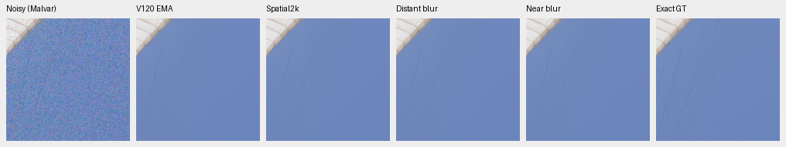
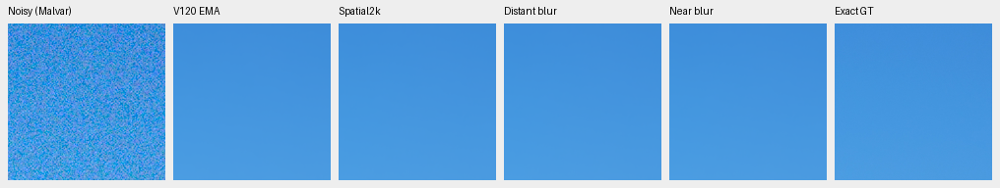

# How much of the photograph affects the native crop?

The spatial 2k EMA model receives a separate complete-scene preview in
addition to the unchanged native RAW tile. This diagnostic changes the
preview near and far from the tile to test which regions affect the
delivered RGB. It retains the trained model, weights and conditioning
from the earlier native review.
[Spatial 2k and matched training controls](whole-scene-context-native-review.md).

Distant context changes the foliage and coarse fence while having little
effect on the overcast sky. The two exact-target development sources and
both qualitative camera scenes show no convincing new fine-detail recovery.

## Same local RAW, different scene preview

The comparison uses all ten observations from the fixed earlier native
suite. Four development fields each contribute four native 256×256 crops
from two sources at the shadow and ISO12800 priors. The other six
observations cover DSCF3879 sky, building, foliage and coarse fence,
plus the DSCF3842 cab area at both established noise conditionings.
The two designated cab ROIs are cut from each cab area.

The original global preview is made from the same noisy CFA observation
and encoded with the same frozen backbone. The long side is capped at
1,024 preview pixels, with the original aspect ratio. The near region
is the union of the projected tile boxes and a 16-preview-pixel halo.
A second 16-pixel cosine transition connects it to the distant region.
A Gaussian with sigma 24 preview pixels blurs one of the two regions
before feature extraction. One variant preserves the near pixels
bit-for-bit and blurs distant content. The complementary variant
preserves the distant pixels bit-for-bit and blurs the near part.
The blur keeps broad shapes and colors, so this test probes the
contribution of structure suppressed by that operation.

Native packed RAW, variance, Bayer order, white balance and matrix
match the previous evaluation for every model call. The ten full-preview
predictions reproduce the earlier run bit-for-bit. Both interventions
share the checkpoint SHA256
`97fd551bd0ae0b7aa97c67e1f6e8b513b722f70d5ad8b8814a96586b934eafac`.
There is no retraining. The comparison evaluates the ordinary full-RAW
model rather than an independent withheld-CFA estimator.
[Inference diagnostic](../scripts/probe_scene_context_extent.py) ·
[Scoring and native rendering](../scripts/report_scene_context_extent.py).

## Measured contribution of preview regions

| Condition and preview | Mean sRGB PSNR (dB) | Weak-band RMS (DN16) | Mean change from full preview (DN16 RMS) |
| --- | ---: | ---: | ---: |
| Shadows, full | 48.09145 | 14.86372 | 0 |
| Shadows, distant blur | 48.09321 | 14.86432 | 0.354 |
| Shadows, near blur | 48.08460 | 14.86843 | 1.331 |
| ISO12800, full | 41.29035 | 115.28831 | 0 |
| ISO12800, distant blur | 41.29122 | 115.30509 | 2.543 |
| ISO12800, near blur | 41.29084 | 115.22109 | 9.732 |

Each condition has eight native crops from two sources. The weak-band metric
uses native 16×16 DCT blocks from the 240×240 interior, a frequency annulus
of 1/8 to 1/3 cycles per pixel, and the predeclared 0.02 band-to-mean contrast
cutoff. Each condition has 1,164 eligible weak blocks and no blocks meeting
the numerical quiet criterion. Overall sRGB scores average equally over the
eight crops. Weak-band errors pool coefficients within each condition.
These are development crops with exact simulated targets.

Blurring near the query changes the mean output about four times as much
as blurring distant context in both development conditions. Distant blur
changes the delivered foliage and coarse-fence crops by 4.14 and 5.15 DN16
RMS, more than the near blur changes on those two crops. The corresponding
distant-blur changes for overcast sky, building and the fine cab ROIs are
0.45, 2.53 and 0.90–1.07 DN16 RMS. The real numbers measure change from
the full-preview prediction. Full context gives no consistent improvement
in measured weak-band error. The two source photographs limit what these
results establish about average quality.

## Native observations

All sixteen native boards were inspected. The spatial variants still lose
thin canopy cords against the clear sky. The blue gradients and the GFX
overcast sky stay smooth. Leaves and building hardware remain soft. Coarse
fence diamonds persist, with little change in individual crossings. The
cab stays soft under both noise profiles. The transferred profile makes
some repeat structure visible without recovering the full fine lattice.

Each cell is an unresized 160×160 crop with the established coordinates
and transforms. The two development examples below use ROI
`[48,48,160,160]` and RGGB. Shadows use display exposure 8 and shot/read
`0.00064/1.6384e-6`. ISO12800 uses display exposure 1 and `0.00256/2.62144e-5`.
The camera boards retain exposure 4 on DSCF3879 and 16 on DSCF3842,
shot/read `0.00128/6.5536e-6` and the transferred second cab profile
`0.0014635776/1.0715704e-6`. Independent ISO100 AHD and camera JPEGs
are qualitative references with different exposure, aperture and motion.
[Native crop provenance](images/scene-context-extent-v1/manifest.json).

[Overcast sky](images/scene-context-extent-v1/main-overcast-sky-main-overcast-sky.png) ·
[Building](images/scene-context-extent-v1/main-building-detail-main-building-detail.png) ·
[Foliage](images/scene-context-extent-v1/main-foliage-main-foliage.png) ·
[Coarse fence](images/scene-context-extent-v1/main-chain-link-fence-main-chain-link-fence.png) ·
[Cab left](images/scene-context-extent-v1/mesh-nominal-fine-green-mesh-left.png) ·
[Cab right](images/scene-context-extent-v1/mesh-nominal-fine-green-mesh-right.png) ·
[Transferred left](images/scene-context-extent-v1/mesh-profile3879-fine-green-mesh-left.png) ·
[Transferred right](images/scene-context-extent-v1/mesh-profile3879-fine-green-mesh-right.png).

Collection took 598.7 seconds for 30 paired spatial forwards and 30 scene
encodings on two CPU threads. The independent audit reproduces 336
reductions and 72 retained native display cells. The full427 benchmark
still runs separately.
[Independent audit](results/scene-context-extent-v1/audit.json) ·
[Executed sources and receipts](results/scene-context-extent-v1/publication.json).
