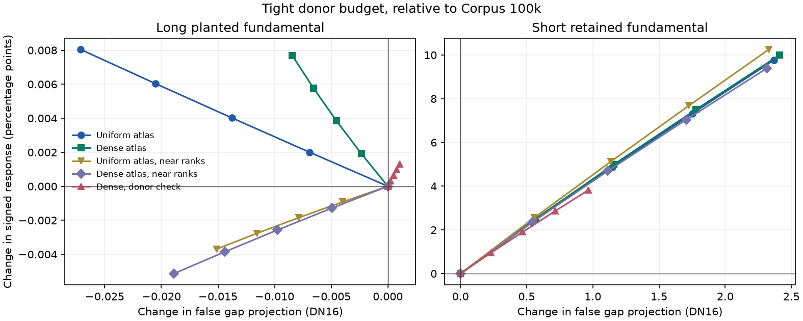
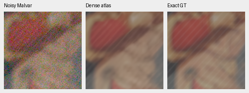
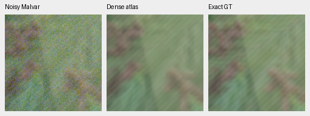

# Reserving dense RAW donors near a weak-detail query

The 32-pixel filter gains more support on the left GFX100S cab
mesh when its scene samples are concentrated near the query.
On the nominal profile, the correction rises from 0.057 to
0.287 DN16 RGB RMS at fixed strength. Both measured mesh peaks
receive more signed response. The changes stay small and fine
crossings remain incomplete. The right-hand result is mixed.

[Machine results](results/scene-dense-atlas-v1/publication.json) ·
[Frozen drivers and receipts](results/scene-dense-atlas-v1/evidence.tar.xz) ·
[Native provenance](images/scene-dense-atlas-v1/manifest.json).

## Sampling separately from matching and delivery

The [wider-window test](scene-patch-width.md) improves short-wire
recovery when the fitting basis has enough spatial support.
Its real cab changes stay below 0.12 DN16. This follow-up
keeps the same 32-pixel window, 0.08–0.16 cycles/pixel band,
held-out donor validation, query innovation, Bayer layout and
parent. It changes the locations of exterior patches that can
enter the filter.

The uniform atlas samples the entire RAW field on a thin grid.
The dense atlas reserves a native 32-pixel lattice within a
240-pixel margin of the query and thins the remaining field
to roughly the same total budget. No patch covers the query
or its 16-pixel halo. Near and far patches are disjoint. Both
policies already sample the full 32-pixel lattice on the
512-pixel fixtures at the ordinary budget.

Both atlases use the original brightness, color and structure
match. A separate proximity control applies a stronger distance
weight on either atlas. The donor-only diagnostic removes
the local two-green sign check and keeps the independently
checked donor covariance. The delivered signed correction
always comes from the query RAW and its frozen reconstruction.

## Exact wire and natural tests

The parent is Corpus 100k EMA
`87b96f3c487b9edaf1c477742b6c38f2a82cc6b20a94716d51cc8cf46a17a760`.
The reference model is V120 EMA
`a9d9b6b4f974e24a6b11e5e740aab32314233a7f53c056cf37c7d2aac1c589fb`.
Each arm is calibrated to add 0.10 DN16 exact-flat RMS on the
same 16 independent-draw long-wire backgrounds. That strength is
then fixed for transfer to 32 other long-wire scenes, 24 short-wire
scenes and 32 earlier held-out natural-photo pairs. The 32 long
scenes include 16 true weak-carrier gaps. Twelve short scenes
contain true gaps. The two synthetic panels use disjoint photo
sources. The tight nominal cap of 64 yields a median of 39
valid donors per atlas. At the nominal cap of 4,800 both atlases
exhaust the 512-pixel fields at a median of 156.

At the tight cap, the dense atlas lowers continuing short-wire
error inside true long-wire gaps by **0.199 DN16** versus uniform
sampling. The paired 95% interval is −0.463 to −0.011 DN16.
False long-wave projection in those gaps changes by +0.009 DN16
[−0.003, +0.022], and exact-flat RMS by +0.001 DN16
[−0.012, +0.012]. Long fundamental response changes by less than
0.001 percentage points, with a 95% interval of about ±0.012 points.

Stronger distance weighting on the uniform atlas also helps at
the tight cap. On the separate short-wire panel, the weak response
rises from 42.723% to 42.965%, a gain of **0.242 points**
[+0.112, +0.381]. Intact error falls 0.264 DN16
[−0.424, −0.122]. False gap projection changes by −0.012 DN16
[−0.175, +0.145]. Dense sampling alone gains 0.116 response
points [−0.048, +0.281]. Combining both changes does not
improve the mean short response. Removing the query sign check
from the dense atlas loses 3.09 response points on this panel at
the wire-calibrated strength and lowers false projection.

At the full cap, dense and uniform sampling produce identical
measurements on the natural-photo transfer. Stronger proximity
weighting lowers fine-increment RMS by 0.085 DN16
[−0.136, −0.039] versus ordinary matching. It still raises
fine-increment RMS by 0.051 DN16 and flat RMS by 0.243 DN16
versus Corpus 100k alone. The gains favor local search when
the donor budget is tight and provide little reason to change
general inference.

The figure varies strength around the locked setting and uses the
same exact wire observations. Its vertical axes show the long
and short carriers on different scales. The CPU study took
125.1 s for calibration, 212.1 s for long scenes, 157.0 s for
short scenes and 81.6 s for natural pairs. Those times cover
all tested conditions and fixture reads. No training or full-frame
timing was performed. These scoped tests leave the broad PSNR
history at its existing evaluated endpoints.

### Native exact targets

The triplets show noisy Malvar, the dense atlas on Corpus 100k,
and exact simulated GT. All cells are native 160 × 160 pixels at
`[48,48,160,160]` in the central `[128,128,256,256]` query. Both
draws use shot/read `0.00128/6.5536e-6`, capture exposure ×0.33,
16-bit ADC, black level 0.03 and display exposure ×2.

**Aveiro**, Alvesgaspar, CC BY-SA 3.0. RGGB, cache crop
`[30,120,512,512]`. This case has the largest long-response
advantage at +0.085 percentage points. The continuing sharper
diagonals show through the noise, while the low-contrast wide
direction and gap boundary stay soft. The paired exact-flat
image stays smooth. [Source](https://commons.wikimedia.org/wiki/File:Aveiro_March_2012-23.jpg) ·
[Methods](images/scene-dense-atlas-v1/exact/long-20-present-comparison.png) ·
[Flat control](images/scene-dense-atlas-v1/exact/long-20-flat-triplet.png).

**Japanese cedar cones**, MrPanyGoff, CC BY-SA 3.0. GRBG,
cache crop `[56,34,512,512]`. This case has the largest increase
in false long projection in the true gaps at +0.068 DN16.
The brighter diagonals are visible, with a subdued second
direction. The paired flat control remains smooth.
[Source](https://commons.wikimedia.org/wiki/File:Japanese_cedar_cones_-_Cryptomeria_japonica.jpg) ·
[Methods](images/scene-dense-atlas-v1/exact/long-18-present-comparison.png) ·
[Flat control](images/scene-dense-atlas-v1/exact/long-18-flat-triplet.png).

The short-wire boards use the same native ROI and display
exposure. Stronger proximity leaves the oblique crossings
subdued in both. Malmaison, Moonik, CC BY-SA 3.0, has the
largest intact-error reduction at 1.335 DN16. It uses BGGR,
`[60,166,512,512]`, shot/read `0.000122196/2.11738e-7` and
capture exposure ×3.7834. The adverse case gains 0.480 DN16
of false projection. It uses the Colmar Jeep photo, Gzen92,
CC BY-SA 4.0, RGGB, `[12,96,512,512]`, shot/read
`0.000947779/3.07163e-6` and capture exposure ×1.00968.
[Malmaison source](https://commons.wikimedia.org/wiki/File:Ch%C3%A2teau_de_Malmaison_-_southwest_garden_side_005.JPG) ·
[Malmaison comparison](images/scene-dense-atlas-v1/short/retained-20-comparison.png) ·
[Colmar source](https://commons.wikimedia.org/wiki/File:D%C3%A9fil%C3%A9_motoris%C3%A9_-_Jeep_Willys_T25E_(Colmar).jpg) ·
[Colmar comparison](images/scene-dense-atlas-v1/short/retained-16-comparison.png).

## Standing GFX100S comparisons

The 12 native boards use the prior scalar gain of 0.228328
and the same frozen Corpus 100k EMA. Uniform sampling reproduces
the previous 32-pixel images at display precision in all 12
views. V120 EMA remains the general-use comparison.

| Cab region and noise | Local patches, uniform → dense | RGB change from parent, uniform → dense | Mean selected donor distance, uniform → dense |
| --- | ---: | ---: | ---: |
| Left nominal | 19 → 384 | 0.057 → 0.287 DN16 | 394 → 158 px |
| Right nominal | 16 → 379 | 0.039 → 0.060 DN16 | 373 → 148 px |
| Left transferred | 19 → 384 | 0.116 → 0.256 DN16 | 394 → 158 px |
| Right transferred | 16 → 379 | 0.077 → 0.077 DN16 | 373 → 148 px |

The nominal left donor bank contains 4,741 valid dense patches
and 4,763 uniform patches. The mean selected green cross power at the two measured
left mesh peaks rises from 1.48 and 1.66 to 4.94 and 3.17 in
normalized units. The statistic uses noisy matching and the
same sensor data as the filter.

At the fixed gain, the signed increases at the two nominal left
peaks rise from 0.022 and 0.009 to 0.189 and 0.114 percentage
points of the observed same-RAW projection. At equal added RGB
correction RMS they are 0.038 and 0.023 points for the dense
atlas. The equal-RMS transferred left comparison gives essentially
the same first-peak response and adds 0.036 points at the second.
On the nominal right and transferred right, the two directions
give mixed changes. Stronger proximity weighting on the original
thin grid leaves the chosen patches substantially farther away.

On the nominal left, removing the local sign check at fixed
gain yields 0.652 and 0.187 points at the two peaks. At its
separately calibrated wire-flat gain, the donor-only result
yields 0.131 and 0.037 points. The dense atlas with the sign
check retains more signed response at that quiet budget. The
ISO100 and JPEG references are independent exposures and are
used for viewing. These projections use the noisy RAW itself.

Both GFX families were viewed with their fixed display settings.
On the main scene, dense sampling changes sky by 0.016 DN16
camera-RGB RMS, while coarse fence changes by 2.108 DN16.
Sky stays smooth and existing coarse crossings remain connected.
The fine building cables and leaf subdivisions stay soft. Both
cab left views retain missing crossings, and the transferred
right still gives the clearest incomplete lattice.

[Sky ×4](images/scene-dense-atlas-v1/standing/main-overcast-sky-main-overcast-sky-x4.png) ·
[Building ×4](images/scene-dense-atlas-v1/standing/main-building-detail-main-building-detail-x4.png) ·
[Foliage ×4](images/scene-dense-atlas-v1/standing/main-foliage-main-foliage-x4.png) ·
[Coarse fence ×4](images/scene-dense-atlas-v1/standing/main-chain-link-fence-main-chain-link-fence-x4.png).

| Cab profile, shot/read | Left ROI | Right ROI |
| --- | --- | --- |
| Nominal `0.00128/6.5536e-6` | [×4](images/scene-dense-atlas-v1/standing/mesh-nominal-fine-green-mesh-left-x4.png) · [×16](images/scene-dense-atlas-v1/standing/mesh-nominal-fine-green-mesh-left-x16.png) | [×4](images/scene-dense-atlas-v1/standing/mesh-nominal-fine-green-mesh-right-x4.png) · [×16](images/scene-dense-atlas-v1/standing/mesh-nominal-fine-green-mesh-right-x16.png) |
| Transferred `0.0014635775921166604/1.0715704128646712e-6` | [×4](images/scene-dense-atlas-v1/standing/mesh-profile3879-fine-green-mesh-left-x4.png) · [×16](images/scene-dense-atlas-v1/standing/mesh-profile3879-fine-green-mesh-left-x16.png) | [×4](images/scene-dense-atlas-v1/standing/mesh-profile3879-fine-green-mesh-right-x4.png) · [×16](images/scene-dense-atlas-v1/standing/mesh-profile3879-fine-green-mesh-right-x16.png) |
