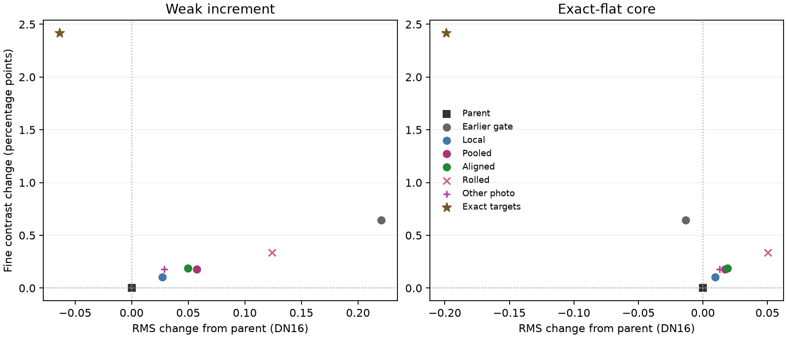
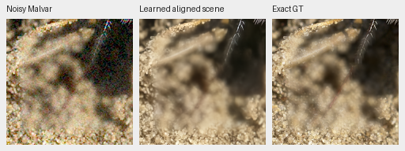
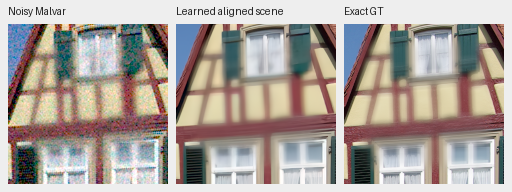

# Training a fine-detail gate with exterior scene context

The aligned whole-scene gate recovers **0.189 percentage points**
of fine contrast over Local 50k on 32 held ISO6400 photos. It adds
**0.019 DN16** of fine RMS in exact-flat cores. It recovers
**0.085 points** more than the matched local learned gate, but
changes by only **0.010 points** when it uses the context of a
different photo. At equal recovered contrast, the earlier
whole-photo Bayer rule keeps flatter cores. The trained gate
remains experimental.

The local encoder can be shared across the three conditioning
forwards. On the checked crop batches this cuts their median
time from **524 to 495 ms** with bit-identical RGB.

The [direct response study](direct-detail-response.md) uses the same
proposals and differentiates through final gain interpolation. Its
signed-response head recovers 0.526 points on 40 faint recaptures with
0.124 DN16 more paired increment error and 0.030 DN16 more flat error.

## What the head can change

The [earlier whole-photo gate](context-conditioned-detail.md) used
phase-aligned power from the Bayer greens to choose where to apply
mild noise-conditioning differences. This study trains a small
selector on the same kind of candidate. The underlying Local 50k
EMA, SHA256
`62f4e9ce84075c8df1a254a1889033b5787133e8c98c63e0ec3d174a94734959`,
stays frozen. Three forwards hold the RAW fixed and vary the
shot/read conditioning and variance by `0.90×`, `1×` and
`1.15×`. Only a band-limited camera-neutral difference from
the nominal output is delivered. Each candidate is capped at
24 DN16 local RMS before delivery.

The selector estimates two gains per 32-pixel station from
Bayer cross-green power, brightness, color, noise conditioning,
clipping and the measured strength of the two candidate fields.
A station with zero or negative cross-green power receives zero
sharp gain. Gains are interpolated to native resolution. Each
variant has the same two hidden layers and 2,226 trainable
parameters.

- **Local** uses the measured station features.
- **Pooled scene** adds one descriptor pooled over the masked
  scene. Padded cells are area-weighted out.
- **Aligned scene** adds features sampled at the station's
  position in the masked whole-scene preview.

The frozen DINOv3 ConvNeXt-Small encoder sees a 448-pixel
long-side preview of noisy Bayer data with the entire query
and a 16-native-pixel halo replaced by a level measured outside
the halo. Two layers are compressed by fixed seeded projections
to 40 features. Each query shares this encoded exterior across
its paired roles. Rolling the aligned features inside the query
tests registration. Substituting the feature map of another held
photo tests the contribution of the exterior beyond the local
measurements.

## Matched training

The frozen source order draws 1,600 distinct photographs from
the cleaned expanded scene training manifest. Complete cached
bin-four photographs retain their original scale with global D4
augmentation. One 256-pixel crop per scene supplies three
independent Bayer observations of the natural, attenuated and
exact-flat variants. The crop, tonal exposure, color calibration
and layout match across each pair. Head training and scored
photos are disjoint by source ID and cached-pixel hash.

The frozen parent outputs are reduced to local features and
quadratic loss statistics, avoiding a cache of RGB predictions.
The objective weights error in the first two roles, the exact
quiet core and the present-minus-attenuated fine increment.
The pair term uses 1.10× its exact increment, encouraging
retention. This training objective uses constant gain within
each station. Evaluation measures actual interpolated delivery
with the fixed 16-pixel DCT scoring from the earlier study.

All three heads complete 1,200 AdamW updates with batch 32,
learning rate `6e-4` and EMA decay 0.994. The same sampled source
indices feed every optimizer. There are 4,800 distinct native
role examples and 115,200 role-example visits per arm. Frozen
feature collection takes **1,194.03 seconds** inside the sample
loops. The joint optimizer loop and checkpoint verification
take **11.61 seconds**. Training keeps raw and EMA head weights
and optimizer state. Evaluation uses the EMA.

| Head | Checkpoint SHA256 |
| --- | --- |
| Local | `5933c4f8e1e93501f0ca04753c929a9308697b9455e0d7b506336ea9dea925c2` |
| Pooled scene | `3f0d60f80b8248a54852f60985d6e4470d6da1d7f60833185978dae24acaa15d` |
| Aligned scene | `5608c380eb6e607e592efd2a81c7f5ea890d9f7a13a27539b4a255733feba3fc` |

The frozen DINO checkpoint has SHA256
`691963f0f796aac860d818d59d9d14287a4675612829fbe9467c7f5df8ce5b14`.
The parent crop forwards use CUDA IEEE FP32 and the masked
scene encoder uses BF16. The audit verifies that replacing
the query and halo changes no preview inputs. A separate
check recomputes fine error after pixel delivery on eight
held photos and agrees with the stored quadratic measurements.

## Held natural texture and wires

The 32 older natural calibration photos set the two blend
strengths independently under the earlier limits of +0.05
DN16 exact-flat RMS and +0.10 DN16 each of paired increment
and present-image RMS relative to Local 50k. Calibration
chooses full sharp gain for local and aligned, 75% for
pooled, and zero smooth gain in all three. The full two-branch
outputs have lower contrast. The held panel consists of 32
other photos with independent Bayer noise across the
present, attenuated and flat roles. Fine response measures
the signed present-minus-attenuated projection in native
1/8–1/3 cycle-per-pixel DCT bands.

| 32 held ISO6400 photos | Fine response | Increment RMS, DN16 | Exact-flat fine RMS, DN16 |
| --- | ---: | ---: | ---: |
| Local 50k EMA | 63.612% | 153.071 | 4.117 |
| Earlier whole-photo Bayer gate | 64.257% | 153.291 | 4.104 |
| Learned local, locked | 63.716% | 153.098 | 4.127 |
| Learned pooled scene, locked | 63.789% | 153.129 | 4.134 |
| Learned aligned scene, locked | 63.801% | 153.121 | 4.136 |
| Rolled alignment, same head and blend | 63.949% | 153.195 | 4.167 |
| Other photo, same head and blend | 63.791% | 153.100 | 4.130 |
| Aligned with both trained gains | 62.190% | 152.954 | 3.984 |

The aligned lock changes response by **+0.189 points**
`[+0.124,+0.265]`, increment RMS by **+0.050 DN16**
`[−0.008,+0.113]`, and flat RMS by **+0.019 DN16**
`[+0.009,+0.031]` versus Local 50k. On the 16 photos
with the least clean-increment energy, the gain is **0.210
points**. Over the learned local lock the aligned gate
recovers **+0.085 points** `[+0.045,+0.130]` with **+0.010
DN16** flat RMS. Substituting another photo changes response
by **−0.010 points** `[−0.065,+0.046]`. Rolling features
raises response and raises both flat and increment error.

Retrospectively scaling the earlier Bayer gate to the aligned
gate's measured response gives **0.033 DN16 less flat RMS**
`[0.020,0.047]` with similar increment error. At the same
response the aligned layout gives **0.007 DN16 less flat RMS**
than rolled features, with a paired interval of approximately
`[0.0004,0.0145]`. Bootstrap intervals resample entire photos.

On 24 retained planted-wire fixtures the aligned lock raises
weak response **32.377%→32.465%**, with intact increment RMS
**188.074→188.288 DN16**. Fine flat RMS changes
**20.490→20.491 DN16**. Weak-direction RMS in the 12 true
gaps rises **9.615→9.632 DN16**. The earlier Bayer rule raises
more wire contrast and adds more error.

The star uses exact targets to choose station gains, with the
same bounded proposals, local cross-green cap and bilinear
delivery. Across the measured response frontier, one such fit
raises response by **2.418 points** while lowering increment RMS
by **0.064 DN16**, present-image RMS by **0.386 DN16**, and
flat RMS by **0.199 DN16**. This shows remaining headroom in
the mild proposals. The fit uses the clean target for every
gain and for selection along the diagnostic curve.

## Reusing the local encoding

The noise sweep renders the same untransformed RAW for the
local DINO encoder at every noise setting. During the final
1,056 training scenes a checked cache runs it once per
batch and compares every reused encoder input with the
original. The first 544 scenes retain the ordinary path.
The preflight and isolated timing cover all four Bayer
layouts with bit-identical RGB for all three settings.
With the collector finished, three repetitions over eight
batches of three crops give median sweep time **0.524→0.495
seconds**, about **5.6% less time**. This measures the three
native crop forwards, excluding data preparation and the
separate exterior encoding. The sweep still runs the RGB
restoration trunk at every noise setting.

## Native exact comparisons

The triplets show noisy Malvar, the locked aligned head above
Local 50k EMA and exact simulated GT. They use the same native
`[48,48,160,160]` crop, GBRG, shot/read
`0.00128/6.5536e-6`, sensor exposure ×0.33 and display
exposure ×3.0303 with a shared sRGB transform. These two
examples give the largest decrease and increase in fine
increment error. The photos were binned, locally attenuated
and captured through the same simulated sensor.

Hans Hillewaert, *Cicindela campestris (mating)*, query
`[8,240,256,256]`. Fine increment RMS falls by 0.208 DN16.
The fine strands and sandy grain remain softer than the target.
[All methods](assets/scene-detail-selector-v1/fresh-27-present.png) ·
[Flat control](assets/scene-detail-selector-v1/fresh-27-flat.png) ·
[Source photo](https://commons.wikimedia.org/wiki/File:Cicindela_campestris_(mating).jpg) ·
[CC BY-SA 4.0](https://creativecommons.org/licenses/by-sa/4.0/).

Berthold Werner, *Marktbreit BW 9*, query
`[486,104,256,256]`. Fine increment RMS rises by 0.418 DN16.
The dark timber trim remains soft, and the exact-flat companion
looks smooth under all displayed fitted gains.
[All methods](assets/scene-detail-selector-v1/fresh-19-present.png) ·
[Flat control](assets/scene-detail-selector-v1/fresh-19-flat.png) ·
[Public domain source photo](https://commons.wikimedia.org/wiki/File:Marktbreit_BW_9.jpg).

## Standing GFX100S comparisons

The aligned head changes the overcast sky by **0.010 DN16 RGB
RMS**. Building, foliage and coarse fence change by **2.921**,
**2.033** and **2.783 DN16**, with subtle modulation and continuous
coarse crossings. The left and right fine cab changes are
**0.108/0.273 DN16** nominal and **0.966/0.810 DN16**
transferred. At ×16 the fine cab retains uneven contrast and
mottle. The reviewed boards show no clearly recovered fine
intersections or new repeating color ripple.

Native origins for sky, building, foliage and coarse fence
are `[5800,1400]`, `[5790,2690]`, `[8890,5570]` and
`[2240,6000]`. Cab origins are `[806,6489]` and
`[1026,6449]`. Nominal shot/read is `0.00128/6.5536e-6`
and the transferred profile is
`0.0014635775921166604/1.0715704128646712e-6`.
V120 Small EMA
`a9d9b6b4f974e24a6b11e5e740aab32314233a7f53c056cf37c7d2aac1c589fb`
is shown as the general comparison. ISO100 AHD and both cab
JPEGs are qualitative references. Aperture, exposure time
and motion differ between RAW captures.

| RAW and conditioning | Native boards |
| --- | --- |
| DSCF3879 nominal ×4 | [Sky](assets/scene-detail-selector-v1/main-overcast-sky-main-overcast-sky-x4.png) · [Building](assets/scene-detail-selector-v1/main-building-detail-main-building-detail-x4.png) · [Foliage](assets/scene-detail-selector-v1/main-foliage-main-foliage-x4.png) · [Coarse fence](assets/scene-detail-selector-v1/main-chain-link-fence-main-chain-link-fence-x4.png) |
| DSCF3842 nominal | [Left ×4](assets/scene-detail-selector-v1/mesh-nominal-fine-green-mesh-left-x4.png) · [Right ×4](assets/scene-detail-selector-v1/mesh-nominal-fine-green-mesh-right-x4.png) · [Left ×16](assets/scene-detail-selector-v1/mesh-nominal-fine-green-mesh-left-x16.png) · [Right ×16](assets/scene-detail-selector-v1/mesh-nominal-fine-green-mesh-right-x16.png) |
| DSCF3842 transferred | [Left ×4](assets/scene-detail-selector-v1/mesh-profile3879-fine-green-mesh-left-x4.png) · [Right ×4](assets/scene-detail-selector-v1/mesh-profile3879-fine-green-mesh-right-x4.png) · [Left ×16](assets/scene-detail-selector-v1/mesh-profile3879-fine-green-mesh-left-x16.png) · [Right ×16](assets/scene-detail-selector-v1/mesh-profile3879-fine-green-mesh-right-x16.png) |

Training, numeric evaluation and native viewing are complete
for this crop-scale component study. The comparable 427-photo
and measured-camera panels cover the underlying full models.
[Score and training summary](results/scene-detail-selector-v1/summary.json) ·
[Native provenance](assets/scene-detail-selector-v1/manifest.json) ·
[Publication hashes](results/scene-detail-selector-v1/publication.json) ·
[Head checkpoints, sources and frozen receipts](results/scene-detail-selector-v1/evidence.tar.xz).
