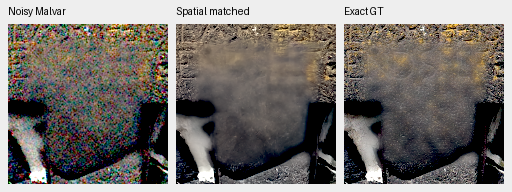
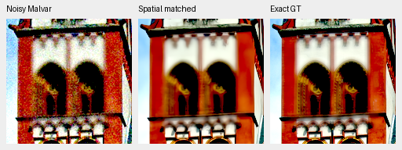

# Local and whole-scene context at matched 20,000 updates

On 64 held-out photos with independent ISO6400 draws, the matched spatial
model lowers fine-increment error by **0.76 DN16** versus Corpus 100k
and loses **0.75 percentage points** of the true fine response. The
local-only 20k arm is nearly tied. Correct distant context improves
flat-region error versus masking the scene features and shows little
difference from a mismatched distant view.
[Paired training audit](results/scene-full-epoch-v1/paired-prefix-020000.json) ·
[Exact-target scores](results/scene-full-epoch-v1/matched-020000-monitor.json) ·
[Evaluation sources and receipts](results/scene-full-epoch-v1/matched-020000-monitor.tar.xz).

## Training and comparison

The 20k checkpoints share **40,000 distinct photos**, 40,000 noise seeds
and 160,000 native queries per arm. Input traces match byte for byte.
Both resume the original 50k schedule from Corpus 100k EMA, with a frozen
DINO encoder, and use the same protected-scene-excluding
90,692-photo manifest and four native queries per photo.
The local model trains without a scene-feature adapter. The spatial arm
uses registered scene features. The retained training loops take
**9,987.81 s local** and **13,139.33 s spatial** through 20k.
All comparisons use EMA.

| Model | Checkpoint SHA256 |
| --- | --- |
| Local-only 20k | `b892a08c8ebbccb05c000e4f42d1f86c3a7d1d5870721ccd6e1c8fe9e82c3889` |
| Spatial 20k | `e56429f491c6712ab931ad4364d5d27ca6a45df5b3d23a7616a915c3aae8dd1f` |
| Corpus 100k | `87b96f3c487b9edaf1c477742b6c38f2a82cc6b20a94716d51cc8cf46a17a760` |
| V120 | `a9d9b6b4f974e24a6b11e5e740aab32314233a7f53c056cf37c7d2aac1c589fb` |

The numerical review measures 64 distinct photo backgrounds at ISO400
and ISO6400, with coupled and independent draws. Each of the 256 groups
contains the present, attenuated and exact-flat roles. Noisy query samples
and local conditioning match across all variants. The matched spatial run
uses a 1,024-pixel scene preview. The mismatched and blurred distant views
preserve the neighboring preview region exactly. The masked control disables
the scene features. The complete CUDA IEEE FP32 numerical collection takes
750.74 s of inference, separately from checkpoint setup and training.
[Scene training and retained schedule](scene-full-epoch.md) ·
[Review input and checkpoint bindings](results/scene-full-epoch-v1/matched-020000-monitor.tar.xz).

## Exact-target results

The lower band covers 1/32–1/8 and the fine band covers 1/8–1/3 cycles
per native pixel. Fine response projects the reconstructed increment onto
the known weak increment. Flat RMS scores the known flat core.

| Independent ISO6400, 64 photos | Fine response | Fine-increment RMS, DN16 | Fine-flat RMS, DN16 | Lower-flat RMS, DN16 |
| --- | ---: | ---: | ---: | ---: |
| V120 | 65.468% | 124.715 | 5.100 | 13.368 |
| Corpus 100k | 65.840% | 124.547 | 4.589 | 12.835 |
| Local-only 20k | 65.099% | 123.774 | 4.322 | 10.746 |
| Spatial 20k, matching | 65.086% | 123.788 | 4.292 | 10.665 |
| Spatial 20k, masked | 65.214% | 123.782 | 4.501 | 11.066 |
| Spatial 20k, blurred distant | 65.243% | 123.779 | 4.327 | 10.720 |
| Spatial 20k, mismatched distant | 65.068% | 123.775 | 4.286 | 10.565 |

Against Corpus 100k, the spatial fine-increment reduction is
**0.758 DN16** [0.490, 1.044] and the response loss is **0.754 points**
[0.340, 1.136]. The local arm is within 0.02 DN16 on fine-increment RMS.
Against the same spatial weights with the scene features masked, matched
scene features reduce fine-flat RMS by **0.208 DN16** [0.070, 0.419].
Against the mismatched distant view, the fine response difference is
**+0.018 points** [−0.046, +0.082] and the fine-flat difference is
+0.006 DN16 [−0.015, +0.026]. At ISO400, the matching view lowers
fine-flat RMS from 2.970 to 2.241 DN16 versus masking, with 2.271 DN16
for the wrong distant view. The experiment finds a benefit from scene
features on flat regions and little evidence that the correct distant
content improves fine reconstruction.

The two 20k models also recover more of the highest band at ISO6400.
Spatial response rises from 26.86% to 28.43% versus Corpus 100k with
higher flat energy, 1.93 to 2.40 DN16. On coupled ISO6400 draws the
spatial arm increases fine-increment RMS from 102.99 to 103.54 DN16
versus Corpus 100k. The paired comparison on the same eight 15k
photos shows 0.09 DN16 less independent fine-increment error and
0.12 points less true fine response than matching spatial 15k.
Separate means and source-paired intervals are available for both
scopes.
[Both numerical scopes and controls](results/scene-full-epoch-v1/matched-020000-monitor.json).

## Exact native crop comparisons

Both triplets use independent ISO6400 shot/read `0.00128/6.5536e-6`,
capture exposure 0.33, 16-bit ADC with black level 0.03, display
exposure ×3.0303 and contrast ×2. Each panel uses the same
160 × 160 native query pixels at `[48,48,160,160]`. The exact target
retains the full fine signal. The spatial matching and local EMA hashes
are in the table above.

**Hauroth**, Palauenc05, CC BY-SA 4.0. RGGB query
`[218,192,256,256]`. Fine stone grain is replaced by softer
mottling in both models. The exact-flat control stays smooth.
[Source](https://commons.wikimedia.org/wiki/File:Hauroth_Wegekreuz_St-Bartholom%C3%A4us.jpg) ·
[All methods](images/scene-full-epoch-v1/evaluation-020000/000-iso6400-independent-role0-comparison.png) ·
[Local triplet](images/scene-full-epoch-v1/evaluation-020000/000-iso6400-independent-role0-local-triplet.png) ·
[Exact-flat control](images/scene-full-epoch-v1/evaluation-020000/000-iso6400-independent-role2-comparison.png).

**Limburg Cathedral**, Berthold Werner, public domain. BGGR query
`[22,250,256,256]`. Both models retain the arch shapes
and trim. Fine bricks and moldings remain softer than the exact target.
[Source](https://commons.wikimedia.org/wiki/File:Limburger_Dom_BW_1.jpg) ·
[All methods](images/scene-full-epoch-v1/evaluation-020000/001-iso6400-independent-role0-comparison.png) ·
[Local triplet](images/scene-full-epoch-v1/evaluation-020000/001-iso6400-independent-role0-local-triplet.png) ·
[Exact-flat control](images/scene-full-epoch-v1/evaluation-020000/001-iso6400-independent-role2-comparison.png).

## Standing GFX100S comparisons

Both EMA arms preserve a visually smooth sky and coherent coarse
fence crossings. Fine building cables and foliage remain soft.
On the nominal fine cab crop, some narrow right diagonals look softer
than with Corpus 100k. The transferred noise profile shows more
diagonal fragments, and both 20k results retain incomplete crossings
and background mottling. The camera JPEG pairs and ISO100 AHD views
are qualitative comparisons with differences in exposure, aperture
and capture time.

The native collection uses CPU IEEE FP32 with reused, input-matched
V120 and Corpus 100k controls. Spatial-versus-local camera RGB
differences measure 1.37 DN16 RMS in the sky, 8.15 on the coarse fence
and 2.02–3.89 across the four cab crops. Main DSCF3879 uses shot/read
`0.00128/6.5536e-6` and display ×4. Both DSCF3842 profiles use display
×16. The transferred profile uses
`0.0014635775921166604/1.0715704128646712e-6`.
[Native provenance and model differences](results/scene-full-epoch-v1/matched-020000-standing.json) ·
[Standing collection archive](results/scene-full-epoch-v1/matched-020000-standing.tar.xz).

| Fixed scene and noise profile | Native comparisons |
| --- | --- |
| DSCF3879/3880 main, nominal | [Sky](images/scene-full-epoch-v1/standing-020000/main-overcast-sky-main-overcast-sky.png) · [Building](images/scene-full-epoch-v1/standing-020000/main-building-detail-main-building-detail.png) · [Foliage](images/scene-full-epoch-v1/standing-020000/main-foliage-main-foliage.png) · [Coarse fence](images/scene-full-epoch-v1/standing-020000/main-chain-link-fence-main-chain-link-fence.png) |
| DSCF3842/3835 cab, nominal | [Left](images/scene-full-epoch-v1/standing-020000/mesh-nominal-fine-green-mesh-left.png) · [Right](images/scene-full-epoch-v1/standing-020000/mesh-nominal-fine-green-mesh-right.png) |
| DSCF3842/3835 cab, transferred DSCF3879 | [Left](images/scene-full-epoch-v1/standing-020000/mesh-profile3879-fine-green-mesh-left.png) · [Right](images/scene-full-epoch-v1/standing-020000/mesh-profile3879-fine-green-mesh-right.png) |

Training through the matched 20k milestone, the 64-photo numerical
evaluation, exact native crop review and both standing GFX reviews
are complete. The full-epoch run continues toward 50k. Comparable
fixed 427-photo and known/unseen camera panels are queued at that
endpoint.
[Review status and evidence bindings](results/scene-full-epoch-v1/matched-020000-quality-status.json) ·
[Comparable PSNR history](performance-history.md).
