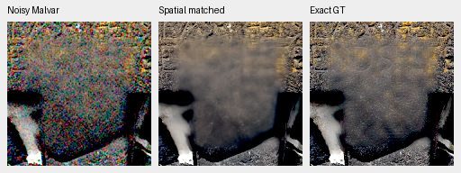
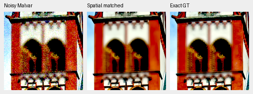

# Matched 25k scene training and exact-photo review

On the same 64 independent ISO6400 photo backgrounds, the spatial
25k EMA lowers exact-flat RMS by **0.102 DN16** versus spatial 20k
and loses **0.253 percentage points** of fine response. The local
25k EMA gives a similar tradeoff. Correct and mismatched distant
views are nearly tied. The 64-photo numerical evaluation and
exact native image review are complete. Both standing GFX scenes
retain the smooth sky and coherent coarse fence. Fine cab crossings
remain incomplete at 25k.
[Training receipt](results/scene-full-epoch-v1/matched-025000-training.json) ·
[Exact-photo results](results/scene-full-epoch-v1/matched-025000-monitor.json).

## Matched budget and fixed inputs

Both EMA models continue from Corpus 100k on identical arrays
through 25,000 updates, with **50,000 distinct photos**, 50,000
sensor noise seeds and **200,000 native queries per arm**. The
90,692-photo protected-scene-excluding source manifest and the
50k learning-rate horizon are shared. The local operator carries
no scene adapter. The spatial arm uses registered scene features
and a frozen DINO encoder. Retained training loops total
**12,399.77 s local** and **16,025.42 s spatial** through 25k.
The separate CUDA IEEE FP32 photo inference loop takes **806.8 s**.
[Input trace audit](results/scene-full-epoch-v1/paired-prefix-025000.json) ·
[Training setup](scene-full-epoch.md).

| EMA checkpoint | SHA256 |
| --- | --- |
| Local-only 25k | `6c5c9a13532f080ed00812e21bef82931f4a6e7826278843fcd23fbd57e5a0fe` |
| Spatial 25k | `e8dc1a71083d5aa9838e85cbfee588faec02ec00143b35e86a01ece561429370` |
| Corpus 100k | `87b96f3c487b9edaf1c477742b6c38f2a82cc6b20a94716d51cc8cf46a17a760` |
| V120 | `a9d9b6b4f974e24a6b11e5e740aab32314233a7f53c056cf37c7d2aac1c589fb` |

Both noise profiles and both draw laws use the same 256
input groups as the matched 20k study. Each contains the
present, attenuated and exact-flat roles. Input fingerprints
agree for every group. Metrics for the V120 and Corpus 100k
controls match the 20k collection exactly. The mismatched
and blurred scene views retain the registered nearby region.
[Evaluation archive](results/scene-full-epoch-v1/matched-025000-monitor.tar.xz) ·
[Per-case receipts](results/scene-full-epoch-v1/matched-025000-case-receipts.tar.xz) ·
[Earlier 20k quality review](scene-full-epoch-20k.md).

## Exact-photo scores

| Independent ISO6400, 64 photos | Fine response | Fine-increment RMS, DN16 | Fine-flat RMS, DN16 | Lower-flat RMS, DN16 |
| --- | ---: | ---: | ---: | ---: |
| V120 | 65.468% | 124.715 | 5.100 | 13.368 |
| Corpus 100k | 65.840% | 124.547 | 4.589 | 12.835 |
| Local-only 25k | 64.900% | 123.678 | 4.225 | 10.514 |
| Spatial 25k, matching | 64.833% | 123.738 | 4.190 | 10.548 |
| Spatial 25k, masked | 65.072% | 123.768 | 4.375 | 10.976 |
| Spatial 25k, blurred distant | 64.900% | 123.696 | 4.208 | 10.543 |
| Spatial 25k, mismatched distant | 64.821% | 123.698 | 4.193 | 10.445 |

Against matched spatial 20k, the 25k model lowers independent
fine-flat RMS **0.102 DN16** [0.072, 0.138], loses **0.253 fine
response points** [0.100, 0.422] and changes increment RMS by
−0.051 DN16 [−0.170, +0.083]. Local-only 25k also lowers flat
error by 0.097 DN16 and loses 0.200 response points over its
matched 20k model. Versus Corpus 100k, spatial 25k has
0.809 DN16 less independent increment error with 1.007 points
less true response. Under coupled ISO6400 draws, spatial 25k
increases fine-increment error by 0.281 DN16 versus spatial
20k with lower flat error.

Spatial context lowers independent fine-flat RMS by 0.184 DN16
versus masking. Matching the distant preview changes response
by +0.011 points [−0.031, +0.058] against the mismatched preview.
Their fine-flat RMS differs by −0.003 DN16 [−0.029, +0.019].
[Paired intervals across all noise laws and bands](results/scene-full-epoch-v1/matched-025000-monitor.json).

## Native exact-target comparisons

Each cell shows 160 × 160 original query pixels at
`[48,48,160,160]`. Both views use the independent ISO6400
shot/read `0.00128/6.5536e-6`, capture exposure 0.33, 16-bit ADC,
black 0.03, display exposure ×3.0303 and contrast ×2. The
middle panels show matching spatial EMA at 25k.
[Native image and checkpoint provenance](results/scene-full-epoch-v1/matched-025000-exact-native.json).

**Hauroth**, Palauenc05, CC BY-SA 4.0, RGGB query
`[218,192,256,256]`. The fine stone grain stays soft and coarse
mottling remains. The exact-flat center looks smooth.
[Source](https://commons.wikimedia.org/wiki/File:Hauroth_Wegekreuz_St-Bartholom%C3%A4us.jpg) ·
[All methods](images/scene-full-epoch-v1/evaluation-025000/000-iso6400-independent-role0-comparison.png) ·
[Local-only triplet](images/scene-full-epoch-v1/evaluation-025000/000-iso6400-independent-role0-local-triplet.png) ·
[Exact-flat board](images/scene-full-epoch-v1/evaluation-025000/000-iso6400-independent-role2-comparison.png).

**Limburg Cathedral**, Berthold Werner, public domain, BGGR
query `[22,250,256,256]`. The arch shapes and trim stay clear.
Fine molding and brick texture remain soft.
[Source](https://commons.wikimedia.org/wiki/File:Limburger_Dom_BW_1.jpg) ·
[All methods](images/scene-full-epoch-v1/evaluation-025000/001-iso6400-independent-role0-comparison.png) ·
[Local-only triplet](images/scene-full-epoch-v1/evaluation-025000/001-iso6400-independent-role0-local-triplet.png) ·
[Exact-flat board](images/scene-full-epoch-v1/evaluation-025000/001-iso6400-independent-role2-comparison.png).

## Standing GFX100S comparisons

Both 25k EMA arms were viewed alongside V120, Corpus 100k and the
independent ISO100 references. The direct 20k and 25k boards use the
same 160 × 160 pixels, conditioning and rendering. The DSCF3879 scene uses
nominal shot/read `0.00128/6.5536e-6` at display ×4. The sky stays smooth,
the coarse crossings stay coherent, and fine leaves and building wires
remain soft. Spatial 25k differs from spatial 20k by 1.05 DN16 RGB RMS in
the sky and 9.02 DN16 in the coarse fence. The native views show little
change in the recovered detail.
[Sky](images/scene-full-epoch-v1/standing-025000/20k-vs-25k-main-overcast-sky-main-overcast-sky.png) ·
[Building](images/scene-full-epoch-v1/standing-025000/20k-vs-25k-main-building-detail-main-building-detail.png) ·
[Foliage](images/scene-full-epoch-v1/standing-025000/20k-vs-25k-main-foliage-main-foliage.png) ·
[Coarse fence](images/scene-full-epoch-v1/standing-025000/20k-vs-25k-main-chain-link-fence-main-chain-link-fence.png).

In the DSCF3842 cab at display ×16, nominal conditioning leaves a diffuse
left lattice and faint right diagonals. The transferred profile
`0.0014635775921166604/1.0715704128646712e-6` shows more right diagonals at
both milestones, with incomplete junctions and uneven background texture.
Both cab crops were inspected alongside DSCF3835 ISO100 AHD and both camera
JPEGs. Aperture, exposure time and subject motion differ between the captures.

| Cab profile | Full native boards with qualitative references | Direct milestone boards |
| --- | --- | --- |
| Nominal | [Left](images/scene-full-epoch-v1/standing-025000/mesh-nominal-fine-green-mesh-left.png) · [Right](images/scene-full-epoch-v1/standing-025000/mesh-nominal-fine-green-mesh-right.png) | [Left](images/scene-full-epoch-v1/standing-025000/20k-vs-25k-mesh-nominal-fine-green-mesh-left.png) · [Right](images/scene-full-epoch-v1/standing-025000/20k-vs-25k-mesh-nominal-fine-green-mesh-right.png) |
| Transferred | [Left](images/scene-full-epoch-v1/standing-025000/mesh-profile3879-fine-green-mesh-left.png) · [Right](images/scene-full-epoch-v1/standing-025000/mesh-profile3879-fine-green-mesh-right.png) | [Left](images/scene-full-epoch-v1/standing-025000/20k-vs-25k-mesh-profile3879-fine-green-mesh-left.png) · [Right](images/scene-full-epoch-v1/standing-025000/20k-vs-25k-mesh-profile3879-fine-green-mesh-right.png) |

The matched training milestone, numerical replay, exact crop viewing and
both standing comparisons are complete. The full 427-photo and known/unseen
camera panels are queued for the final 50k endpoints.
[Standing receipt](results/scene-full-epoch-v1/matched-025000-standing.json) ·
[Completion record](results/scene-full-epoch-v1/matched-025000-quality-status.json) ·
[Comparable PSNR history](performance-history.md).
