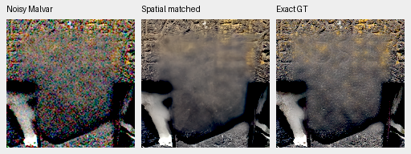
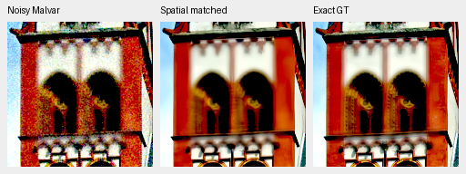

# Matched 30k scene training and exact-photo review

On 64 photos at independent ISO6400, the local-only 30k EMA recovers
**0.121 percentage points** more fine detail than local 25k and raises
fine flat RMS **0.037 DN16**. The spatial 30k EMA gains 0.067 points
over spatial 25k, with uncertainty spanning zero, and raises fine flat RMS
0.037 DN16. The correctly matched distant preview is nearly tied with
the mismatched one. Exact-photo measurements, native exact-crop review and
both standing GFX reviews are complete. The 30k models preserve a smooth
sky and clear coarse fence directions, with incomplete fine cab crossings.
[Paired training audit](results/scene-full-epoch-v1/paired-prefix-030000.json) ·
[Exact-photo scores](results/scene-full-epoch-v1/matched-030000-monitor.json).

## Matched budget and fixed inputs

Both models continue from Corpus 100k EMA on the 90,692-photo training
manifest, with **60,000 distinct photos**, 60,000 distinct noise seeds,
and **240,000 native queries per arm** at 30k. The retained input hashes
match across conditions. The local arm uses the native trunk. The spatial
arm also uses registered context from its frozen DINO encoder. Retained
training loops total **14,803.82 s local** and **19,123.78 s spatial** with a
50k schedule. The separate 30k exact-photo inference loop takes
**612.71 s** under CUDA IEEE FP32, reusing V120 and Corpus 100k outputs
after fingerprint, conditioning and checkpoint checks.
[Training schedule and exclusions](scene-full-epoch.md) ·
[Evaluation archive](results/scene-full-epoch-v1/matched-030000-monitor.tar.xz) ·
[Per-case receipts](results/scene-full-epoch-v1/matched-030000-case-receipts.tar.xz).

| EMA checkpoint | SHA256 |
| --- | --- |
| Local-only 30k | `b0d5fdc14ebc49189099898b1b74d128c244cceb4cc65dbca7db7acb79ca2f19` |
| Spatial 30k | `f7757fc689625faa46607d7d7db0cc780bd4e7877e71881100110ad6c4e8e60b` |
| Corpus 100k | `87b96f3c487b9edaf1c477742b6c38f2a82cc6b20a94716d51cc8cf46a17a760` |
| V120 | `a9d9b6b4f974e24a6b11e5e740aab32314233a7f53c056cf37c7d2aac1c589fb` |

The scores cover the same 256 input groups as the matched 25k study, with 64
photo sources, two ISO profiles and two draw laws. Each group contains
present, attenuated and exact-flat roles. The two baseline outputs reproduce
the 25k scores exactly. The blurred and mismatched conditions retain the
same registered nearby context.
[Matched 25k review](scene-full-epoch-25k.md).

## Exact-photo scores

| Independent ISO6400, 64 photos | Fine response | Fine-increment RMS, DN16 | Fine-flat RMS, DN16 | Lower-flat RMS, DN16 |
| --- | ---: | ---: | ---: | ---: |
| V120 | 65.468% | 124.715 | 5.100 | 13.368 |
| Corpus 100k | 65.840% | 124.547 | 4.589 | 12.835 |
| Local-only 30k | 65.021% | 123.727 | 4.263 | 10.622 |
| Spatial 30k, matching | 64.900% | 123.701 | 4.227 | 10.510 |
| Spatial 30k, masked | 65.183% | 123.784 | 4.486 | 11.126 |
| Spatial 30k, blurred distant | 64.941% | 123.680 | 4.245 | 10.571 |
| Spatial 30k, mismatched distant | 64.885% | 123.668 | 4.233 | 10.433 |

Spatial 30k lowers independent ISO6400 fine-increment RMS
**0.846 DN16** [0.570, 1.131] and fine-flat RMS **0.362 DN16**
[0.050, 0.820] relative to Corpus 100k, while losing **0.940 fine response
points** [0.593, 1.278]. Relative to V120, its increment RMS falls 1.014 DN16
and its fine response falls 0.568 points. At coupled ISO6400 it raises
increment RMS 0.837 DN16 versus Corpus 100k. Relative to its own 25k
checkpoint it changes independent fine increment error by −0.037 DN16
[−0.153, +0.072].

On the same independent ISO6400 inputs, matching the distant view changes
fine response by +0.014 points [−0.026, +0.057] and fine-flat RMS by
−0.006 DN16 [−0.039, +0.021] versus the mismatched distant view.
The visible scene adapter as a whole lowers fine-flat RMS 0.259 DN16
relative to masking it and loses 0.284 response points. At independent
ISO400, matching the distant view lowers fine-flat RMS 0.038 DN16 and
raises fine-increment RMS 0.045 DN16 versus the mismatched view.
[Source-paired intervals](results/scene-full-epoch-v1/matched-030000-monitor.json).

## Native exact-target comparisons

Each panel shows 160×160 original query pixels at `[48,48,160,160]`.
Both crops use independent ISO6400 shot/read `0.00128/6.5536e-6`,
capture exposure 0.33, 16-bit ADC with black 0.03, display ×3.0303
and contrast ×2. The middle panels use matching spatial 30k EMA.
[Native crop and checkpoint provenance](results/scene-full-epoch-v1/matched-030000-exact-native.json).

**Hauroth**, Palauenc05, CC BY-SA 4.0. RGGB query `[218,192,256,256]`.
The modeled stone carries coarse mottling with soft fine grain. The
exact-flat center appears smooth and has subtle boundary transitions.
[Source](https://commons.wikimedia.org/wiki/File:Hauroth_Wegekreuz_St-Bartholom%C3%A4us.jpg) ·
[All methods](images/scene-full-epoch-v1/evaluation-030000/000-iso6400-independent-role0-comparison.png) ·
[Local-only triplet](images/scene-full-epoch-v1/evaluation-030000/000-iso6400-independent-role0-local-triplet.png) ·
[Exact-flat board](images/scene-full-epoch-v1/evaluation-030000/000-iso6400-independent-role2-comparison.png).

**Limburg Cathedral**, Berthold Werner, public domain. BGGR query
`[22,250,256,256]`. The arch outlines are distinct and the smallest trim
and brick relief blend together. The exact-flat version remains smooth.
[Source](https://commons.wikimedia.org/wiki/File:Limburger_Dom_BW_1.jpg) ·
[All methods](images/scene-full-epoch-v1/evaluation-030000/001-iso6400-independent-role0-comparison.png) ·
[Local-only triplet](images/scene-full-epoch-v1/evaluation-030000/001-iso6400-independent-role0-local-triplet.png) ·
[Exact-flat board](images/scene-full-epoch-v1/evaluation-030000/001-iso6400-independent-role2-comparison.png).

## Standing GFX100S comparisons

Both 30k EMA arms were viewed alongside V120, Corpus 100k, and
independent ISO100 demosaics. Direct 25k and 30k boards use identical
160×160 coordinates, conditioning and display. DSCF3879 uses
`0.00128/6.5536e-6` shot/read at display ×4. The sky stays smooth and
coarse chain-link crossings remain coherent. Building brackets, cables
and fine leaf tips stay soft. Spatial 30k differs from spatial 25k by
1.18 DN16 camera-RGB RMS in the sky and 5.98 DN16 on the coarse fence.
The visible detail changes little at native scale.
[Sky](images/scene-full-epoch-v1/standing-030000/25k-vs-30k-main-overcast-sky-main-overcast-sky.png) ·
[Building](images/scene-full-epoch-v1/standing-030000/25k-vs-30k-main-building-detail-main-building-detail.png) ·
[Foliage](images/scene-full-epoch-v1/standing-030000/25k-vs-30k-main-foliage-main-foliage.png) ·
[Coarse fence](images/scene-full-epoch-v1/standing-030000/25k-vs-30k-main-chain-link-fence-main-chain-link-fence.png).

DSCF3842 uses display ×16. The nominal view leaves faint left and right wire
fragments. With the transferred profile `0.0014635775921166604/1.0715704128646712e-6`,
right diagonals remain visible and both ROIs retain background mottling and
incomplete fine intersections. Spatial 30k differs from spatial 25k by
1.48–2.04 DN16 camera-RGB RMS on these four crops. DSCF3880 and DSCF3835
ISO100 AHD and both cab JPEGs are qualitative references. Aperture,
exposure time and movement differ between captures.

| Cab profile | Full native boards with both JPEGs and ISO100 AHD | Direct milestone boards |
| --- | --- | --- |
| Nominal | [Left](images/scene-full-epoch-v1/standing-030000/mesh-nominal-fine-green-mesh-left.png) · [Right](images/scene-full-epoch-v1/standing-030000/mesh-nominal-fine-green-mesh-right.png) | [Left](images/scene-full-epoch-v1/standing-030000/25k-vs-30k-mesh-nominal-fine-green-mesh-left.png) · [Right](images/scene-full-epoch-v1/standing-030000/25k-vs-30k-mesh-nominal-fine-green-mesh-right.png) |
| Transferred | [Left](images/scene-full-epoch-v1/standing-030000/mesh-profile3879-fine-green-mesh-left.png) · [Right](images/scene-full-epoch-v1/standing-030000/mesh-profile3879-fine-green-mesh-right.png) | [Left](images/scene-full-epoch-v1/standing-030000/25k-vs-30k-mesh-profile3879-fine-green-mesh-left.png) · [Right](images/scene-full-epoch-v1/standing-030000/25k-vs-30k-mesh-profile3879-fine-green-mesh-right.png) |

[Standing GFX provenance and differences](results/scene-full-epoch-v1/matched-030000-standing.json) ·
[Frozen standing collection](results/scene-full-epoch-v1/matched-030000-standing.tar.xz).

Training verification, numerical evaluation and native image review are
complete for this matched intermediate milestone. The fixed 427-photo and
known/unseen camera panels are queued at 50k. The 30k scoped measurements
do not add broad PSNR entries.
