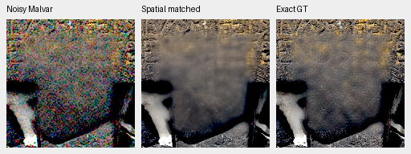
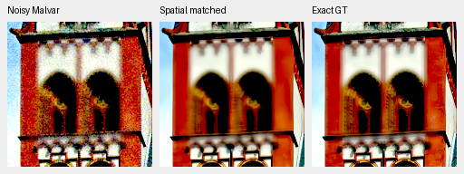

# Matched 35k scene training and exact-photo review

Both 35k models reduce independent ISO6400 fine-increment and flat-region
error versus their own 30k checkpoints on the same 64 photos. Local 35k
lowers fine-increment RMS **0.117 DN16** and fine-flat RMS **0.098 DN16**.
The fine response rises 0.067 percentage points, with uncertainty spanning
zero. The spatial 35k model makes similar gains. Matching distant scene
context still makes little difference versus the wrong distant view.
Both standing GFX families retain their existing sharpness limits,
including incomplete fine cab crossings.
[Paired training audit](results/scene-full-epoch-v1/paired-prefix-035000.json) ·
[Exact-photo scores](results/scene-full-epoch-v1/matched-035000-monitor.json).

## Training and evaluation

Both arms continue from Corpus 100k EMA on the same 50k schedule. The
35k checkpoints have each seen **70,000 distinct photos**, 70,000
distinct noise seeds and **280,000 native queries**. Input traces match.
The local arm uses the native trunk. The spatial arm also uses the
registered scene preview and frozen DINO features. The retained training
loops total 17,061.43 s local and 22,428.67 s spatial. The separate
exact-photo evaluation takes 618.73 s under CUDA IEEE FP32. Controls for
V120 and Corpus 100k reproduce the corresponding 30k scores exactly.
[Schedule and exclusions](scene-full-epoch.md) ·
[Evaluation source archive](results/scene-full-epoch-v1/matched-035000-monitor.tar.xz) ·
[256 case receipts](results/scene-full-epoch-v1/matched-035000-case-receipts.tar.xz).

| EMA checkpoint | SHA256 |
| --- | --- |
| Local-only 35k | `693fbd5e909ba259c028f3a8c9193231885bcca8c9392104cd2f6826808e3d5e` |
| Spatial 35k | `8afdecb5ce417030182fe79f90678f70e8a400887b2eb10d3b4cbc086fe69586` |
| Corpus 100k | `87b96f3c487b9edaf1c477742b6c38f2a82cc6b20a94716d51cc8cf46a17a760` |
| V120 | `a9d9b6b4f974e24a6b11e5e740aab32314233a7f53c056cf37c7d2aac1c589fb` |

The panel has the same 256 input groups as at 30k. Each group contains
present, attenuated and exact-flat roles. All 64 held-out photographs
are tested at ISO400 and ISO6400 with both coupled and independent
draws. Matching, wrong distant, blurred distant and neutral conditions
share the same checkpoint. The wrong and blurred distant controls
retain the same registered nearby context.
[Matched 30k review](scene-full-epoch-30k.md).

## Exact-photo scores

| Independent ISO6400, 64 photos | Fine response | Fine-increment RMS, DN16 | Fine-flat RMS, DN16 | Lower-flat RMS, DN16 |
| --- | ---: | ---: | ---: | ---: |
| V120 | 65.468% | 124.715 | 5.100 | 13.368 |
| Corpus 100k | 65.840% | 124.547 | 4.589 | 12.835 |
| Local-only 30k | 65.021% | 123.727 | 4.263 | 10.622 |
| Spatial 30k, matching | 64.900% | 123.701 | 4.227 | 10.510 |
| Local-only 35k | 65.088% | 123.610 | 4.165 | 10.415 |
| Spatial 35k, matching | 64.999% | 123.596 | 4.164 | 10.448 |
| Spatial 35k, masked | 65.152% | 123.695 | 4.366 | 10.951 |
| Spatial 35k, blurred distant | 65.069% | 123.610 | 4.179 | 10.491 |
| Spatial 35k, wrong distant | 64.997% | 123.587 | 4.169 | 10.392 |

Local 35k changes fine response by +0.067 points [−0.029, +0.163],
increment RMS by −0.117 DN16 [−0.184, −0.058] and fine-flat RMS by
−0.098 DN16 [−0.131, −0.071] versus local 30k. Matching spatial 35k
changes response by +0.099 points [−0.032, +0.224], increment
RMS by −0.105 DN16 [−0.183, −0.030] and flat RMS by
−0.063 DN16 [−0.084, −0.043] versus matching spatial 30k.

Relative to Corpus 100k, local 35k loses **0.752 fine-response points**
and lowers increment RMS **0.937 DN16**. Matching spatial loses
**0.841 points** and lowers increment RMS **0.951 DN16**.
Against V120, the corresponding fine-response changes are −0.380 and
−0.469 points, with increment RMS changes of −1.105 and −1.119 DN16.
The benefits in the independent draws come with weaker recovered signal.
In coupled ISO6400, the matching spatial fine-increment RMS is
0.798 DN16 higher than Corpus 100k.

In the independent ISO6400 replay, using the correct distant scene
changes fine response by +0.002 points [−0.052, +0.062] and fine-flat
RMS by −0.005 DN16 versus the wrong distant view. The full spatial
input lowers fine-flat RMS 0.202 DN16 and loses 0.153 fine-response
points relative to masking it. At independent ISO400, it lowers
fine-flat RMS 0.704 DN16 versus masking and loses 0.083 response points.
The full registered preview helps smooth regions. This readout offers
little evidence of a distant-context gain in weak fine structure.
[Source-paired intervals for every condition](results/scene-full-epoch-v1/matched-035000-monitor.json).

## Native exact-target comparisons

Each cell uses 160×160 unchanged query pixels at `[48,48,160,160]`.
The two triplets show noisy Malvar, the matching spatial 35k EMA and
exact GT. Both use independent ISO6400 shot/read `0.00128/6.5536e-6`,
16-bit ADC with black 0.03, capture exposure 0.33, display ×3.0303
and contrast ×2. The present and exact-flat comparisons were viewed
at native scale. [Crop and checkpoint provenance](results/scene-full-epoch-v1/matched-035000-exact-native.json).

**Hauroth**, Palauenc05, CC BY-SA 4.0. RGGB query `[218,192,256,256]`.
Both arms retain coarse stone mottling. The original fine stone grain
stays soft. The exact-flat center is smooth. [Source](https://commons.wikimedia.org/wiki/File:Hauroth_Wegekreuz_St-Bartholom%C3%A4us.jpg) ·
[Comparison](images/scene-full-epoch-v1/evaluation-035000/000-iso6400-independent-role0-comparison.png) ·
[Local triplet](images/scene-full-epoch-v1/evaluation-035000/000-iso6400-independent-role0-local-triplet.png) ·
[Exact-flat board](images/scene-full-epoch-v1/evaluation-035000/000-iso6400-independent-role2-comparison.png).

**Limburg Cathedral**, Berthold Werner, public domain. BGGR query
`[22,250,256,256]`. The arch outlines stay clear and small trim relief
and brick texture remain soft. Correct and wrong distant context look
similar. [Source](https://commons.wikimedia.org/wiki/File:Limburger_Dom_BW_1.jpg) ·
[Comparison](images/scene-full-epoch-v1/evaluation-035000/001-iso6400-independent-role0-comparison.png) ·
[Local triplet](images/scene-full-epoch-v1/evaluation-035000/001-iso6400-independent-role0-local-triplet.png) ·
[Exact-flat board](images/scene-full-epoch-v1/evaluation-035000/001-iso6400-independent-role2-comparison.png).

## Standing GFX100S comparisons

Both 35k EMAs were viewed alongside V120 and Corpus 100k. Separate
direct comparisons use identical 30k and 35k crop coordinates, noise
and display transforms. The DSCF3879 main scene uses shot/read
`0.00128/6.5536e-6` at display ×4. Its sky stays smooth and the coarse
fence keeps both visible directions. Foliage and the smallest building
cables remain soft. Spatial 35k differs from spatial 30k by 1.32 DN16
camera-RGB RMS in the sky and 5.38 DN16 on the coarse fence, with little
visible difference at native scale.
[Sky](images/scene-full-epoch-v1/standing-035000/30k-vs-35k-main-overcast-sky-main-overcast-sky.png) ·
[Building](images/scene-full-epoch-v1/standing-035000/30k-vs-35k-main-building-detail-main-building-detail.png) ·
[Foliage](images/scene-full-epoch-v1/standing-035000/30k-vs-35k-main-foliage-main-foliage.png) ·
[Coarse fence](images/scene-full-epoch-v1/standing-035000/30k-vs-35k-main-chain-link-fence-main-chain-link-fence.png).

The DSCF3842 cab boards use display ×16. The transferred prior preserves
more visible right-side diagonals than the nominal prior. Mottling and
incomplete fine crossings persist in both 35k arms. Spatial 35k differs
from spatial 30k by 1.36–3.12 DN16 camera-RGB RMS across the four crops.
Both camera JPEGs and both crops of the independent ISO100 AHD were
inspected under each profile. DSCF3880 and DSCF3835 supply qualitative
references with different aperture, exposure time and motion.

| Cab conditioning, shot/read | Native boards with AHD and JPEGs | Direct milestone boards |
| --- | --- | --- |
| Nominal `0.00128/6.5536e-6` | [Left](images/scene-full-epoch-v1/standing-035000/mesh-nominal-fine-green-mesh-left.png) · [Right](images/scene-full-epoch-v1/standing-035000/mesh-nominal-fine-green-mesh-right.png) | [Left](images/scene-full-epoch-v1/standing-035000/30k-vs-35k-mesh-nominal-fine-green-mesh-left.png) · [Right](images/scene-full-epoch-v1/standing-035000/30k-vs-35k-mesh-nominal-fine-green-mesh-right.png) |
| Transferred `0.0014635775921166604/1.0715704128646712e-6` | [Left](images/scene-full-epoch-v1/standing-035000/mesh-profile3879-fine-green-mesh-left.png) · [Right](images/scene-full-epoch-v1/standing-035000/mesh-profile3879-fine-green-mesh-right.png) | [Left](images/scene-full-epoch-v1/standing-035000/30k-vs-35k-mesh-profile3879-fine-green-mesh-left.png) · [Right](images/scene-full-epoch-v1/standing-035000/30k-vs-35k-mesh-profile3879-fine-green-mesh-right.png) |

[Standing GFX provenance and differences](results/scene-full-epoch-v1/matched-035000-standing.json) ·
[Frozen standing collection](results/scene-full-epoch-v1/matched-035000-standing.tar.xz).

Training verification, scope-specific photo scoring and both native
reviews are complete at this intermediate milestone.
The fixed 427-photo and known/unseen camera panels are queued for the
50k endpoints. This 35k review uses the scoped fine-detail panel.
