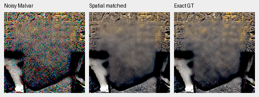
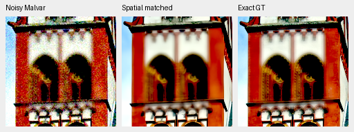

# Matched 40k scene training and exact-photo review

The extra 5,000 updates give a small quiet-region improvement in the
spatial arm and lower its fine response. On the same 64 ISO6400
photographs with independent draws, spatial fine-flat RMS falls
**0.022 DN16** and fine response falls **0.119 percentage points**
versus spatial 35k. Fine-increment RMS changes by **−0.020 DN16**,
with a paired interval spanning zero. Matching distant context gives
close results to the wrong distant view. [Training audit](results/scene-full-epoch-v1/paired-prefix-040000.json) ·
[Photo scores and intervals](results/scene-full-epoch-v1/matched-040000-monitor.json).

## Checkpoints and evaluation

Both arms continue from Corpus 100k EMA on the same 50k schedule and
verify identical observations through 40,000 updates. Each sees
80,000 distinct photos, 80,000 noise seeds and 320,000 native queries.
The local arm uses only the native restoration path. The spatial arm
also uses the registered scene preview and frozen DINO features.
Retained training time is 19,280.83 s for local and 25,611.31 s for
spatial. The separate CUDA IEEE FP32 photo inference takes 623.94 s.
[Schedule and exclusions](scene-full-epoch.md) ·
[Evaluation sources](results/scene-full-epoch-v1/matched-040000-monitor.tar.xz) ·
[256 observation receipts](results/scene-full-epoch-v1/matched-040000-case-receipts.tar.xz).

| Evaluated EMA | SHA256 |
| --- | --- |
| Local-only 40k | `ff4f1310a09227adad6b31bb903b5622706aaf888fa0b2a1ae194ec5d1dbe9f8` |
| Spatial 40k | `d8ba41fa48bab80d515d8248ce6bd787b5347bcd00bcc1816ebbe39ddf52b8ef` |
| Corpus 100k | `87b96f3c487b9edaf1c477742b6c38f2a82cc6b20a94716d51cc8cf46a17a760` |
| V120 | `a9d9b6b4f974e24a6b11e5e740aab32314233a7f53c056cf37c7d2aac1c589fb` |

The panel reuses the 64 held-out sources and all 256 groups from
35k, with identical RAW inputs at ISO400 and ISO6400 under coupled
and independent draws. Every group contains present, attenuated
and exact-flat roles. Corpus 100k and V120 reproduce their earlier
scores exactly. The wrong and blurred distant conditions retain the
same nearby context. [Matched 35k review](scene-full-epoch-35k.md).

## Exact-photo scores

| Independent ISO6400, 64 photos | Fine response | Fine-increment RMS, DN16 | Fine-flat RMS, DN16 | Lower-flat RMS, DN16 |
| --- | ---: | ---: | ---: | ---: |
| V120 | 65.468% | 124.715 | 5.100 | 13.368 |
| Corpus 100k | 65.840% | 124.547 | 4.589 | 12.835 |
| Local only 35k | 65.088% | 123.610 | 4.165 | 10.415 |
| Spatial 35k, matching | 64.999% | 123.596 | 4.164 | 10.448 |
| Local only 40k | 65.058% | 123.617 | 4.151 | 10.460 |
| Spatial 40k, matching | 64.880% | 123.576 | 4.142 | 10.401 |
| Spatial 40k, wrong distant | 64.886% | 123.566 | 4.147 | 10.368 |
| Spatial 40k, blurred distant | 64.945% | 123.591 | 4.164 | 10.491 |
| Spatial 40k, masked | 65.034% | 123.699 | 4.337 | 10.974 |

Compared with spatial 35k, the fine-response change has interval
[−0.207, −0.036] points and the fine-flat change has interval
[−0.039, −0.004] DN16. The −0.020 DN16 increment change has
interval [−0.086, +0.042]. For the local arm all three fine
changes have intervals spanning zero.

Relative to Corpus 100k, matching spatial 40k lowers independent
fine-increment RMS by 0.971 DN16 and fine-flat RMS by 0.447 DN16.
It loses 0.960 points of fine response. The local 40k arm loses
0.782 points and lowers fine-increment RMS by 0.929 DN16.
Both fine-response values are below V120 as well. With coupled
ISO6400 draws, matching spatial fine-increment RMS is 1.062 DN16
higher than Corpus 100k.

At independent ISO6400, matching context changes fine-flat RMS by
−0.005 DN16 [−0.029, +0.015] versus the wrong distant condition.
With the preview masked, restoring matching context lowers
fine-flat RMS by 0.195 DN16 and increment RMS by 0.122 DN16,
while lowering response by 0.154 points. Independent ISO400
fine-flat RMS falls 0.699 DN16 versus masked. The masked control
changes the whole preview. The distant-only control gives little
evidence of a corresponding fine-detail benefit.
[All bands and paired source intervals](results/scene-full-epoch-v1/matched-040000-monitor.json).

## Native exact-target triplets

Each cell uses unchanged 160 × 160 pixels at `[48,48,160,160]`
inside the named query. Both use the independent ISO6400 inputs,
shot/read `0.00128/6.5536e-6`, a 16-bit ADC with black level 0.03,
capture ×0.33, display ×3.0303 and contrast ×2. The present and
exact-flat crops were viewed at native scale.
[Source and rendering provenance](results/scene-full-epoch-v1/matched-040000-exact-native.json).

**Hauroth**, Palauenc05, CC BY-SA 4.0. RGGB query `[218,192,256,256]`.
Both 40k arms retain coarse rock relief. The exact target has finer
grain. The lower boundary of the exact-flat region stays soft.
[Source](https://commons.wikimedia.org/wiki/File:Hauroth_Wegekreuz_St-Bartholom%C3%A4us.jpg) ·
[Comparison](images/scene-full-epoch-v1/evaluation-040000/000-iso6400-independent-role0-comparison.png) ·
[Local triplet](images/scene-full-epoch-v1/evaluation-040000/000-iso6400-independent-role0-local-triplet.png) ·
[Exact-flat board](images/scene-full-epoch-v1/evaluation-040000/000-iso6400-independent-role2-comparison.png).

**Limburg Cathedral**, Berthold Werner, public domain. BGGR query
`[22,250,256,256]`. Both arms retain arches and warm trim. Brick
texture and small relief stay soft. Correct and wrong distant
previews look alike at this exposure.
[Source](https://commons.wikimedia.org/wiki/File:Limburger_Dom_BW_1.jpg) ·
[Comparison](images/scene-full-epoch-v1/evaluation-040000/001-iso6400-independent-role0-comparison.png) ·
[Local triplet](images/scene-full-epoch-v1/evaluation-040000/001-iso6400-independent-role0-local-triplet.png) ·
[Exact-flat board](images/scene-full-epoch-v1/evaluation-040000/001-iso6400-independent-role2-comparison.png).

## Standing GFX100S comparisons

Both 40k EMAs were reviewed next to V120, Corpus 100k and the paired
35k crops. The standing collection uses CPU IEEE FP32. Main scene
shot/read is `0.00128/6.5536e-6` at display ×4. Sky stays smooth,
coarse crossings remain coherent and the smallest cables and leaf
features stay soft. Spatial 40k differs from spatial 35k by 0.786
DN16 camera-RGB RMS in the sky and 3.571 DN16 on the coarse fence.
Both native views are visually close.
[Sky](images/scene-full-epoch-v1/standing-040000/35k-vs-40k-main-overcast-sky-main-overcast-sky.png) ·
[Building](images/scene-full-epoch-v1/standing-040000/35k-vs-40k-main-building-detail-main-building-detail.png) ·
[Foliage](images/scene-full-epoch-v1/standing-040000/35k-vs-40k-main-foliage-main-foliage.png) ·
[Coarse fence](images/scene-full-epoch-v1/standing-040000/35k-vs-40k-main-chain-link-fence-main-chain-link-fence.png).

In the cab at display ×16, the transferred prior still gives clearer
diagonals on the right. Left mottling and incomplete crossings remain.
Spatial 40k differs from spatial 35k by 1.085–1.624 DN16 across the four
crops. There are no clear new crossings. Both camera JPEGs and the
independently demosaiced ISO100 captures are qualitative references
from different aperture, exposure time and motion.

| Cab conditioning, shot/read | Native boards with AHD and JPEGs | Direct 35k and 40k comparisons |
| --- | --- | --- |
| Nominal `0.00128/6.5536e-6` | [Left](images/scene-full-epoch-v1/standing-040000/mesh-nominal-fine-green-mesh-left.png) · [Right](images/scene-full-epoch-v1/standing-040000/mesh-nominal-fine-green-mesh-right.png) | [Left](images/scene-full-epoch-v1/standing-040000/35k-vs-40k-mesh-nominal-fine-green-mesh-left.png) · [Right](images/scene-full-epoch-v1/standing-040000/35k-vs-40k-mesh-nominal-fine-green-mesh-right.png) |
| Transferred `0.0014635775921166604/1.0715704128646712e-6` | [Left](images/scene-full-epoch-v1/standing-040000/mesh-profile3879-fine-green-mesh-left.png) · [Right](images/scene-full-epoch-v1/standing-040000/mesh-profile3879-fine-green-mesh-right.png) | [Left](images/scene-full-epoch-v1/standing-040000/35k-vs-40k-mesh-profile3879-fine-green-mesh-left.png) · [Right](images/scene-full-epoch-v1/standing-040000/35k-vs-40k-mesh-profile3879-fine-green-mesh-right.png) |

[Standing crop identities and differences](results/scene-full-epoch-v1/matched-040000-standing.json) ·
[Frozen standing collection](results/scene-full-epoch-v1/matched-040000-standing.tar.xz).

Training verification, scope-specific photo scoring and both standing
native reviews are complete for the 40k intermediate checkpoints.
The fixed 427-photo and known/unseen measured-camera panels are queued
for the 50k endpoints.
